# การออกแบบงานวิจัยการปลูกทุเรียนจังหวัดนนทบุรีด้วยวิศวกรรมระบบ

**นางสาวอัญธิฌา สรวมประคำ**

ปริญญานิพนธ์นี้เป็นส่วนหนึ่งของการศึกษาตามหลักสูตรปริญญาวิศวกรรมศาสตรบัณฑิต  
สาขาวิชาเทคโนโลยีวิศวกรรมแมคคาทรอนิกส์  
ภาควิชาเทคโนโลยีวิศวกรรมเครื่องกล  
วิทยาลัยเทคโนโลยีอุตสาหกรรม  
มหาวิทยาลัยเทคโนโลยีพระจอมเกล้าพระนครเหนือ  
พ.ศ. 2567

---

**Research design for durian cultivation in Nonthaburi Province using system engineering**

**Ms Unticha Sruamprakam**

Project Report Submitted in Partial fulfillment of the Requirements  
For the bachelor’s degree of Engineering in  
Mechatronics Engineering Technology  
Department of Mechanical Engineering Technology  
College of Industrial Technology  
King Mongkut’s University of Technology North Bangkok  
2024

---

**หัวข้อปริญญานิพนธ์** : การออกแบบงานวิจัยการปลูกทุเรียนจังหวัดนนทบุรีด้วยวิศวกรรมระบบ  
**โดย** : นางสาวอัญธิฌา สรวมประคำ  
**ที่ปรึกษาปริญญานิพนธ์** : ผู้ช่วยศาสตราจารย์ ดร.สุพจน์ แก้วกรณ์  
: ผู้ช่วยศาสตราจารย์ ดร. ชานินทร์ จูฉิม  
: อาจารย์วรเชษฐ์ เจริญสวัสดิ์  
**สาขาวิชา** : เทคโนโลยีวิศวกรรมแมคคาทรอนิกส์  
**ภาควิชา** : เทคโนโลยีวิศวกรรมเครื่องกล  
**ปีการศึกษา** : 2567

วิทยาลัยเทคโนโลยีอุตสาหกรรม มหาวิทยาลัยเทคโนโลยีพระจอมเกล้าพระนครเหนือ อนุมัติให้นับปริญญานิพนธ์ฉบับนี้ เป็นส่วนหนึ่งของการศึกษาตามหลักสูตรปริญญาวิศวกรรมศาสตร์บัณฑิต

..................................................คณบดีวิทยาลัยเทคโนโลยีอุตสาหกรรม  
(รองศาสตราจารย์ ดร. สมิตร ส่งพิริยะกิจ)

คณะกรรมการสอบปริญญานิพนธ์

..................................................ประธานกรรมการ  
(ผู้ช่วยศาสตราจารย์ ดร.สุพจน์ แก้วกรณ์)

..................................................กรรมการ  
(ผู้ช่วยศาสตราจารย์ ดร.ชานินทร์ จูฉิม)

..................................................กรรมการ  
(ผู้ช่วยศาสตราจารย์ ดร.วีระยุทธ จิตวิริยะ)

---

**Project Title** : Research design for durian cultivation in Nonthaburi Province using system engineering  
**By** : Ms Unticha Sruamprakam  
**Project Advisors** : Assistant Professor Dr.Supod Keawkorn  
: Assistant Professor Dr.Chanin Joochim  
: Vorachet Jaroensawas  
**Major Field** : Mechatronics Engineering Technology  
**Department** : Mechanical Engineering Technology  
**Academic Year** : 2024

Accepted by the College of Industrial Technology, King Mongkut’s University of Technology North Bangkok in Partial Fulfillment of the Requirement for the bachelor’s degree of Engineering

..................................................Dean of college of industrial Technology  
(Assistant Professor Dr. Smith Songpiriyakij)

Project committee

..................................................Chairperson  
(Assistant Professor Dr.Supod Keawkorn)

..................................................Committee Member  
(Assistant Professor Dr.Chanin Joochim)

..................................................Committee Member  
(Assistant Professor Dr.Weerayuth Chitwiriya)

---

**หัวข้อปริญญานิพนธ์** : การออกแบบงานวิจัยการปลูกทุเรียนจังหวัดนนทบุรีด้วยวิศวกรรมระบบ  
**โดย** : นางสาวอัญธิฌา สรวมประคำ  
**ที่ปรึกษาปริญญานิพนธ์** : ผู้ช่วยศาสตราจารย์ ดร.สุพจน์ แก้วกรณ์  
: ผู้ช่วยศาสตราจารย์ ดร. ชานินทร์ จูฉิม  
: อาจารย์วรเชษฐ์ เจริญสวัสดิ์  
**สาขาวิชา** : เทคโนโลยีวิศวกรรมแมคคาทรอนิกส์  
**ภาควิชา** : เทคโนโลยีวิศวกรรมเครื่องกล  
**ปีการศึกษา** : 2567

---

**Project Title** : Research design for durian cultivation in Nonthaburi Province using system engineering  
**By** : Ms Unticha Sruamprakam  
**Project Advisors** : Assistant Professor Dr.Supod Keawkorn  
: Assistant Professor Dr.Chanin Joochim  
: Vorachet Jaroensawas  
**Major Field** : Mechatronics Engineering Technology  
**Department** : Mechanical Engineering Technology  
**Academic Year** : 2024

# Abstract

Two completed projects left a working smart-orchard system for durian cultivation, documented in two volumes that record the components, the wiring and the test results in detail. What those volumes lack is therefore not data but a systems engineering representation: requirements are never declared as statements, no traceability runs from farmer need to physical component, and nothing links the hardware volume to the software volume.

This study rebuilds the legacy system as an architecture description, from the farmer's operational level down to the physical level, using the ARCADIA method with the Capella tool, and records design rationale and change-impact paths within that description. The reconstruction was carried out twice and the results compared: once by disciplined reading without a modelling tool, and once by building the model.

The comparison shows that most findings came from disciplined reading rather than from the tool, which contradicts the author's own initial assumption and is reported as observed. What the model adds is threefold: incomplete traceability, cost roll-up across the whole system, and sensor redundancy all become visible, and reading alone found none of them. The value of a systems engineering representation is therefore stated narrowly: it does not read the documents on the engineer's behalf, but it turns observations scattered through prose into architectural properties that can be judged as passing or failing. This conclusion holds only where the source volumes are the sole evidence, with no access to the physical system and no trial of it.

# บทคัดย่อ

โครงการที่สิ้นสุดลงแล้วสองโครงการส่งมอบระบบเกษตรอัจฉริยะสำหรับสวนทุเรียนที่ใช้งานได้ พร้อมเอกสารสองเล่มที่บันทึกอุปกรณ์ ผังการเชื่อมต่อ และผลการทดลองไว้ละเอียด สิ่งที่เอกสารไม่มีจึงไม่ใช่ข้อมูล หากเป็นการแทนระบบในรูปแบบทางวิศวกรรมระบบ คือไม่มีข้อกำหนดที่ประกาศไว้เป็นข้อ ไม่มีความเชื่อมโยงที่สืบย้อนกลับได้จากความต้องการของเกษตรกรไปถึงองค์ประกอบทางกายภาพ และไม่มีสิ่งใดเชื่อมเล่มฝั่งฮาร์ดแวร์กับเล่มฝั่งซอฟต์แวร์เข้าหากัน

การศึกษาครั้งนี้จึงถอดระบบเดิมกลับเป็นคำอธิบายสถาปัตยกรรม ตั้งแต่ระดับปฏิบัติการของเกษตรกรจนถึงระดับกายภาพ ด้วยระเบียบวิธี ARCADIA และเครื่องมือ Capella โดยแสดงเหตุผลการออกแบบและเส้นทางผลกระทบของการเปลี่ยนแปลงไว้ในคำอธิบายนั้น การถอดระบบดำเนินสองแนวทางควบคู่กันแล้วเปรียบเทียบผล คือการอ่านเอกสารอย่างมีวินัยโดยไม่ใช้เครื่องมือ และการสร้างแบบจำลอง

ผลการเปรียบเทียบพบว่าประเด็นส่วนใหญ่ตรวจพบได้จากการอ่านอย่างมีวินัย ไม่ใช่จากเครื่องมือ ซึ่งขัดกับสมมติฐานตั้งต้นของผู้จัดทำเอง จึงรายงานตามที่พบ สิ่งที่แบบจำลองให้เพิ่มมีสามเรื่อง คือการเห็นความไม่ครบถ้วนของการเชื่อมโยง การรวมต้นทุนทั้งระบบ และความซ้ำซ้อนของเซ็นเซอร์ ซึ่งการอ่านเอกสารไม่พบ คุณค่าของการแทนด้วยวิศวกรรมระบบจึงกล่าวได้อย่างจำกัดว่า การแทนดังกล่าวไม่ได้อ่านเอกสารแทนวิศวกร หากเปลี่ยนข้อสังเกตที่กระจายอยู่ในเนื้อความให้เป็นคุณสมบัติของสถาปัตยกรรมที่ตัดสินได้ว่าผ่านหรือไม่ผ่าน ข้อสรุปนี้ใช้ได้เฉพาะเมื่อเอกสารเดิมเป็นหลักฐานเดียว โดยไม่มีการเข้าถึงและไม่มีการทดลองกับระบบจริง

# สรุปสาระสำคัญ

**ปัญหา** ระบบเกษตรอัจฉริยะที่โครงการเดิมสองโครงการส่งมอบไว้ทำงานได้ และมีเอกสารบันทึกไว้ค่อนข้างครบถ้วน แต่ตอบคำถามสามข้อไม่ได้ คือองค์ประกอบใดตอบความต้องการข้อใด เมื่อองค์ประกอบหนึ่งเสียจะกระทบความต้องการข้อใด และเหตุใดจึงเลือกเทคโนโลยีชุดนี้ สาเหตุไม่ใช่การขาดข้อมูล แต่เป็นการขาดการแทนระบบในรูปแบบทางวิศวกรรมระบบที่สืบย้อนกลับได้ คำถามของเล่มนี้จึงเป็นคำถามเชิงเปรียบเทียบ ว่าการแทนด้วยวิศวกรรมระบบให้ผลต่างจากการอ่านเอกสารที่มีอยู่อย่างมีวินัยอย่างไร

**วิธีการ** ปริญญานิพนธ์ฉบับนี้ถอดสถาปัตยกรรมกลับคืนด้วย ARCADIA และ Capella ครบสี่ระดับชั้น โดยดำเนินสองแนวทางควบคู่กันตามหัวข้อ 3.2 คือการอ่านเอกสารและการสร้างแบบจำลอง แล้วเปรียบเทียบผลตามเกณฑ์ที่กำหนดไว้ล่วงหน้า สิ่งที่ยังทำไม่ครบถูกรายงานเป็นช่องว่าง

**ผลที่ได้** แบบจำลองหนึ่งชุดที่ตรวจสอบแล้วด้วย Model Validation ประกอบด้วยความต้องการของผู้ใช้สี่ข้อ ข้อกำหนดของระบบสิบข้อ จุดตัดสินใจออกแบบยี่สิบเอ็ดข้อ และเมทริกซ์การสืบย้อนกลับสองระดับ พร้อมทะเบียนประเด็นสิบเจ็ดประเด็นที่ระบุหลักฐานอ้างอิงทุกประเด็น คำถามทั้งสามข้อตอบได้จากแบบจำลองโดยไม่ต้องเปิดเอกสารต้นฉบับ ตามที่แสดงในหัวข้อ 4.1.4

**คุณค่าที่พิสูจน์ได้** การเปรียบเทียบสองแนวทางพบว่าสิบสี่จากสิบเจ็ดประเด็นได้มาจากการอ่านอย่างมีวินัย ไม่ได้มาจากเครื่องมือ ผลนี้ขัดกับสมมติฐานตั้งต้นของผู้จัดทำเอง จึงถูกรายงานตามที่พบ คุณค่าเฉพาะของแบบจำลองมีสามเรื่อง คือการเห็นความไม่ครบถ้วนของการเชื่อมโยง การรวมต้นทุนทั้งระบบ และการเห็นความซ้ำซ้อนของเซ็นเซอร์ สามเรื่องนี้เป็นสิ่งที่การอ่านเอกสารไม่พบ

**ข้อจำกัด** การศึกษาใช้เอกสารเป็นหลักฐานเดียว ไม่มีการเข้าถึงฮาร์ดแวร์จริงและไม่มีการทดลองในสนาม ข้อเท็จจริงที่เอกสารเดิมไม่ได้บันทึกถูกรายงานเป็นช่องว่างของหลักฐาน ไม่ถูกเติมด้วยการคาดเดา

# กิตติกรรมประกาศ

ปริญญานิพนธ์ฉบับนี้สำเร็จลุล่วงด้วยความกรุณาของบุคคลหลายท่าน ผู้จัดทำขอขอบคุณผู้ช่วยศาสตราจารย์ ดร.สุพจน์ แก้วกรณ์ ผู้ช่วยศาสตราจารย์ ดร.ชานินทร์ จูฉิม และอาจารย์วรเชษฐ์ เจริญสวัสดิ์ ที่ให้คำแนะนำด้านระเบียบวิธีวิศวกรรมระบบ ตั้งคำถามที่นำไปสู่การตรวจทานข้อมูลในเอกสารต้นฉบับ และชี้แนะแนวทางจัดระเบียบผลงานให้สืบย้อนกลับได้ ขอขอบคุณคณาจารย์ในสาขาวิชาเทคโนโลยีวิศวกรรมแมคคาทรอนิกส์ทุกท่าน

ขอขอบคุณคณะผู้จัดทำปริญญานิพนธ์ต้นฉบับทั้งสองคณะ ซึ่งเอกสารและข้อมูลการทดลองของท่านเป็นฐานหลักฐานทั้งหมดของงานครั้งนี้ และขอขอบคุณบิดามารดาที่สนับสนุนเสมอมา คำถามที่ได้รับระหว่างการนำเสนอความก้าวหน้าถูกนำมาปรับวิธีแทนงานและเกณฑ์การทบทวนในบทที่ 3 ซึ่งทำให้คุณภาพของเล่มนี้ดีขึ้นอย่างมีนัยสำคัญ

นางสาวอัญธิฌา สรวมประคำ

# สารบัญ

หมายเหตุ: เลขหน้าในสารบัญกำหนดตามการจัดหน้าเล่มฉบับสมบูรณ์

| เรื่อง | หน้า |
|---|---|
| บทคัดย่อภาษาอังกฤษ | ก |
| บทคัดย่อภาษาไทย | ข |
| สรุปสาระสำคัญ | ค |
| กิตติกรรมประกาศ | ง |
| สารบัญ | จ |
| สารบัญตาราง | ช |
| สารบัญภาพ | ซ |
| **บทที่ 1 บทนำ** | 1 |
| 1.1 ความเป็นมาและความสำคัญของปัญหา | 1 |
| 1.2 วัตถุประสงค์ของการศึกษา | 2 |
| 1.3 ขอบเขตการทำปริญญานิพนธ์ | 2 |
| 1.4 สมมติฐานหรือข้อตกลงเบื้องต้น | 3 |
| 1.5 สถานะของปัญหาและวิธีการศึกษา | 3 |
| 1.6 คำจำกัดความ | 3 |
| 1.7 ประโยชน์ที่คาดว่าจะได้รับ | 4 |
| **บทที่ 2 ทฤษฎีที่สำคัญและงานวิจัยที่เกี่ยวข้อง** | 6 |
| 2.1 บทนำ | 6 |
| 2.2 Model-Based Systems Engineering (MBSE) | 6 |
| 2.3 Capella | 8 |
| 2.4 ARCADIA (Architecture Analysis & Design Integrated Approach) | 9 |
| 2.5 การประยุกต์ใช้ Capella และ ARCADIA ในภาคอุตสาหกรรม | 12 |
| 2.6 กลยุทธ์การวิจัย (Research Strategies) | 13 |
| 2.7 การออกแบบตามหลักสัจพจน์เพื่อลดความซับซ้อนและผลกระทบในการออกแบบ (Axiomatic Design) | 14 |
| 2.8 ผลงานวิจัยที่เกี่ยวข้องและการนำมาใช้สนับสนุนโครงการ | 16 |
| 2.9 สรุปท้ายบท | 19 |
| **บทที่ 3 วิธีการดำเนินงานสำหรับวิศวกรรมย้อนรอย** | 21 |
| 3.1 บทนำและกรอบแนวคิดการวิจัย | 21 |
| 3.2 แนวทางการดำเนินงานสองแนวทาง | 24 |
| 3.3 เกณฑ์เปรียบเทียบที่ประกาศไว้ก่อนเริ่มงาน | 28 |
| 3.4 กรอบวัตถุประสงค์การย้อนรอย (REV-OBJ-1 ถึง REV-OBJ-8) | 31 |
| 3.5 สิ่งที่การอ่านเอกสารให้ได้ และสิ่งที่ให้ไม่ได้ | 41 |
| 3.6 ข้อกำหนดที่สร้างขึ้นจากหลักฐาน และตัววัดที่ทำให้ตัดสินได้ว่าผ่าน | 64 |
| 3.7 คำอธิบายสถาปัตยกรรมสี่ระดับชั้น และสิ่งที่การสืบย้อนกลับเผย | 74 |
| 3.8 สรุปท้ายบท | 92 |
| **บทที่ 4 ผลการทดลอง** | 94 |
| 4.1 ผลการวิเคราะห์และการย้อนรอยระบบ | 94 |
| 4.2 การเปรียบเทียบสถาปัตยกรรมจากเอกสารต้นฉบับกับความเข้าใจที่เพิ่มขึ้นเมื่อแทนด้วยวิศวกรรมระบบ | 106 |
| 4.3 การนำเสนอผลผลิตทางวิศวกรรมระบบและการสาธิตการใช้งาน | 113 |
| 4.3.1 เกณฑ์ที่ทำให้สิ่งหนึ่งนับเป็นผลผลิตทางวิศวกรรมระบบ | 113 |
| 4.3.2 รายการผลผลิตพร้อมคำอธิบายสั้น | 114 |
| 4.3.3 บทสาธิตการใช้งานในซอฟต์แวร์ | 116 |
| 4.3.4 ข้อจำกัดของบทสาธิต | 118 |
| 4.4 บทฝึกผู้รับช่วงงานต่อ เรียนรู้ระบบทีละขั้นจากแบบจำลอง | 118 |
| 4.4.1 ลำดับการฝึกแปดขั้น | 118 |
| 4.4.2 ช่องว่างที่ผู้ฝึกเห็นในแต่ละขั้น | 121 |
| 4.4.3 สิ่งที่เล่มนี้ทำกับช่องว่างแต่ละข้อ | 122 |
| 4.4.4 เกณฑ์ที่ถือว่าผู้ฝึกผ่านการฝึก | 123 |
| **บทที่ 5 สรุปผลการดำเนินการและข้อเสนอแนะ** | 125 |
| 5.1 สรุปผลโครงการย้อนรอยสถาปัตยกรรม | 125 |
| 5.1.1 คุณค่าหลักสี่ข้อที่ปริญญานิพนธ์ฉบับนี้ส่งมอบ | 126 |
| 5.2 ปัญหาและแนวทางการแก้ไข | 128 |
| 5.3 ข้อเสนอแนะสำหรับการพัฒนาต่อยอด | 129 |
| บรรณานุกรม | 131 |

# สารบัญตาราง

| ตารางที่ | หน้า |
|---|---|
| ตารางที่ 1 เปรียบเทียบกลยุทธ์การวิจัยที่พิจารณาและเหตุผลการเลือก | 13 |
| ตารางที่ 2 การเทียบเคียงโดเมนการออกแบบตามหลักสัจพจน์กับระดับชั้นสถาปัตยกรรมของ ARCADIA | 16 |
| ตารางที่ 3 การใช้ประโยชน์จากวรรณกรรมและมาตรฐานวิศวกรรมระบบในการสนับสนุนโครงการ | 19 |
| ตารางที่ 3-ก สิ่งที่วิศวกรรมระบบกำหนดให้ผู้รับช่วงงานต่อต้องส่งมอบ คำถามที่สิ่งนั้นต้องตอบได้ และเหตุที่เอกสารต้นฉบับตอบไม่ได้ | 22 |
| ตารางที่ 3-ข ห้าสถานีของเส้นทาง ข้อมูลเข้า สิ่งที่ทำ ผลผลิตที่ออก และหัวข้อที่รายงาน | 23 |
| ตารางที่ 3-ค ชั้นข้อมูลดิบสามไฟล์ ซึ่งเก็บสิ่งที่อ่านได้จากเอกสารต้นฉบับโดยไม่คำนวณและไม่เติมค่า | 26 |
| ตารางที่ 3-ง ชั้นข้อมูลแบบจำลองห้าไฟล์ ซึ่งคัดลอกแบบจำลองออกมาเป็นตารางให้ตรวจได้โดยไม่ต้องเปิดเครื่องมือ | 27 |
| ตารางที่ 3-จ เงื่อนไขการทำซ้ำของแต่ละขั้น และสิ่งที่การทำซ้ำให้ผลเหมือนเดิมหรือไม่เหมือนเดิม | 28 |
| ตารางที่ 4 เกณฑ์และวิธีวัดในการเปรียบเทียบสองแนวทางการดำเนินงาน | 30 |
| ตารางที่ 5 จุดประสงค์การย้อนรอยแปดข้อ สิ่งที่คำอธิบายสถาปัตยกรรมต้องระบุ ระดับชั้นและผู้มีส่วนได้ส่วนเสีย | 32 |
| ตารางที่ 5-ก ประเด็นเด่นของจุดประสงค์การย้อนรอยทั้งแปดข้อ | 33 |
| ตารางที่ 5-ข แหล่งหลักฐานและสิ่งที่เห็นของแต่ละจุดประสงค์ | 34 |
| ตารางที่ 5-ค การนำความรู้ไปใช้ที่มองเห็นไว้ก่อนเริ่มงาน | 35 |
| ตารางที่ 5-ง สิ่งที่ทำกับหลักฐานของแต่ละจุดประสงค์ | 36 |
| ตารางที่ 5-จ ข้อกำหนดที่ได้จากแต่ละจุดประสงค์ และผู้กำกับรหัส | 37 |
| ตารางที่ 5-ฉ กลไกที่ทำให้ตรวจพบ จำแนกตามจุดประสงค์ | 38 |
| ตารางที่ 5-ช คำถามหน้างานที่ผลของแต่ละจุดประสงค์ตอบได้ | 39 |
| ตารางที่ 5-ซ ตำแหน่งจัดเก็บผลลัพธ์และประเด็นที่รายงานของแต่ละจุดประสงค์ | 40 |
| ตารางที่ 5-ฌ บทเรียนที่ใช้ได้เกินกรณีศึกษานี้ | 41 |
| ตารางที่ 6 รายการฮาร์ดแวร์ของเสา IoT และช่องทางการสื่อสาร | 45 |
| ตารางที่ 7 รายการฮาร์ดแวร์และซอฟต์แวร์ของเกตเวย์และเซิร์ฟเวอร์ | 47 |
| ตารางที่ 8 การเชื่อมต่อขาสัญญาณระหว่างโมดูล LoRa SX1278 กับ ESP32S | 48 |
| ตารางที่ 9 บทบาทของซอฟต์แวร์แต่ละรายการบนเซิร์ฟเวอร์ | 49 |
| ตารางที่ 9-ก สี่ขั้นของกระแสข้อมูลภายใน Node-RED | 51 |
| ตารางที่ 9-ข ขั้นตอนการตั้งค่าบริการภายนอกห้ารายการ | 52 |
| ตารางที่ 9-ค สี่กระบวนการปรับปรุงคุณภาพข้อมูลด้วย MATLAB | 53 |
| ตารางที่ 10 ค่าคำนวณเชิงทฤษฎีของการรับ-ส่งสัญญาณ LoRa ตามเล่มเดิม | 54 |
| ตารางที่ 11 ผลการวัดคุณภาพสัญญาณ LoRa ที่ระยะ 60 เมตรและ 400 เมตร | 54 |
| ตารางที่ 12 รายการชิ้นส่วนอุปกรณ์และราคาประเมินต่อหน่วย | 58 |
| ตารางที่ 13 ประมาณการค่าใช้จ่ายระหว่างใช้งานและค่าบำรุงรักษา | 59 |
| ตารางที่ 13-ก ข้อกำหนดความต้องการของระบบทั้งสิบข้อ พร้อมความต้องการที่บรรลุผลและตัววัดสมรรถนะ | 66 |
| ตารางที่ 13-ข จุดตัดสินใจออกแบบทั้งยี่สิบเอ็ดข้อ พร้อมข้อกำหนดที่บรรลุผลและตัววัดสองระดับ | 69 |
| ตารางที่ 13-ค ตัววัดความสัมฤทธิ์ผลของความต้องการของผู้ใช้ทั้งสี่ข้อ พร้อมระดับที่เป็นอยู่ | 71 |
| ตารางที่ 13-ง ตัววัดสมรรถนะระดับการวิเคราะห์ระบบ เทียบกับแถบเกณฑ์ที่ประกาศไว้ | 72 |
| ตารางที่ 13-จ ตัววัดสมรรถนะระดับสถาปัตยกรรมเชิงตรรกะ เทียบกับแถบเกณฑ์ที่ประกาศไว้ | 72 |
| ตารางที่ 13-ฉ ตัววัดสมรรถนะระดับกายภาพ เทียบกับแถบเกณฑ์ที่ประกาศไว้ | 73 |
| ตารางที่ 14 เมทริกซ์การสืบย้อนกลับระหว่างข้อกำหนดความต้องการของระบบทั้งสิบข้อ กับความต้องการของผู้ใช้ | 74 |
| ตารางที่ 15 การแบ่งจุดตัดสินใจออกแบบทั้งยี่สิบเอ็ดข้อ ตามข้อกำหนดความต้องการของระบบที่บรรลุผล | 75 |
| ตารางที่ 16 เส้นทางการสืบย้อนกลับจากความต้องการของผู้ใช้สู่ข้อกำหนดของระบบและจุดตัดสินใจออกแบบ | 75 |
| ตารางที่ 16-ก ขีดความสามารถสามรายการ ข้อกำหนดที่ตอบ และภาพประกอบ | 78 |
| ตารางที่ 17 รายการสรุปส่วนต่อประสานของระบบ | 83 |
| ตารางที่ 17-ก สี่ขั้นของการสร้างแผนภาพ PAB ด้วยเครื่องมือในแถบ Palette | 86 |
| ตารางที่ 17-ข สามส่วนหลักของสถาปัตยกรรมกายภาพ | 87 |
| ตารางที่ 17-ค ห้าเส้นทางของสถาปัตยกรรมกายภาพของสถานีตรวจวัด จำแนกด้วยรหัสสี | 90 |
| ตารางที่ 17-ง สามส่วนของสถาปัตยกรรมกายภาพของเซิร์ฟเวอร์ | 92 |
| ตารางที่ 18 ผลการประเมินงบประมาณในระดับสถาปัตยกรรมกายภาพ | 95 |
| ตารางที่ 19 เกณฑ์และค่าความหน่วงเวลาที่กำหนดไว้ในแบบจำลอง | 97 |
| ตารางที่ 20 ทะเบียนประเด็นที่ตรวจพบจากการทำวิศวกรรมย้อนรอย | 100 |
| ตารางที่ 21 ผลการเปรียบเทียบสองแนวทางตามเกณฑ์ในตารางที่ 4 | 101 |
| ตารางที่ 21-ก ผลผลิตทางวิศวกรรมระบบทั้งหมด จำแนกตามแนวทางที่ผลิตได้ ตำแหน่งในเล่ม ประโยชน์ที่รองรับ และข้อจำกัดของการนำไปใช้ | 105 |
| ตารางที่ 21-ข ประโยชน์สี่ข้อในหัวข้อ 1.7 ผลผลิตที่รองรับแต่ละข้อ และสถานะการส่งมอบ | 106 |
| ตารางที่ 22 การเปรียบเทียบสถาปัตยกรรมของระบบเดิมสิบสองประเด็น ระหว่างสิ่งที่เอกสารต้นฉบับระบุไว้กับสิ่งที่เพิ่มขึ้นเมื่อแทนด้วยวิศวกรรมระบบ | 109 |
| ตารางที่ 22-ก ผลผลิตทางวิศวกรรมระบบสิบสามกลุ่ม พร้อมชนิด คำอธิบายสั้น และคำถามหน้างานที่ตอบได้ | 116 |
| ตารางที่ 22-ข บทสาธิตการใช้งานหกชุด จำแนกตามบทบาทในทีม คำถามหน้างาน ขั้นตอนในซอฟต์แวร์ ผลผลิตที่ใช้ และคำตอบที่ได้ | 118 |
| ตารางที่ 22-ค ลำดับการฝึกแปดขั้น จำแนกตามคำถามที่ผู้ฝึกถาม ผลผลิตที่เปิดอ่าน สิ่งที่ได้รู้ และสิ่งที่ยังไม่ต้องรู้ | 120 |
| ตารางที่ 22-ง ช่องว่างที่แต่ละขั้นของการฝึกเผย พร้อมจำนวนที่นับได้และหลักฐานในเล่ม | 122 |
| ตารางที่ 22-จ ช่องว่างของโครงการต้นฉบับ สิ่งที่เล่มนี้ทำกับแต่ละข้อ และสถานะสามแบบ | 123 |
| ตารางที่ 22-ฉ ผลผลิตที่ส่งมอบ จำนวน และตำแหน่งในเล่ม | 125 |
| ตารางที่ 22-ช เหตุผลเชิงการออกแบบที่คำอธิบายสถาปัตยกรรมระบุได้ | 125 |
| ตารางที่ 22-ซ ผลการยืนยันสมรรถนะเชิงปริมาณสามด้าน พร้อมสถานะของค่า | 126 |
| ตารางที่ 22-ฌ คุณค่าสี่เรื่องที่แนวทางแบบจำลองให้ และแนวทางการอ่านให้ไม่ได้ | 126 |
| ตารางที่ 23 คุณค่าหลักสี่ข้อ พร้อมผลผลิตที่ส่งมอบจริง หลักฐานในเล่ม และเงื่อนไขที่ทำให้ข้ออ้างนั้นใช้ได้ | 127 |

# สารบัญภาพ

| ภาพที่ | หน้า |
|---|---|
| ภาพที่ 1 โมเดลการพัฒนาระบบแบบ V-Model แสดงความสัมพันธ์ระหว่างกระบวนการพัฒนาและการทดสอบ | 7 |
| ภาพที่ 3 ขั้นตอนวิธีการทำงานของ ARCADIA 4 ขั้นตอน | 10 |
| ภาพ ง ฟีเจอร์ตรวจสอบความถูกต้องของแบบจำลองพร้อมคำแนะนำแก้ไขอัตโนมัติ | 13 |
| ภาพ ฉ แนวคิดพื้นฐานของการออกแบบตามหลักสัจพจน์ | 15 |
| ภาพที่ 3-ก เส้นทางห้าสถานีจากเอกสารต้นฉบับสู่แบบจำลอง พร้อมผลผลิตที่ออกจากแต่ละสถานี | 22 |
| ภาพที่ 4 แนวทางดั้งเดิมแบบไม่ใช้เครื่องมือจำลอง (Manual Approach) | 24 |
| ภาพที่ 5 แนวทางวิศวกรรมระบบอิงแบบจำลอง (MBSE Approach) | 25 |
| ภาพที่ 5-ก ชั้นข้อมูลที่เครื่องอ่านได้ ซึ่งคั่นระหว่างเอกสารต้นฉบับกับแบบจำลอง | 26 |
| ภาพที่ 6 แนวคิดการประเมินและเปรียบเทียบผลลัพธ์การวิศวกรรมย้อนรอย | 29 |
| ภาพที่ 7 การไหลข้อมูลของ Input-Output ของระบบต้นแบบเดิม | 42 |
| ภาพที่ 8 ภาพรวมวงจรในกล่องควบคุมของเสา IoT | 43 |
| ภาพที่ 9 ตัวอย่างวงจรการเชื่อมต่อ I2C ระหว่าง ESP32 กับเซ็นเซอร์ BME280 และ GY-30 | 45 |
| ภาพที่ 10 วงจรของเกตเวย์ | 46 |
| ภาพที่ 12 แผนภาพกระแสข้อมูลใน Node-RED | 50 |
| ภาพที่ 18 แผนภาพกระบวนการจัดการและประมวลผลข้อมูลด้วย MATLAB | 53 |
| ภาพที่ 19 ภาพรวมผลการวัดคุณภาพสัญญาณ LoRa ทั้งค่า RSSI และ SNR ที่ระยะ 60 เมตรและ 400 เมตร | 55 |
| ภาพที่ 23 ผลการสอบเทียบเซ็นเซอร์ 7 in 1 Soil Sensor สี่พารามิเตอร์ในดิน คือ pH ไนโตรเจน ฟอสฟอรัส และโพแทสเซียม | 57 |
| ภาพที่ 33 ผลการจ่ายพลังงานของแบตเตอรี่ | 60 |
| ภาพที่ 35 ความสัมพันธ์แบบ Satisfies จากข้อกำหนดความต้องการของระบบไปยังความต้องการของผู้ใช้ | 74 |
| ภาพที่ 37 แผนภาพความสัมพันธ์ระหว่างข้อกำหนดความต้องการและส่วนประกอบของระบบ (SAB) | 77 |
| ภาพที่ 38 แผนภาพลำดับขั้นตอนขีดความสามารถในการเฝ้าระวัง ติดตามและแจ้งเตือนสภาพแวดล้อมระยะไกล | 78 |
| ภาพที่ 40 แผนภาพลำดับขั้นตอนขีดความสามารถในการเฝ้าระวังสถานะระบบและการจัดการความต่อเนื่อง | 79 |
| ภาพที่ 42 แผนภาพลำดับขั้นตอนขีดความสามารถในการแสดงผลและวิเคราะห์ข้อมูลย้อนหลังแบบเข้าใจง่าย | 80 |
| ภาพที่ 44 ตำแหน่งของ Capability และสถานการณ์ [IS] ใน System Analysis | 80 |
| ภาพที่ 46 แผนภาพรายละเอียดการเชื่อมต่อและเส้นทางการแลกเปลี่ยนข้อมูลเชิงสถาปัตยกรรม (IDB) | 84 |
| ภาพที่ 48 แผนภาพสถาปัตยกรรมกายภาพภาพรวมทั้งหมด ([PAB] All Structure) | 85 |
| ภาพที่ 49-ข ตัวอย่างบอร์ด ESP32S: Node PC, Behavior PC และ Physical Function | 86 |
| ภาพที่ 50 แผนภาพสถาปัตยกรรมกายภาพของเกตเวย์ ([PAB] Gateway Structure) | 88 |
| ภาพที่ 51 เส้นทางจ่ายไฟของสถานีตรวจวัด ตามเส้นทางที่ 1 และ 2 ในตารางที่ 17-ค | 89 |
| ภาพที่ 51-ก เส้นทางข้อมูลของสถานีตรวจวัด ตามเส้นทางที่ 3 ถึง 5 ในตารางที่ 17-ค | 89 |
| ภาพที่ 52 แผนภาพสถาปัตยกรรมกายภาพของเซิร์ฟเวอร์ ([PAB] Server Structure) | 91 |
| ภาพที่ 53 การวิเคราะห์ข้อจำกัดด้านงบประมาณส่วนเสา IoT | 95 |
| ภาพที่ 54 การวิเคราะห์ข้อจำกัดด้านงบประมาณส่วนเกตเวย์ | 97 |
| ภาพที่ 55 แผนภาพสถาปัตยกรรมกายภาพแสดงความหน่วงเวลาทั้งสี่จุดของเส้นทางเดินข้อมูล | 98 |
| ภาพที่ 58-ก ลำดับการฝึกแปดขั้น พร้อมผลผลิตที่แต่ละขั้นเปิดอ่าน | 119 |

# บทที่ 1 บทนำ

## 1.1 ความเป็นมาและความสำคัญของปัญหา

ระบบเป้าหมายของการศึกษาครั้งนี้มีต้นกำเนิดจากปริญญานิพนธ์สองเล่มของสาขาวิชาเทคโนโลยีวิศวกรรมแมคคาทรอนิกส์ มหาวิทยาลัยเทคโนโลยีพระจอมเกล้าพระนครเหนือ เล่มแรกรับผิดชอบฝั่งฮาร์ดแวร์ คือการพัฒนาเสาอินเทอร์เน็ตของสรรพสิ่งสำหรับการตรวจวัดและวิเคราะห์ข้อมูลในสวนผลไม้ เล่มที่สองรับผิดชอบฝั่งซอฟต์แวร์และเซิร์ฟเวอร์ คือการออกแบบและพัฒนาส่วนติดต่อผู้ใช้แบบกราฟิกสำหรับฟาร์มอัตโนมัติ ซึ่งเป็นโครงการที่สิ้นสุดลงแล้ว

เอกสารทั้งสองเล่มบันทึกรายการอุปกรณ์ ผังการเชื่อมต่อ บทบาทของซอฟต์แวร์แต่ละรายการ และผลการทดลองไว้ละเอียด สิ่งที่เอกสารทั้งสองเล่มไม่มีจึงไม่ใช่ข้อมูล หากเป็นการแทนระบบในรูปแบบทางวิศวกรรมระบบ กล่าวคือไม่มีการประกาศข้อกำหนดไว้เป็นข้อ ไม่มีความเชื่อมโยงที่สืบย้อนกลับได้จากความต้องการของเกษตรกรผ่านหน้าที่ของระบบไปถึงองค์ประกอบทางกายภาพ และไม่มีสิ่งใดเชื่อมเล่มฝั่งฮาร์ดแวร์กับเล่มฝั่งซอฟต์แวร์เข้าหากัน ข้อเท็จจริงนี้กำหนดลักษณะของคำถามที่การศึกษาครั้งนี้ตอบได้ คือเป็นคำถามเชิงเปรียบเทียบว่าการแทนด้วยวิศวกรรมระบบให้ผลต่างจากการอ่านเอกสารที่มีอยู่อย่างมีวินัยอย่างไร

โครงการเดิมมุ่งแก้ปัญหาความแปรปรวนของสภาพภูมิอากาศที่กระทบปริมาณและคุณภาพผลผลิตทุเรียนในจังหวัดนนทบุรี โดยออกแบบระบบตรวจวัดปัจจัยแวดล้อมในแปลงปลูกแบบใกล้เวลาจริง ทั้งความชื้น อุณหภูมิ ความเข้มแสง และธาตุอาหารหลักในดิน เพื่อทดแทนระบบเชิงพาณิชย์ที่ราคาสูงและติดตั้งยาก เป้าหมายคือให้เกษตรกรใช้ข้อมูลตัดสินใจเรื่องการให้น้ำและการให้ปุ๋ยโดยไม่ต้องลงพื้นที่ตลอดเวลา ต้นแบบที่ได้คือเสาตรวจวัดสูง 200 เซนติเมตร ฐาน 50 × 50 เซนติเมตร พับเก็บได้ ทำงานด้วยไมโครคอนโทรลเลอร์ ESP32 รับพลังงานจากแผงโซลาร์เซลล์ 6V 6W ร่วมกับแบตเตอรี่ซึ่งจ่ายไฟต่อเนื่องได้ 16 ชั่วโมง ตรวจวัดได้ 14 ค่า ครอบคลุมอุณหภูมิ ความชื้นอากาศ ความเข้มแสง ความเร็วลม ความกดอากาศ และค่าในดินคือไนโตรเจน ฟอสฟอรัส โพแทสเซียม ความเป็นกรด-ด่าง และค่าการนำไฟฟ้า การส่งข้อมูลระยะไกลใช้โครงข่าย LoRa ผ่านเกตเวย์เข้าเซิร์ฟเวอร์ แล้วบันทึกลง Google Sheets และ Firebase เพื่อให้เว็บแอปพลิเคชัน MyDurian แสดงแดชบอร์ด กราฟย้อนหลัง และการดาวน์โหลดไฟล์ CSV พร้อมแจ้งเตือนผ่าน LINE เมื่อค่าเข้าสู่สภาวะผิดปกติ เช่น อุณหภูมิถึง 40 องศาเซลเซียส การพัฒนาต้นแบบใช้งบประมาณ 156,858 บาท ในเวลา 10 เดือน และต้องบูรณาการศาสตร์หลายแขนง ทั้งการออกแบบโครงสร้างด้วย SolidWorks วิศวกรรมแมคคาทรอนิกส์ การเขียนโปรแกรม C/C++ บน ESP32 การพัฒนาซอฟต์แวร์ด้วย NuxtJS, Vue.js และ Tailwind CSS การติดตั้งเซิร์ฟเวอร์ด้วย CasaOS และการจัดการกระแสข้อมูลด้วย Node-RED ความหลากหลายนี้คือเหตุที่องค์ความรู้ของโครงการกระจัดกระจาย เอกสารทั้งสองเล่มบันทึกผลลัพธ์ของแต่ละส่วนไว้ละเอียด แต่ไม่ได้บันทึกว่าส่วนใดถูกเลือกเพราะเหตุใด และตอบความต้องการข้อใด คำอธิบายสถาปัตยกรรมที่เชื่อมสองฝั่งเข้าด้วยกันจึงไม่ปรากฏในเอกสารใดเลย

คำอธิบายสถาปัตยกรรมที่ไม่ปรากฏนี้คือที่ตั้งของความสำคัญของปัญหา ความสำคัญดังกล่าวไม่ได้อยู่ที่ตัวเอกสาร หากอยู่ที่ผู้รับช่วงงานต่อ ผู้รับช่วงงานต่ออ่านเอกสารสองเล่มแล้วทราบว่าระบบประกอบด้วยอุปกรณ์ใดและให้ผลการทดลองเท่าใด แต่ตอบไม่ได้ว่าอุปกรณ์รายการใดรองรับความต้องการข้อใดของเกษตรกร และการเปลี่ยนอุปกรณ์รายการหนึ่งจะกระทบความต้องการข้อใด การตอบไม่ได้นี้ทำให้องค์ความรู้เชิงสถาปัตยกรรมหายไปกับสมาชิกโครงการที่สิ้นสุดไปแล้ว งานบำรุงรักษาและงานต่อยอดต้องเริ่มจากการประกอบความเข้าใจระบบขึ้นใหม่ และทำให้ทรัพยากรที่โครงการเดิมใช้ไปทั้งงบประมาณ 156,858 บาท เวลา 10 เดือน ไม่เกิดผลต่อเนื่องเท่าที่ควร

สภาพดังกล่าวกำหนดรูปของการออกแบบงานวิจัยครั้งนี้ คือการถอดระบบเดิมกลับเป็นคำอธิบายสถาปัตยกรรมตั้งแต่ระดับปฏิบัติการของเกษตรกรไปจนถึงระดับกายภาพ การถอดระบบดังกล่าวดำเนินสองแนวทางควบคู่กันแล้วเปรียบเทียบผล คือแนวทางที่อ่านเอกสารอย่างมีวินัยโดยไม่ใช้เครื่องมือแบบจำลอง และแนวทางที่ใช้แบบจำลอง เพื่อให้ข้อสรุปเรื่องคุณค่าของวิศวกรรมระบบตั้งอยู่บนเกณฑ์ที่กำหนดไว้ล่วงหน้า ผลที่ได้จากสองแนวทางนี้คือคำอธิบายสถาปัตยกรรมที่ปริญญานิพนธ์สองเล่มเดิมไม่มี

## 1.2 วัตถุประสงค์ของการศึกษา

1.2.1 สร้างคำอธิบายสถาปัตยกรรมของระบบเดิมให้ครอบคลุมตั้งแต่ระดับปฏิบัติการจนถึงระดับกายภาพ โดยแสดงเหตุผลการออกแบบและเส้นทางผลกระทบของการเปลี่ยนแปลงไว้ในคำอธิบายดังกล่าว

1.2.2 เปรียบเทียบการทำงานแบบใช้วิศวกรรมระบบกับแบบไม่ใช้ บนกิจกรรมที่มีนัยสำคัญต่อการตัดสินใจ เพื่อให้เห็นความต่างของผลลัพธ์และความพยายามที่ใช้ตามเกณฑ์ที่กำหนดไว้ล่วงหน้า

1.2.3 สาธิตการใช้เครื่องมือวิศวกรรมระบบในการสร้างคำอธิบายสถาปัตยกรรมและการนำคำอธิบายนั้นไปใช้งาน

## 1.3 ขอบเขตการทำปริญญานิพนธ์

1.3.1 ใช้เอกสารปริญญานิพนธ์เดิมสองเล่มร่วมกับเอกสารข้อมูลทางเทคนิคของผู้ผลิตชิ้นส่วนเป็นข้อมูลตั้งต้น โดยไม่เข้าถึงและไม่ทดสอบฮาร์ดแวร์จริง

1.3.2 ครอบคลุมส่วนประกอบของระบบทั้งฝั่งฮาร์ดแวร์และฝั่งซอฟต์แวร์เท่าที่เอกสารเดิมบันทึกไว้

1.3.3 ผลลัพธ์คือคำอธิบายสถาปัตยกรรมพร้อมรายงานผลการวิเคราะห์ ไม่รวมการสร้างหรือแก้ไขระบบจริง และไม่รวมการทดลองในสนาม

## 1.4 สมมติฐานหรือข้อตกลงเบื้องต้น

1.4.1 เอกสารปริญญานิพนธ์เดิมสองเล่ม ซึ่งเขียนโดยคณะทำงานต่างคณะกัน เป็นหลักฐานหลักของการศึกษาครั้งนี้ การศึกษาครั้งนี้ไม่มีการทดลองใช้ฮาร์ดแวร์และซอฟต์แวร์ของสิ่งประดิษฐ์จริง ข้อสรุปทุกข้อจึงมาจากเอกสารเท่านั้น

1.4.2 เอกสารเดิมสองเล่มไม่ได้บันทึกเหตุผลเบื้องหลังการตัดสินใจออกแบบ ข้อกำหนดและเหตุผลที่ปรากฏในแบบจำลองจึงเป็นสิ่งที่การศึกษาครั้งนี้สร้างขึ้นใหม่จากหลักฐาน ไม่ใช่เจตนาเดิมของผู้ออกแบบ

1.4.3 ผู้วิจัยดำเนินงานคนเดียวทั้งแนวทางที่ไม่ใช้เครื่องมือและแนวทางที่ใช้เครื่องมือ ความเข้าใจที่ได้จากแนวทางแรกจึงส่งผลต่อความลึกของการวิเคราะห์ในแนวทางที่สอง ผู้วิจัยยังไม่ได้ร่วมคณะทำงานของเอกสารเดิมทั้งสองเล่ม การวิเคราะห์จึงดำเนินจากมุมมองของบุคคลที่สามตลอดทั้งเล่ม

## 1.5 สถานะของปัญหาและวิธีการศึกษา

1.5.1 ปัญหาที่ต้องแก้ไม่ใช่การขาดข้อมูล แต่เป็นการขาดโครงสร้างและการเชื่อมโยงที่ทำให้ข้อมูลที่มีอยู่ตอบคำถามทางวิศวกรรมได้ ระบบเดิมทำงานได้และมีเอกสารบันทึกไว้ค่อนข้างครบถ้วน แต่การขาดการแทนระบบในรูปแบบทางวิศวกรรมระบบทำให้มองไม่เห็นความสัมพันธ์ระหว่างองค์ประกอบ ความสัมพันธ์ระหว่างองค์ประกอบกับความต้องการที่รองรับ และเหตุผลเบื้องหลังการเลือกเทคโนโลยี

1.5.2 วิธีการศึกษาดำเนินตามกระบวนการ ARCADIA สี่ขั้น คือการวิเคราะห์เชิงปฏิบัติการ การวิเคราะห์ระบบ การออกแบบสถาปัตยกรรมเชิงตรรกะ และการออกแบบสถาปัตยกรรมทางกายภาพ โดยใช้ Capella เป็นเครื่องมือหลัก

1.5.3 การศึกษาดำเนินสองแนวทางควบคู่กันแล้วเปรียบเทียบผล คือแนวทางที่ไม่ใช้เครื่องมือแบบจำลองและแนวทางที่ใช้แบบจำลอง เพื่อให้ข้อสรุปเรื่องคุณค่าของวิศวกรรมระบบตั้งอยู่บนเกณฑ์ที่กำหนดไว้ล่วงหน้า

## 1.6 คำจำกัดความ

1.6.1 วิศวกรรมย้อนกลับ (Reverse Engineering) คือ กระบวนการวิเคราะห์ระบบที่มีอยู่เดิม เพื่อระบุองค์ประกอบและความสัมพันธ์ระหว่างองค์ประกอบ แล้วสร้างภาพแทนของระบบในระดับนามธรรมที่สูงขึ้น โดยไม่มีเอกสารออกแบบต้นฉบับอย่างครบถ้วน (Chikofsky & Cross, 1990)

1.6.2 การสร้างคำอธิบายการออกแบบ (Design Recovery) คือ วิศวกรรมย้อนกลับรูปแบบหนึ่งที่เพิ่มความรู้จากแหล่งภายนอก เช่น เอกสาร ประสบการณ์ของผู้เชี่ยวชาญ และความรู้เชิงโดเมน เพื่อสร้างภาพแทนในระดับนามธรรมที่สูงกว่าสิ่งที่ตัวระบบเปิดเผยโดยตรง (Chikofsky & Cross, 1990) นิยามนี้ตรงกับลักษณะงานในเล่มนี้ ซึ่งอาศัยเอกสารและคำแนะนำของอาจารย์ที่ปรึกษาเป็นแหล่งความรู้เพิ่มเติม

1.6.3 วิศวกรรมระบบบนพื้นฐานของแบบจำลอง (Model-Based Systems Engineering, MBSE) คือ การใช้แบบจำลองอย่างเป็นทางการเพื่อสนับสนุนกิจกรรมด้านความต้องการ การออกแบบ การวิเคราะห์ การพิสูจน์ยืนยัน และการรับรองความถูกต้องของระบบ ตั้งแต่การออกแบบเชิงแนวคิดไปจนถึงระยะต่อ ๆ ไปของวงจรชีวิต โดยใช้แบบจำลองเป็นสื่อหลักแทนเอกสาร (INCOSE, 2007)

1.6.4 คำอธิบายสถาปัตยกรรม (Architecture Description) คือ ผลงานที่ใช้แสดงสถาปัตยกรรมของระบบ ประกอบด้วยมุมมอง (View) ซึ่งแต่ละมุมมองถูกกำกับด้วยจุดยืนการมอง (Viewpoint) ที่ระบุผู้มีส่วนได้ส่วนเสียและข้อกังวลที่มุมมองนั้นมุ่งตอบ (ISO/IEC/IEEE, 2011)

1.6.5 ผลผลิตทางวิศวกรรมระบบ (Systems Engineering Artifact) ในเล่มนี้หมายถึง สิ่งที่จับต้องได้และระบุตำแหน่งได้ซึ่งเกิดจากกิจกรรมทางวิศวกรรมระบบหนึ่งกิจกรรม ได้แก่ องค์ประกอบของแบบจำลอง แผนภาพ เมทริกซ์ ตาราง หรือทะเบียน ที่มีชื่อเรียกเฉพาะและมีตำแหน่งจัดเก็บชัดเจน

1.6.6 Capella คือ เครื่องมือซอฟต์แวร์โอเพนซอร์สของมูลนิธิ Eclipse สำหรับสร้างแบบจำลองสถาปัตยกรรมของระบบ ซอฟต์แวร์ และฮาร์ดแวร์ ตามแนวทาง ARCADIA (Eclipse Foundation, 2026; Roques, 2018)

1.6.7 ARCADIA (Architecture Analysis and Design Integrated Approach) คือ ระเบียบวิธีของ MBSE ที่พัฒนาโดยบริษัท Thales ระหว่างปี ค.ศ. 2005–2010 และได้รับการรับรองเป็นมาตรฐาน AFNOR (XP Z67-140) ตั้งแต่ปี ค.ศ. 2018 ให้มุมมองการสร้างแบบจำลองที่บูรณาการระดับปฏิบัติการ ระดับระบบ ระดับตรรกะ และระดับกายภาพ (Voirin, 2017)

1.6.8 การสืบย้อนกลับ (Traceability) คือ ความสามารถในการติดตามความสัมพันธ์ระหว่างองค์ประกอบของแบบจำลองได้ทั้งไปข้างหน้าจากความต้องการไปสู่การออกแบบ และย้อนกลับจากการออกแบบไปสู่ความต้องการ โดยไม่มีจุดขาดของห่วงโซ่ (ISO/IEC/IEEE, 2023)

## 1.7 ประโยชน์ที่คาดว่าจะได้รับ

1.7.1 ได้ความเข้าใจในคุณลักษณะ โครงสร้าง และการทำงานของระบบเดิม

1.7.2 ได้แบบจำลองสถาปัตยกรรม ซึ่งให้เหตุผลการออกแบบและตรวจสอบย้อนกลับได้

1.7.3 ได้ตัวอย่างปฏิบัติวิศวกรรมระบบในการทำวิศวกรรมย้อนรอย

1.7.4 ได้แบบจำลองที่ใช้เป็นสื่อกลางถ่ายทอดความรู้ระหว่างทีมวิจัยหรือผู้พัฒนารุ่นต่อไป

# บทที่ 2 ทฤษฎีที่สำคัญและงานวิจัยที่เกี่ยวข้อง

## 2.1 บทนำ

วิศวกรรมย้อนกลับ (Reverse Engineering) คือกระบวนการวิเคราะห์ระบบที่มีอยู่เดิม เพื่อระบุองค์ประกอบและความสัมพันธ์ระหว่างองค์ประกอบ แล้วสร้างภาพแทนในระดับนามธรรมที่สูงขึ้น โดยไม่ต้องอาศัยเอกสารออกแบบดั้งเดิมอย่างครบถ้วน (Chikofsky & Cross, 1990) เป้าหมายคือการดึงองค์ความรู้ที่ฝังอยู่ในระบบออกมาใช้เรียนรู้ บำรุงรักษา ปรับปรุงสมรรถนะ หรือพัฒนาต่อยอด

Chikofsky และ Cross (1990) แยกวิศวกรรมย้อนกลับในความหมายแคบ ซึ่งสกัดข้อมูลจากตัวระบบเท่าที่ระบบเปิดเผย ออกจากการสร้างคำอธิบายการออกแบบ (Design Recovery) ซึ่งอนุญาตให้เพิ่มความรู้จากเอกสาร ผู้เชี่ยวชาญ และความรู้เชิงโดเมน งานในเล่มนี้จัดอยู่ในประเภทหลัง การจำแนกนี้มีผลต่อการตีความผลงาน เพราะหมายความว่าภาพแทนที่ได้เป็นการสันนิษฐานเหตุผลเชิงการออกแบบจากหลักฐานที่มี ไม่ใช่การยืนยันเจตนาของผู้ออกแบบเดิม

Müller และคณะ (2000) ชี้ว่าอุปสรรคของงานประเภทนี้ไม่ได้อยู่ที่การสกัดข้อมูล แต่อยู่ที่การยกระดับข้อมูลขึ้นเป็นนามธรรมที่มีความหมายทางวิศวกรรม และอยู่ที่การตรวจสอบว่านามธรรมนั้นถูกต้อง ข้อสังเกตนี้เป็นเหตุผลโดยตรงที่เล่มนี้กำหนดเกณฑ์ตรวจรับไว้ล่วงหน้าทุกขั้นงาน เพราะหากขาดเกณฑ์ดังกล่าว แผนภาพที่วาดขึ้นย่อมไม่ต่างจากข้อสันนิษฐานที่ไม่มีใครตรวจสอบได้

ภายใต้แนวคิด MBSE วิศวกรรมย้อนกลับทำหน้าที่แปลงระบบที่มีอยู่ให้เป็นแบบจำลองเชิงระบบ ซึ่งเพิ่มความสามารถในการสืบย้อนกลับและรองรับการวิเคราะห์ผลกระทบเมื่อมีการปรับเปลี่ยนในอนาคต (ISO/IEC/IEEE, 2015) เล่มนี้ใช้แนวคิดดังกล่าวถอดองค์ประกอบเชิงหน้าที่ กระบวนการทำงาน และโครงสร้างของระบบตรวจวัดสภาพแวดล้อมในสวนทุเรียนออกมาเป็นแบบจำลอง ซึ่งจะถือว่าสำเร็จเมื่อห่วงโซ่ความสัมพันธ์จากความต้องการของผู้ใช้ไปถึงองค์ประกอบทางกายภาพไม่มีจุดขาด

## 2.2 Model-Based Systems Engineering (MBSE)

MBSE คือแนวทางที่เปลี่ยนศูนย์กลางของงานวิศวกรรมระบบจากเอกสาร (document-centric) มาเป็นแบบจำลอง (model-centric) โดยใช้แบบจำลองเป็นสื่อหลักตลอดวงจรชีวิตระบบ (INCOSE, 2007) ประโยชน์ที่ได้คือการลดความผิดพลาดจากการปรับข้อมูลให้ตรงกันด้วยมือระหว่างเอกสารหลายฉบับ การเพิ่มความสามารถในการสืบย้อนกลับ และการวิเคราะห์ผลกระทบได้ทันทีจากตัวแบบจำลอง

ความแตกต่างนี้มีผลในทางปฏิบัติ ซึ่งอธิบายได้จากกรณีของโครงการต้นฉบับโดยตรง เอกสารสองเล่มของโครงการเดิมบันทึกข้อเท็จจริงเดียวกันไว้ไม่ตรงกันบางรายการ เช่น ขนาดของแบตเตอรี่ที่ระบุในส่วนการทดลองต่างจากที่ระบุในรายการงบประมาณ ความไม่ตรงกันเช่นนี้เป็นผลที่คาดได้ของการทำงานแบบมีเอกสารเป็นศูนย์กลาง เพราะข้อเท็จจริงหนึ่งถูกเขียนซ้ำหลายแห่งโดยไม่มีกลไกตรวจสอบความสอดคล้อง ขณะที่ในแบบจำลอง ข้อเท็จจริงหนึ่งถูกบันทึกเป็นคุณสมบัติขององค์ประกอบเพียงแห่งเดียว แล้วถูกอ้างถึงจากทุกแผนภาพที่ต้องใช้

กระบวนการทางวิศวกรรมระบบนิยมอธิบายด้วย V-Model ซึ่งแสดงกิ่งซ้ายที่แตกรายละเอียดจากความต้องการลงสู่การออกแบบ และกิ่งขวาที่ประกอบและทวนสอบจากหน่วยย่อยกลับขึ้นสู่ระดับระบบ ดังภาพที่ 1 ความสำคัญของแผนภาพนี้ต่องานย้อนรอยอยู่ที่การชี้ว่าแต่ละระดับมีกิจกรรมทวนสอบคู่ของตนเอง การย้อนรอยขึ้นมาทีละระดับจึงต้องกำหนดเกณฑ์การทบทวนของแต่ละระดับไว้ด้วย ไม่ใช่ตรวจความถูกต้องเพียงครั้งเดียวที่ปลายทาง

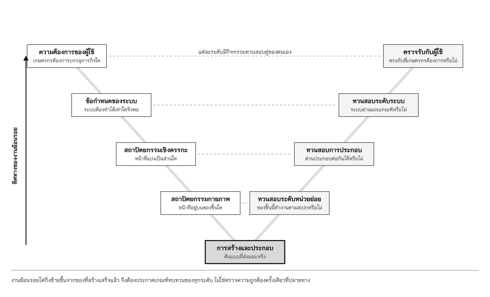

> **ภาพที่ 1** โมเดลการพัฒนาระบบแบบ V-Model แสดงความสัมพันธ์ระหว่างกระบวนการพัฒนาและการทดสอบ

### 2.2.1 แบบจำลองเดียวในสองรูปแบบการแทน

การมีแบบจำลองเป็นศูนย์กลางกำหนดว่าข้อเท็จจริงหนึ่งต้องถูกบันทึกไว้แห่งเดียว แต่ไม่ได้กำหนดว่าแบบจำลองนั้นต้องถูกแทนด้วยรูปแบบใด รูปแบบการแทนเป็นสิ่งที่มาตรฐาน ISO/IEC/IEEE 42010 แยกออกจากตัวคำอธิบายสถาปัตยกรรม (ISO/IEC/IEEE, 2011) การแยกดังกล่าวเปิดทางให้คำอธิบายเดียวถูกแทนได้ทั้งด้วยแผนภาพและด้วยข้อความ โดยจะถือว่าสองรูปแบบแทนแบบจำลองเดียวกันเฉพาะเมื่อองค์ประกอบทุกตัวในรูปแบบหนึ่งพบได้ในอีกรูปแบบหนึ่งภายใต้ชื่อเดียวกัน

เงื่อนไขดังกล่าวเป็นเหตุผลที่เล่มนี้เก็บแบบจำลองของระบบเดิมไว้สองรูปแบบ รูปแบบแรกคือแผนภาพในเครื่องมือ Capella ตามหัวข้อ 3.7 รูปแบบที่สองคือข้อความในภาษาเฉพาะโดเมนของผลิตภัณฑ์ NORASI ซึ่งเก็บแบบจำลองทั้งหมดไว้ในแฟ้มข้อความเพียงแฟ้มเดียว พร้อมฝาแฝดภาษาไทยที่เรียงบรรทัดตรงกันทุกบรรทัด ชื่อองค์ประกอบในแฟ้มของ Capella เป็นชื่อเดียวกับฝาแฝดภาษาไทยนั้นทุกตัว ตัวอย่างเช่นจุดตัดสินใจ DP-01 ปรากฏด้วยชื่อ DP-01_LoRa_433_MHz_แทน_WiFi_หรือ_4G ในระดับสถาปัตยกรรมเชิงตรรกะ และปรากฏอีกครั้งด้วยชื่อเดิมต่อท้ายด้วยคำว่าการนำไปปฏิบัติในระดับกายภาพ ความตรงกันของทั้งสองรูปแบบจึงตรวจได้ด้วยการนับ กล่าวคือทั้งสองรูปแบบมีความต้องการของผู้ใช้สี่ข้อ ข้อกำหนดของระบบสิบข้อ และจุดตัดสินใจออกแบบยี่สิบเอ็ดข้อซึ่งแต่ละข้อปรากฏสองระดับชั้น การนับนี้จะยืนยันความเป็นแบบจำลองเดียวกันได้เฉพาะเมื่อให้ผลเท่ากันทุกระดับชั้น

จำนวนที่นับได้นั้นเป็นจำนวนเดียวกับที่หัวข้อ 3.6.1 ถึง 3.6.3 ประกาศไว้ กล่าวคือเล่มนี้ใช้ชุดรหัสของแบบจำลองโดยตรง ไม่ได้ตั้งรหัสของตนเองขึ้นอีกชุดหนึ่งแล้วจับคู่ภายหลัง การใช้ชุดเดียวทำให้ข้ออ้างทุกข้อในบทที่ 3 ถึงบทที่ 5 ถูกตรวจย้อนกับแบบจำลองได้ด้วยการเทียบรหัสตรง และทำให้ความต่างใด ๆ ระหว่างเล่มกับแบบจำลองเป็นข้อผิดพลาดที่ต้องแก้ ไม่ใช่ความต่างที่ต้องอธิบาย เงื่อนไขของการใช้ชุดเดียวคือการแก้แบบจำลองทุกครั้งต้องถูกไล่กลับมาแก้ในเล่มด้วย

รูปแบบข้อความยังตอบข้อจำกัดของเครื่องมือที่หัวข้อ 2.5 ระบุไว้เรื่องการไม่มีระบบควบคุมรุ่นในตัว เพราะแบบจำลองที่เป็นข้อความถูกเทียบความต่างทีละบรรทัดและผูกค่าแฮชกำกับรุ่นที่อ้างถึงได้ ส่วนฝาแฝดภาษาไทยทำให้ผู้รับช่วงงานอ่านแบบจำลองได้โดยไม่ต้องแปล ซึ่งเป็นเงื่อนไขของประโยชน์ข้อ 1.7.4 ประโยชน์ทั้งสองข้อนี้จะเกิดขึ้นจริงเฉพาะเมื่อการรายงานผลทุกครั้งอ้างรุ่นของแฟ้มที่ใช้อ่านค่ากำกับไว้ด้วย

## 2.3 Capella

Capella เป็นเครื่องมือโอเพนซอร์สสำหรับงาน MBSE ที่ขับเคลื่อนด้วยระเบียบวิธี ARCADIA ช่วยให้วิเคราะห์ ออกแบบ และจัดการสถาปัตยกรรมของระบบซับซ้อนได้เป็นขั้นตอน ตั้งแต่การวิเคราะห์ความต้องการเชิงปฏิบัติการไปจนถึงสถาปัตยกรรมทางกายภาพ (Eclipse Foundation, 2026; Roques, 2018)

### 2.3.1 ความสัมพันธ์ระหว่าง Capella และระเบียบวิธี ARCADIA

Capella บังคับใช้มุมมองและลำดับขั้นของ ARCADIA อย่างเคร่งครัด โดยแบ่งสถาปัตยกรรมเป็นสี่ระดับ ระดับแรกคือการวิเคราะห์เชิงปฏิบัติการ (Operational Analysis, OA) ซึ่งมองจากผู้ใช้งานเพื่อเข้าใจว่าผู้ใช้ต้องการบรรลุภารกิจใด โดยยังไม่คำนึงถึงตัวระบบ ระดับที่สองคือการวิเคราะห์ระบบ (System Analysis, SA) ซึ่งกำหนดขอบเขตของระบบและหน้าที่ที่ระบบต้องทำในลักษณะกล่องดำ ระดับที่สามคือสถาปัตยกรรมเชิงตรรกะ (Logical Architecture, LA) ซึ่งจัดกลุ่มหน้าที่เป็นองค์ประกอบเชิงตรรกะโดยยังไม่เจาะจงเทคโนโลยี และระดับที่สี่คือสถาปัตยกรรมทางกายภาพ (Physical Architecture, PA) ซึ่งระบุส่วนประกอบทางกายภาพที่ทำหน้าที่จริง

การบังคับลำดับขั้นเป็นทั้งข้อดีและข้อจำกัดในงานย้อนรอย ข้อดีคือผู้ย้อนรอยกระโดดไปวาดสถาปัตยกรรมกายภาพโดยข้ามการระบุความต้องการไม่ได้ จึงถูกบังคับให้บันทึกเหตุผลเชิงการออกแบบไว้ชัดเจน ข้อจำกัดคือเอกสารต้นฉบับมีข้อมูลระดับกายภาพเป็นส่วนใหญ่ ขณะที่ข้อมูลระดับปฏิบัติการมีน้อย ผู้ย้อนรอยจึงต้องสร้างระดับบนจากการอนุมานย้อนหลัง การอนุมานดังกล่าวจะมีน้ำหนักเฉพาะเมื่อระบุหลักฐานที่ใช้อนุมานกำกับไว้ทุกครั้ง

### 2.3.2 แผนภาพหลักใน Capella

Capella รองรับแผนภาพสามกลุ่ม กลุ่มแรกคือแผนภาพสถาปัตยกรรม (Architecture Blank Diagrams) ได้แก่ OAB, SAB, LAB และ PAB ซึ่งแสดงโครงสร้างและการเชื่อมต่อในแต่ละระดับ กลุ่มที่สองคือแผนภาพขีดความสามารถ (Capabilities Diagrams) ซึ่งแสดงขีดความสามารถและการตอบสนองต่อกรณีการใช้งาน กลุ่มที่สามคือแผนภาพห่วงโซ่หน้าที่ (Functional Chain Diagrams) ซึ่งแสดงลำดับการทำงานแบบต้นจนจบ

เล่มนี้ใช้ Capella สร้างแบบจำลองระบบตรวจวัดสภาพแวดล้อมสำหรับสวนทุเรียน ตั้งแต่ระดับบริบทการปลูกจริงไปจนถึงโครงสร้างเชิงตรรกะและเชิงกายภาพ การเลือกเครื่องมือนี้จะถือว่าเหมาะสมเมื่อแผนภาพที่ผลิตได้ตอบคำถามทางวิศวกรรมในวัตถุประสงค์ข้อ 1.2.1 ได้โดยไม่ต้องอาศัยคำอธิบายปากเปล่าประกอบ

## 2.4 ARCADIA (Architecture Analysis & Design Integrated Approach)

ARCADIA เป็นกระบวนการออกแบบสถาปัตยกรรมที่เน้นการใช้แบบจำลองร่วมกันระหว่างผู้มีส่วนได้ส่วนเสีย และวิเคราะห์หน้าที่ของระบบควบคู่กับข้อกำหนดที่ไม่ใช่หน้าที่ (Voirin, 2017) ลำดับขั้นทั้งสี่แสดงดังภาพที่ 3

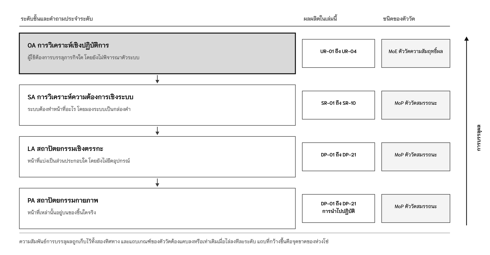

> **ภาพที่ 3** ขั้นตอนวิธีการทำงานของ ARCADIA 4 ขั้นตอน

### 2.4.1 การวิเคราะห์เชิงปฏิบัติการ (Operational Analysis)

คำถามหลักของขั้นนี้ไม่ใช่ระบบต้องทำอะไร แต่เป็นผู้ใช้ต้องการบรรลุภารกิจใด โดยยังไม่พิจารณาตัวระบบที่จะสร้าง ความแตกต่างของคำถามสองข้อนี้มีผลต่อการออกแบบอย่างมาก เพราะคำถามข้อหลังเปิดทางให้พิจารณาทางเลือกที่ไม่ใช่เทคโนโลยีด้วย เช่น การออกแบบกล่องอุปกรณ์ให้ผู้ใช้ถอดสายไฟไม่ได้ ซึ่งแก้ปัญหาตรงจุดกว่าการเพิ่มฟังก์ชันซอฟต์แวร์

### 2.4.2 การวิเคราะห์ความต้องการเชิงระบบ (Functional & Non-Functional Need)

ขั้นนี้ระบุว่าระบบต้องทำหน้าที่อะไรเพื่อตอบความต้องการระดับปฏิบัติการ โดยมองระบบเป็นกล่องดำเพื่อให้ความสนใจอยู่ที่การโต้ตอบกับสิ่งแวดล้อมภายนอกและที่ขอบเขตของระบบ ข้อกำหนดที่ไม่ใช่หน้าที่สำคัญเป็นพิเศษในกรณีศึกษานี้ เพราะข้อจำกัดด้านต้นทุน พลังงาน และความทนทานต่อสภาพแวดล้อม เป็นตัวกำหนดทางเลือกทางเทคโนโลยีมากกว่าข้อกำหนดด้านหน้าที่

### 2.4.3 การออกแบบสถาปัตยกรรมเชิงตรรกะ (Logical Architecture)

ขั้นนี้แบ่งหน้าที่ออกเป็นส่วนประกอบย่อยและกำหนดความสัมพันธ์ระหว่างกัน โดยยังไม่ยึดติดกับอุปกรณ์ที่จะใช้จริง คุณค่าของขั้นนี้ในงานย้อนรอยอยู่ที่การแยกให้เห็นว่าหน้าที่ใดเป็นหน้าที่ที่ระบบต้องมีอย่างแน่นอน และหน้าที่ใดเป็นเพียงผลพลอยได้จากการเลือกอุปกรณ์เฉพาะรุ่น

### 2.4.4 การออกแบบสถาปัตยกรรมทางกายภาพ (Physical Architecture)

ขั้นสุดท้ายจัดสรรสถาปัตยกรรมเชิงตรรกะลงบนทรัพยากรทางกายภาพจริง เช่น หน่วยประมวลผล ประเภทของบัสข้อมูล และแพลตฟอร์มซอฟต์แวร์ ในงานย้อนรอย ขั้นนี้เป็นขั้นที่หลักฐานจากเอกสารต้นฉบับสมบูรณ์ที่สุด จึงใช้ตรวจความถูกต้องของการอนุมานในระดับบนได้ดีที่สุด กล่าวคือหากองค์ประกอบทางกายภาพใดสืบย้อนกลับขึ้นไปถึงหน้าที่และความต้องการใดไม่ได้เลย ย่อมแสดงว่าการอนุมานในระดับบนยังไม่ครบถ้วน

### 2.4.5 ตัววัดและห่วงโซ่การบรรลุผลระหว่างระดับชั้น

ระดับชั้นทั้งสี่ในหัวข้อ 2.4.1 ถึง 2.4.4 บอกว่าองค์ประกอบหนึ่งอยู่ที่ระดับใด แต่ไม่บอกว่าระบบไปถึงสภาพที่ต้องการแล้วหรือยัง คำตอบของคำถามนั้นมาจากตัววัดสองชนิดที่คู่มือวิศวกรรมระบบของ INCOSE แยกออกจากกัน (INCOSE, 2023) ชนิดแรกคือตัววัดความสัมฤทธิ์ผล (Measure of Effectiveness) เขียนย่อว่า MoE ซึ่งอยู่ที่ระดับการวิเคราะห์เชิงปฏิบัติการเท่านั้น และบอกสภาพปลายทางที่เจ้าของระบบยืนยันได้ว่าบรรลุแล้วหรือยัง ชนิดที่สองคือตัววัดสมรรถนะ (Measure of Performance) เขียนย่อว่า MoP ซึ่งอยู่ที่ระดับที่ต่ำกว่าทุกระดับ และบอกค่าที่วัดได้จากตัวระบบ การแยกสองชนิดนี้จะให้ประโยชน์เฉพาะเมื่อ MoE ไม่ถูกเขียนเป็นค่าสมรรถนะ เพราะ MoE ที่เขียนเป็นค่าสมรรถนะย่อมวัดสิ่งเดียวกับ MoP ซ้ำอีกครั้งหนึ่ง

ตัววัดแต่ละตัวในแบบจำลองของเล่มนี้ประกาศสี่สิ่งคู่กัน คือชื่อ แถบเกณฑ์ที่เป็นช่วงปิดสองค่า ทิศทางว่ามากดีหรือน้อยดี และสูตรที่ชี้ไปยังพารามิเตอร์ขององค์ประกอบซึ่งเป็นที่มาของค่า พร้อมค่าที่เป็นอยู่ ณ เวลาที่อ่าน โดย MoE ทั้งสี่ตัวใช้สเกลสามระดับร่วมกัน คือยังไม่ได้ตามต้องการ ได้ตามต้องการบางส่วน และได้ตามต้องการ นอกจากนี้ตัววัดทุกตัวยังระบุบทบาทผู้เกี่ยวข้องไว้สี่บทบาท คือผู้รับผิดชอบผลสุดท้าย ผู้ลงมือปฏิบัติ ผู้ที่ต้องถูกหารือก่อนเปลี่ยนแปลง และผู้ที่ต้องได้รับแจ้งเมื่อค่าหลุดแถบเกณฑ์ การประกาศครบทั้งหมดนี้ทำให้คำว่าผ่านหรือไม่ผ่านถูกตัดสินจากแบบจำลอง ไม่ใช่จากคำอธิบายในเนื้อความ ทั้งนี้ผลการตัดสินจะเชื่อถือได้เฉพาะเมื่อแถบเกณฑ์ถูกประกาศไว้ก่อนการอ่านค่า ไม่ใช่ย้อนมาจากค่าที่วัดได้แล้ว

ความสัมพันธ์ที่ร้อยระดับชั้นทั้งสี่เข้าด้วยกันคือการบรรลุผล องค์ประกอบของระดับล่างประกาศว่าตนบรรลุผลองค์ประกอบใดของระดับบน และแบบจำลองเก็บความสัมพันธ์นั้นไว้ทั้งสองทิศทาง ห่วงโซ่จึงถือว่าไม่ขาดเมื่อสองทิศทางตรงกัน กล่าวคือองค์ประกอบหนึ่งบรรลุผลอีกองค์ประกอบหนึ่งเมื่อและเฉพาะเมื่อองค์ประกอบที่สองบันทึกไว้ว่าถูกบรรลุผลโดยองค์ประกอบที่หนึ่ง เงื่อนไขสองทิศทางนี้ทำให้นิยามการสืบย้อนกลับในหัวข้อ 1.6.8 ถูกตรวจด้วยเครื่องมือได้ ไม่ต้องอาศัยการกวาดตาดูแผนภาพ

ตัววัดของระดับล่างยังอ้างขึ้นไปหาตัววัดของระดับบนที่ตนขัดเกลา แถบเกณฑ์จึงต้องแคบลงหรือเท่าเดิมเมื่อไล่ลงไปทีละระดับ แถบที่กว้างขึ้นหมายความว่าระดับล่างสัญญาไว้น้อยกว่าที่ระดับบนรับไว้ ซึ่งเป็นจุดขาดของห่วงโซ่ชนิดที่การนับความสัมพันธ์เพียงอย่างเดียวตรวจไม่พบ กฎข้อนี้เป็นเกณฑ์ที่หัวข้อ 3.6.4 ใช้ตัดสินผลของตัววัดทุกตัว และใช้ตัดสินได้เฉพาะเมื่อตัววัดตลอดห่วงโซ่ประกาศหน่วยและทิศทางเดียวกัน

## 2.5 การประยุกต์ใช้ Capella และ ARCADIA ในภาคอุตสาหกรรม

จุดแข็งของ Capella คือการนำเสนอแบบจำลองเป็นแผนภาพ ซึ่งช่วยให้ผู้มีส่วนได้ส่วนเสียจากหลายสาขาเข้าใจโครงสร้างและพฤติกรรมของระบบร่วมกันได้โดยไม่ต้องอาศัยเอกสารเชิงเทคนิคจำนวนมาก แนวทางนี้ลดความคลาดเคลื่อนในการตีความข้อกำหนด และลดความเสี่ยงจากความไม่สอดคล้องระหว่างเอกสารกับการออกแบบจริง

ในภาคอุตสาหกรรม Capella และ ARCADIA ถูกใช้ในกิจการทางทะเลโดย Naval Group การจัดการจราจรทางอากาศโดย Thales Australia ระบบรางโดย Digitale Schiene Deutschland พลังงานโดย UK Atomic Energy Authority และ Framatome และการบินและอวกาศโดย Rolls-Royce และ ArianeGroup (Capella MBSE Tool, 2026)

Baron และคณะ (2023) ศึกษาการนำ ARCADIA และ Capella ไปใช้ออกแบบระบบการผลิตร่วมกับผู้ปฏิบัติงานภาคอุตสาหกรรมกว่า 15 ราย ผลการศึกษาชี้ว่าเครื่องมือมีความยืดหยุ่นสูงและปรับใช้ได้หลายขนาดโครงการ โดยเฉพาะฟีเจอร์ Semantic Browser ที่รักษาความสามารถในการสืบย้อนกลับระหว่างระดับ และสาธิตทั้งแนวทางออกแบบจากบนลงล่างและแนวทางวิศวกรรมย้อนรอยจากล่างขึ้นบน (Bottom-up Retro-engineering) งานวิจัยดังกล่าวจึงเป็นหลักฐานว่าแนวทางที่เล่มนี้ใช้มีแบบอย่างในภาคอุตสาหกรรมรองรับ

งานวิจัยเดียวกันชี้ข้อจำกัดไว้สองข้อ ข้อแรกคือโครงสร้างทั่วไปของ Capella อาจไม่สอดคล้องกับข้อกำหนดเฉพาะของบางอุตสาหกรรม ข้อที่สองคือเครื่องมือไม่มีระบบควบคุมเวอร์ชันในตัว (Baron et al., 2023) ข้อจำกัดข้อที่สองกระทบเล่มนี้โดยตรง เพราะหมายความว่าแบบจำลองที่ส่งมอบจะคงคุณค่าไว้ได้เฉพาะเมื่อกำหนดวิธีจัดเก็บและควบคุมรุ่นของไฟล์ไว้ด้วย

**การประยุกต์ใช้ใน MBSE กับเครื่องมือ Capella**

ฟีเจอร์ที่เล่มนี้ใช้งานจริงมีสามรายการ Semantic Browser ใช้ตรวจว่าองค์ประกอบหนึ่งถูกอ้างถึงจากที่ใด Computed Links ใช้ตรวจความสัมพันธ์ที่เครื่องมืออนุมานโดยอัตโนมัติ และ Model Validation ดังภาพ ง ใช้เป็นหลักฐานประกอบการทวนสอบในหัวข้อ 3.5.10 เพราะให้รายการข้อผิดพลาดเชิงโครงสร้างพร้อมคำแนะนำแก้ไข

> **ภาพ ง** ฟีเจอร์ตรวจสอบความถูกต้องของแบบจำลอง (Model Validation) พร้อมคำแนะนำแก้ไขอัตโนมัติ (Quick Fix) ในเครื่องมือ Capella

> *ที่มา: Eclipse Foundation. (2026). Tool features. https://mbse-capella.org/features.html*

## 2.6 กลยุทธ์การวิจัย (Research Strategies)

คำถามการวิจัยของเล่มนี้เป็นคำถามเชิงเปรียบเทียบ กล่าวคือการนำข้อมูลจากเอกสารต้นฉบับเข้าสู่แบบจำลองดิจิทัลให้ผลลัพธ์ที่ดีกว่าการอ่านเอกสารทีละหน้าในแง่ใด และดีกว่าในราคาเท่าใด คำถามลักษณะนี้มีกลยุทธ์ที่เป็นไปได้สามทาง ซึ่งเปรียบเทียบไว้ดังตารางที่ 1 การเลือกกลยุทธ์ต้องเกิดก่อนการเลือกเครื่องมือ เพราะกลยุทธ์กำหนดว่าข้อสรุปจะมีน้ำหนักลักษณะใดและถูกโต้แย้งได้ด้วยเหตุผลแบบใด

| กลยุทธ์ | สิ่งที่ให้ได้ | สิ่งที่ให้ไม่ได้ | ความเหมาะสมกับการศึกษานี้ |
|---|---|---|---|
| การวิจัยเชิงทดลอง (Experimental research) | เปรียบเทียบสองวิธีการบนผู้เข้าร่วมหลายราย ควบคุมตัวแปรได้ สรุปผลเชิงสถิติได้ | ต้องมีผู้เข้าร่วมจำนวนมากและระบบทดสอบหลายระบบ ซึ่งเกินทรัพยากรของปริญญานิพนธ์ระดับปริญญาตรี | ไม่เหมาะ เพราะมีผู้ปฏิบัติงานเพียงรายเดียวและมีระบบกรณีศึกษาเพียงระบบเดียว |
| การวิจัยเชิงกรณีศึกษา (Case study research) | อธิบายปรากฏการณ์ในบริบทจริงอย่างลึก ใช้หลักฐานหลายแหล่งยืนยันกันเอง เหมาะกับคำถามว่าอย่างไรและเพราะเหตุใด (Yin, 2018; Runeson & Höst, 2009) | สรุปผลเชิงสถิติไปสู่ประชากรทั่วไปไม่ได้ ต้องระบุขอบเขตการนำผลไปใช้ให้ชัด | เหมาะ เพราะมีระบบกรณีศึกษาที่มีเอกสารครบถ้วนและต้องการคำอธิบายเชิงเหตุผลของการออกแบบ |
| การวิจัยเชิงออกแบบ (Design science research) | ผลิตสิ่งประดิษฐ์เชิงวิธีการแล้วประเมินสิ่งประดิษฐ์นั้น เหมาะกับการเสนอวิธีทำงานใหม่ (Hevner et al., 2004; Blessing & Chakrabarti, 2009) | ต้องมีเกณฑ์ประเมินสิ่งประดิษฐ์ที่ชัดเจน มิฉะนั้นกลายเป็นการนำเสนอวิธีการโดยไม่มีหลักฐาน | เหมาะบางส่วน เพราะการเปรียบเทียบสองแนวทางในหัวข้อ 3.2 ต้องถูกประเมินด้วยเกณฑ์ที่กำหนดไว้ล่วงหน้า |

**ตารางที่ 1** เปรียบเทียบกลยุทธ์การวิจัยที่พิจารณาและเหตุผลการเลือก

การศึกษาครั้งนี้เลือกกรณีศึกษาเดี่ยวแบบฝังตัว (Embedded single-case study) เป็นกลยุทธ์หลัก โดยมีระบบต้นแบบเดิมเป็นกรณีศึกษา และมีจุดประสงค์การย้อนรอยแปดข้อในหัวข้อ 3.4 เป็นหน่วยวิเคราะห์ย่อย ขณะเดียวกันก็รับวินัยของการวิจัยเชิงออกแบบมาใช้กับการเปรียบเทียบสองแนวทาง ด้วยการกำหนดเกณฑ์ประเมินไว้ล่วงหน้าในหัวข้อ 3.3 การผสานสองกลยุทธ์จะชอบด้วยเหตุผลทางระเบียบวิธีเฉพาะเมื่อข้อสรุปถูกจำกัดขอบเขตไว้ที่กรณีศึกษานี้และระบบที่มีลักษณะใกล้เคียง และเมื่อการประเมินรายงานผลทั้งด้านที่สนับสนุนและไม่สนับสนุนวิธีการที่เสนอ

Runeson และ Höst (2009) ระบุมาตรการที่ทำให้กรณีศึกษาน่าเชื่อถือไว้สามข้อ คือการใช้หลักฐานหลายแหล่งตรวจยืนยันกันเอง การบันทึกห่วงโซ่หลักฐานให้ผู้อื่นตามรอยได้ และการระบุภัยคุกคามต่อความถูกต้องไว้อย่างเปิดเผย มาตรการทั้งสามถูกนำมาใช้ตามลำดับ คือการตรวจยืนยันด้วยเอกสารต้นฉบับทั้งสองเล่มร่วมกับเอกสารข้อมูลของผู้ผลิต การอ้างเลขหน้ากำกับทุกข้อเท็จจริงที่นำมาใช้ และการรายงานภัยคุกคามไว้ในหัวข้อ 3.3.4

## 2.7 การออกแบบตามหลักสัจพจน์เพื่อลดความซับซ้อนและผลกระทบในการออกแบบ (Axiomatic Design)

การออกแบบตามหลักสัจพจน์ของ Suh (1990, 2001) อธิบายการออกแบบเป็นการจับคู่ระหว่างสี่โดเมน คือโดเมนความต้องการของลูกค้า (Customer Attributes, CA) โดเมนความต้องการเชิงหน้าที่ (Functional Requirements, FR) โดเมนตัวแปรการออกแบบ (Design Parameters, DP) และโดเมนตัวแปรกระบวนการ (Process Variables, PV) การออกแบบที่ดีคือการจับคู่ที่ทำให้ความต้องการเชิงหน้าที่แต่ละข้อถูกตอบสนองโดยตัวแปรการออกแบบของตนเองอย่างเป็นอิสระ ดังภาพ ฉ

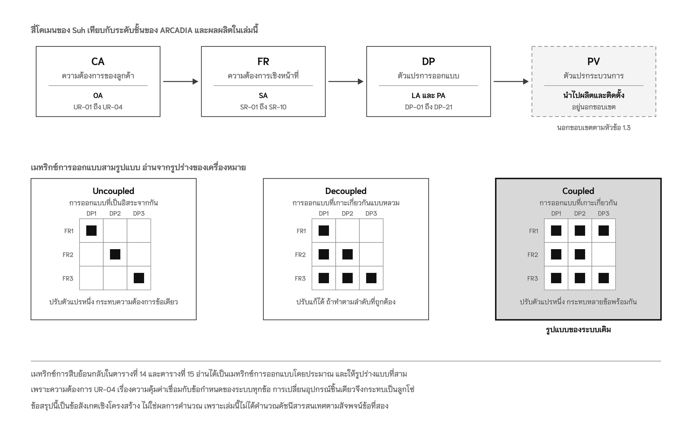

> **ภาพ ฉ** แนวคิดพื้นฐานของการออกแบบตามหลักสัจพจน์

ทฤษฎีนี้ตั้งอยู่บนสัจพจน์สองข้อ สัจพจน์ความเป็นอิสระ (Independence Axiom) กำหนดว่าการออกแบบที่ดีต้องรักษาความเป็นอิสระของความต้องการเชิงหน้าที่ไว้ และสัจพจน์สารสนเทศ (Information Axiom) กำหนดว่าทางเลือกที่ดีที่สุดคือทางเลือกที่ใช้ปริมาณสารสนเทศน้อยที่สุด กล่าวคือมีความน่าจะเป็นที่จะสำเร็จสูงสุด

ความสัมพันธ์ระหว่างความต้องการเชิงหน้าที่กับตัวแปรการออกแบบแสดงด้วยเมทริกซ์การออกแบบ ซึ่งมีสามรูปแบบ รูปแบบแรกคือการออกแบบที่เป็นอิสระจากกัน (Uncoupled Design) ซึ่งเมทริกซ์เป็นเมทริกซ์ทแยงมุม การปรับตัวแปรหนึ่งกระทบความต้องการเพียงข้อเดียว รูปแบบที่สองคือการออกแบบที่เกาะเกี่ยวกันแบบหลวม (Decoupled Design) ซึ่งเมทริกซ์เป็นเมทริกซ์สามเหลี่ยม การปรับแก้ยังทำได้หากดำเนินตามลำดับที่ถูกต้อง รูปแบบที่สามคือการออกแบบที่เกาะเกี่ยวกัน (Coupled Design) ซึ่งสมาชิกนอกแนวทแยงกระจายทั่ว การปรับตัวแปรหนึ่งกระทบความต้องการหลายข้อพร้อมกันและไม่มีลำดับการปรับแก้ที่รับประกันผลได้ ทั้งสามรูปแบบแสดงเทียบกันในภาพ ฉ

เหตุที่ทฤษฎีนี้ถูกนำมาใช้คือความสอดคล้องเชิงโครงสร้างระหว่างโดเมนทั้งสี่ของ Suh กับระดับชั้นทั้งสี่ของ ARCADIA ดังตารางที่ 2 ความสอดคล้องนี้ทำให้เมทริกซ์การสืบย้อนกลับในหัวข้อ 3.7.1 อ่านได้ในฐานะเมทริกซ์การออกแบบโดยประมาณ และทำให้ความเกาะเกี่ยวของการออกแบบเดิมอ่านได้จากรูปร่างของเมทริกซ์

| โดเมนตามหลักสัจพจน์ (Suh, 1990) | ระดับชั้นของ ARCADIA (Voirin, 2017) | ผลผลิตที่สอดคล้องในปริญญานิพนธ์ฉบับนี้ |
|---|---|---|
| Customer Attributes (CA) | Operational Analysis (OA) | ความต้องการของผู้ใช้ UR-01–UR-04 (หัวข้อ 3.6.1) |
| Functional Requirements (FR) | System Analysis (SA) | ข้อกำหนดความต้องการของระบบ SR-01–SR-10 (หัวข้อ 3.6.2) |
| Design Parameters (DP) | Logical และ Physical Architecture (LA, PA) | จุดตัดสินใจออกแบบ DP-01–DP-21 (หัวข้อ 3.6.3) |
| Process Variables (PV) | การนำไปผลิตและติดตั้งใช้งาน | อยู่นอกขอบเขตตามหัวข้อ 1.3.3 |

**ตารางที่ 2** การเทียบเคียงโดเมนการออกแบบตามหลักสัจพจน์กับระดับชั้นสถาปัตยกรรมของ ARCADIA

เมื่ออ่านเมทริกซ์การสืบย้อนกลับในตารางที่ 14 และตารางที่ 15 ด้วยสายตาของทฤษฎีนี้ พบว่าการออกแบบของระบบเดิมมีลักษณะเกาะเกี่ยวกัน เพราะความต้องการของผู้ใช้ข้อ UR-04 ซึ่งเป็นเรื่องความคุ้มค่า เชื่อมโยงกับข้อกำหนดของระบบทุกข้อ และจุดตัดสินใจออกแบบหลายข้อเชื่อมโยงกับข้อกำหนดเดียวกัน ข้อสังเกตนี้อธิบายว่าเหตุใดการเปลี่ยนอุปกรณ์เพียงชิ้นเดียวจึงส่งผลกระทบเป็นลูกโซ่ และเป็นเหตุผลเชิงทฤษฎีที่สนับสนุนข้อเสนอแนะในหัวข้อ 5.3.2 ทั้งนี้การอ่านดังกล่าวเป็นการอ่านเชิงคุณภาพ เพราะเล่มนี้ไม่ได้คำนวณค่าดัชนีสารสนเทศตามสัจพจน์ข้อที่สอง ข้อสรุปเรื่องความเกาะเกี่ยวจึงมีน้ำหนักในฐานะข้อสังเกตเชิงโครงสร้าง ไม่ใช่ผลการคำนวณเชิงปริมาณ

## 2.8 ผลงานวิจัยที่เกี่ยวข้องและการนำมาใช้สนับสนุนโครงการ

หัวข้อนี้ไม่สรุปเนื้อหาของวรรณกรรมที่อ่านมา แต่ตอบว่าวรรณกรรมและมาตรฐานแต่ละรายการถูกนำมาใช้ทำสิ่งใด และหากไม่มีรายการนั้นแล้วส่วนใดของโครงการจะอ่อนแอลง การตอบเช่นนี้จำเป็นเพราะงานย้อนรอยอาศัยการอนุมานจากหลักฐานที่ไม่สมบูรณ์ น้ำหนักของข้อสรุปจึงขึ้นอยู่กับความชัดเจนว่าเกณฑ์ที่ใช้ตัดสินแต่ละขั้นมาจากที่ใด

### 2.8.1 วรรณกรรมและมาตรฐานที่ใช้กำหนดเกณฑ์การทำงาน

วรรณกรรมที่ใช้แบ่งได้ห้ากลุ่มตามหน้าที่ กลุ่มที่หนึ่งให้นิยามและขอบเขตของงาน ได้แก่ Chikofsky และ Cross (1990) ซึ่งกำหนดว่างานนี้เป็นการสร้างคำอธิบายการออกแบบ จึงอนุญาตให้ใช้ความรู้จากอาจารย์ที่ปรึกษาและเอกสารผู้ผลิตเป็นหลักฐานประกอบ และ Müller และคณะ (2000) ซึ่งเป็นเหตุผลของการกำหนดเกณฑ์ตรวจรับไว้ล่วงหน้า กลุ่มที่สองให้โครงสร้างของผลผลิต ได้แก่ ISO/IEC/IEEE 42010 (ISO/IEC/IEEE, 2011) ซึ่งนิยามมุมมองและจุดยืนการมอง ISO/IEC/IEEE 15288 (ISO/IEC/IEEE, 2015, 2023) ซึ่งนิยามกระบวนการทางเทคนิคและใช้แยกกิจกรรมทวนสอบออกจากการรับรองความถูกต้องในหัวข้อ 3.5.10 และคู่มือวิศวกรรมระบบของ INCOSE (2023) ซึ่งแยกตัววัดความสัมฤทธิ์ผลออกจากตัววัดสมรรถนะในหัวข้อ 2.4.5

กลุ่มที่สามให้ระเบียบวิธีและเครื่องมือ ได้แก่ Voirin (2017) และ Roques (2018) ซึ่งกำหนดลำดับระดับชั้นและชนิดแผนภาพ และ Baron และคณะ (2023) ซึ่งให้หลักฐานว่า Capella ใช้กับงานย้อนรอยได้จริงพร้อมข้อจำกัดเรื่องการควบคุมรุ่น 

กลุ่มที่สี่ให้ระเบียบวิธีการวิจัยและทฤษฎีการออกแบบ ได้แก่ Yin (2018), Runeson และ Höst (2009), Hevner และคณะ (2004), Blessing และ Chakrabarti (2009) และ Suh (1990, 2001) กลุ่มที่ห้าเป็นฐานหลักฐานของกรณีศึกษาโดยตรง ได้แก่ Tuntawisut และคณะ (2024) สำหรับฝั่งฮาร์ดแวร์ Nunthasrithananon และคณะ (2024) สำหรับฝั่งซอฟต์แวร์ ร่วมกับ Semtech Corporation (2020) และ Rappaport (2002) ซึ่งใช้ตรวจทานการคำนวณงบลิงก์ กลุ่มสุดท้ายนี้เป็นที่มาของการตรวจพบประเด็นหลายรายการในทะเบียนประเด็น

### 2.8.2 สรุปการใช้ประโยชน์จากวรรณกรรม

ความสัมพันธ์ระหว่างวรรณกรรมแต่ละรายการกับหัวข้อที่นำไปใช้ และผลที่จะเกิดหากไม่มีรายการนั้น สรุปไว้ดังตารางที่ 3 ตารางนี้ทำหน้าที่เป็นเมทริกซ์สืบย้อนกลับระดับวรรณกรรม กล่าวคือเกณฑ์การตัดสินใจทุกข้อในบทที่ 3 สืบย้อนกลับไปถึงแหล่งอ้างอิงที่กำหนดเกณฑ์นั้นได้

| วรรณกรรม / มาตรฐาน | สิ่งที่นำมาใช้ | หัวข้อที่นำไปใช้ | ผลที่จะเกิดหากไม่มีรายการนี้ |
|---|---|---|---|
| Chikofsky & Cross (1990) | นิยามวิศวกรรมย้อนกลับและการสร้างคำอธิบายการออกแบบ | 1.6.1, 1.6.2, 2.1, 1.3.1 | ไม่สามารถอ้างได้ว่าการใช้ความรู้จากภายนอกเป็นส่วนของระเบียบวิธี |
| Müller et al. (2000) | ข้อสังเกตว่าการตรวจสอบนามธรรมเป็นปัญหาหลัก | 2.1, 3.3 | เกณฑ์การทบทวนจะขาดเหตุผลรองรับ |
| ISO/IEC/IEEE 42010 (2011) | โครงสร้างคำอธิบายสถาปัตยกรรม มุมมองและข้อกังวล และการแยกรูปแบบการแทนออกจากคำอธิบาย | 1.6.4, 2.2.1, 3.4 | มุมมองจะกลายเป็นการจัดกลุ่มตามอำเภอใจ |
| ISO/IEC/IEEE 15288 (2015, 2023) | กระบวนการทางเทคนิคของวงจรชีวิตระบบ | 2.1, 3.2.3, 3.5.10.2 | ไม่สามารถแยกกิจกรรมทวนสอบออกจากการรับรองความถูกต้องได้ |
| INCOSE (2023) | ความต่างระหว่างตัววัดความสัมฤทธิ์ผลกับตัววัดสมรรถนะ | 2.4.5, 3.6.4 | ชั้นของตัววัดจะไม่มีมาตรฐานกำหนดว่าตัวใดวัดภารกิจและตัวใดวัดสมรรถนะ |
| Voirin (2017); Roques (2018) | ระเบียบวิธี ARCADIA และการใช้งาน Capella | 1.6.7, 2.3, 2.4, 3.2.10, 3.7 | ลำดับขั้นงานและชนิดแผนภาพจะไม่มีมาตรฐานกำกับ |
| Baron et al. (2023) | หลักฐานการใช้ Capella กับงานย้อนรอยและข้อจำกัดของเครื่องมือ | 2.2.1, 2.5, 3.1, 5.3.2.1 | ข้ออ้างว่าแนวทางนี้ใช้ได้จริงจะไม่มีหลักฐานภาคอุตสาหกรรมรองรับ |
| Yin (2018); Runeson & Höst (2009) | หลักเกณฑ์การวิจัยเชิงกรณีศึกษา | 2.6, 3.3.4 | ไม่มีเกณฑ์กำหนดขอบเขตการนำผลไปใช้และภัยคุกคามต่อความถูกต้อง |
| Hevner et al. (2004); Blessing & Chakrabarti (2009) | วินัยการประเมินสิ่งประดิษฐ์เชิงวิธีการ | 2.6, 3.3 | การเปรียบเทียบสองแนวทางจะเป็นข้อเสนอที่ไม่ถูกประเมิน |
| Suh (1990, 2001) | สัจพจน์ความเป็นอิสระและเมทริกซ์การออกแบบ | 2.7, 3.7.1, 5.3.2.2 | ไม่สามารถอ่านความเกาะเกี่ยวของการออกแบบเดิมจากเมทริกซ์ได้ |
| Tuntawisut et al. (2024) | ข้อมูลฮาร์ดแวร์ วงจร ราคา และโครงสร้างเสา | 3.5.1–3.5.4, 4.1.2 | ไม่มีฐานหลักฐานสำหรับระดับสถาปัตยกรรมกายภาพ |
| Nunthasrithananon et al. (2024) | ข้อมูลซอฟต์แวร์ เซิร์ฟเวอร์ ผลการทดลองสัญญาณและการสอบเทียบ | 3.5.5–3.5.9, 4.1.2 | ไม่มีฐานหลักฐานสำหรับระดับระบบและกระแสข้อมูล |
| Semtech Corporation (2020); Rappaport (2002) | คุณลักษณะโมดูล LoRa และหลักการคำนวณการสูญเสียกำลัง | 3.5.9, ตารางที่ 20 | ไม่สามารถตรวจทานการคำนวณงบลิงก์ในเอกสารต้นฉบับได้ |
| Capella MBSE Tool (2026); Eclipse Foundation (2026) | กรณีศึกษาภาคอุตสาหกรรมและฟีเจอร์ของเครื่องมือ | 2.3, 2.5 | ขาดบริบทการใช้งานจริงของเครื่องมือ |
| LY Corporation (2025) | ประกาศยุติบริการ LINE Notify | 3.6.3, ตารางที่ 20 | ไม่ทราบว่าช่องทางแจ้งเตือนของระบบเดิมใช้งานไม่ได้แล้ว |

**ตารางที่ 3** การใช้ประโยชน์จากวรรณกรรมและมาตรฐานวิศวกรรมระบบในการสนับสนุนโครงการ

## 2.9 สรุปท้ายบท

บทนี้วางฐานทางทฤษฎีไว้ห้าชั้น ชั้นแรกคือนิยามและขอบเขตของงานวิศวกรรมย้อนกลับ ซึ่งกำหนดว่างานนี้เป็นการสร้างคำอธิบายการออกแบบจากเอกสาร ชั้นที่สองคือ MBSE ระเบียบวิธี ARCADIA และเครื่องมือ Capella ซึ่งกำหนดลำดับขั้นและชนิดของผลผลิต ชั้นที่สามคือตัววัดสองชนิดและห่วงโซ่การบรรลุผลตามหัวข้อ 2.4.5 ซึ่งทำให้คำว่าผ่านหรือไม่ผ่านตัดสินได้จากแบบจำลอง ชั้นที่สี่คือกลยุทธ์กรณีศึกษาผสานวินัยการวิจัยเชิงออกแบบ ซึ่งกำหนดขอบเขตของข้อสรุป และชั้นที่ห้าคือทฤษฎีการออกแบบตามหลักสัจพจน์ ซึ่งให้เครื่องมืออ่านความเกาะเกี่ยวของการออกแบบเดิมจากเมทริกซ์การสืบย้อนกลับ

ฐานห้าชั้นดังกล่าวผูกกับแบบจำลองชุดเดียว ซึ่งหัวข้อ 2.2.1 ระบุว่าถูกเก็บไว้สองรูปแบบและนับองค์ประกอบได้เท่ากัน คือความต้องการของผู้ใช้สี่ข้อ ข้อกำหนดของระบบสิบข้อ และจุดตัดสินใจออกแบบยี่สิบเอ็ดข้อ รหัสที่เล่มนี้ใช้อ้างถึงองค์ประกอบเหล่านั้นจึงเป็นรหัสชุดเดียวกับที่แบบจำลองใช้ คือ UR ตามด้วยเลขสองหลักสำหรับความต้องการของผู้ใช้ SR สำหรับข้อกำหนดของระบบ และ DP สำหรับจุดตัดสินใจออกแบบ การใช้รหัสชุดเดียวเป็นเงื่อนไขที่ทำให้ข้ออ้างทุกข้อในบทที่ 3 ถึงบทที่ 5 ถูกตรวจย้อนกับแบบจำลองได้

ข้อสังเกตที่สำคัญที่สุดคือข้อสังเกตของ Müller และคณะ (2000) ที่ว่าความยากของงานประเภทนี้อยู่ที่การตรวจสอบว่านามธรรมที่สร้างขึ้นถูกต้อง ไม่ได้อยู่ที่การสกัดข้อมูล ข้อสังเกตนี้เป็นเหตุผลที่บทที่ 3 ไม่เริ่มจากวิธีใช้เครื่องมือ แต่เริ่มจากวิธีแทนงานที่บังคับให้ทุกขั้นระบุเกณฑ์การทบทวนและผู้ใช้ประโยชน์ไว้ล่วงหน้า เมื่อมองย้อนไปที่ความกระจัดกระจายขององค์ความรู้ในโครงการเดิม สิ่งที่ขาดไปจึงไม่ใช่ความสามารถทางเทคนิคของผู้พัฒนาเดิม แต่เป็นโครงสร้างที่ทำให้ความรู้ซึ่งพวกเขามีอยู่แล้วคงอยู่ต่อไปได้หลังโครงการสิ้นสุด
# บทที่ 3 วิธีการดำเนินงานสำหรับวิศวกรรมย้อนรอย

## 3.1 บทนำและกรอบแนวคิดการวิจัย

บทนี้เรียงลำดับตามเส้นทางของวิศวกรที่เพิ่งเข้ามารับช่วงระบบนี้ต่อ และยังไม่รู้จักระบบเลย

### 3.1.1 สภาพตั้งต้นของผู้รับช่วงงานต่อ

สิ่งที่ผู้รับช่วงงานต่อมีอยู่คือเอกสารสองเล่ม เล่มฝั่งฮาร์ดแวร์ 161 หน้า และสไลด์สอบป้องกันฝั่งซอฟต์แวร์ 153 สไลด์

สิ่งที่ไม่มีคือสิทธิเข้าถึงฮาร์ดแวร์ตามหัวข้อ 1.3.1 ผู้พัฒนาเดิมที่จะถามได้ และคำอธิบายสถาปัตยกรรมที่เชื่อมสองเล่มเข้าด้วยกันตามหัวข้อ 1.1

สภาพนี้ทำให้คำถามตั้งต้นไม่ใช่ระบบทำงานอย่างไร เพราะเอกสารสองเล่มตอบข้อนั้นไว้แล้ว แต่เป็นคำถามว่าของชิ้นใดมีอยู่เพราะความต้องการข้อใด ซึ่งไม่มีเล่มใดตอบ

### 3.1.2 สิ่งที่วิศวกรรมระบบกำหนดให้ต้องส่งมอบ

วิศวกรรมระบบไม่ได้กำหนดให้วาดแผนภาพ แต่กำหนดให้ส่งมอบสิ่งที่ตอบคำถามหกข้อได้ ดังตารางที่ 3-ก

| สิ่งที่ต้องส่งมอบ | คำถามที่สิ่งนั้นต้องตอบได้ | เหตุที่เอกสารต้นฉบับตอบไม่ได้ | หัวข้อที่ส่งมอบ |
|---|---|---|---|
| ความต้องการของผู้ใช้ที่ประกาศเป็นข้อ | เกษตรกรต้องการอะไรจากระบบ | เอกสารบันทึกผลงานที่ทำได้ ไม่ได้บันทึกความต้องการไว้เป็นข้อ | 3.6.1 |
| ข้อกำหนดของระบบที่วัดได้ | ระบบต้องทำได้เท่าใดจึงนับว่าพอ | เอกสารบันทึกค่าที่วัดได้ ไม่ได้บันทึกค่าที่ต้องถึง | 3.6.2 |
| จุดตัดสินใจออกแบบพร้อมเหตุผล | เลือกของชิ้นนี้เพราะเหตุใด | เอกสารบันทึกของที่เลือก ไม่ได้บันทึกทางเลือกที่ทิ้งไป | 3.6.3 |
| ตัววัดพร้อมแถบเกณฑ์ | ข้อกำหนดข้อนี้ผ่านหรือไม่ และห่างจากเกณฑ์เท่าใด | เอกสารไม่มีแถบเกณฑ์ให้เทียบ จึงไม่มีสิ่งที่เรียกว่าไม่ผ่าน | 3.6.4 |
| คำอธิบายสถาปัตยกรรมสี่ระดับชั้น | หน้าที่นี้อยู่ที่ของชิ้นใด และของชิ้นนี้ทำหน้าที่ใด | เอกสารแยกเป็นสองเล่ม ไม่มีเล่มใดครอบทั้งสองฝั่ง | 3.7 |
| ห่วงโซ่การสืบย้อนกลับ | ถ้าเปลี่ยนสิ่งนี้ อะไรกระทบตามไปด้วย | เอกสารไม่มีเส้นเชื่อมระหว่างสองเล่ม | 3.7.1 |

**ตารางที่ 3-ก** สิ่งที่วิศวกรรมระบบกำหนดให้ผู้รับช่วงงานต่อต้องส่งมอบ คำถามที่สิ่งนั้นต้องตอบได้ และเหตุที่เอกสารต้นฉบับตอบไม่ได้

คอลัมน์ที่สามของตารางที่ 3-ก เป็นเหตุที่เล่มนี้มีอยู่ ถ้าเอกสารต้นฉบับตอบครบทั้งหกข้อ งานย้อนรอยครั้งนี้ก็ไม่จำเป็น

คอลัมน์ที่สองเป็นเกณฑ์ตรวจรับของทั้งบท ผลผลิตที่ตอบคำถามของตนเองไม่ได้ย่อมไม่นับเป็นผลผลิต ตามเกณฑ์ห้าขั้นในหัวข้อ 4.3.1

### 3.1.3 เส้นทางห้าสถานี

เส้นทางจากเอกสารสองเล่มถึงแบบจำลองที่เปิดดูได้ผ่านห้าสถานี ดังตารางที่ 3-ข และภาพที่ 3-ก

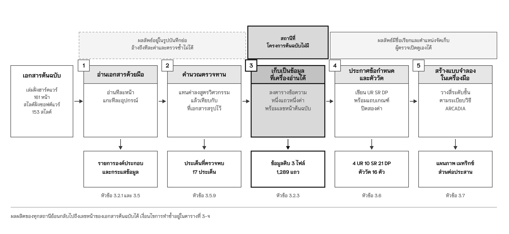

> **ภาพที่ 3-ก** เส้นทางห้าสถานีจากเอกสารต้นฉบับสู่แบบจำลอง พร้อมผลผลิตที่ออกจากแต่ละสถานี

| สถานี | ข้อมูลเข้า | สิ่งที่ทำ | ผลผลิตที่ออก | หัวข้อ |
|---|---|---|---|---|
| 1 อ่านเอกสารด้วยมือ | เอกสารสองเล่ม 161 หน้าและ 153 สไลด์ | อ่านทีละหน้า แกะทีละอุปกรณ์ | รายการองค์ประกอบ กระแสข้อมูล และข้อสังเกต | 3.2.1 และ 3.5.1 ถึง 3.5.8 |
| 2 คำนวณตรวจทาน | ค่าที่เอกสารพิมพ์ไว้ | แทนค่าลงสูตรวิศวกรรม แล้วเทียบกับที่เอกสารสรุป | ประเด็นที่ตรวจพบสิบเจ็ดประเด็น | 3.5.9 และ 4.1.3 |
| 3 เก็บสิ่งที่พบไว้เป็นข้อมูลที่เครื่องอ่านได้ | บันทึกย่อจากสองสถานีแรก | ลงตารางข้อความ หนึ่งแถวหนึ่งค่า พร้อมเลขหน้าของต้นฉบับ | ตารางข้อมูลดิบสามไฟล์ 1,289 แถว | 3.2.3 |
| 4 ประกาศข้อกำหนดและตัววัด | ตารางข้อมูลดิบ | เขียนความต้องการ ข้อกำหนด จุดตัดสินใจ และตัววัด | ความต้องการสี่ข้อ ข้อกำหนดสิบข้อ จุดตัดสินใจยี่สิบเอ็ดข้อ และตัววัดสิบหกตัว | 3.6 |
| 5 สร้างแบบจำลองในเครื่องมือ | ข้อกำหนดและตัววัด | วางสี่ระดับชั้นตามระเบียบวิธี ARCADIA | แผนภาพ เมทริกซ์ และรายการส่วนต่อประสาน | 3.7 |

**ตารางที่ 3-ข** ห้าสถานีของเส้นทาง ข้อมูลเข้า สิ่งที่ทำ ผลผลิตที่ออก และหัวข้อที่รายงาน

เส้นทางเรียงตามคำถาม ไม่ได้เรียงตามความสามารถของเครื่องมือ สถานีที่ห้าจึงมาท้ายสุด เพราะเครื่องมือรับได้เฉพาะสิ่งที่สี่สถานีก่อนหน้าได้ประกาศชื่อและที่มาไว้แล้ว

สถานีที่สามเป็นสถานีที่โครงการต้นฉบับไม่มี ผลของการไม่มีคือข้อเท็จจริงกระจายอยู่ในเนื้อความของสองเล่ม อ้างถึงทีละค่าไม่ได้ และตรวจซ้ำไม่ได้ ซึ่งเป็นสภาพที่หัวข้อ 1.1 ระบุไว้

### 3.1.4 การแยกวิธีดำเนินงานออกจากเนื้องาน

Müller และคณะ (2000) ชี้ว่าความยากของงานย้อนรอยอยู่ที่การยกระดับและตรวจสอบนามธรรม ไม่ใช่ที่การสกัดข้อมูล

ข้อนั้นบังคับให้แยกวิธีดำเนินงานออกจากเนื้องาน วิธีดำเนินงานคือสองแนวทางในหัวข้อ 3.2 เกณฑ์เปรียบเทียบในหัวข้อ 3.3 และกรอบวัตถุประสงค์แปดข้อในหัวข้อ 3.4

เนื้องานคือผลการสำรวจในหัวข้อ 3.5 ข้อกำหนดและตัววัดในหัวข้อ 3.6 และคำอธิบายสถาปัตยกรรมในหัวข้อ 3.7

สิ่งที่การแยกนี้ซื้อกลับมาคือเกณฑ์ถูกประกาศก่อนเห็นผล จึงใช้ตัดสินได้ว่าข้อสรุปข้อหนึ่งผ่านหรือไม่ผ่าน ส่วนเกณฑ์ที่เขียนหลังเห็นผลย่อมถูกเขียนให้พอดีกับผลที่ได้

## 3.2 แนวทางการดำเนินงานสองแนวทาง

การศึกษาดำเนินสองแนวทางควบคู่กันตามหัวข้อ 1.5.3 แล้วเปรียบเทียบผลตามเกณฑ์ในหัวข้อ 3.3 หัวข้อนี้อธิบายทั้งสองแนวทาง สถานีที่เชื่อมสองแนวทางเข้าด้วยกัน และเงื่อนไขที่ทำให้ทั้งเส้นทางทำซ้ำได้

### 3.2.1 แนวทางที่หนึ่ง อ่านเอกสารโดยไม่ใช้เครื่องมือแบบจำลอง (Manual Approach)

อ่านเอกสารปริญญานิพนธ์เดิมทั้งสองเล่มทีละหน้าตามคำแนะนำของอาจารย์ที่ปรึกษา แล้วแกะและสรุปข้อมูลทีละอุปกรณ์ ทั้งชนิดของฮาร์ดแวร์ หลักการทำงาน และโครงสร้างของระบบ โดยไม่เข้าถึงฮาร์ดแวร์จริงตามหัวข้อ 1.3.1 ดังภาพที่ 4

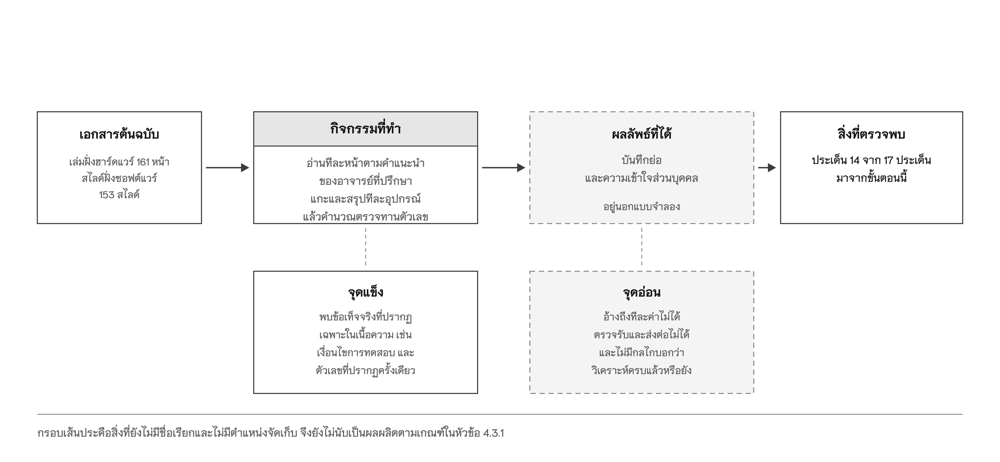

> **ภาพที่ 4** แนวทางดั้งเดิมแบบไม่ใช้เครื่องมือจำลอง (Manual Approach)

จุดแข็งคือการอ่านทีละหน้าทำให้พบข้อเท็จจริงที่ปรากฏเฉพาะในเนื้อความ เช่น เงื่อนไขการทดสอบ ข้อสังเกตของผู้พัฒนาเดิม และตัวเลขที่ปรากฏครั้งเดียวในภาคผนวก ประเด็นที่ตรวจพบในหัวข้อ 4.1.3 ส่วนใหญ่มาจากการอ่านและการคำนวณตรวจทาน ไม่ได้มาจากเครื่องมือ

จุดอ่อนคือผลลัพธ์คงอยู่ในรูปบันทึกย่อและความเข้าใจส่วนบุคคล จึงอ้างถึง ตรวจรับ หรือส่งต่อไม่ได้ และไม่มีกลไกใดบอกได้ว่าการวิเคราะห์ครบถ้วนแล้วหรือยัง

### 3.2.2 แนวทางที่สอง ใช้แบบจำลองเป็นฐาน (MBSE Approach)

ศึกษาระเบียบวิธี ARCADIA และเครื่องมือ Capella เพิ่มเติมภายใต้คำแนะนำของอาจารย์ที่ปรึกษา แล้วนำข้อมูลจากเอกสารต้นฉบับมาสร้างแบบจำลองสถาปัตยกรรมสี่ระดับชั้นตามหัวข้อ 1.5.2 ดังภาพที่ 5

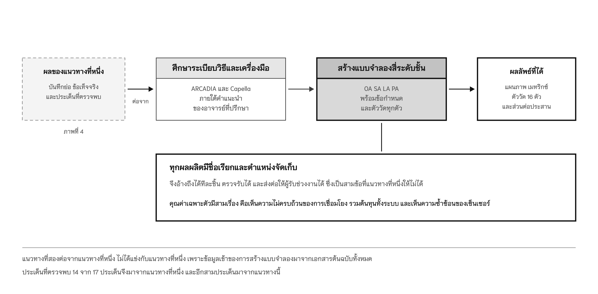

> **ภาพที่ 5** แนวทางวิศวกรรมระบบอิงแบบจำลอง (Model-Based Systems Engineering MBSE Approach)

แนวทางนี้ต่อจากแนวทางที่หนึ่ง ไม่ใช่แข่งกับแนวทางที่หนึ่ง เพราะข้อมูลเข้าของการสร้างแบบจำลองมาจากเอกสารต้นฉบับทั้งหมด

ผลการเปรียบเทียบในหัวข้อ 4.1.4 จึงไม่ตอบว่าแนวทางใดดีกว่าโดยสิ้นเชิง แต่ตอบว่าการเพิ่มขั้นสร้างแบบจำลองเข้าไปหลังการอ่านให้ผลเพิ่มขึ้นในด้านใด และด้วยความพยายามเท่าใด

### 3.2.3 สถานีที่เชื่อมสองแนวทาง การเก็บสิ่งที่พบไว้เป็นข้อมูลที่เครื่องอ่านได้

ช่องว่างระหว่างสองแนวทางอยู่ที่รูปแบบของสิ่งที่พบ แนวทางที่หนึ่งให้บันทึกย่อซึ่งอ้างถึงทีละค่าไม่ได้ตามหัวข้อ 3.2.1 ส่วนแบบจำลองรับข้อมูลเข้าได้เฉพาะสิ่งที่มีชื่อเรียกและมีที่มา สถานีนี้ปิดช่องว่างนั้น ดังภาพที่ 5-ก

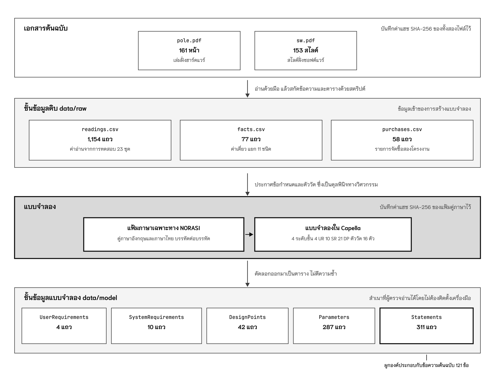

> **ภาพที่ 5-ก** ชั้นข้อมูลที่เครื่องอ่านได้ ซึ่งคั่นระหว่างเอกสารต้นฉบับกับแบบจำลอง

วิธีทำคือลงตารางข้อความ หนึ่งแถวหนึ่งค่า ทุกแถวระบุไฟล์ต้นฉบับและเลขหน้าที่ค่านั้นพิมพ์อยู่ ชั้นแรกเก็บสิ่งที่อ่านได้จากเอกสาร ดังตารางที่ 3-ค

| ไฟล์ | หนึ่งแถวคืออะไร | จำนวนแถว | ที่มา | คำถามที่ตอบได้ |
|---|---|---|---|---|
| `readings.csv` | ค่าอ่านหนึ่งค่าจากการทดสอบซ้ำ | 1,154 | การทดสอบ 23 ชุดจากทั้งสองเล่ม | ค่านี้วัดกี่ครั้ง และกระจายอย่างไร |
| `facts.csv` | ค่าเดี่ยวหนึ่งค่าที่เอกสารระบุ | 77 | เล่มฝั่งฮาร์ดแวร์ 40 แถว ฝั่งซอฟต์แวร์ 37 แถว | ค่านี้เป็นค่าวัด ค่าสเปก ค่าในโค้ด หรือข้อสรุป |
| `purchases.csv` | รายการจัดซื้อหนึ่งบรรทัด | 58 | โครงงานเสา 44 แถว โครงงานหน้าเว็บ 14 แถว | ของชิ้นนี้ราคาเท่าใด และซื้อกี่ชิ้น |

**ตารางที่ 3-ค** ชั้นข้อมูลดิบสามไฟล์ ซึ่งเก็บสิ่งที่อ่านได้จากเอกสารต้นฉบับโดยไม่คำนวณและไม่เติมค่า

สิ่งที่คอลัมน์ชนิดของ `facts.csv` ซื้อกลับมาคือการแยกค่าที่วัดได้ออกจากค่าที่เป็นสเปกและค่าที่อ่านจากโค้ด เอกสารต้นฉบับพิมพ์ทั้งสามชนิดเรียงกันเป็นตัวเลขเหมือนกัน เมื่อแยกแล้วจึงเห็นว่าค่าสเปกมี 19 แถว ค่าในโค้ด 13 แถว ขณะที่ค่าที่วัดได้มีเพียง 3 แถว การแยกนี้เป็นเหตุให้ประเด็น F-14 ปรากฏ คือค่าความหน่วงเวลาทั้งชุดเป็นเกณฑ์จากเอกสารผู้ผลิต ไม่ใช่ค่าที่วัดในสนาม

ชั้นที่สองเก็บแบบจำลองเองไว้ในรูปตาราง เพื่อให้ผู้ตรวจอ่านแบบจำลองได้โดยไม่ต้องติดตั้งเครื่องมือ ดังตารางที่ 3-ง

| ไฟล์ | หนึ่งแถวคืออะไร | จำนวนแถว | คำถามที่ตอบได้ |
|---|---|---|---|
| `UserRequirements.csv` | ความต้องการของผู้ใช้หนึ่งข้อ | 4 | เกษตรกรต้องการอะไร และถึงระดับใดแล้ว |
| `SystemRequirements.csv` | ข้อกำหนดของระบบหนึ่งข้อ | 10 | ข้อกำหนดข้อนี้ตอบความต้องการข้อใด และมีตัววัดหรือไม่ |
| `DesignPoints.csv` | จุดตัดสินใจหนึ่งข้อ ที่หนึ่งระดับชั้น | 42 คือ 21 ข้อ สองระดับชั้น | จุดตัดสินใจนี้ปรากฏเป็นของชิ้นใดที่ระดับกายภาพ |
| `Parameters.csv` | พารามิเตอร์หนึ่งค่าของหนึ่งองค์ประกอบ | 287 คือระดับระบบ 6 ระดับตรรกะ 15 ระดับกายภาพ 266 | สูตรของตัววัดดึงค่าจากที่ใด |
| `Statements.csv` | ข้อความต้นฉบับหนึ่งข้อที่รองรับหนึ่งองค์ประกอบ | 311 จากข้อความ 121 ข้อ | องค์ประกอบนี้มีหลักฐานอยู่ที่หน้าใดของเล่มใด |

**ตารางที่ 3-ง** ชั้นข้อมูลแบบจำลองห้าไฟล์ ซึ่งคัดลอกแบบจำลองออกมาเป็นตารางให้ตรวจได้โดยไม่ต้องเปิดเครื่องมือ

สิ่งที่ `Statements.csv` ซื้อกลับมาคือองค์ประกอบทุกชิ้นในแบบจำลองมีข้อความต้นฉบับรองรับที่ระบุเลขหน้าได้ 311 ครั้ง ผู้ตรวจจึงตรวจได้ทีละองค์ประกอบว่าสิ่งนั้นมาจากเอกสาร ไม่ได้มาจากการเติมของผู้จัดทำ ซึ่งเป็นข้อที่งานย้อนรอยถูกตั้งคำถามมากที่สุด

ข้อตกลงข้อเดียวที่บังคับทั้งสองชั้นคือห้ามคำนวณ ห้ามแปลงหน่วย ห้ามแก้ตัวสะกดของต้นฉบับ และห้ามเติมค่าที่เอกสารไม่ได้พิมพ์ ช่องหน่วยของการทดสอบเซ็นเซอร์จึงว่างไว้ เพราะตารางต้นฉบับไม่พิมพ์หน่วย

ข้อจำกัดของชั้นข้อมูลคือไม่ได้ตัดสินว่าค่าใดถูก เพียงบันทึกว่าเอกสารพิมพ์อะไรไว้ที่หน้าใด การตัดสินว่าผ่านหรือไม่ผ่านเกิดที่สถานีที่สี่ เมื่อมีแถบเกณฑ์ตามหัวข้อ 3.6.4

### 3.2.4 เงื่อนไขที่ทำให้ทั้งเส้นทางทำซ้ำได้

ปัญหาของงานย้อนรอยคือผู้ตรวจต้องเชื่อผู้ทำ เพราะตรวจไม่ได้ว่าค่าที่รายงานมาจากหน้าใด และตรวจไม่ได้ว่าถ้าทำซ้ำจะได้ผลเดิมหรือไม่

สิ่งที่สถานีที่สามซื้อกลับมาคือผู้ตรวจไม่ต้องเชื่อ เพราะทุกขั้นบันทึกสิ่งที่ต้องใช้ทำซ้ำไว้ ดังตารางที่ 3-จ

| ขั้น | สิ่งที่บันทึกไว้เพื่อให้ทำซ้ำได้ | ผลของการทำซ้ำ |
|---|---|---|
| เอกสารต้นฉบับ | ค่าแฮช SHA-256 ของไฟล์ทั้งสอง | ตรวจได้ว่าอ่านจากไฟล์เดียวกัน ไม่ใช่ฉบับอื่น |
| ชั้นข้อมูลดิบสามไฟล์ | คำสั่งเต็มที่ระบุทุกตารางและทุกเลขหน้า | ได้ไฟล์เดิมทุกไบต์ |
| แบบจำลอง | ค่าแฮช SHA-256 ของแฟ้มภาษาเฉพาะทางคู่ภาษาอังกฤษและภาษาไทย | ตรวจได้ว่าคัดลอกจากรุ่นเดียวกัน |
| ชั้นข้อมูลแบบจำลองสี่ไฟล์แรก | คำสั่งที่ระบุรูปแบบทุกคอลัมน์ | ได้ไฟล์เดิมทุกไบต์ เพราะเป็นการคัดลอก ไม่ใช่การตีความ |
| `Statements.csv` | คำสั่งที่ระบุเกณฑ์การเลือกข้อความรองรับ | ผ่านเกณฑ์ชุดเดิม แต่การเลือกข้อความเป็นดุลพินิจการอ่าน จึงอาจได้ข้อความอื่น |

**ตารางที่ 3-จ** เงื่อนไขการทำซ้ำของแต่ละขั้น และสิ่งที่การทำซ้ำให้ผลเหมือนเดิมหรือไม่เหมือนเดิม

แถวสุดท้ายของตารางที่ 3-จ เป็นแถวที่สำคัญที่สุด เพราะประกาศว่าขั้นใดเป็นเครื่องจักรและขั้นใดเป็นดุลพินิจของมนุษย์ การแยกสองอย่างนี้ออกจากกันคือสิ่งที่เอกสารต้นฉบับไม่ได้ทำ และเป็นเหตุที่ข้อสรุปของเอกสารตรวจซ้ำไม่ได้

ข้อจำกัดคือการทำซ้ำได้ไม่ได้รับประกันว่าถูก ถ้าผู้จัดทำอ่านตารางผิดตั้งแต่ต้น การทำซ้ำย่อมให้ค่าผิดเดิมทุกไบต์ สิ่งที่การทำซ้ำรับประกันคือความผิดนั้นหาที่มาได้ และแก้ที่จุดเดียวแล้วค่าทั้งเล่มเปลี่ยนตาม

## 3.3 เกณฑ์เปรียบเทียบที่ประกาศไว้ก่อนเริ่มงาน

### 3.3.1 คำถามของการเปรียบเทียบ

คำถามตั้งต้นคือการนำข้อมูลเข้าสู่ Capella ช่วยให้เข้าใจระบบได้ดีกว่าการอ่านเอกสารหรือไม่ คำว่าดีกว่าไม่มีเกณฑ์ในตัวเอง จึงแยกเป็นสองข้อ

แนวทางแบบจำลองให้ผลผลิตที่แนวทางการอ่านให้ไม่ได้หรือไม่

แนวทางแบบจำลองใช้ความพยายามเพิ่มขึ้นเท่าใดเมื่อเทียบกับผลที่ได้เพิ่ม

### 3.3.2 มิติและเกณฑ์การเปรียบเทียบ

การเปรียบเทียบดำเนินใน 2 มิติ มิติแรกคือคุณภาพผลลัพธ์ มิติที่สองคือปริมาณความพยายามที่ใช้ ดังภาพที่ 6 เกณฑ์ย่อยของทั้งสองมิติพร้อมวิธีวัดถูกกำหนดไว้ล่วงหน้าดังตารางที่ 4

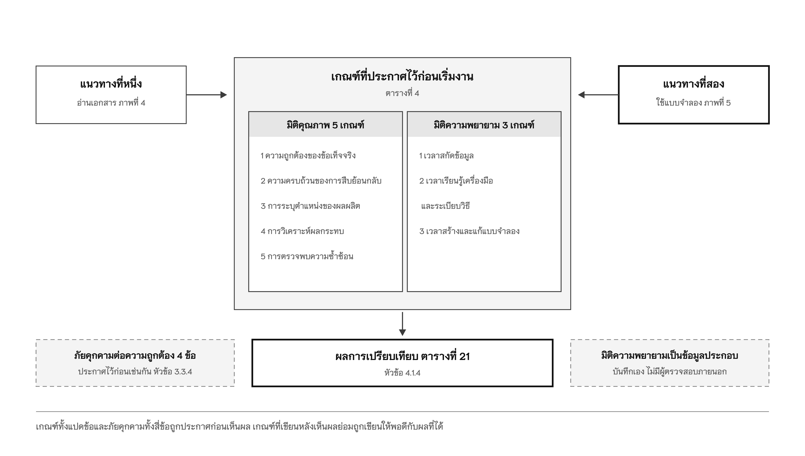

> **ภาพที่ 6** แนวคิดการประเมินและเปรียบเทียบผลลัพธ์การวิศวกรรมย้อนรอย

| มิติ | เกณฑ์ | วิธีวัด | เหตุผลที่ใช้เกณฑ์นี้ |
|---|---|---|---|
| คุณภาพ | ความถูกต้องของข้อเท็จจริง | จำนวนข้อเท็จจริงที่ขัดแย้งกับเอกสารต้นฉบับซึ่งตรวจพบด้วยแต่ละแนวทาง | ความถูกต้องเป็นเงื่อนไขขั้นต่ำของผลงานย้อนรอย |
| คุณภาพ | ความครบถ้วนของการสืบย้อนกลับ | จำนวนความสัมพันธ์ที่ขาดหายหรือไม่มีปลายทางซึ่งตรวจพบได้ | เป็นคุณลักษณะที่วัตถุประสงค์ข้อ 1.2.1 ต้องการโดยตรง |
| คุณภาพ | ความสามารถในการระบุตำแหน่งของผลผลิต | สัดส่วนของข้อสรุปที่ระบุตำแหน่งจัดเก็บหรือเลขภาพกำกับได้ | ผลผลิตที่ระบุตำแหน่งไม่ได้ย่อมส่งต่อไม่ได้ |
| คุณภาพ | ความสามารถในการวิเคราะห์ผลกระทบ | จำนวนขั้นตอนที่ต้องทำเพื่อตอบคำถามว่าหากเปลี่ยนองค์ประกอบหนึ่งจะกระทบความต้องการข้อใด | เป็นคำถามหน้างานหลักของนักพัฒนา |
| คุณภาพ | ความสามารถในการตรวจพบความซ้ำซ้อน | จำนวนรายการที่พบว่าทำหน้าที่ซ้อนทับกัน | ความซ้ำซ้อนเป็นต้นเหตุของต้นทุนเกินกรอบในกรณีศึกษานี้ |
| ความพยายาม | เวลาที่ใช้ในการสกัดข้อมูล | ชั่วโมงที่บันทึกไว้ในสมุดบันทึกการทำงาน | เป็นต้นทุนหลักของแนวทางที่หนึ่ง |
| ความพยายาม | เวลาที่ใช้ในการเรียนรู้เครื่องมือและระเบียบวิธี | ชั่วโมงที่บันทึกไว้ในสมุดบันทึกการทำงาน | เป็นต้นทุนแรกเข้าของแนวทางที่สองซึ่งมักถูกละเลย |
| ความพยายาม | เวลาที่ใช้ในการสร้างและแก้ไขแบบจำลอง | ชั่วโมงที่บันทึกไว้ในสมุดบันทึกการทำงาน | เป็นต้นทุนดำเนินการของแนวทางที่สอง |

**ตารางที่ 4** เกณฑ์และวิธีวัดในการเปรียบเทียบสองแนวทางการดำเนินงาน

### 3.3.3 วิธีการบันทึกข้อมูลเพื่อการเปรียบเทียบ

เกณฑ์มิติคุณภาพบันทึกจากผลงานที่ปรากฏในเล่มและในแบบจำลอง ผู้อ่านตรวจซ้ำได้

เกณฑ์มิติความพยายามบันทึกจากสมุดบันทึกการทำงานของผู้ศึกษาเอง ไม่มีผู้ตรวจสอบภายนอก จึงมีสถานะเป็นข้อมูลประกอบ ไม่ใช่ข้อมูลที่ใช้สรุปผลเชิงปริมาณ

### 3.3.4 ภัยคุกคามต่อความถูกต้องของผลการเปรียบเทียบ

ภัยคุกคามสี่ข้อที่ต้องระบุไว้ตามหลักเกณฑ์การวิจัยเชิงกรณีศึกษา (Runeson & Höst, 2009)

ผู้ปฏิบัติงานเป็นบุคคลเดียวกันทั้งสองแนวทาง ความเข้าใจจากแนวทางที่หนึ่งถูกนำไปใช้ในแนวทางที่สอง ผลจึงตีความว่าเป็นการแข่งขันที่เริ่มต้นเท่ากันไม่ได้

ผู้ปฏิบัติงานเป็นผู้ประเมินผลงานของตนเอง มาตรการลดความเสี่ยงคือเกณฑ์ที่นับได้ซึ่งกำหนดไว้ล่วงหน้าในตารางที่ 4 และการรายงานผลที่ไม่สนับสนุนแนวทางแบบจำลองในหัวข้อ 4.1.4

กรณีศึกษามีระบบเดียวและมีเอกสารค่อนข้างครบ ข้อสรุปจึงใช้กับระบบที่ไม่มีเอกสารไม่ได้

หลักฐานทั้งหมดเป็นเอกสาร ไม่มีการเข้าถึงระบบจริง ประเด็นที่ตรวจพบจึงเป็นประเด็นระดับเอกสารและการคำนวณ ซึ่งอาจไม่ปรากฏเมื่อระบบทำงานในสนาม ข้อจำกัดนี้บันทึกไว้ในหัวข้อ 5.2

## 3.4 กรอบวัตถุประสงค์การย้อนรอย (REV-OBJ-1 ถึง REV-OBJ-8)

จุดประสงค์การย้อนรอยแปดข้อประกาศไว้ก่อนเริ่มงาน ใช้รหัสชุดเดียวกับที่แบบจำลอง DurianOrchardMonitoring กำกับไว้ในช่อง Study category

การประกาศไว้ก่อนทำให้ใช้เป็นเกณฑ์ตรวจรับได้ จุดประสงค์ที่เขียนหลังเห็นผลย่อมถูกเขียนให้พอดีกับผลที่ได้

ข้อที่ปิดไม่ได้ต้องรายงานเป็นช่องว่าง ไม่ใช่ตัดออกจากรายการ

ทั้งแปดข้อเขียนเป็นสิ่งที่คำอธิบายสถาปัตยกรรมต้องระบุ ไม่ใช่ชื่อด้านที่ตรวจ เพราะชื่อด้านบอกเพียงว่ามองที่ใด แต่ไม่บอกว่าคำอธิบายต้องตอบอะไร

| จุดประสงค์การย้อนรอย | สิ่งที่คำอธิบายสถาปัตยกรรมต้องระบุ | ระดับชั้น / ผู้มีส่วนได้ส่วนเสีย |
|---|---|---|
| REV-OBJ-1 ประสิทธิภาพการทำงาน | สมรรถนะที่ระบบทำได้จริง เพื่อให้ข้อกำหนดเชิงปริมาณในหัวข้อ 3.6.2 มีค่าตั้งต้นจากหลักฐาน ไม่ใช่จากการกำหนดขึ้นใหม่ | PA / นักพัฒนา |
| REV-OBJ-2 ต้นทุนทางเศรษฐศาสตร์ | ฐานต้นทุนของสถาปัตยกรรมเดิม เพื่อให้การชั่งทางเลือกครั้งถัดไปเทียบกับกรอบงบประมาณจริง ไม่ใช่กับราคาที่ประมาณขึ้น | PA / ผู้บริหารโครงการ |
| REV-OBJ-3 ความน่าเชื่อถือของระบบ | เงื่อนไขที่ระบบยังทำงานได้ เพื่อระบุขอบเขตการใช้งานที่ข้อสรุปของระบบเดิมเป็นจริง | OA และ PA / เกษตรกรและนักบำรุงรักษา |
| REV-OBJ-4 ความสามารถในการบำรุงรักษา | ขอบเขตการแยกส่วนที่ทำให้ซ่อมได้ เพื่อให้นักบำรุงรักษาหาจุดเสียได้โดยไม่ต้องอ่านระบบทั้งระบบ | PA / นักบำรุงรักษา |
| REV-OBJ-5 ความสามารถในการขยายระบบ | ขีดจำกัดของการขยายระบบ เพื่อแยกความสามารถที่มีจริงออกจากความสามารถที่ถูกกล่าวอ้าง ก่อนวางแผนเพิ่มโหนด | SA / นักพัฒนา |
| REV-OBJ-6 ความปลอดภัยและความมั่นคง | เส้นทางข้อมูลและจุดที่ไม่มีการป้องกัน เพื่อระบุส่วนต่อประสานที่ต้องแก้ก่อนนำระบบกลับมาใช้ | SA / นักพัฒนา |
| REV-OBJ-7 ความซับซ้อนของระบบ | ภาระการบูรณาการที่ซ่อนอยู่ เพื่อประเมินภาระของผู้รับช่วงงานต่อ ไม่ใช่เพียงราคาอุปกรณ์ | LA และ PA / นักพัฒนา |
| REV-OBJ-8 แนวทางการออกแบบ | เหตุผลเบื้องหลังการตัดสินใจออกแบบ เพื่อให้ผู้รับช่วงงานต่อรู้ว่าข้อใดเปลี่ยนได้ และข้อใดเปลี่ยนแล้วกระทบความต้องการ | OA และ SA / ผู้รับช่วงงานต่อ |

**ตารางที่ 5** จุดประสงค์การย้อนรอยแปดข้อ สิ่งที่คำอธิบายสถาปัตยกรรมต้องระบุ ระดับชั้นและผู้มีส่วนได้ส่วนเสีย

ความสัมพันธ์ระหว่างจุดประสงค์กับระดับชั้นเป็นแบบหลายต่อหลาย คอลัมน์ที่สามจึงใช้ตรวจความครอบคลุมได้ด้วย การรายงานทั้งแปดข้อใช้เก้าหัวข้อตามหัวข้อ 3.4.1 ถึง 3.4.9 เรียงตามลำดับการทำงานจริง

### 3.4.1 ประเด็นเด่น

ประเด็นเด่นคือข้อกังวลที่ทำให้จุดประสงค์ข้อนั้นถูกตั้งขึ้น เขียนไว้ก่อนลงมือทุกข้อ ดังตารางที่ 5-ก

| จุดประสงค์ | ประเด็นเด่นที่ทำให้ตั้งจุดประสงค์นี้ |
|---|---|
| REV-OBJ-1 ประสิทธิภาพการทำงาน | สัญญาณต้องครอบคลุมสวนที่มีทรงพุ่มหนาแน่น ขณะที่โครงสร้างแบบจุดต่อจุดบริหารหลายโหนดได้ยาก |
| REV-OBJ-2 ต้นทุนทางเศรษฐศาสตร์ | งบประมาณจัดหาอุปกรณ์ต้องประหยัดและให้สมรรถนะสูงพร้อมกัน |
| REV-OBJ-3 ความน่าเชื่อถือของระบบ | ความต่อเนื่องของการสื่อสารและความทนทานต่อสภาพแวดล้อม ร่วมกับการใช้งานที่ยังไม่ครอบคลุม 24 ชั่วโมง |
| REV-OBJ-4 ความสามารถในการบำรุงรักษา | ความสะดวกในการตรวจซ่อมจุดเสียและการปรับเปลี่ยนตรรกะการทำงาน |
| REV-OBJ-5 ความสามารถในการขยายระบบ | ศักยภาพในการเพิ่มจำนวนโหนดในพื้นที่กว้างและความยืดหยุ่นในการเพิ่มฟังก์ชันแสดงผล |
| REV-OBJ-6 ความปลอดภัยและความมั่นคง | ความเสี่ยงจากการเข้าถึงข้อมูลโดยไม่ได้รับอนุญาต และการสูญหายของข้อมูลเมื่ออุปกรณ์หน้างานชำรุด |
| REV-OBJ-7 ความซับซ้อนของระบบ | ความล่าช้าจากฮาร์ดแวร์หน้างานถึงซอฟต์แวร์บนคลาวด์ และความยุ่งยากในการติดตั้งเสาสัญญาณ |
| REV-OBJ-8 แนวทางการออกแบบ | ความเหมาะสมของเทคโนโลยีที่เลือกใช้ ในกรณีที่ Wi-Fi หรือ Bluetooth ตอบโจทย์พื้นที่เกษตรกรรมไม่ได้ |

**ตารางที่ 5-ก** ประเด็นเด่นของจุดประสงค์การย้อนรอยทั้งแปดข้อ

### 3.4.2 สิ่งที่เห็น

สิ่งที่เห็นคือข้อเท็จจริงที่อ่านได้จากหลักฐานก่อนการตีความ ดังตารางที่ 5-ข

| จุดประสงค์ | แหล่งหลักฐาน | สิ่งที่เห็น |
|---|---|---|
| REV-OBJ-1 ประสิทธิภาพการทำงาน | ผลการทดลองงบลิงก์ ระยะทาง และการใช้พลังงานในเล่มเดิม ร่วมกับเอกสารข้อมูลผู้ผลิตโมดูล LoRa | งบลิงก์ในเล่มเดิมนับอัตราขยายของเสาอากาศซ้ำสองครั้ง และกำลังภาครับที่วัดได้ที่ระยะ 400 เมตร อ่อนกว่าค่าเชิงทฤษฎีประมาณ 43 dB |
| REV-OBJ-2 ต้นทุนทางเศรษฐศาสตร์ | รายการงบประมาณและราคาต่อหน่วย | ต้นทุนฮาร์ดแวร์ของโหนดเกินกรอบงบประมาณร้อยละ 6.278 คิดเป็น 1,790 บาท |
| REV-OBJ-3 ความน่าเชื่อถือของระบบ | ผลการทดลองพลังงานกับสเปกแบตเตอรี่ | พลังงานที่จ่ายได้ให้ระยะเวลาใช้งานประมาณ 13.4 ชั่วโมง ไม่ตรงกับ 16 ชั่วโมงที่รายงานไว้ และต่ำกว่าเป้าหมาย 24 ชั่วโมง |
| REV-OBJ-4 ความสามารถในการบำรุงรักษา | ผังวงจร โปรแกรมเฟิร์มแวร์ และกระแสข้อมูล Node-RED | ขอบเขตความรับผิดชอบระหว่างฮาร์ดแวร์กับซอฟต์แวร์อยู่ที่จุดส่งคำขอ HTTP |
| REV-OBJ-5 ความสามารถในการขยายระบบ | โครงสร้างการจำแนกที่อยู่โหนด | ขยายช่องทางปลายทางได้ง่าย แต่การเพิ่มโหนดต้นทางต้องแก้ตรรกะทั้งที่เกตเวย์และที่ Node-RED |
| REV-OBJ-6 ความปลอดภัยและความมั่นคง | โปรแกรมเกตเวย์ | การส่งข้อมูลไปเซิร์ฟเวอร์ใช้การเชื่อมต่อ TCP ธรรมดาโดยไม่มีการเข้ารหัส |
| REV-OBJ-7 ความซับซ้อนของระบบ | รายการเทคโนโลยีและภาษาที่ใช้ทั้งระบบ | InfluxDB รุ่น 2.0 ใช้ภาษา Flux ซึ่งไม่เข้ากันกับภาษา InfluxQL รุ่นก่อนหน้า |
| REV-OBJ-8 แนวทางการออกแบบ | ผลการตัดสินใจที่ปรากฏในเล่มเดิม ร่วมกับบันทึกการสำรวจความต้องการ | บริการ LINE Notify ยุติการให้บริการแล้วตั้งแต่ 31 มีนาคม 2568 |

**ตารางที่ 5-ข** แหล่งหลักฐานและสิ่งที่เห็นของแต่ละจุดประสงค์

### 3.4.3 การนำความรู้ไปใช้ที่มองเห็น

หัวข้อนี้เขียนไว้ก่อนเริ่มงานเช่นเดียวกับประเด็นเด่น ดังตารางที่ 5-ค

| จุดประสงค์ | การนำไปใช้ที่มองเห็น |
|---|---|
| REV-OBJ-1 ประสิทธิภาพการทำงาน | ใช้ค่าที่สกัดได้จากเอกสารเป็นค่าตั้งต้นของข้อกำหนดเชิงปริมาณในโครงการถัดไป แทนการกำหนดเกณฑ์ขึ้นใหม่ |
| REV-OBJ-2 ต้นทุนทางเศรษฐศาสตร์ | ใช้เป็นฐานเปรียบเทียบเมื่อชั่งทางเลือกฮาร์ดแวร์ครั้งถัดไป |
| REV-OBJ-3 ความน่าเชื่อถือของระบบ | ใช้กำหนดรอบการบำรุงรักษาและขอบเขตการใช้งานที่ประกาศต่อเกษตรกร |
| REV-OBJ-4 ความสามารถในการบำรุงรักษา | ออกแบบจุดตัดความรับผิดชอบไว้ล่วงหน้า |
| REV-OBJ-5 ความสามารถในการขยายระบบ | ประเมินงานที่ต้องทำก่อนขยายพื้นที่สวน แทนการสมมุติว่าเพิ่มโหนดได้ทันที |
| REV-OBJ-6 ความปลอดภัยและความมั่นคง | ใช้เป็นรายการตรวจความปลอดภัยของส่วนต่อประสาน |
| REV-OBJ-7 ความซับซ้อนของระบบ | ประเมินภาระการรับช่วงงานก่อนตัดสินใจรับโครงการต่อ |
| REV-OBJ-8 แนวทางการออกแบบ | ตั้งกิจกรรมทวนสอบสถานะบริการภายนอกเป็นงานประจำของการบำรุงรักษา |

**ตารางที่ 5-ค** การนำความรู้ไปใช้ที่มองเห็นไว้ก่อนเริ่มงาน

### 3.4.4 สิ่งที่ทำ

สิ่งที่ทำคือการกระทำต่อหลักฐานจนเห็นสิ่งที่เห็น เขียนให้ผู้อื่นทำซ้ำได้ด้วยหลักฐานชุดเดียวกัน ดังตารางที่ 5-ง

| จุดประสงค์ | สิ่งที่ทำ |
|---|---|
| REV-OBJ-1 ประสิทธิภาพการทำงาน | คำนวณงบลิงก์ตรวจทานค่าที่รายงานไว้ แล้วเทียบความไวในการรับสัญญาณกับเอกสารข้อมูลผู้ผลิต |
| REV-OBJ-2 ต้นทุนทางเศรษฐศาสตร์ | กระทบยอดราคาต่อหน่วยกับกรอบงบประมาณในแบบจำลอง แล้วตรวจเงื่อนไขโควตาของบริการแจ้งเตือน |
| REV-OBJ-3 ความน่าเชื่อถือของระบบ | คำนวณระยะเวลาจ่ายพลังงานตรวจทาน แล้วเทียบสเปกแบตเตอรี่ระหว่างสองส่วนของเล่มเดิม |
| REV-OBJ-4 ความสามารถในการบำรุงรักษา | ถอดองค์ประกอบและไล่กระแสข้อมูลจากเซ็นเซอร์ถึงที่จัดเก็บ แล้วระบุจุดที่ตัดความรับผิดชอบได้ |
| REV-OBJ-5 ความสามารถในการขยายระบบ | ไล่เส้นทางข้อมูลจากโหนดถึงส่วนแสดงผล แล้วแยกจุดที่ขยายได้ออกจากจุดที่ขยายไม่ได้ |
| REV-OBJ-6 ความปลอดภัยและความมั่นคง | ไล่ส่วนต่อประสานทีละช่วงตั้งแต่โหนดถึงแดชบอร์ด แล้วระบุช่วงที่ไม่มีมาตรการป้องกัน |
| REV-OBJ-7 ความซับซ้อนของระบบ | รวบรวมรายการเทคโนโลยีและภาษาที่ต้องดูแลพร้อมกัน แล้วตรวจความเข้ากันระหว่างรุ่น |
| REV-OBJ-8 แนวทางการออกแบบ | สร้างเมทริกซ์สืบย้อนกลับสองระดับในแบบจำลอง แล้วทวนสอบสถานะบริการภายนอกที่ระบบพึ่งพา |

**ตารางที่ 5-ง** สิ่งที่ทำกับหลักฐานของแต่ละจุดประสงค์

### 3.4.5 สิ่งที่ได้

สิ่งที่ได้คือข้อกำหนดที่สร้างขึ้นจากหลักฐาน บันทึกเป็นรหัสตามหัวข้อ 3.6.1 ถึง 3.6.3 ดังตารางที่ 5-จ

| จุดประสงค์ | ข้อกำหนดที่ได้ | กำกับโดย |
|---|---|---|
| REV-OBJ-1 ประสิทธิภาพการทำงาน | SR-01, DP-02 และคู่การนำไปปฏิบัติของ DP-01 กับ DP-02 | แบบจำลอง |
| REV-OBJ-2 ต้นทุนทางเศรษฐศาสตร์ | SR-07, DP-15 และคู่การนำไปปฏิบัติของ DP-15 | แบบจำลอง |
| REV-OBJ-3 ความน่าเชื่อถือของระบบ | SR-04, SR-08, DP-09 และคู่การนำไปปฏิบัติของ DP-09 กับ DP-16 | แบบจำลอง |
| REV-OBJ-4 ความสามารถในการบำรุงรักษา | SR-10, DP-20, DP-21 | เล่มนี้ |
| REV-OBJ-5 ความสามารถในการขยายระบบ | SR-03, DP-06, DP-07 | เล่มนี้ |
| REV-OBJ-6 ความปลอดภัยและความมั่นคง | SR-08, DP-16, DP-17 | เล่มนี้ |
| REV-OBJ-7 ความซับซ้อนของระบบ | SR-05, SR-06, DP-10, DP-11, DP-12, DP-13 | เล่มนี้ |
| REV-OBJ-8 แนวทางการออกแบบ | UR-04, SR-09, DP-18, DP-19 | เล่มนี้ |

**ตารางที่ 5-จ** ข้อกำหนดที่ได้จากแต่ละจุดประสงค์ และผู้กำกับรหัส

แบบจำลองกำกับช่อง Study category ไว้เองสามข้อ อีกห้าข้อเล่มนี้กำกับเองจากความหมายของข้อกำหนด

การกำกับที่เล่มนี้ทำเองจะมีน้ำหนักเท่ากับที่แบบจำลองกำกับ เมื่อถูกย้ายเข้าไปเป็นช่อง Study category ของแบบจำลอง

REV-OBJ-4 และ REV-OBJ-5 เคยไม่มีข้อกำหนดของระบบรองรับ แบบจำลองชุดสิบข้อปิดช่องว่างนี้แล้วด้วย SR-10 และ SR-03

### 3.4.6 สิ่งที่เห็นเมื่อมองคู่กับวิศวกรรมระบบ

หัวข้อนี้ตอบว่ากลไกใดทำให้ตรวจพบสิ่งที่การอ่านอย่างเดียวตรวจไม่พบ ดังตารางที่ 5-ฉ

| จุดประสงค์ | กลไกและสิ่งที่กลไกนั้นเผย |
|---|---|
| REV-OBJ-1 ประสิทธิภาพการทำงาน | พิสูจน์ด้วยการคำนวณตรวจทาน เผยความผิดพลาดที่การอ่านอย่างเดียวเผยไม่ได้ |
| REV-OBJ-2 ต้นทุนทางเศรษฐศาสตร์ | ชั่งด้วยการกระทบยอดราคากับกรอบงบประมาณ เผยส่วนเกินที่ตารางราคาต่อหน่วยไม่แสดง |
| REV-OBJ-3 ความน่าเชื่อถือของระบบ | ประกอบด้วยการรวมสเปกพลังงานเข้ากับเป้าหมายการใช้งาน เผยช่องว่างที่สเปกแยกชิ้นเผยไม่ได้ |
| REV-OBJ-4 ความสามารถในการบำรุงรักษา | แยกด้วยการระบุขอบเขตความรับผิดชอบที่จุดส่งคำขอ HTTP |
| REV-OBJ-5 ความสามารถในการขยายระบบ | เชื่อมด้วยการไล่เส้นทางข้อมูล เผยว่าข้อจำกัดของการขยายอยู่ที่ตรรกะจำแนกที่อยู่ |
| REV-OBJ-6 ความปลอดภัยและความมั่นคง | เชื่อมด้วยการไล่ส่วนต่อประสานทีละช่วง เผยช่วงที่ข้อมูลเดินทางโดยไม่มีการเข้ารหัส |
| REV-OBJ-7 ความซับซ้อนของระบบ | ประกอบด้วยการนับเทคโนโลยีที่ต้องดูแลพร้อมกัน เผยความไม่เข้ากันระหว่างสองรุ่นของฐานข้อมูลเดียวกัน |
| REV-OBJ-8 แนวทางการออกแบบ | สืบด้วยเมทริกซ์สืบย้อนกลับสองระดับ เผยความสัมพันธ์ Satisfies ที่ขาดหาย |

**ตารางที่ 5-ฉ** กลไกที่ทำให้ตรวจพบ จำแนกตามจุดประสงค์

หลักฐานของหัวข้อนี้คือประเด็น F-12 F-13 และ F-15 ซึ่งตารางที่ 20 กำกับไว้ว่าตรวจพบได้จากแบบจำลองเท่านั้น

### 3.4.7 ประโยชน์ที่เห็น

ประโยชน์ต้องแปลเป็นคำถามหน้างานที่ตรวจสอบได้ว่าตอบได้จริง ดังตารางที่ 5-ช

| จุดประสงค์ | คำถามหน้างานที่ตอบได้ |
|---|---|
| REV-OBJ-1 ประสิทธิภาพการทำงาน | ค่ากำลังสัญญาณที่กำลังอ้างอิงอยู่เชื่อถือได้หรือไม่ |
| REV-OBJ-2 ต้นทุนทางเศรษฐศาสตร์ | ชิ้นส่วนใดควรเปลี่ยนก่อนเพื่อดึงต้นทุนกลับเข้ากรอบ |
| REV-OBJ-3 ความน่าเชื่อถือของระบบ | ระบบใช้งานต่อเนื่องได้กี่ชั่วโมงจริงก่อนต้องเข้าดูแล |
| REV-OBJ-4 ความสามารถในการบำรุงรักษา | อาการเสียที่พบอยู่ฝั่งฮาร์ดแวร์หรือฝั่งซอฟต์แวร์ ก่อนลงมือถอดอุปกรณ์ |
| REV-OBJ-5 ความสามารถในการขยายระบบ | เพิ่มโหนดได้อีกกี่จุดโดยไม่ต้องแก้ตรรกะ |
| REV-OBJ-6 ความปลอดภัยและความมั่นคง | ต้องแก้จุดใดก่อนเปิดระบบให้ใช้งานจริงอีกครั้ง |
| REV-OBJ-7 ความซับซ้อนของระบบ | ผู้รับช่วงงานต่อต้องมีทักษะด้านใดบ้างจึงดูแลระบบนี้ได้ |
| REV-OBJ-8 แนวทางการออกแบบ | เปลี่ยนจุดตัดสินใจออกแบบข้อหนึ่งแล้วความต้องการข้อใดกระทบ |

**ตารางที่ 5-ช** คำถามหน้างานที่ผลของแต่ละจุดประสงค์ตอบได้

### 3.4.8 วิธีแทนผลลัพธ์

ผลลัพธ์ทุกข้อระบุตำแหน่งจัดเก็บเป็นเลขตาราง เลขภาพ หรือเลขหัวข้อ ตามนิยามในหัวข้อ 1.6.5 ดังตารางที่ 5-ซ

| จุดประสงค์ | ตำแหน่งผลลัพธ์ | ประเด็นที่รายงาน |
|---|---|---|
| REV-OBJ-1 ประสิทธิภาพการทำงาน | ตารางที่ 10–11, ภาพที่ 19–22, ตารางที่ 19 | F-01, F-02, F-03, F-14 |
| REV-OBJ-2 ต้นทุนทางเศรษฐศาสตร์ | ตารางที่ 12–13, ตารางที่ 18, ภาพที่ 53–54 | F-10, F-13, F-15 |
| REV-OBJ-3 ความน่าเชื่อถือของระบบ | ตารางที่ 11, ภาพที่ 33, ตารางที่ 20 | F-04, F-05, F-06, F-07, F-11, F-17 |
| REV-OBJ-4 ความสามารถในการบำรุงรักษา | ตารางที่ 6–9, ตารางที่ 17, ภาพที่ 50–52 | ไม่มี |
| REV-OBJ-5 ความสามารถในการขยายระบบ | ตารางที่ 17, ภาพที่ 46, ภาพที่ 48 | ไม่มี |
| REV-OBJ-6 ความปลอดภัยและความมั่นคง | ตารางที่ 9, ตารางที่ 17, ตารางที่ 20 | F-08, F-09 |
| REV-OBJ-7 ความซับซ้อนของระบบ | ตารางที่ 7 และตารางที่ 9, ภาพที่ 48 | F-15, F-16 |
| REV-OBJ-8 แนวทางการออกแบบ | ตารางที่ 14–16, หัวข้อ 3.6.3, ตารางที่ 20 | F-09, F-12 |

**ตารางที่ 5-ซ** ตำแหน่งจัดเก็บผลลัพธ์และประเด็นที่รายงานของแต่ละจุดประสงค์

REV-OBJ-4 และ REV-OBJ-5 ไม่มีประเด็นที่รายงานได้ ซึ่งเป็นช่องว่างชุดเดียวกับหัวข้อ 3.4.5

### 3.4.9 สิ่งที่เรียนรู้และความรู้ใหม่

บทเรียนทุกข้อสืบย้อนกลับไปถึงกลไกในตารางที่ 5-ฉ ได้ ดังตารางที่ 5-ฌ

| จุดประสงค์ | บทเรียน |
|---|---|
| REV-OBJ-1 ประสิทธิภาพการทำงาน | เกณฑ์สมรรถนะที่ย้อนมาจากผลการทดลอง ใช้เป็นเกณฑ์ตรวจรับผลการทดลองนั้นเองไม่ได้ |
| REV-OBJ-2 ต้นทุนทางเศรษฐศาสตร์ | ต้นทุนการจัดหาไม่ใช่ต้นทุนการถือครอง การประเมินที่หยุดอยู่ที่ราคาซื้อตอบความคุ้มค่าไม่ได้ |
| REV-OBJ-3 ความน่าเชื่อถือของระบบ | ความตึงเครียดระหว่างข้อกำหนดสองข้อต้องบันทึกไว้เป็นข้อกำหนด ไม่ใช่กลบด้วยการเขียนให้ดูไม่ขัดกัน |
| REV-OBJ-4 ความสามารถในการบำรุงรักษา | คุณลักษณะที่ไม่ถูกประกาศเป็นข้อกำหนด ตรวจไม่พบว่าขาด เพราะไม่มีเกณฑ์ให้เทียบ |
| REV-OBJ-5 ความสามารถในการขยายระบบ | ความสามารถในการขยายช่องทางปลายทาง ไม่ใช่ความสามารถในการขยายจำนวนโหนดต้นทาง |
| REV-OBJ-6 ความปลอดภัยและความมั่นคง | การป้องกันระดับเครือข่ายไม่ใช่การป้องกันระดับข้อมูล |
| REV-OBJ-7 ความซับซ้อนของระบบ | ความซับซ้อนที่เพิ่มขึ้นเป็นราคาที่จ่ายเพื่อสมรรถนะ จึงต้องรายงานคู่กับสมรรถนะที่ได้มา |
| REV-OBJ-8 แนวทางการออกแบบ | ระบบที่พึ่งพาบริการภายนอกเสื่อมสภาพได้เองแม้ตัวระบบไม่เปลี่ยน |

**ตารางที่ 5-ฌ** บทเรียนที่ใช้ได้เกินกรณีศึกษานี้

REV-OBJ-8 เป็นข้อที่เสี่ยงที่สุด เพราะเอกสารต้นฉบับบันทึกผลของการตัดสินใจไว้ แต่ไม่ได้บันทึกกระบวนการตัดสินใจ ข้อสรุปจึงเป็นการสันนิษฐานย้อนหลังของผู้จัดทำ ไม่ใช่คำยืนยันของผู้ออกแบบเดิม

## 3.5 สิ่งที่การอ่านเอกสารให้ได้ และสิ่งที่ให้ไม่ได้

หัวข้อนี้รายงานผลของแนวทางที่หนึ่งตามหัวข้อ 3.2.1 โดยแต่ละหัวข้อย่อยระบุสองอย่างคู่กัน คือสิ่งที่การอ่านเอกสารอย่างมีวินัยให้ได้ และคำถามที่การอ่านตอบไม่ได้ ซึ่งเป็นเหตุให้ต้องทำแนวทางที่สอง รายการองค์ประกอบทั้งหมดที่ยกมาจากเอกสารต้นฉบับอยู่ในตารางที่ 6 ถึงตารางที่ 9 และมีสถานะเป็นข้อมูลตั้งต้น ไม่ใช่ผลงานของเล่มนี้

### 3.5.1 ขอบเขตความรับผิดชอบที่เอกสารสองเล่มไม่มีใครบันทึก

เอกสารต้นฉบับบรรยายระบบเป็นสามสถานีตามภาพที่ 7 คือสถานีตรวจวัด เกตเวย์ และเซิร์ฟเวอร์ การบรรยายนั้นครบถ้วนในระดับของที่จับต้องได้ แต่ตอบสี่คำถามต่อไปนี้ไม่ได้

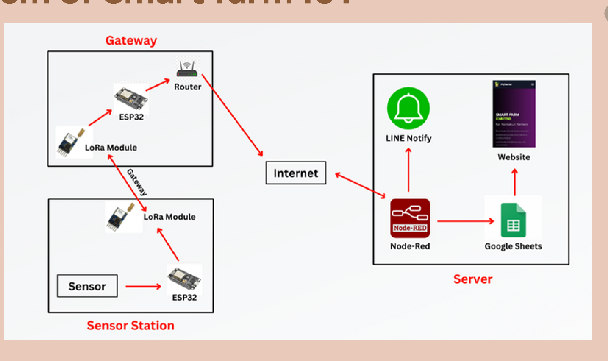

> **ภาพที่ 7** การไหลข้อมูลของ Input-Output ของระบบต้นแบบเดิม  
ที่มา: Nunthasrithananon et al. (2024), p. 9.
> ที่มา: Nunthasrithananon et al. (2024).

สามสถานีไม่บอกว่าความรับผิดชอบของเล่มใดจบที่ใด เล่มฝั่งฮาร์ดแวร์จบที่เกตเวย์ส่งคำขอออกไป เล่มฝั่งซอฟต์แวร์เริ่มที่ Node-RED รับคำขอเข้ามา จุดบรรจบคือคำขอ HTTP ซึ่งไม่ปรากฏในเล่มใดเลย เพราะแต่ละเล่มจบที่ขอบของตนเอง

การระบุจุดบรรจบเป็นเงื่อนไขเดียวที่ทำให้ประกอบเอกสารสองเล่มเข้าเป็นแบบจำลองเดียวได้ตามวัตถุประสงค์ข้อ 1.2.1 ถ้าไม่ระบุ งานย้อนรอยจะได้แบบจำลองสองชุดที่ไม่ต่อกัน ซึ่งเท่ากับสภาพเดิมที่เอกสารสองเล่มเป็นอยู่

สามสถานีไม่บอกว่าสถานีใดเป็นจุดเดียวที่ล้มเหลวได้ทั้งระบบ ข้อเท็จจริงที่เกษตรกรถอดสายไฟเกตเวย์แล้วระบบหยุดทั้งระบบ กลายเป็นประเด็น F-17 เมื่อนำสามสถานีมาวางคู่กับความต้องการ UR-01 เท่านั้น การวางคู่นั้นเอกสารทำไม่ได้ เพราะไม่มีความต้องการให้วางคู่

สามสถานีไม่บอกว่าข้อจำกัดที่พบเป็นข้อจำกัดของการออกแบบหรือของที่ซื้อมา การแยกเป็นสี่ระดับชั้นตามหัวข้อ 3.7 ทำให้แยกได้ และผลต่างปรากฏเป็นตัวเลขในหัวข้อ 4.2.1

รายการองค์ประกอบของทั้งสามสถานีอยู่ในตารางที่ 6 ถึงตารางที่ 9 ซึ่งยกมาจากเอกสารต้นฉบับทั้งหมด จึงเป็นข้อมูลตั้งต้น ไม่ใช่ผลงานของเล่มนี้

### 3.5.2 การจำกัดขอบเขตการตรวจซ่อมที่ได้จากการวางช่องทางสื่อสารไว้แถวเดียวกัน

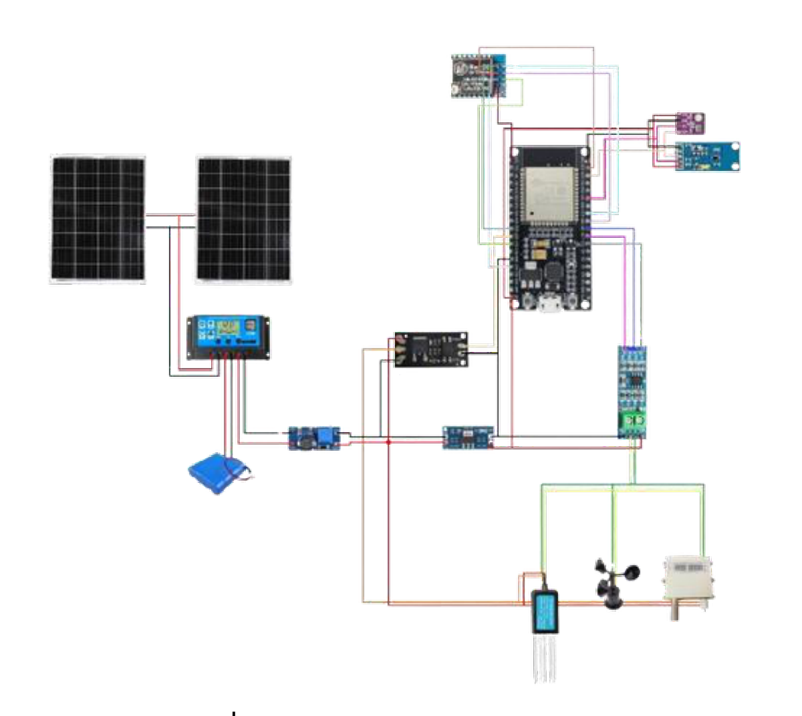

> **ภาพที่ 8** ภาพรวมวงจรในกล่องควบคุมของเสา IoT  
ที่มา: Tuntawisut et al. (2024), p. 61.
> ที่มา: Tuntawisut et al. (2024).

| รายการ | รุ่น / สเปก | หน้าที่ | ช่องทางสื่อสาร | แหล่งจ่ายไฟ |
|---|---|---|---|---|
| โมดูล LoRa | SX1278 | รับส่งข้อมูลไร้สายระยะไกล | SPI กับ ESP32S | 3.3V จาก ESP32S |
| เสาอากาศ | Antenna 5 dBi 433MHz | แผ่กระจายคลื่นวิทยุ | ต่อ SMA กับโมดูล LoRa | — |
| ไมโครคอนโทรลเลอร์ | ESP32S | ประมวลผลหลักและจัดรูปแบบข้อมูล | — | 5V จาก AMS1117 |
| โมดูลขับโหลด MOSFET | LR7843 | ขับโหลดด้วยสัญญาณ PWM | PWM จาก ESP32S | 12V จาก MT3608 |
| เซ็นเซอร์อุณหภูมิ/ความชื้น/ความดัน | BME280 | วัดอุณหภูมิ ความชื้น ความกดอากาศ | I2C | 5V จาก AMS1117 |
| เซ็นเซอร์ความเข้มแสง | GY-30 | วัดความเข้มแสง | I2C | 5V จาก AMS1117 |
| เซ็นเซอร์วัดค่าดิน | 7 in 1 Soil Sensor | วัดอุณหภูมิ ความชื้น pH EC และ NPK ในดิน | RS485 (Modbus RTU) | 12V จาก MT3608 |
| เซ็นเซอร์ความเร็วลม | WSS004 | วัดความเร็วลม | RS485 (Modbus RTU) | 12V จาก MT3608 |
| เซ็นเซอร์อุณหภูมิอากาศ | SHT 30 | วัดอุณหภูมิและความชื้นสัมพัทธ์ | RS485 (Modbus RTU) | 12V จาก MT3608 |
| โมดูลแปลงข้อมูล | Isolated UART TTL to RS485 | แปลงระดับสัญญาณ RS485 เป็น TTL | UART กับ ESP32S | 5V จาก AMS1117 |
| แผงโซลาร์เซลล์ | 6V 6W | ผลิตพลังงานไฟฟ้าจากแสงอาทิตย์ | — | — |
| ตัวควบคุมการชาร์จ | CN3971 MPPT Charger | ควบคุมการชาร์จแบตเตอรี่และจ่ายไฟระบบ | — | จากแผงโซลาร์เซลล์ |
| วงจรเพิ่มแรงดัน | MT3608 (5V เป็น 12V) | จ่ายไฟ 12V ให้เซ็นเซอร์ RS485 และโมดูลขับโหลด | — | จาก CN3971 |
| วงจรลดแรงดัน | AMS1117 (12V เป็น 5V) | จ่ายไฟ 5V ให้บอร์ดคอนโทรลและโมดูล RS485 | — | จาก MT3608 |
| แบตเตอรี่ | 18650 3.7V 12.7Ah | สำรองพลังงานสำหรับการทำงานต่อเนื่อง | — | จาก CN3971 |

**ตารางที่ 6** รายการฮาร์ดแวร์ของเสา IoT และช่องทางการสื่อสาร  
ที่มา: เรียบเรียงจาก Tuntawisut et al. (2024).

คุณค่าของตารางที่ 6 ไม่ได้อยู่ที่การมีรายการอุปกรณ์ เพราะเอกสารต้นฉบับมีอยู่แล้ว หากอยู่ที่การวางช่องทางสื่อสารและแหล่งจ่ายไฟของอุปกรณ์เดียวกันไว้ในแถวเดียวกัน ซึ่งเอกสารต้นฉบับแยกไว้ต่างหน้า

ผลที่ได้คือการอนุมานสาเหตุร่วม หากเซ็นเซอร์ 7 in 1, WSS004 และ SHT30 หยุดส่งค่าพร้อมกัน ผู้ต้องสงสัยคือโมดูลแปลง RS485 หรือวงจรเพิ่มแรงดัน MT3608 ไม่ใช่ตัวเซ็นเซอร์ เพราะเป็นองค์ประกอบร่วมของทั้งสามตัว

สิ่งที่ตารางที่ 6 ยังตอบไม่ได้คือเมื่อเซ็นเซอร์สามตัวนั้นหยุด ความต้องการข้อใดของเกษตรกรไม่ได้รับการตอบสนอง คำตอบนั้นต้องรอความสัมพันธ์ในตารางที่ 14 ถึงตารางที่ 16

### 3.5.3 จุดตัดสินใจที่แลกความเสถียรกับต้นทุน ซึ่งเอกสารบันทึกเป็นข้อเท็จจริงสองข้อแยกกัน

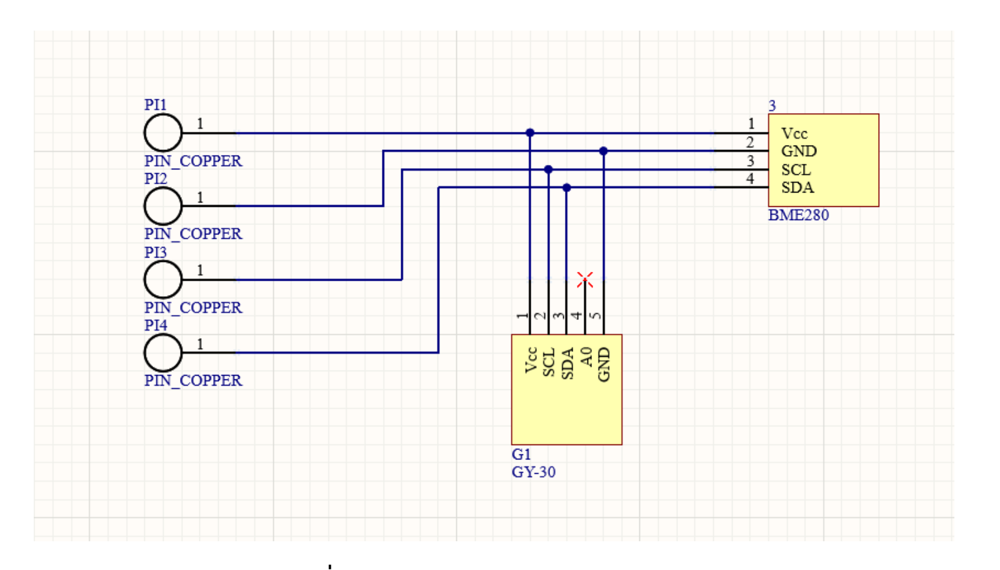

> **ภาพที่ 9** ตัวอย่างวงจรการเชื่อมต่อ I2C ระหว่าง ESP32 กับเซ็นเซอร์ BME280 และ GY-30  
ที่มา: Tuntawisut et al. (2024), p. 60.
> ที่มา: Tuntawisut et al. (2024).

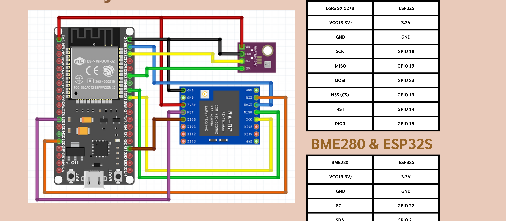

> **ภาพที่ 10** วงจรของเกตเวย์  
ที่มา: Nunthasrithananon et al. (2024), p. 11.
> ที่มา: Nunthasrithananon et al. (2024).

| ส่วน | ประเภท | รายการ | หน้าที่ |
|---|---|---|---|
| เกตเวย์ | ฮาร์ดแวร์ | โมดูล LoRa SX1278 | รับสัญญาณจากสถานีตรวจวัด |
| เกตเวย์ | ฮาร์ดแวร์ | เสาอากาศ 5 dBi 433MHz | รับคลื่นวิทยุ |
| เกตเวย์ | ฮาร์ดแวร์ | ไมโครคอนโทรลเลอร์ ESP32S | ตรวจความถูกต้องของข้อมูลและส่งคำขอ HTTP |
| เกตเวย์ | ฮาร์ดแวร์ | BMP280 | วัดความกดอากาศ อุณหภูมิ และความชื้น ณ ตำแหน่งเกตเวย์ |
| เกตเวย์ | ฮาร์ดแวร์ | เราเตอร์ | เชื่อมต่อเกตเวย์เข้าสู่อินเทอร์เน็ต |
| เซิร์ฟเวอร์ | ฮาร์ดแวร์ | Local Server ที่ติดตั้งระบบปฏิบัติการ CasaOS | ประมวลผลและจัดเก็บข้อมูลส่วนกลาง |
| เซิร์ฟเวอร์ | ซอฟต์แวร์ | CasaOS | ระบบปฏิบัติการและตัวจัดการโครงสร้างพื้นฐาน |
| เซิร์ฟเวอร์ | ซอฟต์แวร์ | Node-RED | บริหารจัดการกระแสข้อมูลทั้งระบบ |
| เซิร์ฟเวอร์ | ซอฟต์แวร์ | Google Sheets | จัดเก็บประวัติข้อมูลในรูปตาราง |
| เซิร์ฟเวอร์ | ซอฟต์แวร์ | InfluxDB | จัดเก็บข้อมูลดิบแบบอนุกรมเวลา |
| เซิร์ฟเวอร์ | ซอฟต์แวร์ | Firebase | ยืนยันตัวตนและจัดเก็บข้อมูลผู้ใช้งาน |
| เซิร์ฟเวอร์ | ซอฟต์แวร์ | LINE Notify | ส่งข้อความแจ้งเตือนไปยังผู้ใช้งาน |
| เซิร์ฟเวอร์ | ซอฟต์แวร์ | NuxtJS, Vue.js, Tailwind CSS | พัฒนาและแสดงผลเว็บแอปพลิเคชัน |
| เซิร์ฟเวอร์ | ซอฟต์แวร์ | AWS Amplify | บริการโฮสต์เว็บแอปพลิเคชันในระยะแรก |
| เซิร์ฟเวอร์ | ซอฟต์แวร์ | Apache2 | ให้บริการเว็บเซิร์ฟเวอร์ |
| เซิร์ฟเวอร์ | ซอฟต์แวร์ | FileZilla | ถ่ายโอนไฟล์ระหว่างเครื่องผู้พัฒนากับเซิร์ฟเวอร์ |

**ตารางที่ 7** รายการฮาร์ดแวร์และซอฟต์แวร์ของเกตเวย์และเซิร์ฟเวอร์  
ที่มา: เรียบเรียงจาก Nunthasrithananon et al. (2024).

ภาพที่ 9 ให้ข้อเท็จจริงที่ใช้คาดการณ์ความเสียหายเป็นกลุ่มได้ คือ ESP32 เชื่อมกับ BME280 และ GY-30 บนบัส I2C ชุดเดียวกัน ความผิดพลาดบนบัสจึงกระทบเซ็นเซอร์ทุกตัวบนบัสนั้นพร้อมกัน

เอกสารต้นฉบับบันทึกข้อเท็จจริงสองข้อไว้แยกกัน ข้อแรกคือ Amazon Web Services เสถียรและเร็วแต่มีค่าใช้จ่ายเพิ่มตามพื้นที่ใช้งาน ข้อที่สองคือเซิร์ฟเวอร์ภายในที่ย้ายมาใช้หยุดทำงานเป็นช่วง สองข้อนี้อยู่ต่างที่และไม่มีข้อความใดเชื่อมถึงกัน (Nunthasrithananon et al., 2024)

การแทนด้วยวิศวกรรมระบบรวมสองข้อนั้นเป็นจุดตัดสินใจข้อเดียว คือ DP-16 ซึ่งแลกความเสถียรกับต้นทุน และทำให้ราคาที่จ่ายปรากฏเป็นตัวเลข คือสภาพพร้อมใช้ร้อยละ 95.24 เทียบแถบที่ต้องได้ร้อยละ 100 เต็ม

ผลที่ตามมาคือ F-11 เปลี่ยนสถานะจากข้อสังเกตว่าเซิร์ฟเวอร์ล่มบ่อย เป็นผลที่คาดได้ของจุดตัดสินใจที่บันทึกไว้ ซึ่งเป็นเหตุผลเชิงการออกแบบที่ REV-OBJ-8 มุ่งให้คำอธิบายสถาปัตยกรรมระบุไว้

### 3.5.4 จุดตรวจอันดับต้นที่ได้จากบริบทการใช้งาน ไม่ใช่จากตารางขาสัญญาณ

| LoRa SX 1278 | ESP32S |
|---|---|
| VCC (3.3V) | 3.3V |
| GND | GND |
| SCK | GPIO 18 |
| MISO | GPIO 19 |
| MOSI | GPIO 23 |
| NSS (CS) | GPIO 13 |
| RST | GPIO 14 |
| DIO0 | GPIO 15 |

**ตารางที่ 8** การเชื่อมต่อขาสัญญาณระหว่างโมดูล LoRa SX1278 กับ ESP32S  
ที่มา: Nunthasrithananon et al. (2024).

ตารางที่ 8 ให้ข้อมูลที่ใช้ประกอบและตรวจซ่อมวงจรได้ แต่เป็นข้อมูลที่ยกมาจากเอกสารต้นฉบับทั้งตาราง

สิ่งที่เพิ่มขึ้นคือการอ่านชนิดคอนเน็กเตอร์คู่กับบริบทการใช้งานกลางแจ้ง โมดูล LoRa SX1278 ต่อกับเสาอากาศ 5 dBi 433MHz ด้วยคอนเน็กเตอร์ชนิด SMA ซึ่งคลายตัวได้จากแรงสั่นและการเปลี่ยนแปลงอุณหภูมิ

ข้อเท็จจริงสองข้อนั้นรวมกันให้จุดตรวจอันดับต้นเมื่อความแรงสัญญาณลดลงโดยไม่มีสาเหตุอื่นชัดเจน ซึ่งเป็นคำตอบที่ตารางขาสัญญาณอย่างเดียวให้ไม่ได้ เพราะตารางบอกว่าต่อที่ใด ไม่ได้บอกว่าจุดใดเสื่อมสภาพก่อน

### 3.5.5 การแยกเลเยอร์ที่เอกสารทำไว้แล้ว แต่ไม่ได้ผูกกับข้อกำหนดใด

| ซอฟต์แวร์ | บทบาทในสถาปัตยกรรม | หน้าที่ที่ปฏิบัติจริง |
|---|---|---|
| CasaOS | ระบบปฏิบัติการและตัวจัดการโครงสร้างพื้นฐาน | จัดสรรทรัพยากรหน่วยประมวลผล หน่วยความจำ และพื้นที่จัดเก็บ พร้อมให้แดชบอร์ดควบคุมแอปพลิเคชันผ่านเว็บเบราว์เซอร์ |
| Node-RED | ศูนย์กลางบริหารกระแสข้อมูล | รับชุดข้อมูลที่เกตเวย์ส่งเข้ามา คัดแยก แปลงค่า แล้วกระจายงานไปยังบริการภายนอก |
| Google Sheets | คลังจัดเก็บข้อมูลประวัติ | จัดเก็บข้อมูลย้อนหลังในรูปตารางเพื่อเรียกดูรายงาน |
| InfluxDB | ฐานข้อมูลอนุกรมเวลา | จัดเก็บข้อมูลดิบจากเซ็นเซอร์ตามพิกัดเวลาสำหรับการวิเคราะห์ระยะยาว |
| Firebase | ระบบยืนยันตัวตนและฐานข้อมูลผู้ใช้ | ทำหน้าที่ Authentication และ Firestore Database สำหรับข้อมูลบัญชีผู้ใช้งาน |
| LINE Notify | ช่องทางแจ้งเตือน | ส่งข้อความแจ้งเตือนสถานะข้อมูลฟาร์มเข้าโทรศัพท์มือถือของผู้ดูแลระบบ |
| Tailwind CSS | ส่วนติดต่อผู้ใช้ | จัดโครงสร้างและตกแต่งหน้าจอให้รองรับการแสดงผลบนอุปกรณ์หลายขนาด |
| FileZilla | เครื่องมือจัดการไฟล์ | ถ่ายโอนไฟล์ระหว่างคอมพิวเตอร์ของผู้พัฒนาและเซิร์ฟเวอร์ระยะไกล |
| MATLAB | เครื่องมือประมวลผลและพยากรณ์ข้อมูล | พัฒนาและทดสอบการคำนวณเติมเต็มข้อมูลที่ขาดหายด้วย Cubic Spline Interpolation |

**ตารางที่ 9** บทบาทของซอฟต์แวร์แต่ละรายการบนเซิร์ฟเวอร์  
ที่มา: เรียบเรียงจาก Nunthasrithananon et al. (2024).

> ที่มา: Nunthasrithananon et al. (2024).

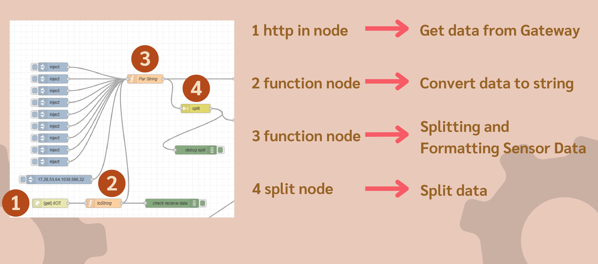

> **ภาพที่ 12** แผนภาพกระแสข้อมูลใน Node-RED  
ที่มา: Nunthasrithananon et al. (2024), p. 40.
> ที่มา: ดัดแปลงจาก Nunthasrithananon et al. (2024).

เอกสารต้นฉบับแยกบทบาทซอฟต์แวร์เป็นเลเยอร์ไว้แล้ว การแยกนั้นเป็นผลงานของผู้พัฒนาเดิม ไม่ใช่ของเล่มนี้

สิ่งที่เอกสารไม่ได้ทำคือผูกบทบาทแต่ละรายการกับข้อกำหนดที่บทบาทนั้นรองรับ จึงตอบไม่ได้ว่าถ้าถอดซอฟต์แวร์รายการใดออก ความต้องการข้อใดจะไม่ได้รับการตอบสนอง

การผูกดังกล่าวเกิดขึ้นในหัวข้อ 3.6.3 ซึ่งทำให้ InfluxDB กับ Firebase อยู่ใต้ DP-16 และ DP-17 ที่บรรลุผล SR-08 ส่วน Node-RED อยู่ใต้ DP-12 ที่บรรลุผล SR-06

### 3.5.6 คุณสมบัติเชิงสถาปัตยกรรมที่ได้จากการทำงานขนาน ซึ่งเอกสารไม่ได้ระบุ

| ขั้น | โหนดที่ใช้ | สิ่งที่ทำ |
|---|---|---|
| 1 รับสัญญาณเข้าเครือข่าย | http in แบบ GET | ดักรับชุดข้อมูลดิบจากเกตเวย์ |
| 2 แปลงรูปข้อมูล | to String แล้ว Par-String | แปลงสตริงเป็นโครงสร้าง JSON ภายใน msg.payload |
| 3 คัดแยกและจัดเส้นทาง | split แล้ว Switch Address Object | แยกข้อมูลที่ห่อรวมกันเป็นข้อความย่อยตามรายการพารามิเตอร์ แล้วจำแนกตามค่า Address ส่งไปโหนดฟังก์ชันย่อยของแต่ละอุปกรณ์ |
| 4 ก กระจายงานขนาน ทางบันทึก | google sheet แล้ว Send Google Sheet | จัดรูปแบบ แล้วบันทึกต่อท้ายแถวเดิมด้วยคำสั่ง Append Row |
| 4 ข กระจายงานขนาน ทางแจ้งเตือน | ฟังก์ชัน Line แล้ว http request | จับคู่ API Token แล้วส่งข้อความแจ้งเตือนเข้าแอปพลิเคชัน LINE |

**ตารางที่ 9-ก** สี่ขั้นของกระแสข้อมูลภายใน Node-RED

สี่ขั้นในตารางที่ 9-ก เป็นลำดับที่อ่านได้จากภาพที่ 12 โดยตรง จึงเป็นข้อมูลตั้งต้น

สิ่งที่เพิ่มขึ้นคือการอ่านขั้นที่สี่ว่าเป็นคุณสมบัติเชิงสถาปัตยกรรม การให้ทางบันทึกข้อมูลและทางแจ้งเตือนทำงานขนานกันทำให้สองทางไม่ขึ้นแก่กัน ความล้มเหลวของช่องทางแจ้งเตือนจึงไม่ทำให้ข้อมูลสูญหาย

คุณสมบัตินั้นมีค่าเมื่ออ่านคู่กับประเด็น F-09 ที่ว่า LINE Notify ยุติการให้บริการแล้ว กล่าวคือช่องทางแจ้งเตือนตายไปแล้วจริง แต่ข้อมูลยังครบ ซึ่งเป็นข้อสรุปที่เอกสารต้นฉบับไม่ได้ระบุ เพราะเอกสารบรรยายสองทางเป็นสองกระบวนการ ไม่ได้บรรยายเป็นคุณสมบัติของสถาปัตยกรรม

### 3.5.7 บริการภายนอกที่ต้องนับเป็นองค์ประกอบของสถาปัตยกรรม

| บริการ | ขั้นตอนตั้งค่า | แหล่งอ้างอิง |
|---|---|---|
| Google Sheets | สร้างตารางบนคลาวด์ เปิดสิทธิ์ใน Google Cloud Console สร้าง Service Account พร้อมกุญแจส่วนตัวเป็นไฟล์ JSON จับคู่ใน Credentials ของโหนด Google Sheets คัดลอกหมายเลขเอกสารจากลิงก์สเปรดชีต ตั้ง Method เป็น Append Row กำหนดขอบเขตเซลล์ แชร์สิทธิ์ให้บัญชีตัวแทน กำหนดหัวคอลัมน์ให้ตรงกับตัวแปรจากเซ็นเซอร์ และเตรียม Google Apps Script | Nunthasrithananon et al. (2024, pp. 67–75) |
| Firebase | สร้างโปรเจกต์ Web Application ติดตั้ง Firebase SDK เปิด Authentication สองช่องทาง คืออีเมลกับรหัสผ่าน และบัญชี Google ด้วยกลไก OAuth แล้วเปิด Firestore Database จัดโครงสร้างเป็น Collection, Document และ Field พร้อมกำหนด Rule จำกัดสิทธิ์ | Nunthasrithananon et al. (2024, pp. 80–88) |
| LINE Notify | เข้าสู่ระบบผ่านโดเมน notify-bot ขอออกรหัส Access Token ผูกชื่อ Token เข้ากับกลุ่ม LINE ปลายทาง ฝัง Token ในสคริปต์ของโหนดฟังก์ชันซึ่งประกอบรหัสเข้าฟิลด์ Authorization ของส่วนหัวคำขอ แล้วนำบัญชีบอทเข้ากลุ่มรับแจ้งเตือน | — |
| InfluxDB | จากเมนู Load Data สร้าง Bucket สำหรับข้อมูลอนุกรมเวลา สร้าง API Token กำหนดสิทธิ์ให้ซอฟต์แวร์ภายนอก แล้วนำค่า Bucket กับ API Token ไปตั้งในโหนด InfluxDB | Nunthasrithananon et al. (2024, pp. 92–96) |
| FileZilla | เข้าระบบจัดการไฟล์ผ่านโปรโตคอล FTP ด้วยพารามิเตอร์ที่คณะผู้จัดทำเล่มต้นฉบับกำหนด สร้างไดเรกทอรีฝั่งเซิร์ฟเวอร์ระยะไกล แล้วอัปโหลดชุดข้อมูลหรือรูปภาพไปปลายทาง เพื่อเรียกใช้ผ่านอินเทอร์เน็ตได้ | Nunthasrithananon et al. (2024, pp. 88–92) |

**ตารางที่ 9-ข** ขั้นตอนการตั้งค่าบริการภายนอกห้ารายการ

ขั้นตอนตั้งค่าทั้งห้ารายการยกมาจากเอกสารต้นฉบับ จึงเป็นข้อมูลตั้งต้นที่ผู้รับช่วงงานต่อใช้ตั้งระบบขึ้นใหม่ได้

สิ่งที่เพิ่มขึ้นคือการนับบริการภายนอกทั้งห้าเป็นองค์ประกอบของสถาปัตยกรรม ไม่ใช่เครื่องมือที่ใช้ตั้งค่า เมื่อนับเช่นนั้น คำถามที่ตามมาคือบริการใดยังให้บริการอยู่

คำถามนั้นเผยว่าหนึ่งในห้ารายการตายไปแล้ว คือ LINE Notify ตามประเด็น F-09 ระบบจึงเสื่อมสภาพลงเองแม้ไม่มีผู้ใดแก้โค้ด ซึ่งเป็นบทเรียนที่ตารางที่ 5-ฌ บันทึกไว้ที่ REV-OBJ-8

ข้อสรุปในทางปฏิบัติคือการทวนสอบสถานะบริการภายนอกต้องเป็นกิจกรรมประจำของการบำรุงรักษา ตามข้อเสนอแนะในหัวข้อ 5.3.2

### 3.5.8 การแก้ที่ปลายทางซึ่งเอกสารไม่ได้แยกค่าที่วัดได้ออกจากค่าที่เติม

| กระบวนการ | สิ่งที่ทำ |
|---|---|
| Clean Missing Data | ระบุตำแหน่งข้อมูลที่ขาดหายจากสภาวะ Network Dropout |
| Cubic Spline Interpolation | เติมช่องว่างด้วยสมการพหุนามกำลังสาม ให้เส้นโค้งต่อเนื่องและราบเรียบในระดับอนุพันธ์อันดับสอง (Nunthasrithananon et al., 2024, p. 20) |
| Clean Outlier Data | กำจัดข้อมูลที่เบี่ยงเบนผิดปกติจากสัญญาณรบกวนฉับพลัน |
| De-noise Data | ใช้ตัวกรองสัญญาณดิจิทัลลดทอนสัญญาณรบกวนความถี่สูง |

**ตารางที่ 9-ค** สี่กระบวนการปรับปรุงคุณภาพข้อมูลด้วย MATLAB

> **ภาพที่ 18** แผนภาพกระบวนการจัดการและประมวลผลข้อมูลด้วย MATLAB  
ที่มา: Nunthasrithananon et al. (2024), p. 45.

สี่กระบวนการในตารางที่ 9-ค ยกมาจากเอกสารต้นฉบับ รวมถึง Cubic Spline Interpolation ที่เติมช่องว่างด้วยสมการพหุนามกำลังสาม (Nunthasrithananon et al., 2024, p. 20)

สิ่งที่เพิ่มขึ้นคือการระบุว่าการเติมค่าเป็นการแก้ที่ปลายทาง ทำให้กราฟที่แสดงต่อเกษตรกรต่อเนื่อง แต่ไม่ได้ทำให้ข้อมูลที่สูญหายกลับคืนมา

คำถามที่การระบุนั้นบังคับให้ถามคือระบบแยกค่าที่วัดได้จริงออกจากค่าที่เติมเข้าไปในการแสดงผลหรือไม่ เอกสารต้นฉบับไม่ได้ระบุว่ามีการแยก จึงต้องรายงานเป็นช่องว่าง

ช่องว่างข้อนี้กระทบความต้องการ UR-02 โดยตรง เพราะเกษตรกรที่อ่านกราฟไม่มีทางทราบว่าค่าใดวัดได้จริง ซึ่งเป็นคำถามที่การอ่านเอกสารอย่างเดียวไม่เกิดขึ้น เพราะเอกสารบรรยายการเติมค่าเป็นขั้นตอนประมวลผล ไม่ได้บรรยายเป็นสิ่งที่ผู้ใช้ต้องทราบสถานะ

### 3.5.9 สิ่งที่การคำนวณตรวจทานเผย ซึ่งการอ่านเอาความอย่างเดียวเผยไม่ได้

หัวข้อนี้รายงานผลการปิดจุดประสงค์ทั้งแปดข้อในตารางที่ 5 โดยแต่ละข้อระบุว่าการนำข้อเท็จจริงของเอกสารมาคำนวณตรวจทานหรือมาวางเทียบกัน เผยสิ่งใดที่ข้อความในเอกสารไม่ได้บอก ประเด็นที่ได้จากหัวข้อนี้สิบสี่ประเด็นเป็นฐานของการเปรียบเทียบในหัวข้อ 4.1.4

**REV-OBJ-1 ความผิดพลาดของงบลิงก์ที่การคำนวณตรวจทานเผย**

ข้อกังวลคือสัญญาณต้องครอบคลุมพื้นที่เกษตรขนาดใหญ่ที่มีสิ่งกีดขวางหนาแน่นจากต้นทุเรียน และโครงสร้างเดิมเป็นแบบจุดต่อจุดซึ่งยากต่อการบริหารข้อมูลจากหลายจุดพร้อมกัน

ขั้นออกแบบกำหนดกำลังส่ง 17 dBm ซึ่งเป็นค่าตั้งต้นของโมดูล ESP32 SX1278 ใช้เสาอากาศ 5 dBi ทั้งสองด้าน แล้วคำนวณกำลังภาครับเชิงทฤษฎีที่ระยะ 400 เมตรได้ -40.8 dBm (Nunthasrithananon et al., 2024, p. 34) เทียบกับความไวในการรับสัญญาณที่เล่มเดิมระบุไว้ -130 dBm จึงสรุปว่าที่ระยะ 400 เมตรยังรับสัญญาณได้ดี

| พารามิเตอร์ | สถานีเซ็นเซอร์ | เกตเวย์ |
|---|---|---|
| เสาอากาศ | 5 dBi | 5 dBi |
| ความถี่ | 433 MHz | 433 MHz |
| กำลังส่ง | 17 dBm (ค่าตั้งต้น ESP32 SX1278) | 17 dBm (ค่าตั้งต้น ESP32 SX1278) |
| กำลังภาครับเชิงทฤษฎีที่ 400 เมตร | -40.8 dBm | -40.8 dBm |

**ตารางที่ 10** ค่าคำนวณเชิงทฤษฎีของการรับ-ส่งสัญญาณ LoRa ตามเล่มเดิม  
ที่มา: Nunthasrithananon et al. (2024, p. 34).

| ระยะทาง | Packet Loss | ค่าเฉลี่ย RSSI | ค่าเฉลี่ย SNR | ช่วงที่ค่าเกาะกลุ่ม | แหล่งอ้างอิง |
|---|---|---|---|---|---|
| 60 เมตร | 0% (ครบ 50 จุด) | -46.7 dBm | 9.8 dB | RSSI -45 ถึง -49 dBm, SNR 9 ถึง 11 dB | Nunthasrithananon et al. (2024, p. 140) |
| 400 เมตร | 4% (48 จาก 50 จุด) | -84.16 dBm | 6.466 dB | RSSI -85 ถึง -95 dBm, SNR 5 ถึง 9 dB | Nunthasrithananon et al. (2024, p. 137) |

**ตารางที่ 11** ผลการวัดคุณภาพสัญญาณ LoRa ที่ระยะ 60 เมตรและ 400 เมตร

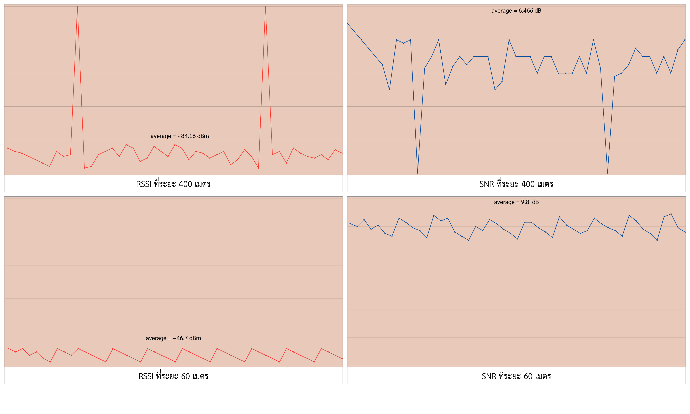

> **ภาพที่ 19** ภาพรวมผลการวัดคุณภาพสัญญาณ LoRa ทั้งค่า RSSI และ SNR ที่ระยะ 60 เมตรและ 400 เมตร  
ที่มา: Nunthasrithananon et al. (2024), pp. 21, 22, 29, 30.
> ที่มา: Nunthasrithananon et al. (2024).

> ที่มา: Nunthasrithananon et al. (2024).

> ที่มา: Nunthasrithananon et al. (2024).

> ที่มา: Nunthasrithananon et al. (2024).

ที่ระยะ 400 เมตร ค่า RSSI เกาะกลุ่ม -85 dBm ถึง -95 dBm ซึ่งเป็นเกณฑ์ปานกลางสำหรับ LoRa และ SNR อยู่ในเกณฑ์บวก 5 dB ถึง 9 dB สัญญาณข้อมูลจึงยังเด่นชัดเหนือสัญญาณรบกวน

ที่ตำแหน่งข้อมูล 11 และ 38 ค่า RSSI ขึ้นไปที่ 0 dBm และ SNR ตกลงมาที่ 0 dB อย่างฉับพลัน เป็นหลักฐานของ Packet Loss จากการรบกวนกันของคลื่นหรือการบดบังทางกายภาพในช่วงเสี้ยววินาที เป็นเหตุให้ต้องพึ่งอัลกอริทึม Cubic Spline Interpolation อัตราความสำเร็จคำนวณได้เป็น (48 / 50) × 100% = 96%

ที่ระยะ 60 เมตร ความแรงสัญญาณอยู่ในช่วง -45 dBm ถึง -49 dBm ซึ่งค่าที่สูงกว่า -50 dBm จัดเป็นสัญญาณแรงสูง เส้นกราฟแกว่งเป็นรอบคาบสม่ำเสมอ อัตราการสูญหายของข้อมูลเป็นศูนย์ครบทั้ง 50 จุด และ SNR เกาะกลุ่ม 9 dB ถึง 11 dB ตัวรับฝั่งเกตเวย์จึงถอดรหัสได้สมบูรณ์โดยไม่ต้องส่งซ้ำ

การเทียบสองระยะให้ข้อสรุปเชิงสถาปัตยกรรมว่าที่ระยะ 60 เมตรข้อมูลดิบวิ่งเข้าฐานข้อมูลได้โดยตรงโดยไม่ต้องเติมค่า ขณะที่ระยะ 400 เมตรต้องพึ่งการเติมค่าทางคณิตศาสตร์ ระยะทางจึงเป็นตัวกำหนดว่าสถาปัตยกรรมต้องมีองค์ประกอบการประมวลผลข้อมูลเพิ่มขึ้นหรือไม่

การตรวจทานการคำนวณงบลิงก์โดยผู้จัดทำพบสามประเด็น

ค่ากำลังภาครับเชิงทฤษฎี -40.8 dBm อ่อนกว่าค่าเฉลี่ย RSSI ที่วัดได้จริงที่ระยะเดียวกันที่ -84.16 dBm ถึงประมาณ 43 dB ส่วนต่างนี้สะท้อนผลของทรงพุ่มต้นไม้และภูมิประเทศที่ไม่เป็นแนวสายตาตรง ซึ่งแบบจำลองการสูญเสียกำลังในอวกาศว่างไม่ได้พิจารณา (Rappaport, 2002) บันทึกเป็นประเด็น F-01

ขั้นตอนการคำนวณในเล่มต้นฉบับหักลบอัตราขยายของเสาอากาศทั้งสองด้านออกจากค่า Path Loss ไปแล้วครั้งหนึ่ง จาก 77.2 dB เหลือ 67.2 dB ก่อนบวกอัตราขยายภาคส่งและภาครับเพิ่มอีกครั้งในสมการ จึงนับผลของอัตราขยายซ้ำสองครั้ง หากไม่นับซ้ำจะได้ค่าทางทฤษฎี -50.6 dBm บันทึกเป็นประเด็น F-02

เอกสารเดิมระบุความไวในการรับสัญญาณ -130 dBm ขณะที่เอกสารข้อมูลผู้ผลิตระบุความไวสูงสุด -148 dBm ซึ่งขึ้นกับการตั้งค่า Spreading Factor และ Bandwidth (Semtech Corporation, 2020) บันทึกเป็นประเด็น F-03

ผลการสอบเทียบเซ็นเซอร์ 7 in 1 Soil Sensor ซึ่งวัดความชื้น อุณหภูมิ ค่าการนำไฟฟ้า ความเป็นกรด-ด่าง และค่า NPK ในดิน แสดงดังภาพที่ 23 (Nunthasrithananon et al., 2024, pp. 104–125, 141–143)

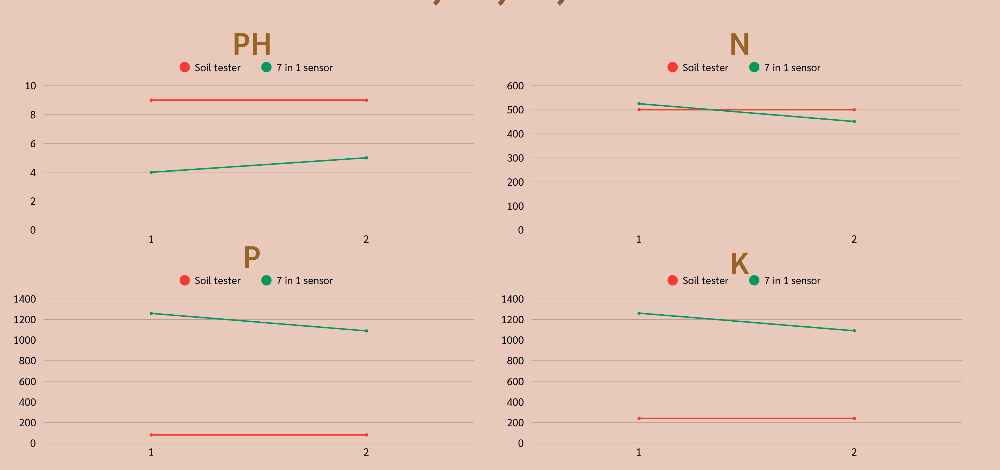

> **ภาพที่ 23** ผลการสอบเทียบเซ็นเซอร์ 7 in 1 Soil Sensor สี่พารามิเตอร์ในดิน คือ pH ไนโตรเจน ฟอสฟอรัส และโพแทสเซียม  
ที่มา: Nunthasrithananon et al. (2024), p. 101.
> ที่มา: Nunthasrithananon et al. (2024).

> ที่มา: Nunthasrithananon et al. (2024).

> ที่มา: Nunthasrithananon et al. (2024).

> ที่มา: Nunthasrithananon et al. (2024).

> ที่มา: Nunthasrithananon et al. (2024).

> ที่มา: Nunthasrithananon et al. (2024).

> ที่มา: Nunthasrithananon et al. (2024).

**REV-OBJ-2 ต้นทุนการถือครองที่เอกสารไม่ได้ประเมินไว้**

ข้อกังวลคืองบประมาณจัดหาอุปกรณ์และความคุ้มค่าในการติดตั้ง ซึ่งต้องประหยัดและให้สมรรถนะสูงพร้อมกัน

| รายการชิ้นส่วนประกอบ | ราคาประเมินต่อหน่วย (บาท) |
|---|---|
| โมดูล LoRa SX1278 | 175 |
| เสาอากาศ Antenna 5 dBi | 120 |
| ไมโครคอนโทรลเลอร์ ESP32S | 200 |
| เซ็นเซอร์อุณหภูมิ/ความชื้น/ความดัน BME 280 | 200 |
| เซ็นเซอร์อุณหภูมิอากาศ SHT 30 | 100 |
| เซ็นเซอร์วัดค่าดิน 7 in 1 Soil Sensor | 1,500 |
| เซ็นเซอร์ความเร็วลม WSS004 | 1,800 |
| แผงโซลาร์เซลล์ 6V 6W | 300 |
| ตัวควบคุมการชาร์จ CN3971 MPPT Charger | 250 |
| วงจรเพิ่มแรงดัน MT3608 (5V เป็น 12V) | 50 |
| วงจรลดแรงดัน AMS1117 (12V เป็น 5V) | 100 |
| โมดูลแปลงข้อมูล Isolated UART TTL to RS485 | 100 |
| แบตเตอรี่ 18650 3.7V 12.7Ah | 400 |

**ตารางที่ 12** รายการชิ้นส่วนอุปกรณ์และราคาประเมินต่อหน่วย  
ที่มา: ราคาต่อชิ้นบางรายการจาก Tuntawisut et al. (2024, ภาคผนวกงบประมาณ).

> ที่มา: Nunthasrithananon et al. (2024, p. 39).

> ที่มา: Nunthasrithananon et al. (2024, p. 39).

> ที่มา: Nunthasrithananon et al. (2024, p. 40).

อุปกรณ์หลักเป็นอุปกรณ์ระดับผู้พัฒนาที่มีจำหน่ายทั่วไป สอดคล้องกับการควบคุมงบประมาณ และการออกแบบวงจรดังภาพที่ 8 ลดความซับซ้อนของระบบจ่ายไฟ ทำให้ต้นทุนรวมต่อหน่วยต่ำลง

ค่าใช้จ่ายระหว่างใช้งานและค่าบำรุงรักษาซึ่งเอกสารต้นฉบับไม่ได้ประเมินไว้ ผู้จัดทำประมาณการขึ้นดังตารางที่ 13 โดยระบุสถานะของแต่ละรายการกำกับไว้

| รายการค่าใช้จ่าย | ประมาณการ | สถานะข้อมูล |
|---|---|---|
| ค่าเสื่อมสภาพแบตเตอรี่ 18650 ในสภาพอากาศร้อนของสวนทุเรียน ควรเปลี่ยนทุก 1.5–2 ปี | ประมาณ 400 บาทต่อชุด | ประมาณการโดยผู้จัดทำ |
| ค่าทำความสะอาดเซ็นเซอร์และแผงโซลาร์เซลล์จากคราบฝุ่นและสารเคมีตกค้าง | ประมาณ 100–200 บาทต่อปี | ประมาณการโดยผู้จัดทำ |
| ค่าบริการ Firebase หากขยายจำนวนผู้ใช้งานหรืออุปกรณ์เกินกว่า Free Tier | ประมาณ 300–1,500 บาทต่อปี | ประมาณการโดยผู้จัดทำ |
| ค่าอินเทอร์เน็ตสำหรับเกตเวย์ หากติดตั้งในพื้นที่ที่ไม่มีสัญญาณ Wi-Fi ครอบคลุม | ประมาณ 1,200–2,400 บาทต่อปี | ประมาณการโดยผู้จัดทำ |
| ค่าเดินทางลงพื้นที่ตรวจสอบหน้างานกรณีแก้ไขทางไกลไม่ได้ | ประมาณ 500–1,000 บาทต่อครั้ง | ประมาณการโดยผู้จัดทำ |
| ค่าแรงช่างเทคนิคกรณีเกษตรกรเปลี่ยนอะไหล่เองไม่ได้ | ประมาณ 300–500 บาทต่อวัน | ประมาณการโดยผู้จัดทำ |

**ตารางที่ 13** ประมาณการค่าใช้จ่ายระหว่างใช้งานและค่าบำรุงรักษา

เอกสารต้นฉบับประเมินเฉพาะต้นทุนการจัดหา ไม่ได้ประเมินต้นทุนการถือครองตลอดอายุการใช้งาน ขณะที่ความต้องการของเกษตรกรในหัวข้อ 3.6.1 ครอบคลุมทั้งการลงทุนครั้งแรกและภาระค่าใช้จ่ายระหว่างใช้งาน ช่องว่างนี้ต้องรายงานไว้

ตัวเลขในตารางที่ 13 เป็นประมาณการที่ยังไม่ได้ยืนยันด้วยข้อมูลจริง ใช้วางแผนได้ แต่อ้างอิงเป็นต้นทุนจริงไม่ได้

**REV-OBJ-3 ตัวเลขพลังงานที่ตรวจทานแล้วไม่สอดคล้องกันทั้งชุด**

ข้อกังวลคือความต่อเนื่องในการสื่อสารและความทนทานของอุปกรณ์ต่อสภาพแวดล้อม ร่วมกับการใช้งานที่ยังไม่ครอบคลุม 24 ชั่วโมง

เอกสารต้นฉบับระบุว่าระบบจ่ายพลังงานได้ 31.7821 Wh คิดเป็นใช้งานต่อเนื่องประมาณ 16 ชั่วโมงนับจากชาร์จเต็ม ต่ำกว่าเป้าหมาย 24 ชั่วโมง แนวทางปรับปรุงที่เสนอคือเพิ่มความจุแบตเตอรี่หรือกำลังของแผงโซลาร์เซลล์ (Tuntawisut et al., 2024)

P = V × I (สมการที่ 1)

แทนค่าในสมการที่ 1 ได้ P = 11.32 × 0.21 = 2.3772 W

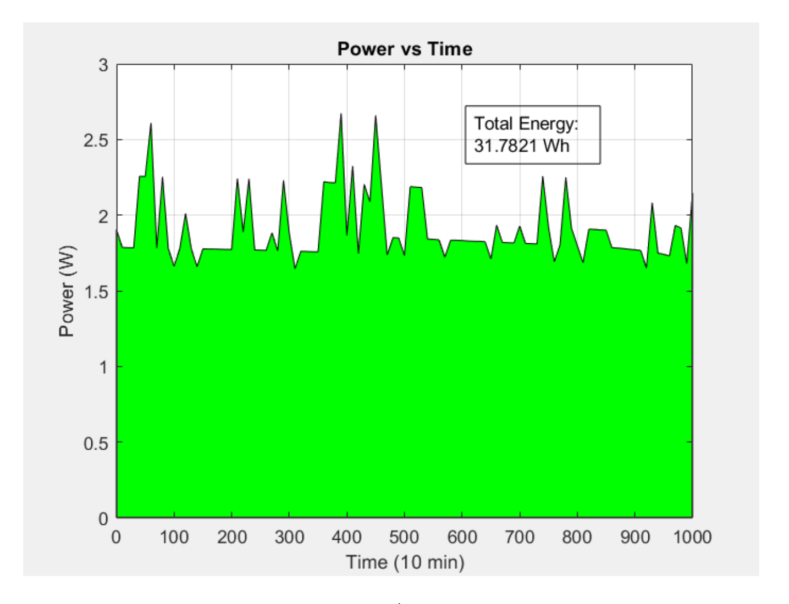

> **ภาพที่ 33** ผลการจ่ายพลังงานของแบตเตอรี่  
ที่มา: Tuntawisut et al. (2024), p. 105.

เอกสารต้นฉบับระบุสเปกแบตเตอรี่ไม่ตรงกัน ระหว่างส่วนการทดลองซึ่งระบุ 12V 12Ah กับรายการงบประมาณซึ่งระบุ 18650 3.7V 12.7Ah บันทึกเป็นประเด็น F-04

พลังงานที่จ่ายได้ 31.7821 Wh หารด้วยกำลังไฟฟ้า 2.3772 W ได้ประมาณ 13.4 ชั่วโมง ไม่ตรงกับ 16 ชั่วโมงที่รายงานไว้ ส่วนต่างอาจอธิบายด้วยพลังงานที่แผงโซลาร์เซลล์เติมเข้าระหว่างวัน แต่เอกสารต้นฉบับไม่ได้ระบุเงื่อนไขการทดสอบ จึงยืนยันไม่ได้ บันทึกเป็นประเด็น F-05

ข้อสรุปเรื่องระยะเวลาใช้งานต่อเนื่องจึงมีน้ำหนักในฐานะค่าที่รายงานไว้ในเอกสารต้นฉบับ ไม่ใช่ค่าที่ตรวจทานแล้วสอดคล้องกันทั้งชุด ส่วนข้อเท็จจริงที่ 16 ชั่วโมงต่ำกว่าเป้าหมาย 24 ชั่วโมง บันทึกเป็นประเด็น F-06

ผลการสอบเทียบค่าธาตุอาหารในดินคลาดเคลื่อนสูงตามหัวข้อ 3.6.2 บันทึกเป็นประเด็น F-07

ผลการทดลอง 50 ครั้งในระดับเกตเวย์พบอัตราความสำเร็จประมาณ 94% คลาดเคลื่อนประมาณ 6% จากสภาพแวดล้อม สิ่งกีดขวาง อาคาร และภูมิประเทศ ตัวเลขนี้ต้องแยกจากอัตราความสำเร็จ 96% ของลิงก์ LoRa ที่ระยะ 400 เมตรในตารางที่ 11 เพราะวัดที่จุดต่างกันในเส้นทางเดินของข้อมูล

เซิร์ฟเวอร์ล่มเป็นบางช่วง ทำให้ข้อมูลและการแจ้งเตือนเป็นข้อมูลเก่า ผู้จัดทำเอกสารต้นฉบับเสนอให้ย้ายไปเซิร์ฟเวอร์ที่เสถียรกว่า เช่น เซิร์ฟเวอร์ของมหาวิทยาลัยหรือบริการคลาวด์ของผู้ให้บริการโทรคมนาคม บันทึกเป็นประเด็น F-11

เกษตรกรบางรายถอดปลั๊กหรือสายไฟของเกตเวย์โดยไม่เข้าใจระบบ ทำให้ระบบหยุดทำงาน แนวทางแก้ที่เสนอคือติดป้ายอธิบาย ให้ความรู้ผู้ใช้งาน และออกแบบกล่องอุปกรณ์ให้ปิดสนิท บันทึกเป็นประเด็น F-17

**REV-OBJ-4 คุณลักษณะที่ไม่ถูกประกาศเป็นข้อกำหนด จึงตรวจไม่พบว่าขาด**

เอกสารต้นฉบับให้ข้อเท็จจริงสองข้อที่เอื้อต่อการบำรุงรักษา คือ ESP32S กับโมดูล LoRa SX1278 หาทดแทนได้ง่ายและราคาต่ำ และ Node-RED แก้จุดจัดเก็บข้อมูลได้โดยไม่ต้องแก้เฟิร์มแวร์

สองข้อนั้นเป็นผลพลอยได้ของการแยกความรับผิดชอบที่จุดส่งคำขอ HTTP ตามหัวข้อ 3.5.1 ไม่ใช่ผลของการออกแบบเพื่อการบำรุงรักษา เพราะเอกสารไม่ได้ประกาศความต้องการด้านนี้ไว้เลย

ผลที่ตามมาคือจุดประสงค์ข้อนี้ปิดไม่ได้ และตารางที่ 20 ไม่มีประเด็นใดในด้านนี้ ไม่ใช่เพราะระบบไม่มีปัญหา หากเพราะไม่มีเกณฑ์ให้เทียบ ซึ่งเป็นบทเรียนที่ตารางที่ 5-ฌ บันทึกไว้

ช่องว่างนี้ถูกปิดในรอบที่สองด้วย SR-10 ซึ่งประกาศการนำสถานีกลับมาใช้งานเป็นข้อกำหนด จึงมีเกณฑ์ให้เทียบตั้งแต่นั้น

**REV-OBJ-5 ความสามารถที่รายงานไว้ ไม่ใช่ความสามารถที่มีจริง**

เอกสารต้นฉบับรายงานคุณสมบัติที่เอื้อต่อการขยายระบบไว้สามประการ การนำสามประการนั้นมาวางเทียบกับโครงสร้างการสื่อสารเผยว่าทั้งสามอยู่ในระดับซอฟต์แวร์ทั้งหมด

Node-RED เป็นตัวกลาง ทำให้ขยายช่องทางส่งข้อมูลไปยังฐานข้อมูลหรือระบบแจ้งเตือนอื่นได้โดยไม่กระทบสถาปัตยกรรมหลัก

NuxtJS รองรับการออกแบบเชิงโมดูล จึงเพิ่มกราฟหรือตารางสำหรับเซ็นเซอร์ชนิดใหม่ได้ง่าย

รูปแบบการส่งข้อมูลแบบข้อความคั่นด้วยจุลภาค ทำให้เพิ่มชนิดเซ็นเซอร์ใหม่เข้าชุดข้อมูลได้ง่าย

คุณสมบัติทั้งสามอยู่ในระดับซอฟต์แวร์ทั้งหมด ขณะที่ข้อจำกัดที่แท้จริงอยู่ในระดับสถาปัตยกรรมการสื่อสาร เพราะโครงสร้างแบบจุดต่อจุดตามหัวข้อ 3.5.9 ที่ REV-OBJ-1 ทำให้การเพิ่มโหนดจำนวนมากต้องแก้ตรรกะการจำแนก Address ที่เกตเวย์และที่ Node-RED

ความสามารถในการขยายระบบที่รายงานไว้ในเอกสารต้นฉบับจึงเป็นความสามารถในการขยายช่องทางปลายทาง ไม่ใช่การขยายจำนวนโหนดต้นทาง

**REV-OBJ-6 การป้องกันระดับเครือข่ายที่ถูกนับเป็นการป้องกันระดับข้อมูล**

ข้อกังวลคือความเสี่ยงจากการเข้าถึงข้อมูลโดยไม่ได้รับอนุญาต และการสูญหายของข้อมูลเมื่ออุปกรณ์หน้างานชำรุดจากสภาพแวดล้อม

ระบบเดิมใช้คลาวด์จัดเก็บข้อมูลแทนการเก็บไว้ที่ตัวอุปกรณ์เพียงอย่างเดียว โดยใช้ InfluxDB ร่วมกับ Google Sheets เกษตรกรจึงเข้าถึงข้อมูลย้อนหลังได้แม้อุปกรณ์หน้างานเสียหาย

เกตเวย์ตรวจว่าข้อมูลที่รับจาก LoRa เป็นตัวเลขที่ถูกต้องหรือไม่ก่อนนำไปบันทึก

หน้าแดชบอร์ดจัดการสิทธิ์ด้วย Firebase Authentication โดยผู้ดูแลระบบสร้างบัญชีผู้ใช้งานเอง

ช่องโหว่ที่ยังไม่ได้แก้อยู่ที่การส่งข้อมูลจากเกตเวย์ไปเซิร์ฟเวอร์ ซึ่งใช้การเชื่อมต่อ TCP ธรรมดาผ่าน WiFiClient โดยไม่มีการเข้ารหัส ไม่ใช่ HTTPS หรือ TLS บันทึกเป็นประเด็น F-08

มาตรการที่ระดับเกตเวย์อาศัยเพียงชื่อเครือข่ายและรหัสผ่านของ Wi-Fi ซึ่งเป็นการป้องกันระดับเครือข่าย ไม่ใช่ระดับข้อมูล ข้อสรุปคือระบบเดิมป้องกันฝั่งการแสดงผลได้ค่อนข้างดี แต่ไม่มีมาตรการป้องกันฝั่งการส่งผ่านข้อมูล

**REV-OBJ-7 ความซับซ้อนที่เป็นราคาของสมรรถนะ ไม่ใช่ความบกพร่อง**

ข้อกังวลคือความล่าช้าในการเชื่อมต่อจากฮาร์ดแวร์หน้างานไปยังซอฟต์แวร์บนคลาวด์ ซึ่งกระทบการตัดสินใจแบบเวลาจริง และความยุ่งยากในการติดตั้งเสาสัญญาณ ซึ่งกระทบต้นทุนแรงงานและความเสี่ยงในการเชื่อมต่อผิดพลาด

ระบบต้องอาศัยการพัฒนาข้ามหลายเทคโนโลยีพร้อมกัน ได้แก่ เฟิร์มแวร์ ESP32 และ LoRa ด้วยภาษา C++ การเขียนกระแสข้อมูลเชิงภาพบน Node-RED ภาษา Flux สำหรับ InfluxDB รุ่น 2.0 กรอบงาน NuxtJS และ Vue.js สำหรับส่วนหน้า และ Firebase สำหรับระบบยืนยันตัวตน

ภาษา Flux ของ InfluxDB รุ่น 2.0 ไม่เข้ากันกับภาษา InfluxQL รุ่นก่อนหน้า บันทึกเป็นประเด็น F-16

ในทางกลับกัน InfluxDB เพิ่มสมรรถนะในการเขียนและอ่านข้อมูลจำนวนมากได้รวดเร็ว ความซับซ้อนที่เพิ่มขึ้นจึงเป็นราคาที่จ่ายไปเพื่อสมรรถนะ ไม่ใช่ความซับซ้อนที่ไม่มีเหตุผลรองรับ

**REV-OBJ-8 เหตุผลที่สันนิษฐานย้อนหลังได้ และขอบเขตที่สันนิษฐานไม่ได้**

ข้อกังวลคือความเหมาะสมของเทคโนโลยีที่เลือกใช้ ในกรณีที่ Wi-Fi หรือ Bluetooth ตอบโจทย์พื้นที่เกษตรกรรมที่มีอุปสรรคทางกายภาพสูงไม่ได้ ผลการวิเคราะห์สันนิษฐานเหตุผลได้สามข้อจากหลักฐานที่ปรากฏ

ซอฟต์แวร์โอเพนซอร์สอย่าง Node-RED และ InfluxDB ร่วมกับบริการคลาวด์ที่มีระดับใช้งานฟรีอย่าง Firebase และฮาร์ดแวร์ต้นทุนต่ำอย่าง ESP32 และ LoRa SX1278 ตอบทั้งสมรรถนะและงบประมาณที่เกษตรกรเข้าถึงได้

สวนทุเรียนมีใบและลำต้นหนาแน่น ซึ่งลดทอนสัญญาณความถี่สูงอย่าง Wi-Fi ได้ง่าย แต่ LoRa ทำงานบนความถี่ต่ำจึงผ่านสิ่งกีดขวางได้ดีกว่า

หากใช้โครงข่ายโทรศัพท์เคลื่อนที่ ทุกโหนดต้องเสียค่าบริการซิมการ์ดรายเดือน แต่ LoRa ทำให้สร้างเครือข่ายส่วนตัวที่มีเกตเวย์เพียงจุดเดียวเชื่อมต่ออินเทอร์เน็ต

ข้อสรุปทั้งสามเป็นการสันนิษฐานของผู้จัดทำจากหลักฐานที่ปรากฏ ไม่ใช่คำยืนยันของผู้ออกแบบเดิม เพราะเอกสารต้นฉบับบันทึกผลของการตัดสินใจไว้แต่ไม่ได้บันทึกกระบวนการเปรียบเทียบทางเลือก จึงอาจถูกหักล้างได้หากพบบันทึกการประชุมหรือเอกสารการตัดสินใจเพิ่มเติม

### 3.5.10 การวิเคราะห์เชิงปฏิบัติการและกระบวนการทบทวนความถูกต้อง

หัวข้อนี้วิเคราะห์ความสอดคล้องระหว่างการออกแบบทางเทคนิคกับการใช้งานจริง โดยอ้างอิง ARCADIA ระดับที่หนึ่งและมาตรฐาน ISO/IEC/IEEE 15288

**ผลการวิเคราะห์เชิงปฏิบัติการ (ARCADIA ระดับที่หนึ่ง)**

จุดอ่อนที่สุดของระบบไม่ได้อยู่ที่สมรรถนะของเทคโนโลยีสื่อสาร แต่อยู่ที่สมมติฐานเรื่องพฤติกรรมผู้ใช้ซึ่งไม่เคยถูกระบุเป็นข้อกำหนด

แม้ LoRa มีอัตราความสำเร็จประมาณ 94% จากการทดลอง 50 ครั้งในระดับเกตเวย์ แต่เมื่อเกษตรกรถอดสายไฟของเกตเวย์ ระบบก็ยังหยุดทำงานทั้งระบบ

ระบบเดิมซับซ้อนในการใช้งานมากพอที่ภาระงานของเกษตรกรไม่ลดลงตามเจตนาของระบบอัตโนมัติ

การวิเคราะห์ระดับนี้ทำให้ต้องเปลี่ยนคำถามตั้งต้นของการออกแบบ จากคำถามว่าระบบต้องส่งข้อมูลอะไร เป็นคำถามว่าผู้ใช้ต้องการบรรลุภารกิจใด

เมื่อภารกิจของเกษตรกรคือการดูแลทุเรียนได้อย่างต่อเนื่อง การออกแบบจึงต้องมีระบบสำรองไฟหรือโครงสร้างป้องกันการรบกวนตั้งแต่ต้น ไม่ใช่เพิ่มการแจ้งเตือนเมื่อระบบหยุดทำงานแล้ว ข้อสรุปนี้ยังต้องยืนยันด้วยการทดสอบในสนาม

**กระบวนการยืนยันความถูกต้องและการรับรองความสมเหตุสมผล**

ตามมาตรฐาน ISO/IEC/IEEE 15288 (ISO/IEC/IEEE, 2023) การทวนสอบ (Verification) ตอบว่าระบบถูกสร้างถูกต้องตามข้อกำหนดหรือไม่ ส่วนการรับรองความถูกต้อง (Validation) ตอบว่าระบบที่สร้างขึ้นถูกต้องตามเจตนาของผู้ใช้หรือไม่

การแยกสองคำถามนี้สำคัญต่อกรณีศึกษานี้ เพราะระบบเดิมผ่านคำถามแรกในหลายด้าน แต่ไม่ผ่านคำถามที่สองในด้านที่ภาระงานของเกษตรกรไม่ลดลง

การทวนสอบแบบจำลองที่จัดทำขึ้นใช้ฟีเจอร์ Model Validation ร่วมกับการตรวจความครบถ้วนของการสืบย้อนกลับตามเกณฑ์ที่ตกลงไว้ล่วงหน้า รอบแรกพบความสัมพันธ์ที่ขาดหายหรือไม่มีปลายทาง ซึ่งแก้ไขครบแล้วและบันทึกเป็นประเด็น F-12 รายละเอียดอยู่ในหัวข้อ 3.7.1

การรับรองความถูกต้องของระบบเดิมต้องดำเนินสามด้าน ทั้งสามเป็นข้อเสนอที่ยังไม่ได้ดำเนินการ เพราะอยู่นอกขอบเขตตามหัวข้อ 1.3.3

การรับรองตามบริบทการใช้งาน ทดสอบความทนทานต่อพฤติกรรมผู้ใช้ เช่น ประเมินว่าป้ายเตือนและกล่องอุปกรณ์ที่ปิดสนิทลดอัตราการถอดสายไฟได้จริงหรือไม่

การรับรองความน่าเชื่อถือ ยืนยันความต่อเนื่องของข้อมูลบนคลาวด์แม้เครือข่ายขัดข้อง

การรับรองความสามารถในการใช้งาน ประเมินการเข้าถึงข้อมูลผ่านช่องทางที่เกษตรกรคุ้นเคย

## 3.6 ข้อกำหนดที่สร้างขึ้นจากหลักฐาน และตัววัดที่ทำให้ตัดสินได้ว่าผ่าน

จากผลการวิเคราะห์รอบที่หนึ่งในหัวข้อ 3.5.9 ผู้จัดทำวิเคราะห์ความต้องการซ้ำในรอบที่สอง เพื่อสร้างข้อกำหนดสามระดับ คือข้อกำหนดความต้องการของผู้ใช้ ข้อกำหนดความต้องการของระบบ และจุดตัดสินใจออกแบบ พร้อมผูกประเด็นที่พบระหว่างการพัฒนาไว้กับข้อกำหนดที่เกี่ยวข้อง โดยอ้างอิงกรอบข้อกำหนดจากบันทึกการสำรวจความต้องการและประเด็นที่พบระหว่างโครงการ (วรเชษฐ์ เจริญสวัสดิ์, การสื่อสารส่วนบุคคล, 20 พฤษภาคม 2569)

มุมมองที่ใช้เขียนหัวข้อนี้คือการวิเคราะห์เชิงปฏิบัติการและการวิเคราะห์ระบบ ผู้อ่านเป้าหมายคือเกษตรกรและนักพัฒนา

ข้อกำหนดทั้งสามระดับเป็นการสันนิษฐานย้อนหลังจากหลักฐานที่ปรากฏ ไม่ใช่ข้อกำหนดที่ผู้พัฒนาเดิมประกาศไว้เป็นลายลักษณ์อักษรก่อนเริ่มพัฒนา สถานะจึงเป็นข้อกำหนดที่สร้างขึ้นจากหลักฐาน (Recovered Requirements) ตามนิยามในหัวข้อ 1.6.2

### 3.6.1 สร้างข้อกำหนดความต้องการของผู้ใช้ (User Requirement) เชิงคุณภาพ

ข้อกำหนดระดับนี้ระบุความต้องการขั้นต้นของเกษตรกร พร้อมประเด็นที่แสดงว่าความต้องการข้อนั้นยังไม่ได้รับการตอบสนองอย่างสมบูรณ์

UR-01 การเฝ้าระวังและการตัดสินใจระยะไกล เกษตรกรต้องการตรวจสอบสภาพแวดล้อมในสวนทั้งน้ำ ปุ๋ย และสภาพอากาศ เพื่อตัดสินใจโดยไม่ต้องลงพื้นที่ตลอดเวลา ประเด็นที่พบคือเกษตรกรถอดสายไฟของเกตเวย์โดยไม่ทราบผลที่ตามมา ความต้องการข้อนี้จึงขึ้นอยู่กับความต่อเนื่องของเกตเวย์ ซึ่งเป็นจุดเดียวที่ล้มเหลวได้ทั้งระบบ

UR-02 การใช้งานที่ง่ายและข้อมูลที่อ่านเข้าใจง่าย เกษตรกรไม่มีความรู้ทางเทคนิคเชิงลึก จึงต้องการหน้าจอที่ใช้งานง่ายและอ่านผลเข้าใจได้ทันที ประเด็นที่พบคือเกษตรกรบางรายใช้งานเว็บไซต์ไม่ชำนาญ และเสนอให้ปรับเป็นภาษาไทย ตัวอักษรขนาดใหญ่ และโทนสีที่อ่านง่าย คุณลักษณะของผู้ใช้จึงเป็นข้อกำหนดเชิงหน้าที่ ไม่ใช่การตกแต่งที่ปรับภายหลังได้โดยไม่กระทบสถาปัตยกรรม

UR-03 การรับรู้สภาพที่เป็นผลเสียอย่างทันท่วงที เกษตรกรต้องการแจ้งเตือนทันทีเมื่อสภาพแวดล้อมเข้าสู่สภาวะที่เป็นผลเสีย เช่น อุณหภูมิสูงเกินเกณฑ์ ข้อสังเกตคือการแจ้งเตือนผ่านแอปพลิเคชันแชทส่งมาเป็นข้อความตัวอักษรทั่วไป หากเกษตรกรไม่เปิดเสียงแจ้งเตือนหรือไม่เปิดดูหน้าจอบ่อย ก็จะไม่รับรู้สภาวะวิกฤตได้ทันในกรณีฉุกเฉิน

UR-04 ความคุ้มค่าในการลงทุนครั้งแรกและภาระค่าใช้จ่ายระหว่างใช้งาน เกษตรกรต้องการระบบที่มีต้นทุนเข้าถึงได้ เพราะผลิตภัณฑ์เชิงพาณิชย์ราคาสูงและมีค่าใช้จ่ายแฝง ประเด็นที่พบคือเซิร์ฟเวอร์คลาวด์แบบเดิมมีค่าใช้จ่ายรายเดือนสูงเกินไป เป็นที่มาโดยตรงของจุดตัดสินใจย้ายไปใช้เซิร์ฟเวอร์ภายในตามหัวข้อ 3.6.3

### 3.6.2 สร้างข้อกำหนดความต้องการของระบบ (System Requirement) เชิงปริมาณ

ข้อกำหนดระดับนี้บอกว่าระบบต้องทำอะไร แบบจำลองประกาศไว้สิบข้อ รหัส SR-01 ถึง SR-10 ดังตารางที่ 13-ก

| รหัส | ข้อกำหนดของระบบ | ความต้องการของผู้ใช้ที่บรรลุผล | จุดตัดสินใจออกแบบที่รองรับ | ตัววัดสมรรถนะ |
|---|---|---|---|---|
| SR-01 | ส่งค่าวัดได้จากระยะ 400 เมตร | UR-01, UR-04 | DP-01, DP-02, DP-03 | สัดส่วนค่าวัดที่ส่งถึงที่ระยะ 400 เมตร (ร้อยละ) แถบ 96 ถึง 100 อ่านได้ 96 ผ่าน |
| SR-02 | วัดทุกค่าที่เกษตรกรใช้ตัดสินใจ | UR-01, UR-04 | DP-04, DP-05 | ไม่มี |
| SR-03 | รองรับหลายแปลงด้วยเกตเวย์เดียว | UR-01, UR-04 | DP-06, DP-07 | ไม่มี |
| SR-04 | จ่ายพลังงานให้ตัวเองทั้งกลางวันและกลางคืน | UR-02, UR-04 | DP-08, DP-09 | ชั่วโมงที่ขาดจากหนึ่งวันของแบตเตอรี่ แถบ 0 ถึง 0 อ่านได้ 8 ไม่ผ่าน |
| SR-05 | แสดงสภาพสวนให้อ่านได้ในแวบเดียวเป็นภาษาไทย | UR-02, UR-04 | DP-10, DP-11 | ไม่มี |
| SR-06 | เก็บบันทึกให้ครบถ้วน | UR-03, UR-04 | DP-12, DP-13 | ไม่มี |
| SR-07 | เตือนเกษตรกรทันเวลา | UR-02, UR-03, UR-04 | DP-14, DP-15 | จำนวนข้อความเตือนต่อเดือน แถบ 0 ถึง 300 อ่านได้ 180 ผ่าน |
| SR-08 | บันทึกตลอดเวลาอย่างปลอดภัย | UR-04 | DP-16, DP-17 | สัดส่วนเวลาทำงานของเซิร์ฟเวอร์ (ร้อยละ) แถบ 100 ถึง 100 อ่านได้ 95.24 ไม่ผ่าน |
| SR-09 | ดำเนินงานด้วยค่าใช้จ่ายรายเดือนต่ำ | UR-04 | DP-18, DP-19 | ไม่มี |
| SR-10 | นำสถานีกลับมาใช้งานได้เร็ว | UR-04 | DP-20, DP-21 | ไม่มี |

**ตารางที่ 13-ก** ข้อกำหนดความต้องการของระบบทั้งสิบข้อ พร้อมความต้องการของผู้ใช้ที่บรรลุผล จุดตัดสินใจออกแบบที่รองรับ และตัววัดสมรรถนะ

สิ่งที่อ่านได้จากตารางที่ 13-ก

ข้อกำหนดทุกข้อบรรลุผล UR-04 ซึ่งเป็นเรื่องความคุ้มค่า

ข้อกำหนดทุกข้อมีจุดตัดสินใจออกแบบรองรับสองถึงสามข้อ ไม่มีข้อใดลอยอยู่

มีตัววัดสมรรถนะสี่ข้อ คือ SR-01 SR-04 SR-07 และ SR-08

อีกหกข้อไม่มีตัววัด คือ SR-02 SR-03 SR-05 SR-06 SR-09 และ SR-10 จึงตัดสินไม่ได้ว่าผ่าน และต้องรายงานเป็นช่องว่าง

หัวข้อนี้ส่งมอบประโยชน์ข้อ 1.7.2 เฉพาะส่วนที่ว่าข้อกำหนดตรวจสอบย้อนกลับได้ ส่วนการวัดผลยังไม่ครบ เพราะข้อกำหนดหกข้อไม่มีตัววัด

### 3.6.3 สร้างข้อกำหนดการออกแบบ (Design Point) การนำไปปฏิบัติ

จุดตัดสินใจออกแบบบอกว่าเลือกอะไรเพื่อตอบข้อกำหนดของระบบ แบบจำลองประกาศไว้ยี่สิบเอ็ดข้อ รหัส DP-01 ถึง DP-21 แต่ละข้อมีสองระดับ คือระดับตรรกะที่บันทึกหลักการ และระดับกายภาพที่บันทึกของที่ซื้อมาจริง ดังตารางที่ 13-ข

| รหัส | จุดตัดสินใจออกแบบ | ข้อกำหนดที่บรรลุผล | ตัววัดระดับตรรกะ | ตัววัดระดับกายภาพ |
|---|---|---|---|---|
| DP-01 | LoRa 433 MHz แทน WiFi หรือ 4G | SR-01 | ไม่มี | สัดส่วนเฟรมที่เกตเวย์รับได้ที่ระยะ 400 เมตร (ร้อยละ) แถบ 96 ถึง 100 อ่านได้ 96 ผ่าน |
| DP-02 | เสาอากาศ 5 dBi ทั้งสองฝั่ง | SR-01 | กำลังที่รับได้ที่ระยะ 400 เมตร (dBm) แถบ -130 ถึง 27 อ่านได้ -50.6 ผ่าน | ค่าเฉลี่ย RSSI ที่วัดได้ที่ระยะ 400 เมตร (dBm) แถบ -130 ถึง 27 อ่านได้ -84.16 ผ่าน |
| DP-03 | เกตเวย์ใช้ไฟบ้านที่บ้านสวน | SR-01 | ไม่มี | ไม่มี |
| DP-04 | หัววัดดินอุตสาหกรรม 7 in 1 ตัวเดียว | SR-02 | ไม่มี | ไม่มี |
| DP-05 | วัดอากาศด้วย BME280 และ SHT30 | SR-02 | ไม่มี | ไม่มี |
| DP-06 | ที่อยู่หนึ่งไบต์ต่อสถานี | SR-03 | ไม่มี | ไม่มี |
| DP-07 | ใช้ช่องสัญญาณ 433 MHz ร่วมกันช่องเดียว | SR-03 | ไม่มี | ไม่มี |
| DP-08 | แผง 6 W สองแผง MPPT และแบตเตอรี่ 18650 หนึ่งชุด | SR-04 | ไม่มี | ไม่มี |
| DP-09 | ส่งทุก 200 ms ไม่หลับเลย | SR-04 | ชั่วโมงที่ขาดจากหนึ่งวันที่ภาระที่วัดได้ แถบ 0 ถึง 0 อ่านได้ 10.63 ไม่ผ่าน | ชั่วโมงที่ขาดจากหนึ่งวันในการทดสอบแบตเตอรี่ แถบ 0 ถึง 0 อ่านได้ 7.33 ไม่ผ่าน |
| DP-10 | เว็บแอป NuxtJS Vue Tailwind ของตนเอง | SR-05 | ไม่มี | ไม่มี |
| DP-11 | ใบหน้าและป้ายภาษาไทยแทนตัวเลข | SR-05 | ไม่มี | ไม่มี |
| DP-12 | โฟลว์ Node RED หนึ่งสาขาต่อสถานี | SR-06 | ไม่มี | ไม่มี |
| DP-13 | สไปลน์กำลังสามเติมช่องว่างสั้น | SR-06 | ไม่มี | ไม่มี |
| DP-14 | เตือนทุกครั้งที่ข้ามเกณฑ์ | SR-07 | ไม่มี | ไม่มี |
| DP-15 | LINE Notify เป็นช่องทางเดียว | SR-07 | ข้อความที่ต้องใช้ต่อเดือน แถบ 0 ถึง 300 อ่านได้ 180 ผ่าน | จำนวนข้อความ LINE ต่อเดือน แถบ 0 ถึง 300 อ่านได้ 180 ผ่าน |
| DP-16 | เซิร์ฟเวอร์ CasaOS ในสวนแทน AWS | SR-08 | ไม่มี | สภาพพร้อมใช้ของเซิร์ฟเวอร์ CasaOS (ร้อยละ) แถบ 100 ถึง 100 อ่านได้ 95.24 ไม่ผ่าน |
| DP-17 | สำเนาใน Sheets และล็อกอินด้วย Firebase | SR-08 | ไม่มี | ไม่มี |
| DP-18 | เราเตอร์ Pocket WiFi ที่เกตเวย์ | SR-09 | ไม่มี | ไม่มี |
| DP-19 | ใช้บริการฟรีสำหรับคลังข้อมูล ล็อกอิน และข้อความ | SR-09 | ไม่มี | ไม่มี |
| DP-20 | เปลี่ยนโมดูลจากสต็อกและแฟลชผ่าน USB | SR-10 | ไม่มี | ไม่มี |
| DP-21 | ซอฟต์แวร์หกชุดบนเครื่องเดียว | SR-10 | ไม่มี | ไม่มี |

**ตารางที่ 13-ข** จุดตัดสินใจออกแบบทั้งยี่สิบเอ็ดข้อ พร้อมข้อกำหนดที่บรรลุผลและตัววัดของระดับตรรกะกับระดับกายภาพ

สิ่งที่อ่านได้จากตารางที่ 13-ข

จุดตัดสินใจแต่ละข้อบรรลุผลข้อกำหนดเพียงข้อเดียว เมทริกซ์จึงเป็นบล็อกทแยงมุม การเปลี่ยนอุปกรณ์หนึ่งชิ้นกระทบข้อกำหนดข้อเดียว

ความเกาะเกี่ยวของการออกแบบอยู่ที่ชั้นบน เพราะ UR-04 ดึงข้อกำหนดไว้ทั้งสิบข้อ

มีตัววัดห้าข้อ คือ DP-01 DP-02 DP-09 DP-15 และ DP-16

อีกสิบหกข้อไม่มีตัววัดทั้งสองระดับ จึงบันทึกไว้ว่าเลือกอะไร แต่ตัดสินไม่ได้ว่าได้ผลตามต้องการ

DP-01 และ DP-16 มีตัววัดเฉพาะระดับกายภาพ ไม่มีระดับตรรกะ จึงอ้างกลับขึ้นไปไม่ได้

จุดตัดสินใจสี่ข้อเป็นต้นเหตุของประเด็นที่ตรวจพบในหัวข้อ 4.1.3

DP-09 เฟิร์มแวร์ส่งทุก 200 มิลลิวินาทีและไม่หลับ สถานีกินกำลังตลอดเวลา เวลาทำงานด้วยแบตเตอรี่ขาดจากหนึ่งวัน บันทึกเป็น F-05 และ F-06

DP-16 ย้ายจากคลาวด์มาเป็นเซิร์ฟเวอร์ CasaOS ในสวน ลดค่าใช้จ่ายรายเดือน แลกกับสภาพพร้อมใช้ที่ลดลง บันทึกเป็น F-11

DP-21 วางซอฟต์แวร์หกชุดบนเครื่องเดียว ผู้บำรุงรักษาต้องเชี่ยวชาญหกชุด บันทึกเป็น F-16

DP-15 ใช้ LINE Notify เป็นช่องทางแจ้งเตือนเดียว โดยระบบเดิมแจ้งเตือนสองทาง ทางแรกจาก Node-RED ผ่านโหนด http request ไปยัง LINE Notify ทางที่สองเป็นรายงานตามรอบเวลาผ่าน LINE Messaging API โดยใช้ Google Apps Script ตั้งทริกเกอร์ (Nunthasrithananon et al., 2024, pp. 52, 54–66)

โควตาของ LINE Messaging API คือ 300 ข้อความต่อเดือน เล่มเดิมจึงตั้งรอบส่งทุก 4 ชั่วโมง รวม 180 ข้อความ เกษตรกรได้รายงานวันละ 6 ครั้ง บันทึกเป็น F-10 (Nunthasrithananon et al., 2024, pp. 66, 146)

LINE Notify ยุติการให้บริการเมื่อวันที่ 31 มีนาคม 2568 ช่องทางจาก Node-RED จึงใช้ไม่ได้อีก บันทึกเป็น F-09 (LY Corporation, 2025) เป็นเหตุที่ UR-03 ไม่ได้รับการตอบสนองเลย

ช่องว่างที่ยังต้องปิด

จุดตัดสินใจสิบหกข้อที่ไม่มีตัววัดยังไม่มีแถบเกณฑ์

ประเด็นที่เล่มนี้รวบรวมไว้ยังไม่ได้บันทึกเป็นองค์ประกอบในแบบจำลอง แบบจำลองอ้างถึงเก้าประเด็นในช่องเหตุผลของตัววัด คือ F-04 F-05 F-06 F-07 F-08 F-09 F-10 F-16 และ F-17

หัวข้อนี้ส่งมอบประโยชน์ข้อ 1.7.2 คือเหตุผลการออกแบบของทุกจุดตัดสินใจถูกบันทึกและสืบย้อนกลับได้ ส่วนประโยชน์ข้อ 1.7.1 ยังไม่ครบ เพราะสิบหกข้อที่ไม่มีตัววัดทำให้การทำงานของจุดตัดสินใจเหล่านั้นตัดสินไม่ได้

### 3.6.4 การวัดระดับความสำเร็จของข้อกำหนดด้วย MoE และ MoP

ข้อกำหนดสามระดับในหัวข้อ 3.6.1 ถึง 3.6.3 บอกว่าระบบต้องทำสิ่งใด ตัววัดสองชนิดตามหัวข้อ 2.4.5 บอกว่าไปถึงไหน

MoE อยู่ที่ระดับการวิเคราะห์เชิงปฏิบัติการเท่านั้น เป็นสภาพปลายทางของภารกิจ

MoP อยู่ที่ระดับที่ต่ำกว่าทุกระดับ เป็นค่าที่อ่านได้จากตัวระบบ

ตัววัดทุกตัวประกาศทิศทางและแถบเกณฑ์เป็นช่วงปิดสองค่า ไม่ใช่ค่าเป้าหมายเดี่ยว เพราะค่าเดี่ยวไม่บอกว่าเกินหรือขาดเท่าใดจึงไม่ผ่าน

ค่าทุกค่าในตารางที่ 13-ค ถึงตารางที่ 13-ฉ อ่านจากแบบจำลอง DurianOrchardMonitoring โดยแทนค่าพารามิเตอร์ที่แบบจำลองประกาศไว้ลงในสูตรของตัววัดแต่ละตัว ไม่ใช่การกรอกค่าจากเนื้อความ แบบจำลองใช้รหัส UR-01 ถึง UR-04, SR-01 ถึง SR-10 และ DP-01 ถึง DP-21 ซึ่งเป็นชุดเดียวกับหัวข้อ 3.6.1 ถึง 3.6.3 และประกาศตัววัดไว้ 4 MoE กับ 12 MoP ครบทุกตัวในตารางทั้งสี่

| ความต้องการของผู้ใช้ | ตัววัดความสัมฤทธิ์ผล | สภาพปลายทางที่ต้องถึง | ระดับที่เป็นอยู่ | ผล |
|---|---|---|---|---|
| UR-01 สวนที่เฝ้าดูและตัดสินใจได้จากที่ไกล | สวนถูกเฝ้าดูจากที่ไกล | ได้ตามต้องการ | ได้ตามต้องการบางส่วน | ยังไม่ถึง |
| UR-02 สวนที่ทุกคนอ่านได้ในแวบเดียว | สวนอ่านได้ในแวบเดียว | ได้ตามต้องการ | ได้ตามต้องการบางส่วน | ยังไม่ถึง |
| UR-03 สวนที่เตือนก่อนเกิดความเสียหาย | รู้ภัยทันเวลา | ได้ตามต้องการ | ยังไม่ได้ตามต้องการ | ยังไม่ถึง |
| UR-04 สวนที่เฝ้าดูได้ในงบของเกษตรกรรายย่อย | การเฝ้าดูอยู่ในงบที่จ่ายไหว | ได้ตามต้องการ | ได้ตามต้องการบางส่วน | ยังไม่ถึง |

**ตารางที่ 13-ค** ตัววัดความสัมฤทธิ์ผลของความต้องการของผู้ใช้ทั้งสี่ข้อ พร้อมระดับที่เป็นอยู่

สเกลที่ MoE ทั้งสี่ตัวใช้ร่วมกันมีสามระดับ คือยังไม่ได้ตามต้องการ ได้ตามต้องการบางส่วน และได้ตามต้องการ เหตุของระดับที่เป็นอยู่มีดังนี้

UR-01 ได้บางส่วน เพราะระบบหยุดทั้งระบบเมื่อผู้ใช้ถอดสายไฟเกตเวย์ ตามประเด็น F-17

UR-02 ได้บางส่วน เพราะเกษตรกรบางรายใช้หน้าเว็บไม่ชำนาญ และขอให้ปรับเป็นภาษาไทยตัวอักษรใหญ่

UR-03 ยังไม่ได้ตามต้องการเลย เพราะ LINE Notify ซึ่งเป็นช่องทางแจ้งเตือนเดียวยุติการให้บริการ ตามประเด็น F-09

UR-04 ได้บางส่วน เพราะเซิร์ฟเวอร์คลาวด์ระยะแรกมีค่าใช้จ่ายสูงเกินไป และเซิร์ฟเวอร์ภายในที่มาแทนก็หยุดทำงาน ตามประเด็น F-11

| ข้อกำหนดของระบบ | ตัววัดสมรรถนะ | ทิศทาง | แถบเกณฑ์ | ค่าที่อ่านได้ | ผล | ตัววัดที่ขัดเกลา |
|---|---|---|---|---|---|---|
| SR-01 | สัดส่วนค่าวัดที่ส่งถึงที่ระยะ 400 เมตร (ร้อยละ) | มากดี | 96 ถึง 100 | 96 | ผ่าน | สวนถูกเฝ้าดูจากที่ไกล |
| SR-04 | ชั่วโมงที่ขาดจากหนึ่งวันของแบตเตอรี่ | น้อยดี | 0 ถึง 0 | 8 | ไม่ผ่าน | สวนอ่านได้ในแวบเดียว |
| SR-07 | จำนวนข้อความเตือนต่อเดือน | น้อยดี | 0 ถึง 300 | 180 | ผ่าน | รู้ภัยทันเวลา |
| SR-08 | สัดส่วนเวลาทำงานของเซิร์ฟเวอร์ (ร้อยละ) | มากดี | 100 ถึง 100 | 95.24 | ไม่ผ่าน | การเฝ้าดูอยู่ในงบที่จ่ายไหว |

**ตารางที่ 13-ง** ตัววัดสมรรถนะระดับการวิเคราะห์ระบบ เทียบกับแถบเกณฑ์ที่ประกาศไว้

| จุดตัดสินใจออกแบบ | ตัววัดสมรรถนะ | ทิศทาง | แถบเกณฑ์ | ค่าที่อ่านได้ | ผล | ตัววัดที่ขัดเกลา |
|---|---|---|---|---|---|---|
| DP-02 | กำลังที่รับได้ที่ระยะ 400 เมตร (dBm) | มากดี | -130 ถึง 27 | -50.6 | ผ่าน | — |
| DP-09 | ชั่วโมงที่ขาดจากหนึ่งวันที่ภาระที่วัดได้ | น้อยดี | 0 ถึง 0 | 10.63 | ไม่ผ่าน | ชั่วโมงที่ขาดจากหนึ่งวันของแบตเตอรี่ |
| DP-15 | ข้อความที่ต้องใช้ต่อเดือน | น้อยดี | 0 ถึง 300 | 180 | ผ่าน | จำนวนข้อความเตือนต่อเดือน |

**ตารางที่ 13-จ** ตัววัดสมรรถนะระดับสถาปัตยกรรมเชิงตรรกะ เทียบกับแถบเกณฑ์ที่ประกาศไว้

| จุดตัดสินใจออกแบบ | ตัววัดสมรรถนะ | ทิศทาง | แถบเกณฑ์ | ค่าที่อ่านได้ | ผล | ตัววัดที่ขัดเกลา |
|---|---|---|---|---|---|---|
| DP-01 | สัดส่วนเฟรมที่เกตเวย์รับได้ที่ 400 เมตร (ร้อยละ) | มากดี | 96 ถึง 100 | 96 | ผ่าน | — |
| DP-02 | ค่าเฉลี่ย RSSI ที่วัดได้ที่ระยะ 400 เมตร (dBm) | มากดี | -130 ถึง 27 | -84.16 | ผ่าน | กำลังที่รับได้ที่ระยะ 400 เมตร (dBm) |
| DP-09 | ชั่วโมงที่ขาดจากหนึ่งวันในการทดสอบแบตเตอรี่ | น้อยดี | 0 ถึง 0 | 7.33 | ไม่ผ่าน | ชั่วโมงที่ขาดจากหนึ่งวันที่ภาระที่วัดได้ |
| DP-15 | จำนวนข้อความ LINE ต่อเดือน | น้อยดี | 0 ถึง 300 | 180 | ผ่าน | ข้อความที่ต้องใช้ต่อเดือน |
| DP-16 | สภาพพร้อมใช้ของเซิร์ฟเวอร์ CasaOS (ร้อยละ) | มากดี | 100 ถึง 100 | 95.24 | ไม่ผ่าน | — |

**ตารางที่ 13-ฉ** ตัววัดสมรรถนะระดับสถาปัตยกรรมกายภาพ เทียบกับแถบเกณฑ์ที่ประกาศไว้

ผลรวมของตารางที่ 13-ง ถึงตารางที่ 13-ฉ คือ MoP 12 ตัว ผ่านเจ็ดตัว ไม่ผ่านห้าตัว แยกเป็นระดับการวิเคราะห์ระบบ 2 ตัว ระดับตรรกะ 1 ตัว และระดับกายภาพ 2 ตัว

ตัวที่ไม่ผ่านรวมอยู่ในสองเรื่องเท่านั้น เรื่องแรกคือพลังงานของสถานี ขาดจากหนึ่งวัน 8 ชั่วโมงเมื่ออ่านจากข้อกำหนดของระบบ 10.63 ชั่วโมงเมื่ออ่านจากภาระที่วัดได้ และ 7.33 ชั่วโมงเมื่ออ่านจากผลทดสอบแบตเตอรี่

เรื่องที่สองคือสภาพพร้อมใช้ของเซิร์ฟเวอร์ ได้ร้อยละ 95.24 ทั้งที่แถบเกณฑ์เรียกร้องร้อยละ 100 เต็ม

ความซ้ำของทั้งสองเรื่องข้ามสามระดับชั้นเป็นหลักฐานว่าปัญหาอยู่ที่การออกแบบ ไม่ใช่ที่การวัดครั้งใดครั้งหนึ่ง

ตัววัดสองตัวผ่านพอดีขอบแถบ คือสัดส่วนค่าวัดที่ส่งถึงที่ระยะ 400 เมตร และสัดส่วนเฟรมที่เกตเวย์รับได้ที่ระยะเดียวกัน ซึ่งได้ร้อยละ 96 พอดีขอบล่างของแถบ 96 ถึง 100 จึงเป็นจุดเฝ้าระวัง ไม่ใช่จุดที่ปลอดภัย

MoP สามตัวไม่ประกาศว่าขัดเกลาตัววัดใดของระดับบน คือกำลังที่รับได้ที่ระยะ 400 เมตร (dBm) สัดส่วนเฟรมที่เกตเวย์รับได้ที่ระยะ 400 เมตร (ร้อยละ) และสภาพพร้อมใช้ของเซิร์ฟเวอร์ CasaOS (ร้อยละ) ทั้งสามให้ค่าได้แต่ไม่ส่งผลขึ้นถึง MoE ใด เป็นจุดขาดของห่วงโซ่ตามหัวข้อ 2.4.5 ต้องรายงานเป็นช่องว่าง

ข้อสรุปของทั้งสี่ตารางคือ MoE ทั้งสี่ตัวไม่มีตัวใดถึงสภาพปลายทางที่ต้องการ สามตัวได้บางส่วน หนึ่งตัวยังไม่ได้เลย เพราะตัววัดสมรรถนะที่อ้างถึงยังไม่ผ่านแถบเกณฑ์ นี่คือคำตอบเชิงปริมาณของคำถามว่าระบบเดิมตอบความต้องการของเกษตรกรได้เพียงใด ซึ่งทะเบียนประเด็นในหัวข้อ 4.1.3 ตอบได้เพียงเชิงคุณภาพ

## 3.7 คำอธิบายสถาปัตยกรรมสี่ระดับชั้น และสิ่งที่การสืบย้อนกลับเผย

หัวข้อนี้รายงานผลการดำเนินงานในเครื่องมือ Capella เรียงตามลำดับที่ระเบียบวิธี ARCADIA กำหนด

### 3.7.1 การสร้างความสัมพันธ์เชื่อมโยง Traceability ระหว่าง UR, SR และ DP

ขั้นตอนนี้สร้างความสัมพันธ์ระหว่างความต้องการของผู้ใช้ ข้อกำหนดของระบบ และจุดตัดสินใจออกแบบ เริ่มจากเลือกกลุ่มข้อกำหนดแต่ละระดับในแบบจำลอง ผลที่ได้อยู่ในตารางที่ 14 ถึงตารางที่ 16

> **ภาพที่ 35** ความสัมพันธ์แบบ Satisfies จากข้อกำหนดความต้องการของระบบ (SR-01–SR-10) ไปยังความต้องการของผู้ใช้ (UR-01–UR-04)

ผลการสร้างความสัมพันธ์แสดงในหน้าต่าง Project Explorer โดยข้อกำหนดแต่ละข้อมีรายการ Satisfies ระบุองค์ประกอบปลายทางที่ตอบสนอง ดังภาพที่ 35

ความสัมพันธ์ถูกสรุปเป็นเมทริกซ์สองระดับ คือตารางที่ 14 ระดับข้อกำหนดของระบบกับความต้องการของผู้ใช้ และตารางที่ 15 ระดับจุดตัดสินใจออกแบบกับข้อกำหนดของระบบ

| **ข้อกำหนดความต้องการของระบบ (SR)** | **UR-01** | **UR-02** | **UR-03** | **UR-04** |
|---|---|---|---|---|
| SR-01 ส่งค่าวัดได้จากระยะ 400 เมตร | ✓ |  |  | ✓ |
| SR-02 วัดทุกค่าที่เกษตรกรใช้ตัดสินใจ | ✓ |  |  | ✓ |
| SR-03 รองรับหลายแปลงด้วยเกตเวย์เดียว | ✓ |  |  | ✓ |
| SR-04 จ่ายพลังงานให้ตัวเองทั้งกลางวันและกลางคืน |  | ✓ |  | ✓ |
| SR-05 แสดงสภาพสวนให้อ่านได้ในแวบเดียวเป็นภาษาไทย |  | ✓ |  | ✓ |
| SR-06 เก็บบันทึกให้ครบถ้วน |  |  | ✓ | ✓ |
| SR-07 เตือนเกษตรกรทันเวลา |  | ✓ | ✓ | ✓ |
| SR-08 บันทึกตลอดเวลาอย่างปลอดภัย |  |  |  | ✓ |
| SR-09 ดำเนินงานด้วยค่าใช้จ่ายรายเดือนต่ำ |  |  |  | ✓ |
| SR-10 นำสถานีกลับมาใช้งานได้เร็ว |  |  |  | ✓ |
| **จำนวน SR ที่บรรลุผล** | **3** | **3** | **2** | **10** |

**ตารางที่ 14** เมทริกซ์การสืบย้อนกลับระหว่างข้อกำหนดความต้องการของระบบ (SR) ทั้งสิบข้อ กับความต้องการของผู้ใช้ (UR)

| **ข้อกำหนดของระบบ (SR)** | **จุดตัดสินใจออกแบบที่บรรลุผลข้อกำหนดนี้ (DP)** | **จำนวน** |
|---|---|---|
| SR-01 ส่งค่าวัดได้จากระยะ 400 เมตร | DP-01, DP-02, DP-03 | 3 |
| SR-02 วัดทุกค่าที่เกษตรกรใช้ตัดสินใจ | DP-04, DP-05 | 2 |
| SR-03 รองรับหลายแปลงด้วยเกตเวย์เดียว | DP-06, DP-07 | 2 |
| SR-04 จ่ายพลังงานให้ตัวเองทั้งกลางวันและกลางคืน | DP-08, DP-09 | 2 |
| SR-05 แสดงสภาพสวนให้อ่านได้ในแวบเดียวเป็นภาษาไทย | DP-10, DP-11 | 2 |
| SR-06 เก็บบันทึกให้ครบถ้วน | DP-12, DP-13 | 2 |
| SR-07 เตือนเกษตรกรทันเวลา | DP-14, DP-15 | 2 |
| SR-08 บันทึกตลอดเวลาอย่างปลอดภัย | DP-16, DP-17 | 2 |
| SR-09 ดำเนินงานด้วยค่าใช้จ่ายรายเดือนต่ำ | DP-18, DP-19 | 2 |
| SR-10 นำสถานีกลับมาใช้งานได้เร็ว | DP-20, DP-21 | 2 |
| **รวม** | **21** | **21** |

**ตารางที่ 15** การแบ่งจุดตัดสินใจออกแบบ (DP) ทั้งยี่สิบเอ็ดข้อ ตามข้อกำหนดความต้องการของระบบที่แต่ละข้อบรรลุผล

| **ความต้องการของผู้ใช้ (UR)** | **ข้อกำหนดของระบบที่บรรลุผล (SR)** | **จุดตัดสินใจออกแบบที่รองรับ (DP)** |
|---|---|---|
| UR-01 สวนที่เฝ้าดูและตัดสินใจได้จากที่ไกล | SR-01, SR-02, SR-03 | DP-01, DP-02, DP-03, DP-04, DP-05, DP-06, DP-07 |
| UR-02 สวนที่ทุกคนอ่านได้ในแวบเดียว | SR-04, SR-05, SR-07 | DP-08, DP-09, DP-10, DP-11, DP-14, DP-15 |
| UR-03 สวนที่เตือนก่อนเกิดความเสียหาย | SR-06, SR-07 | DP-12, DP-13, DP-14, DP-15 |
| UR-04 สวนที่เฝ้าดูได้ในงบของเกษตรกรรายย่อย | SR-01, SR-02, SR-03, SR-04, SR-05, SR-06, SR-07, SR-08, SR-09, SR-10 | DP-01, DP-02, DP-03, DP-04, DP-05, DP-06, DP-07, DP-08, DP-09, DP-10, DP-11, DP-12, DP-13, DP-14, DP-15, DP-16, DP-17, DP-18, DP-19, DP-20, DP-21 |

**ตารางที่ 16** เส้นทางการสืบย้อนกลับจากความต้องการของผู้ใช้ (UR) สู่ข้อกำหนดของระบบ (SR) และจุดตัดสินใจออกแบบ (DP)

ตารางที่ 14 ใช้เครื่องหมายถูกแทนความสัมพันธ์ Satisfies จากแถวไปยังคอลัมน์ แถวสุดท้ายแสดงจำนวนองค์ประกอบที่บรรลุผลแต่ละคอลัมน์ ส่วนตารางที่ 15 แสดงเป็นรายการ เพราะจุดตัดสินใจแต่ละข้อบรรลุผลข้อกำหนดเพียงข้อเดียว เมทริกซ์แบบเครื่องหมายถูกจึงว่างเกือบทั้งตาราง

รหัสในตารางทั้งสามเป็นชุดเดียวกับหัวข้อ 3.6.1 ถึง 3.6.3 และเป็นชุดเดียวกับที่แบบจำลองใช้ จึงเทียบกันได้ตรงโดยไม่ต้องแปลงรหัส

ความต้องการของผู้ใช้ทั้งสี่ข้อมีข้อกำหนดของระบบรองรับอย่างน้อยหนึ่งข้อ และข้อกำหนดทั้งสิบข้อมีจุดตัดสินใจออกแบบรองรับสองถึงสามข้อ จึงผ่านเกณฑ์ความครบถ้วนของการสืบย้อนกลับ

UR-04 ซึ่งเป็นความต้องการเรื่องความคุ้มค่า เชื่อมโยงกับข้อกำหนดของระบบทุกข้อ ประเด็นด้านต้นทุนจึงแทรกอยู่ในทุกการตัดสินใจออกแบบ

ตารางที่ 15 มีรูปร่างเป็นบล็อกทแยงมุม เมื่ออ่านคู่กับทฤษฎีการออกแบบตามหลักสัจพจน์ในหัวข้อ 2.7 จะได้ว่าความเกาะเกี่ยวของการออกแบบเดิมไม่ได้อยู่ที่ชั้นล่าง หากอยู่ที่ชั้นบนซึ่ง UR-04 ดึงข้อกำหนดไว้ทุกข้อ การเปลี่ยนอุปกรณ์หนึ่งชิ้นจึงกระทบข้อกำหนดข้างเคียงไม่มาก แต่กระทบข้ออ้างเรื่องความคุ้มค่าทุกครั้ง

ผลสำคัญของขั้นตอนนี้คือการตรวจพบความสัมพันธ์ Satisfies ที่ขาดหายระหว่างการสร้างแบบจำลอง ซึ่งแก้ไขครบก่อนสรุปผลและบันทึกเป็นประเด็น F-12 แบบจำลองที่ส่งมอบจึงไม่มีเส้นที่ขาดหายในระดับข้อกำหนดเหลืออยู่

จุดขาดที่ยังเหลืออยู่ที่ระดับตัววัด คือ MoP สามตัวที่ไม่ประกาศการขัดเกลาตามหัวข้อ 3.6.4

การตรวจพบนี้แสดงว่าการเก็บความสัมพันธ์ไว้ในแบบจำลองทำให้ตรวจพบความไม่สมบูรณ์ของการสืบย้อนกลับได้อย่างเป็นระบบ ซึ่งทำได้ยากหากใช้เอกสารเพียงอย่างเดียว เพราะเอกสารไม่มีกลไกบอกได้ว่าความสัมพันธ์ที่ควรมีขาดหายไป ข้อสังเกตนี้ถูกนำไปตอบคำถามการเปรียบเทียบในหัวข้อ 4.1.4

ประโยชน์เชิงปฏิบัติคือการวิเคราะห์ผลกระทบเมื่อเปลี่ยนอุปกรณ์ เช่น หากเปลี่ยนรุ่นเซ็นเซอร์วัดธาตุอาหารใน DP-02 เมทริกซ์แสดงทันทีว่าข้อกำหนด SR-02 กระทบ และความต้องการ UR-02 กับ UR-04 กระทบตามไปด้วย เป็นคำถามหน้างานหลักของนักพัฒนา และเป็นคำตอบของวัตถุประสงค์ข้อ 1.2.1 โดยตรง

### 3.7.2 การสร้าง SAB (System Architecture Blank)

> **ภาพที่ 37** แผนภาพความสัมพันธ์ระหว่างข้อกำหนดความต้องการและส่วนประกอบของระบบ (SAB)

แผนภาพ SAB แสดงสถาปัตยกรรมระบบและความเชื่อมโยงทางหน้าที่ โดยเชื่อมข้อกำหนดความต้องการเข้ากับส่วนประกอบหลัก เพื่อระบุขอบเขตหน้าที่ของแต่ละส่วนประกอบ

ประโยชน์คือช่วยระบุส่วนต่อประสานที่สำคัญ เช่น การเชื่อมต่อระหว่างเกตเวย์กับระบบวิเคราะห์ข้อมูล ซึ่งเป็นข้อมูลเข้าของหัวข้อ 3.7.5

### 3.7.3 การสร้าง Capability และ IS (Interface Scenario)

ขั้นแรกกำหนดขีดความสามารถหลักของระบบ ขั้นต่อมาสร้างสถานการณ์การทำงานเป็นแผนภาพลำดับขั้นตอน ซึ่งแสดงลำดับเหตุการณ์การรับส่งข้อมูลและการตอบสนองระหว่างส่วนประกอบตามเส้นเวลา ขีดความสามารถทั้งสามแสดงดังตารางที่ 16-ก

| ขีดความสามารถ | ตอบข้อกำหนด | ภาพ |
|---|---|---|
| 1 การเฝ้าระวัง ติดตามและแจ้งเตือนสภาพแวดล้อมระยะไกล | UR-01 และ UR-03 | ภาพที่ 38 |
| 2 การเฝ้าระวังสถานะระบบและการจัดการความต่อเนื่อง | SR-08 และรับมือกับประเด็นความเสถียรของเซิร์ฟเวอร์และพฤติกรรมผู้ใช้ตามหัวข้อ 3.5.10 | ภาพที่ 40 |
| 3 การแสดงผลและวิเคราะห์ข้อมูลย้อนหลังแบบเข้าใจง่าย | UR-02 เป็นขีดความสามารถของส่วนเว็บแอปพลิเคชันในงานของ Nunthasrithananon et al. (2024, p. 2) ซึ่งแสดงค่าเซ็นเซอร์ สภาพอากาศ และพิกัดเสาจากบริการแผนที่ | ภาพที่ 42 |

**ตารางที่ 16-ก** ขีดความสามารถสามรายการ ข้อกำหนดที่ตอบ และภาพประกอบ

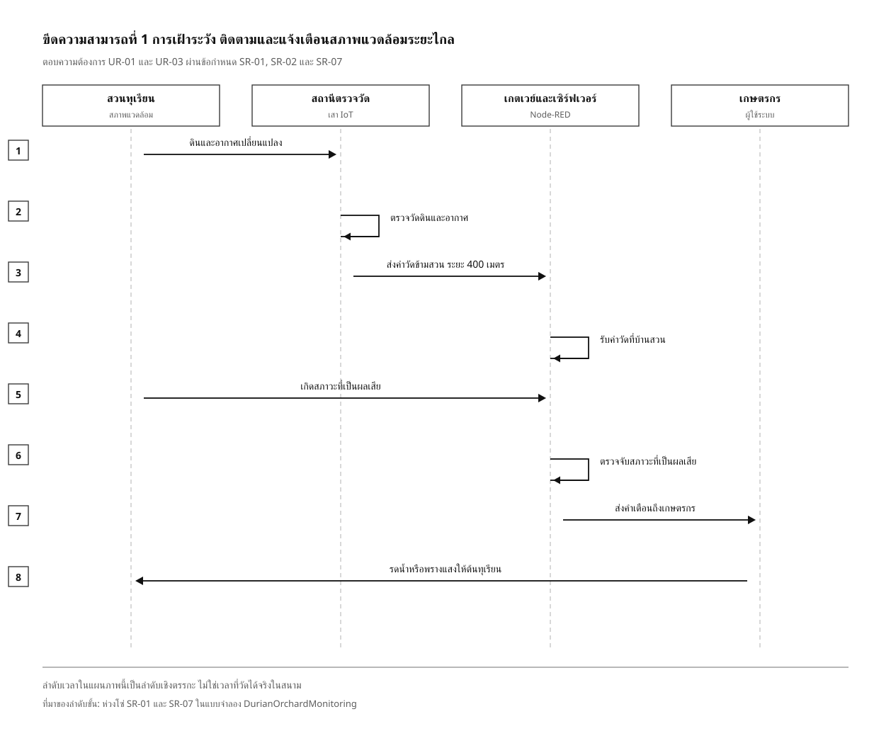

> **ภาพที่ 38** แผนภาพลำดับขั้นตอนขีดความสามารถในการเฝ้าระวัง ติดตามและแจ้งเตือนสภาพแวดล้อมระยะไกล

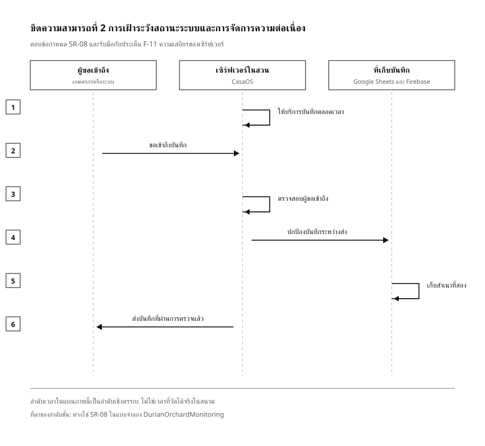

> **ภาพที่ 40** แผนภาพลำดับขั้นตอนขีดความสามารถในการเฝ้าระวังสถานะระบบและการจัดการความต่อเนื่อง

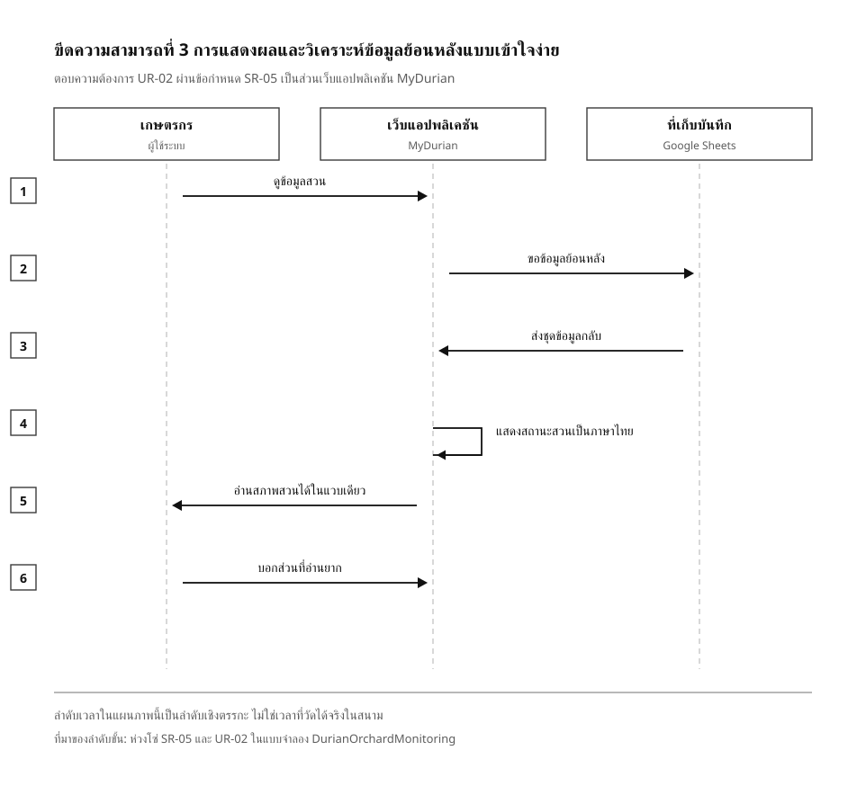

> **ภาพที่ 42** แผนภาพลำดับขั้นตอนขีดความสามารถในการแสดงผลและวิเคราะห์ข้อมูลย้อนหลังแบบเข้าใจง่าย

ลำดับเวลาในสถานการณ์เหล่านี้เป็นลำดับเชิงตรรกะ ไม่ใช่เวลาที่วัดได้จริงในสนาม

### 3.7.4 ตำแหน่งจัดเก็บของ Capability ในแบบจำลอง

> **ภาพที่ 44** ตำแหน่งของ Capability และสถานการณ์ [IS] ใน System Analysis

ขีดความสามารถทั้งสามจัดเก็บภายใต้หัวข้อ System Analysis ในโครงสร้างต้นไม้ของแบบจำลอง การระบุตำแหน่งไว้เช่นนี้ทำให้ขีดความสามารถมีสถานะเป็นผลผลิตตามนิยามในหัวข้อ 1.6.5 เพราะผู้รับช่วงงานต่อค้นหาองค์ประกอบนั้นได้ตามตำแหน่งที่ระบุ

### 3.7.5 การสร้างส่วนต่อประสาน (Interfaces)

การสร้างส่วนต่อประสานคือการกำหนดข้อกำหนดทางเทคนิคของการเชื่อมต่อและแลกเปลี่ยนข้อมูล โดยระบุทิศทาง รูปแบบข้อมูล และช่องทางการสื่อสาร รายการทั้งหมดแสดงดังตารางที่ 17

สิ่งแลกเปลี่ยนข้อมูลชนิด FLOW นิยามโครงสร้างและพารามิเตอร์ของข้อมูลที่ไหลเวียนในระบบ

สัญญาณและเหตุการณ์ควบคุมชนิด EVENT และ OPERATION กำหนดเงื่อนไขการแจ้งเตือนและตรรกะการทำงานเมื่อพบสภาวะตรงตามเกณฑ์

ช่องทางการเชื่อมต่อระหว่างองค์ประกอบ ระบุต้นทางและปลายทางของการแลกเปลี่ยนข้อมูล

| ประเภทส่วนต่อประสาน | รายการส่วนต่อประสาน | ทิศทาง / องค์ประกอบที่เกี่ยวข้อง | คำอธิบายเชิงเทคนิค |
|---|---|---|---|
| **รูปแบบ/โครงสร้างข้อมูล** | อุณหภูมิภายนอก / ในดิน | IoT Pole → Gateway | ข้อมูลดิบจากเซ็นเซอร์ภาคสนามที่ส่งผ่านสัญญาณคลื่นวิทยุ LoRa 433MHz |
| | ความชื้นภายนอก / ในดิน | | |
| | ความเข้มแสง / ค่า NPK / ค่า pH | | |
| | จัดรูปแบบข้อความข้อมูลคั่นด้วยจุลภาค | Gateway → Server | ส่งข้อมูลเป็นพารามิเตอร์ของคำขอ HTTP GET ไปยัง Node-RED ซึ่งแปลงเป็น JSON ที่ฝั่งเซิร์ฟเวอร์ (Nunthasrithananon et al., 2024, pp. 48–49) |
| | ส่ง HTTP GET | | |
| | แปลงข้อความเป็น JSON ที่ Node-RED | | |
| | Append Real-time NoSQL Log | Server → Database | โครงสร้างข้อมูลสำหรับการบันทึกลงฐานข้อมูล Firebase และ InfluxDB |
| | Write Time-Series Timestamp | | |
| **สัญญาณและเหตุการณ์ควบคุม** | แจ้งเตือนอุณหภูมิภายนอก > 40°C | Server → อุปกรณ์สำหรับแสดงผล | ตรรกะเงื่อนไขการแจ้งเตือน เมื่อสภาพแวดล้อมในแปลงเกษตรเข้าสู่สภาวะวิกฤต |
| | แจ้งเตือนความชื้นในดิน < 20% หรือ > 40% | | |
| | แจ้งเตือนค่า pH / NPK เกินเกณฑ์ | | |
| | พยายามเชื่อมต่อเครือข่ายใหม่ทุก 5 วินาที | ภายในเกตเวย์ (Gateway) | กลไกควบคุมความเสถียรของระบบสื่อสาร เพื่อให้อุปกรณ์ทำงานได้อย่างต่อเนื่อง |
| | ตรวจพบการขาดการเชื่อมต่อเครือข่าย | | |
| | สั่งรีสตาร์ทอุปกรณ์อัตโนมัติ | | |
| **ช่องทางการเชื่อมต่อระบบ** | IoT Pole to Gateway | ระหว่างโมดูลหลักของสถาปัตยกรรม | ช่องทางการเชื่อมต่อทางกายภาพและตรรกะของระบบเกษตรอัจฉริยะภาพรวม |
| | Gateway to Server | | |
| | Server to อุปกรณ์สำหรับแสดงผล | | |
| | อุปกรณ์สำหรับแสดงผล to Server | | |
| | เกษตรกร to อุปกรณ์สำหรับแสดงผล | | |

**ตารางที่ 17** รายการสรุปส่วนต่อประสานของระบบ

การกำหนดส่วนต่อประสานละเอียดในระดับการวิเคราะห์ระบบ ทำให้ผู้พัฒนานำข้อกำหนดโครงสร้างข้อมูลไปออกแบบทางกายภาพ เขียนสคริปต์บน Node-RED และออกแบบตารางฐานข้อมูลได้สอดคล้องกัน ป้องกันข้อมูลสูญหายหรือระบบสื่อสารไม่เข้าใจกันในขั้นติดตั้งใช้งานจริง

### 3.7.6 การสร้าง IDB (Interface Design Blank)

> **ภาพที่ 46** แผนภาพรายละเอียดการเชื่อมต่อและเส้นทางการแลกเปลี่ยนข้อมูลเชิงสถาปัตยกรรม (IDB)

แผนภาพ IDB แสดงจุดเชื่อมต่อและเส้นทางการไหลของข้อมูลทั้งหมดในภาพเดียว ตั้งแต่สวน เสา IoT เกตเวย์ เซิร์ฟเวอร์ ไปจนถึงอุปกรณ์แสดงผลและเกษตรกร เพื่อยืนยันว่าไม่มีส่วนใดขาดการเชื่อมต่อ และข้อมูลทุกชุดมีต้นทางและปลายทางชัดเจน

ตารางที่ 17 เป็นหลักฐานการตรวจรับตามเกณฑ์ที่ตกลงไว้ล่วงหน้า เพราะแสดงว่าสิ่งแลกเปลี่ยนข้อมูลทุกรายการมีต้นทางและปลายทางที่ระบุได้

### 3.7.7 การสร้าง PA (Physical Architecture)

สถาปัตยกรรมทางกายภาพกำหนดส่วนประกอบทั้งฮาร์ดแวร์และซอฟต์แวร์ที่รองรับหน้าที่ที่กำหนดไว้ก่อนหน้า ดังภาพที่ 48

![ภาพที่ 48 แผนภาพสถาปัตยกรรมกายภาพภาพรวมทั้งหมด (\[PAB\] All Structure)](<screenshots-from-capella/[PAB] Structure.svg>)

> **ภาพที่ 48** แผนภาพสถาปัตยกรรมกายภาพภาพรวมทั้งหมด ([PAB] All Structure)

ช่องทางการเชื่อมต่อทางกายภาพที่กำหนดในระดับนี้ ได้แก่ บัส I2C สำหรับ BMP280 และ GY-30 การสื่อสาร RS485 แบบ Modbus RTU สำหรับเซ็นเซอร์ 7 in 1, WSS004 และ SHT30 ซึ่งต่อผ่านโมดูล RS485 เข้าพอร์ตอนุกรมของ ESP32S และบัส SPI สำหรับโมดูล LoRa SX1278 ตามรายละเอียดในตารางที่ 6 และตารางที่ 8 (Tuntawisut et al., 2024)

การสร้างแผนภาพ PAB ใช้เครื่องมือจากแถบ Palette สี่ขั้น ดังตารางที่ 17-ก

| ขั้น | เครื่องมือ | ผลที่ได้ |
|---|---|---|
| 1 | Node PC | กล่องสีเหลือง แทนฮาร์ดแวร์ที่มีอยู่จริง |
| 2 | Deploy Behavior PC วางในกล่องสีเหลือง | กล่องสีฟ้า แทนซอฟต์แวร์หรือเฟิร์มแวร์ที่ทำงานบนฮาร์ดแวร์นั้น |
| 3 | Physical Function วางในกล่องสีฟ้า | กล่องสีเขียว แทนหน้าที่ย่อยของซอฟต์แวร์ |
| 4 | Functional Exchange ลากระหว่างพอร์ตขาออกกับพอร์ตขาเข้า | เส้นทางการส่งผ่านข้อมูล |

**ตารางที่ 17-ก** สี่ขั้นของการสร้างแผนภาพ PAB ด้วยเครื่องมือในแถบ Palette

> **ภาพที่ 49-ข** ตัวอย่างบอร์ด ESP32S: Node PC (สีเหลือง), Behavior PC (สีฟ้า) และ Physical Function (สีเขียว)

ตัวอย่างของบอร์ด ESP32S ดังภาพที่ 49-ข มีกล่องสีฟ้าชื่อการอ่านและส่งค่าเซ็นเซอร์ กล่องสีฟ้าซ้อนกันได้เพื่อแสดงลำดับชั้นของซอฟต์แวร์ ซึ่ง Node-RED ทำงานอยู่ภายใน CasaOS บนเครื่องเซิร์ฟเวอร์

การอธิบายวิธีสร้างแผนภาพไว้สำคัญต่อการนำผลงานไปใช้ต่อ เพราะผู้รับช่วงงานต่อที่ไม่คุ้นเคยกับเครื่องมือจะตีความรหัสสีไม่ได้หากไม่มีคำอธิบายกำกับ และจะเพิ่มองค์ประกอบใหม่ตามแบบแผนเดิมไม่ได้

ภาพที่ 48 แบ่งองค์ประกอบทางกายภาพออกเป็นสามส่วนหลัก ดังตารางที่ 17-ข

| ส่วน | องค์ประกอบและหน้าที่ |
|---|---|
| สถานีตรวจวัด (IoT Pole) | ฮาร์ดแวร์ปลายทางในพื้นที่เกษตร ประกอบด้วยชุดเซ็นเซอร์ ระบบบริหารพลังงานแสงอาทิตย์ และบอร์ด ESP32S ซึ่งรวบรวมข้อมูลดิบมาห่อหุ้มเป็นโครงสร้างข้อมูล แล้วแพร่สัญญาณออกทางเสาอากาศภาคส่งที่ความถี่ 433MHz |
| กล่องรวบรวมและส่งผ่านสัญญาณ (Gateway) | รับสัญญาณจากเสาอากาศภาครับเพื่อถอดรหัสในโมดูล LoRa ใช้ ESP32S ตรวจความถูกต้องของข้อมูล แล้วเชื่อมต่ออินเทอร์เน็ตผ่านเราเตอร์ส่งไปยัง Node-RED ด้วยคำขอ HTTP GET (Nunthasrithananon et al., 2024, pp. 48, 305) |
| ระบบประมวลผลส่วนกลาง (Server) | เซิร์ฟเวอร์ภายในที่ใช้ CasaOS (Nunthasrithananon et al., 2024, p. 13) มี Node-RED เป็นศูนย์กลางกระจายข้อมูลไปจัดเก็บใน InfluxDB และ Google Sheets ใช้ Firebase เก็บข้อมูลผู้ใช้งาน เติมข้อมูลที่ขาดหายด้วย Data Cleansing ที่พัฒนาด้วย MATLAB และแสดงผลผ่านเว็บแอปพลิเคชันที่พัฒนาด้วย NuxtJS, Vue.js และ Tailwind CSS |

**ตารางที่ 17-ข** สามส่วนหลักของสถาปัตยกรรมกายภาพ

แผนภาพยังแสดงการเชื่อมต่อระบบแจ้งเตือนเข้ากับ LINE API เพื่อส่งข้อมูลสภาวะวิกฤตถึงอุปกรณ์เคลื่อนที่ของเกษตรกร ภาพรวมนี้แสดงว่าระบบแบ่งแยกหน้าที่อย่างเป็นเอกเทศ แต่ยังรักษาความสอดคล้องของการรับส่งข้อมูลระหว่างฮาร์ดแวร์และซอฟต์แวร์ไว้ได้

**สถาปัตยกรรมกายภาพของเกตเวย์**

![ภาพที่ 50 แผนภาพสถาปัตยกรรมกายภาพของเกตเวย์ (\[PAB\] Gateway Structure)](figures/fig-50-pab-gateway.svg)

> **ภาพที่ 50** แผนภาพสถาปัตยกรรมกายภาพของเกตเวย์ ([PAB] Gateway Structure)

เส้นสีน้ำเงินแสดงเส้นทางเดินของข้อมูลสารสนเทศหลัก จากโมดูลฮาร์ดแวร์ภาครับทั้งเสาอากาศและโมดูล LoRa ส่งต่อไปยังหน่วยประมวลผล ESP32S และสิ้นสุดที่การส่งออกสู่อุปกรณ์จัดเส้นทาง

เส้นทางนี้สะท้อนเส้นทางวิกฤตของข้อมูลที่เกตเวย์ต้องบริหารจัดการ เพื่อไม่ให้ชุดข้อมูลสูญหายระหว่างการแปลงโปรโตคอล

**สถาปัตยกรรมกายภาพของสถานีตรวจวัด**

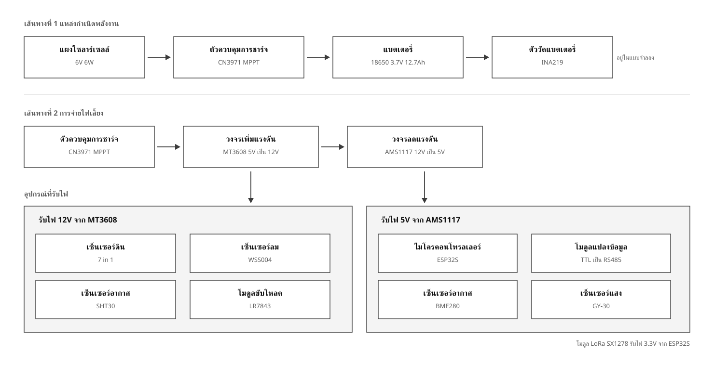

> **ภาพที่ 51** เส้นทางจ่ายไฟของสถานีตรวจวัด ตามเส้นทางที่ 1 และ 2 ในตารางที่ 17-ค

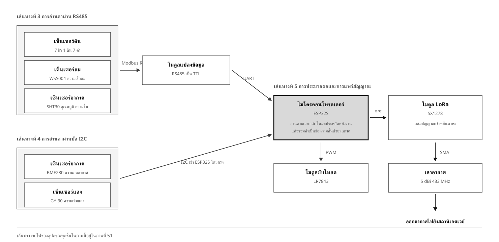

> **ภาพที่ 51-ก** เส้นทางข้อมูลของสถานีตรวจวัด ตามเส้นทางที่ 3 ถึง 5 ในตารางที่ 17-ค

ห้าเส้นทางในตารางที่ 17-ค แยกแสดงเป็นสองภาพ เส้นทางที่ 1 และ 2 ซึ่งเป็นการไหลเวียนพลังงานอยู่ในภาพที่ 51 ส่วนเส้นทางที่ 3 ถึง 5 ซึ่งเป็นการสื่อสารอยู่ในภาพที่ 51-ก การแยกนี้ทำให้ชื่ออุปกรณ์ทุกชิ้นอ่านได้เมื่อพิมพ์ลงหน้ากระดาษ

| เส้นทาง | สี | รายละเอียด |
|---|---|---|
| 1 แหล่งกำเนิดพลังงาน | น้ำเงิน | จาก Solar cell 6V 6W เข้าโมดูล CN3971 MPPT Charger เพื่อปรับเสถียรภาพกระแสและแรงดัน ก่อนส่งไปเก็บที่แบตเตอรี่ 18650 3.7V 12.7Ah |
| 2 การจ่ายไฟเลี้ยง | แดง | ไฟจาก CN3971 เข้าวงจรเพิ่มแรงดัน MT3608 เพื่อจ่ายไฟ 12V ให้เซ็นเซอร์ที่สื่อสารผ่าน RS485 คือ 7 in 1 sensor, WSS004 Wind sensor และ SHT30 sensor จากนั้นไฟ 12V ส่วนหนึ่งเข้าวงจรลดแรงดัน AMS1117 เพื่อลดเหลือ 5V จ่ายให้ BMP280 และ GY30 |
| 3 การอ่านค่าผ่าน RS485 | เขียว | เซ็นเซอร์ Modbus RTU สามตัว คือ 7 in 1 sensor ซึ่งวัดค่าในดินทั้งอุณหภูมิ ความชื้น ความเป็นกรด-ด่าง ความนำไฟฟ้า และ NPK, WSS004 ซึ่งวัดความเร็วลม และ SHT30 ซึ่งวัดอุณหภูมิและความชื้นสัมพัทธ์ ส่งข้อมูลเข้า RS485 Module เพื่อแปลงเป็นระดับแรงดัน TTL ก่อนเข้าพอร์ตอนุกรมของ ESP32S (Tuntawisut et al., 2024) |
| 4 การอ่านค่าผ่านบัส I2C | ม่วง | BMP280 วัดความกดอากาศ และ GY30 วัดความเข้มแสง ส่งข้อมูลเข้า ESP32S โดยตรง (Tuntawisut et al., 2024) |
| 5 การประมวลผลและการแพร่สัญญาณไร้สาย | ดำ | สัญญาณข้อมูลดิบจากทุกเส้นทางมารวมที่ ESP32S ภายใต้บล็อกซอฟต์แวร์การอ่านและส่งค่าเซ็นเซอร์ ซึ่งมีสามขั้น คือการอ่านข้อมูลตามเวลา การสั่งเข้าโหมดประหยัดพลังงาน และการเข้ารหัสชุดข้อมูลในโปรโตคอล LoRa โดยรวมค่าเซ็นเซอร์เป็นข้อความชุดเดียวคั่นด้วยจุลภาคซึ่งเกตเวย์ใช้แยกข้อมูล (Nunthasrithananon et al., 2024, p. 305) จากนั้นโมดูล LoRa SX1278 ผสมสัญญาณดิจิทัลเข้ากับคลื่นพาหะ และส่งออกสู่เสาอากาศ 5 dBi 433MHz |

**ตารางที่ 17-ค** ห้าเส้นทางของสถาปัตยกรรมกายภาพของสถานีตรวจวัด จำแนกด้วยรหัสสี

การใช้รหัสสีระบุประเภทของเส้นทางเดินเพิ่มความสามารถในการสืบย้อนรอย เพราะแยกการไหลเวียนของพลังงานไฟฟ้าออกจากการเดินระบบสัญญาณข้อมูลได้ชัดเจน ซึ่งตอบคำถามหน้างานของนักบำรุงรักษาโดยตรง

**สถาปัตยกรรมกายภาพของเซิร์ฟเวอร์**

![ภาพที่ 52 แผนภาพสถาปัตยกรรมกายภาพของเซิร์ฟเวอร์ (\[PAB\] Server Structure)](figures/fig-52-pab-server.svg)

> **ภาพที่ 52** แผนภาพสถาปัตยกรรมกายภาพของเซิร์ฟเวอร์ ([PAB] Server Structure)

ภาพที่ 52 แสดงองค์ประกอบทั้งหมดที่ติดตั้งภายใต้ CasaOS บนเซิร์ฟเวอร์ภายใน อธิบายได้สามส่วน ดังตารางที่ 17-ง

| ส่วน | รายละเอียด |
|---|---|
| 1 การประมวลผลและการจัดเส้นทางข้อมูลหลัก | ข้อมูลจากภาคสนามเข้าสู่ Node-RED เป็นลำดับขั้น เริ่มจาก Ingest HTTP Request ซึ่งรับคำขอจากเกตเวย์ ถัดมา Convert to String แล้ว Parse JSON จากนั้น Deconstruct msg.payload ซึ่งแยกข้อมูลตามโครงสร้าง แล้ว Switch address ซึ่งแยกเส้นทางตามหมายเลขโหนด และ Sort Sensor Dataset ซึ่งจัดเรียงพารามิเตอร์ลงตัวแปร ก่อนเข้าสู่ Format Payload Parameters และจบที่ฟังก์ชันจัดเตรียมโครงสร้างชุดสารสนเทศก่อนส่งออก (Nunthasrithananon et al., 2024, pp. 48–50) |
| 2 ระบบฐานข้อมูลและการวิเคราะห์ชั้นสูง | InfluxDB รับข้อมูลผ่านเส้นทาง Write Time-Series Timestamp เข้าฟังก์ชันจัดเก็บสารสนเทศสภาพแวดล้อมตามพิกัดเวลาสำหรับประวัติระยะยาว Firebase รับข้อมูลผ่านเส้นทาง Real-time NoSQL Log เข้าฟังก์ชันจัดเก็บบันทึกสถานะระบบแบบทันที ซึ่งในงานเดิมใช้เก็บข้อมูลผู้ใช้งานในรูปแบบ NoSQL (Nunthasrithananon et al., 2024, p. 87) ส่วนการแจ้งเตือนส่งจาก Node-RED ไปยัง LINE โดยตรง MATLAB ใช้พัฒนาและทดสอบการคำนวณแทนค่าเพื่อชดเชยข้อมูลที่ขาดหาย ซึ่งในงานเดิมนำโค้ดไปทำงานบนแพลตฟอร์มภายนอก (Nunthasrithananon et al., 2024, pp. 129–130) และ FileZilla เป็นไคลเอนต์ FTP ที่รองรับ FTPS และ SFTP ใช้โอนย้ายไฟล์ระหว่างเครื่องผู้พัฒนากับเซิร์ฟเวอร์ (Nunthasrithananon et al., 2024, p. 17) |
| 3 การขับเคลื่อนการแสดงผลหน้าบ้าน | ผลลัพธ์ที่ผ่านการชดเชยข้อมูลถูกส่งเป็นรายงานสถิติเข้าสู่กล่องคอมโพเนนต์ Tailwind CSS เพื่อแปลงข้อมูลตัวเลขเป็นกราฟ แผนภูมิ และแดชบอร์ดที่เกษตรกรเรียกดูได้ผ่านเบราว์เซอร์ โดยเว็บแอปพลิเคชันพัฒนาด้วย NuxtJS, Vue.js และ Tailwind CSS |

**ตารางที่ 17-ง** สามส่วนของสถาปัตยกรรมกายภาพของเซิร์ฟเวอร์

เส้นสีน้ำเงินสะท้อนเส้นทางวิกฤตของข้อมูลซอฟต์แวร์ ตั้งแต่การแกะโปรโตคอลคำขอ HTTP การประมวลผลตรรกะภายใน Node-RED ไปจนถึงการกระจายตัวแปรไปจัดเก็บในฐานข้อมูลและการส่งออกไปขับเคลื่อนการแสดงผล

## 3.8 สรุปท้ายบท

3.8.1 บทนี้พาผู้รับช่วงงานต่อเดินครบห้าสถานีในตารางที่ 3-ข จากเอกสารสองเล่มถึงแบบจำลองที่เปิดดูได้

3.8.2 สองสถานีแรกให้ข้อเท็จจริงและประเด็นที่ตรวจพบ ซึ่งรายงานไว้ในหัวข้อ 3.5 สถานีที่สามเปลี่ยนสิ่งที่พบให้เป็นข้อมูลที่อ้างถึงทีละค่าได้ตามหัวข้อ 3.2.3 สถานีที่สี่ประกาศข้อกำหนดและตัววัดในหัวข้อ 3.6 และสถานีที่ห้าประกอบทั้งหมดเป็นคำอธิบายสถาปัตยกรรมในหัวข้อ 3.7

3.8.3 สิ่งที่เส้นทางนี้ซื้อกลับมา ซึ่งการอ่านเอกสารอย่างเดียวซื้อไม่ได้ คือทุกข้อสรุปในเล่มนี้ย้อนไปถึงหน้าของต้นฉบับได้ และทุกข้อกำหนดมีแถบเกณฑ์ที่ทำให้ไม่ผ่านได้

3.8.4 ผลของการกำหนดเกณฑ์ตรวจรับไว้ล่วงหน้าปรากฏที่การทวนสอบไม่ผ่านในรอบแรกหลายครั้ง และความไม่ผ่านเหล่านั้นกลายเป็นประเด็นที่มีคุณค่าต่อโครงการ แทนที่จะถูกกลบด้วยการปรับเกณฑ์ให้ผ่าน

3.8.5 สิ่งที่ทำให้งานวิศวกรรมย้อนรอยแตกต่างจากการวาดแผนภาพประกอบรายงาน ไม่ใช่จำนวนแผนภาพ แต่เป็นการที่แต่ละแผนภาพตอบได้ว่าเขียนขึ้นเพื่อผู้ใด ด้วยหลักฐานใด ผ่านเกณฑ์ใด และใครจะนำไปใช้ทำสิ่งใด

# บทที่ 4 ผลการทดลอง

บทนี้รายงานผลการวิเคราะห์และออกแบบระบบตรวจวัดสภาวะแวดล้อมสำหรับการปลูกทุเรียนจังหวัดนนทบุรีด้วยวิศวกรรมระบบย้อนรอย ตามขอบเขตในหัวข้อ 1.3 แบ่งเป็นสี่หัวข้อ หัวข้อ 4.1 รายงานผลของสองแนวทาง ทะเบียนประเด็นที่ตรวจพบ และผลการเปรียบเทียบตามเกณฑ์ในตารางที่ 4 หัวข้อ 4.2 เปรียบเทียบสถาปัตยกรรมทีละประเด็น หัวข้อ 4.3 นำเสนอผลผลิตและบทสาธิตการใช้งาน และหัวข้อ 4.4 เรียงผลผลิตทั้งหมดเป็นลำดับการฝึกผู้รับช่วงงานต่อ

## 4.1 ผลการวิเคราะห์และการย้อนรอยระบบ

### 4.1.1 ผลการวิเคราะห์แบบไม่ใช้เครื่องมือ

ผลของการอ่านเอกสารต้นฉบับทั้งสองเล่มทีละหน้าในรอบที่หนึ่ง คือรายการองค์ประกอบ ช่องทางการสื่อสาร และกระแสข้อมูลในหัวข้อ 3.5.1 ถึง 3.5.8 ร่วมกับผลการย้อนรอยตามกรอบวัตถุประสงค์แปดข้อในหัวข้อ 3.5.9

ผลที่ได้เพียงพอต่อการตอบว่าระบบเดิมประกอบด้วยอะไรและทำงานอย่างไร แต่ยังไม่เพียงพอต่อการตอบว่าองค์ประกอบใดตอบความต้องการข้อใด เพราะเอกสารต้นฉบับไม่ได้บันทึกความต้องการไว้เป็นข้อ

ผลสำคัญของรอบที่หนึ่งคือการตรวจพบช่องว่างระหว่างหน้าที่การทำงานเดิมกับโครงสร้างทางกายภาพ ตัวอย่างที่ชัดที่สุดคือข้อกำหนดเรื่องการทำงานต่อเนื่อง 24 ชั่วโมงที่ไม่สอดคล้องกับความจุพลังงานที่มีอยู่จริง 16 ชั่วโมง ซึ่งตรวจพบได้จากการอ่านโดยไม่ต้องใช้เครื่องมือใด

ข้อจำกัดของรอบที่หนึ่งคือผลลัพธ์ทั้งหมดอยู่ในรูปบันทึกย่อและความเข้าใจของผู้ศึกษา จึงไม่มีกลไกบอกได้ว่าการวิเคราะห์ครบถ้วนแล้วหรือยัง และไม่มีกลไกบอกได้ว่าข้อสรุปข้อหนึ่งขัดแย้งกับอีกข้อหนึ่งหรือไม่ เป็นเหตุผลที่ต้องดำเนินการรอบที่สองด้วยแบบจำลอง

### 4.1.2 ผลการวิเคราะห์เชิงปฏิบัติการและกระบวนการผ่านแบบจำลอง

การวิเคราะห์รอบที่สองพบข้อจำกัดสองด้านที่แสดงผลผ่านแบบจำลองใน Capella ได้ คือจุดหน่วงในลำดับการไหลของข้อมูล และประเด็นด้านต้นทุนอุปกรณ์

**การวิเคราะห์ข้อจำกัดด้านงบประมาณและราคาอุปกรณ์**

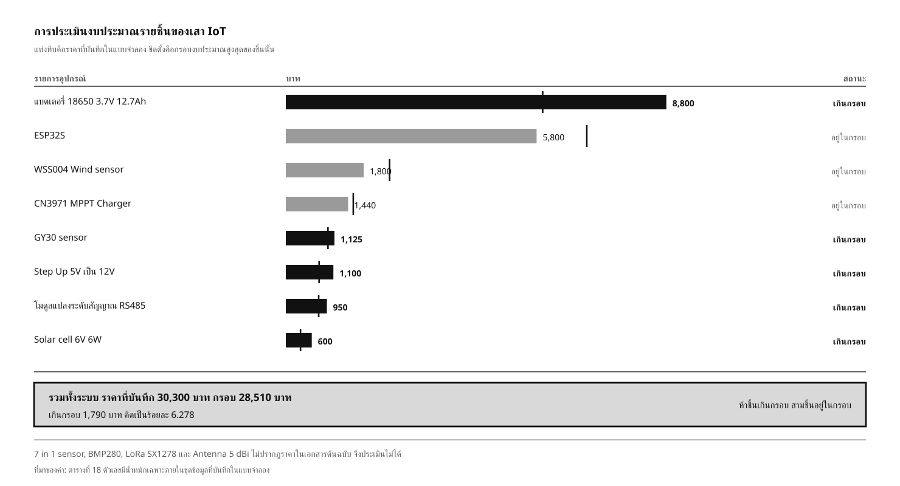

> **ภาพที่ 53** การวิเคราะห์ข้อจำกัดด้านงบประมาณส่วนเสา IoT

| รายการอุปกรณ์ | ราคาจริงที่บันทึกในแบบจำลอง (บาท) | กรอบงบประมาณสูงสุด (บาท) | สถานะ |
|---|---|---|---|
| Solar cell 6V 6W | 600 | 340 | เกินกรอบ |
| แบตเตอรี่ 18650 3.7V 12.7Ah | 8,800 | 5,940 | เกินกรอบ |
| โมดูลแปลงระดับสัญญาณ RS485 | 950 | 760 | เกินกรอบ |
| Step Up (5V เป็น 12V) | 1,100 | 770 | เกินกรอบ |
| GY30 sensor | 1,125 | 975 | เกินกรอบ |
| ESP32S | 5,800 | 6,960 | อยู่ในกรอบ |
| CN3971 MPPT Charger | 1,440 | 1,560 | อยู่ในกรอบ |
| WSS004 Wind sensor | 1,800 | 2,400 | อยู่ในกรอบ |
| 7 in 1 sensor, BMP280, LoRa SX1278, Antenna 5 dBi | ตรงตามกรอบพอดีหรือไม่ปรากฏราคาในเอกสารต้นฉบับ | — | ไม่สามารถประเมินได้ |
| **รวมทั้งระบบ** | **30,300** | **28,510** | **เกินกรอบ 1,790 บาท คิดเป็น 6.278%** |

**ตารางที่ 18** ผลการประเมินงบประมาณในระดับสถาปัตยกรรมกายภาพ

การประเมินนำข้อมูลอุปกรณ์จากเอกสารต้นฉบับมากำหนดเป็นคุณสมบัติทางกายภาพในแบบจำลอง พร้อมตั้งค่ากรอบงบประมาณเป้าหมาย เมื่อบันทึกราคาจริงลงไป โปรแกรมคำนวณเทียบกับงบประมาณและแจ้งสถานะความเสี่ยงด้วยแถบสีแดงหากมูลค่ารวมเกินกรอบ

กลไกนี้แปลงข้อกำหนดเชิงต้นทุนให้เป็นเงื่อนไขที่แบบจำลองตรวจสอบได้โดยอัตโนมัติ แทนที่จะเป็นข้อความที่ผู้อ่านต้องตรวจเอง

ภาพที่ 53 ระบุได้ว่าอุปกรณ์ใดเป็นจุดที่ต้นทุนบานปลาย ส่วนภาพที่ 54 แสดงอุปกรณ์ที่ไม่ปรากฏราคาในเอกสารต้นฉบับ ซึ่งแบบจำลองประเมินไม่ได้และต้องไปสำรวจราคาจริงเพิ่ม การตรวจพบกลุ่มที่สองมีคุณค่าในตัวเอง เพราะเป็นการระบุช่องว่างของหลักฐานที่ต้องเติมก่อนประเมินความคุ้มค่าได้สมบูรณ์

การคำนวณเปอร์เซ็นต์ที่เกินงบประมาณใช้สมการ

Percentage Excess = ((Actual Cost − Budget) / Budget) × 100 (สมการที่ 2)

แทนค่าในสมการที่ 2 โดยงบประมาณที่ตั้งไว้ 28,510 บาท และค่าใช้จ่ายจริง 30,300 บาท ได้

Percentage Excess = ((30,300 − 28,510) / 28,510) × 100 = 6.278%

ผลสรุปคือเกินงบประมาณ 1,790 บาท คิดเป็นร้อยละ 6.278

ราคาที่บันทึกในแบบจำลองตามตารางที่ 18 ไม่ตรงกับราคาต่อหน่วยในตารางที่ 12 ซึ่งน่าจะเกิดจากค่าในแบบจำลองเป็นราคารวมตามจำนวนชิ้นที่ใช้ แต่เอกสารต้นฉบับไม่ได้ระบุจำนวนชิ้นไว้ จึงกระทบยอดสองชุดนี้ให้ตรงกันจากหลักฐานที่มีไม่ได้ บันทึกเป็นประเด็น F-13

ข้อสรุปเรื่องการเกินงบประมาณร้อยละ 6.278 จึงมีน้ำหนักเฉพาะภายในชุดข้อมูลที่บันทึกในแบบจำลอง และต้องยืนยันด้วยการสำรวจราคาและจำนวนชิ้นจริงก่อนนำไปใช้ตัดสินใจจัดซื้อ

แนวทางควบคุมงบประมาณที่วางได้จากข้อมูลนี้มีสามข้อ

ปรับเปลี่ยนอุปกรณ์ที่ราคาสูง โดยเฉพาะชุดแบตเตอรี่และแผงโซลาร์เซลล์ ด้วยการคำนวณความจุและกำลังไฟฟ้าให้เหมาะกับการใช้งานจริง

เลือกเซ็นเซอร์แบบรวมฟังก์ชันเพื่อลดอุปกรณ์แปลงสัญญาณย่อย ซึ่งลดจำนวนคอมโพเนนต์และต้นทุนรวม

นำสเปกและราคาใหม่ลงประเมินในแบบจำลองซ้ำ เพื่อยืนยันว่าสถานะเปลี่ยนจากเกินกรอบเป็นอยู่ในกรอบ

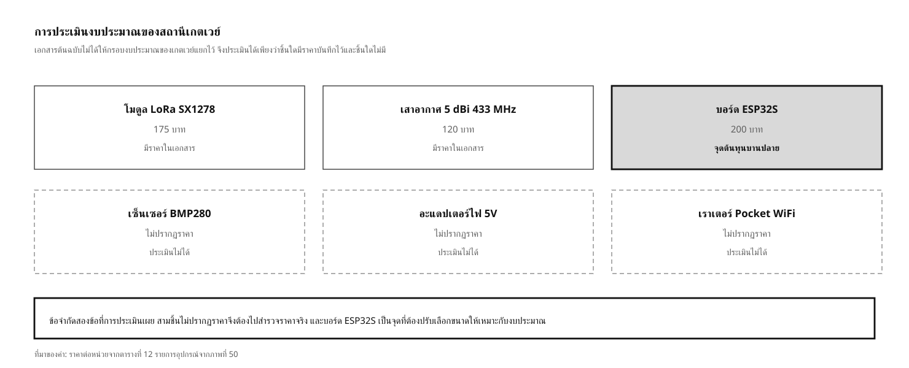

> **ภาพที่ 54** การวิเคราะห์ข้อจำกัดด้านงบประมาณส่วนเกตเวย์

ผลการประเมินส่วนเกตเวย์ตามภาพที่ 54 พบข้อจำกัดสองประการ คือจุดที่ไม่ระบุราคาในเอกสารต้นฉบับซึ่งต้องไปสำรวจราคาจริง และจุดต้นทุนบานปลายที่บอร์ด ESP32S ซึ่งต้องวางแผนปรับเลือกขนาดบอร์ดให้เหมาะกับงบประมาณในขั้นถัดไป

**การวิเคราะห์ความหน่วงเวลาเชิงทฤษฎีจากเอกสารข้อมูลผู้ผลิต**

| จุดวัด | เกณฑ์ / ค่าที่กำหนดในแบบจำลอง | ที่มาของค่า |
|---|---|---|
| รอบการอ่านค่าเซ็นเซอร์ผ่าน Modbus RTU ที่ความเร็ว 9600 bps | ไม่เกิน 1,000 มิลลิวินาทีต่อรอบการอ่าน | รอบการทำงานของโปรโตคอลและเวลาตอบสนองของเซ็นเซอร์ตามเอกสารผู้ผลิต |
| การสื่อสารระหว่าง ESP32S กับโมดูล LoRa ผ่าน SPI | ไม่เกิน 20 มิลลิวินาที | คุณลักษณะของโปรโตคอล SPI ตามเอกสารผู้ผลิต |
| ความหน่วงรวมจากเสา IoT ถึงระบบคลาวด์ | ประมาณ 2–3 วินาที | ประมาณการจากการสื่อสารไร้สาย LoRa และการส่งผ่านเครือข่ายอินเทอร์เน็ตสาธารณะ |
| ความหน่วงรวมของการมอนิเตอร์และการแสดงผล | ประมาณ 2.5–3 วินาที | ประมาณการจากสถาปัตยกรรมแบบประมวลผลที่ปลายทาง |

**ตารางที่ 19** เกณฑ์และค่าความหน่วงเวลาที่กำหนดไว้ในแบบจำลอง

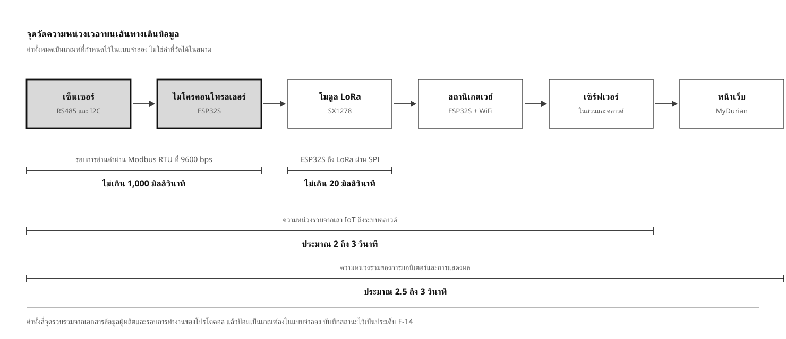

> **ภาพที่ 55** แผนภาพสถาปัตยกรรมกายภาพแสดงความหน่วงเวลาทั้งสี่จุดของเส้นทางเดินข้อมูล

เอกสารต้นฉบับไม่ได้บันทึกค่าความหน่วงเวลาจริงของแต่ละฟังก์ชันไว้ การประเมินด้านนี้จึงรวบรวมคุณลักษณะทางเทคนิคจากเอกสารข้อมูลของผู้ผลิตและรอบการทำงานของโปรโตคอล แล้วป้อนเป็นเกณฑ์เชิงทฤษฎีลงในแบบจำลอง สถานะของค่าทั้งชุดจึงเป็นเกณฑ์ที่กำหนดขึ้น ไม่ใช่ค่าที่วัดได้ บันทึกเป็นประเด็น F-14

เกณฑ์ไม่เกิน 1,000 มิลลิวินาทีต่อรอบการอ่าน กำหนดขึ้นเพื่อให้ระบบแสดงผลข้อมูลสภาวะเกษตรได้ใกล้เคียงเวลาจริง

เกณฑ์ 20 มิลลิวินาทีของการสื่อสารผ่าน SPI กำหนดขึ้นเพื่อให้ข้อมูลเข้าสู่กระบวนการมอดูเลตสัญญาณวิทยุได้รวดเร็วและไม่มีข้อมูลตกค้างในหน่วยความจำชั่วคราว

ส่วนเกตเวย์มีค่าความหน่วงรวมจากเสา IoT ถึงระบบคลาวด์ประมาณ 2 ถึง 3 วินาที ซึ่งเกิดส่วนใหญ่ในขั้นการสื่อสารไร้สายผ่าน LoRa และการส่งข้อมูลผ่านเครือข่ายอินเทอร์เน็ตสาธารณะ ระบบจึงยังรักษาความสามารถในการแสดงผลแบบใกล้เวลาจริงไว้ได้

ส่วนการแสดงผลออกแบบในลักษณะประมวลผลที่ปลายทาง โดยเครื่องคอมพิวเตอร์ปลายทางเป็นทั้งหน่วยประมวลผลและส่วนติดต่อผู้ใช้งาน ความหน่วงรวมจึงอยู่ที่ประมาณ 2.5 ถึง 3 วินาที

คุณค่าที่ได้ไม่ใช่ค่าความหน่วงจริงของระบบเดิม แต่เป็นโครงสร้างที่พร้อมรับค่าจริงเมื่อมีการวัดในอนาคต และรายการจุดวัดที่ต้องไปวัดจริง ข้อสรุปนี้จะกลายเป็นข้อสรุปเรื่องสมรรถนะของระบบเดิมได้เฉพาะเมื่อมีการวัดค่าจริงในสนามมาแทนค่าในแบบจำลอง

### 4.1.3 ทะเบียนประเด็นที่ตรวจพบ

| รหัส | ประเด็นที่ตรวจพบ | REV-OBJ | มุมมอง | แนวทางที่ตรวจพบ | หลักฐานอ้างอิง |
|---|---|---|---|---|---|
| F-01 | การคำนวณงบลิงก์ในเอกสารต้นฉบับนับอัตราขยายของเสาอากาศซ้ำสองครั้ง หากไม่นับซ้ำจะได้ -50.6 dBm แทน -40.8 dBm | 1 | PA | การอ่านและคำนวณตรวจทาน | หัวข้อ 3.5.9 ที่ REV-OBJ-1; Rappaport (2002) |
| F-02 | กำลังภาครับที่วัดได้จริงที่ระยะ 400 เมตร อ่อนกว่าค่าเชิงทฤษฎีประมาณ 43 dB เนื่องจากแบบจำลองอวกาศว่างไม่รวมผลของทรงพุ่มต้นไม้ | 1 | PA | การอ่านและคำนวณตรวจทาน | หัวข้อ 3.5.9 ที่ REV-OBJ-1; ตารางที่ 10–11 |
| F-03 | เอกสารต้นฉบับระบุความไวในการรับสัญญาณที่ -130 dBm ขณะที่เอกสารผู้ผลิตระบุสูงสุด -148 dBm ขึ้นกับการตั้งค่า | 1 | PA | การอ่านเทียบเอกสารผู้ผลิต | Semtech Corporation (2020) |
| F-04 | สเปกแบตเตอรี่ไม่ตรงกันระหว่างส่วนการทดลองซึ่งระบุ 12V 12Ah กับรายการงบประมาณซึ่งระบุ 18650 3.7V 12.7Ah | 3 | PA | การอ่านเทียบภายในเอกสาร | หัวข้อ 3.5.9 ที่ REV-OBJ-3 |
| F-05 | พลังงานที่จ่ายได้ 31.7821 Wh กับกำลังไฟฟ้า 2.3772 W ให้ระยะเวลาใช้งานประมาณ 13.4 ชั่วโมง ไม่ตรงกับ 16 ชั่วโมงที่รายงานไว้ | 3 | PA | การคำนวณตรวจทาน | หัวข้อ 3.5.9 ที่ REV-OBJ-3 |
| F-06 | ระยะเวลาจ่ายพลังงานต่อเนื่อง 16 ชั่วโมง ต่ำกว่าเป้าหมายการใช้งานต่อเนื่อง 24 ชั่วโมง | 3 | OA, PA | การอ่าน | หัวข้อ 3.5.9 ที่ REV-OBJ-3; SR-04 |
| F-07 | ค่าธาตุอาหารในดินคลาดเคลื่อนสูงเมื่อเทียบชุดทดสอบมาตรฐาน และเซ็นเซอร์อ่านปุ๋ยสูตรธาตุเดี่ยวบางสูตรไม่ได้ | 3 | SA, PA | การอ่าน | หัวข้อ 3.6.2; DP-04 |
| F-08 | การส่งข้อมูลจากเกตเวย์ไปเซิร์ฟเวอร์ใช้การเชื่อมต่อ TCP ธรรมดาโดยไม่มีการเข้ารหัส | 6 | SA | การอ่าน | หัวข้อ 3.5.9 ที่ REV-OBJ-6 |
| F-09 | บริการ LINE Notify ยุติการให้บริการตั้งแต่ 31 มีนาคม 2568 ทำให้ช่องทางแจ้งเตือนจาก Node-RED ใช้งานไม่ได้ | 6, 8 | SA | การตรวจสอบสถานะบริการภายนอก | LY Corporation (2025) |
| F-10 | โควตาการส่งข้อความ 300 ข้อความต่อเดือน จำกัดรายงานตามรอบเวลาเหลือวันละ 6 ครั้ง | 2 | SA | การอ่าน | DP-15; Nunthasrithananon et al. (2024, pp. 66, 146) |
| F-11 | เซิร์ฟเวอร์ภายในหยุดทำงานเป็นช่วง และเอกสารต้นฉบับไม่ได้บันทึกขั้นตอนนำกลับมาทำงานไว้ | 3 | PA | การอ่าน | หัวข้อ 3.5.9 ที่ REV-OBJ-3; SR-08 |
| F-12 | ความสัมพันธ์ Satisfies ขาดหายระหว่างการสร้างแบบจำลอง แก้ครบก่อนส่งมอบ จุดขาดที่ยังเหลืออยู่ที่ระดับตัววัด คือ MoP สามตัวที่ไม่ประกาศการขัดเกลา | 8 | ทุกระดับ | **แบบจำลองเท่านั้น** | หัวข้อ 3.7.1 |
| F-13 | ต้นทุนฮาร์ดแวร์ของโหนดเกินกรอบงบประมาณร้อยละ 6.278 คิดเป็น 1,790 บาท และราคาอุปกรณ์เกตเวย์หลายรายการไม่ปรากฏในเอกสารต้นฉบับ รวมถึงไม่สามารถกระทบยอดราคาในแบบจำลองกับราคาต่อหน่วยได้ | 2 | PA | **แบบจำลองเท่านั้น** | หัวข้อ 4.1.2; ตารางที่ 18 |
| F-14 | เอกสารต้นฉบับไม่ได้บันทึกค่าความหน่วงเวลาจริงของแต่ละฟังก์ชันไว้ ค่าที่ใช้จึงเป็นเกณฑ์เชิงทฤษฎีจากเอกสารผู้ผลิต | 1 | PA | การอ่าน | หัวข้อ 4.1.2; ตารางที่ 19 |
| F-15 | เซ็นเซอร์ SHT30 มีขอบเขตการวัดอุณหภูมิและความชื้นซ้อนอยู่ในขอบเขตของ BME280 ทั้งหมด | 2, 7 | PA | **แบบจำลองเท่านั้น** | หัวข้อ 5.2.2 |
| F-16 | InfluxDB รุ่น 2.0 ใช้ภาษา Flux ซึ่งไม่เข้ากันกับภาษา InfluxQL รุ่นก่อนหน้า เพิ่มความซับซ้อนในการบำรุงรักษา | 7 | LA, PA | การอ่าน | หัวข้อ 3.5.9 ที่ REV-OBJ-7 |
| F-17 | การถอดสายไฟเกตเวย์โดยผู้ใช้เป็นรูปแบบความล้มเหลวที่ทำให้ระบบหยุดทั้งระบบ และไม่มีมาตรการทางสถาปัตยกรรมรองรับ | 3 | OA | การอ่าน | หัวข้อ 3.6.1; หัวข้อ 3.5.10 |

**ตารางที่ 20** ทะเบียนประเด็นที่ตรวจพบจากการทำวิศวกรรมย้อนรอย

ทะเบียนประเด็นที่ตรวจพบมี 17 ประเด็น แต่ละประเด็นระบุจุดประสงค์การย้อนรอยที่เกี่ยวข้อง มุมมองที่ประเด็นนั้นปรากฏ แนวทางที่ตรวจพบ และหลักฐานอ้างอิง ทะเบียนนี้ตอบวัตถุประสงค์ข้อ 1.2.3 โดยตรง และเป็นรายการงานตั้งต้นสำหรับผู้ที่จะนำระบบเดิมกลับมาใช้งานหรือพัฒนาต่อ

ประเด็นทั้ง 17 ประเด็นครอบคลุมจุดประสงค์การย้อนรอย 6 ข้อจาก 8 ข้อ จุดประสงค์ที่ไม่ปรากฏประเด็นคือ REV-OBJ-4 ความสามารถในการบำรุงรักษา และ REV-OBJ-5 ความสามารถในการขยายระบบ

การไม่พบประเด็นไม่ได้หมายความว่าระบบเดิมไม่มีปัญหาในสองด้านนั้น แต่หมายความว่าหลักฐานระดับเอกสารไม่เพียงพอต่อการตรวจพบ เพราะทั้งสองด้านเป็นคุณลักษณะที่ปรากฏเมื่อมีการใช้งานจริงในระยะยาว ซึ่งอยู่นอกขอบเขตตามหัวข้อ 1.3.3

### 4.1.4 ผลการเปรียบเทียบสองแนวทางการดำเนินงาน

| มิติ | เกณฑ์ | แนวทางที่ 1 แบบไม่ใช้เครื่องมือ | แนวทางที่ 2 แบบใช้แบบจำลอง |
|---|---|---|---|
| คุณภาพ | ความถูกต้องของข้อเท็จจริง | ตรวจพบประเด็นเชิงตัวเลขและเชิงตรรกะ 14 ประเด็น (F-01 ถึง F-11, F-14, F-16, F-17) | ไม่ตรวจพบประเด็นเพิ่มในด้านนี้ เนื่องจากข้อมูลเข้ามาจากการอ่านทั้งหมด |
| คุณภาพ | ความครบถ้วนของการสืบย้อนกลับ | ไม่มีกลไกตรวจสอบ จึงไม่สามารถระบุได้ว่าความสัมพันธ์ใดขาดหาย | ตรวจพบความสัมพันธ์ที่ขาดหายหรือไม่มีปลายทาง 6 เส้น (F-12) |
| คุณภาพ | ความสามารถในการระบุตำแหน่งของผลผลิต | ผลลัพธ์อยู่ในรูปบันทึกย่อ ไม่มีชื่อเรียกและตำแหน่งจัดเก็บ | ผลผลิตทุกรายการมีชื่อองค์ประกอบและตำแหน่งจัดเก็บในแบบจำลอง |
| คุณภาพ | ความสามารถในการวิเคราะห์ผลกระทบ | ต้องย้อนอ่านเอกสารต้นฉบับทุกครั้งที่มีคำถามใหม่ | อ่านได้จากเมทริกซ์ในตารางที่ 14 ถึงตารางที่ 16 โดยตรง |
| คุณภาพ | ความสามารถในการตรวจพบความซ้ำซ้อน | ไม่ตรวจพบ เพราะสเปกของอุปกรณ์แต่ละตัวอยู่ต่างหน้ากันในเอกสาร | ตรวจพบความซ้ำซ้อนของขอบเขตการวัด 1 รายการ (F-15) และตรวจพบต้นทุนเกินกรอบ (F-13) |
| ความพยายาม | เวลาที่ใช้ในการสกัดข้อมูล | [กรอกจากสมุดบันทึกการทำงาน: ___ ชั่วโมง] | ไม่มี เนื่องจากใช้ข้อมูลจากแนวทางที่ 1 |
| ความพยายาม | เวลาที่ใช้ในการเรียนรู้เครื่องมือและระเบียบวิธี | ไม่มี | [กรอกจากสมุดบันทึกการทำงาน: ___ ชั่วโมง] |
| ความพยายาม | เวลาที่ใช้ในการสร้างและแก้ไขแบบจำลอง | ไม่มี | [กรอกจากสมุดบันทึกการทำงาน: ___ ชั่วโมง] |

**ตารางที่ 21** ผลการเปรียบเทียบสองแนวทางตามเกณฑ์ในตารางที่ 4

ช่องที่เป็นข้อมูลเวลาทำงานต้องกรอกจากสมุดบันทึกการทำงานของผู้ศึกษา จึงระบุไว้เป็นช่องว่าง เพราะเป็นข้อมูลที่ประมาณขึ้นไม่ได้

ประเด็นที่ตรวจพบส่วนใหญ่ 14 จาก 17 ประเด็น มาจากการอ่านเอกสารอย่างมีวินัยและการคำนวณตรวจทาน ไม่ได้มาจากเครื่องมือ ข้อสรุปนี้ขัดกับความคาดหมายตั้งต้นในหัวข้อ 3.3.1 และต้องรายงานไว้ตามหัวข้อ 3.3.4 แนวทางแบบจำลองจึงไม่ทดแทนการอ่าน

คุณค่าเฉพาะตัวของแนวทางแบบจำลองเรื่องแรกคือการตรวจพบความไม่ครบถ้วนของการสืบย้อนกลับ เพราะเอกสารไม่มีกลไกบอกได้ว่าความสัมพันธ์ที่ควรมีขาดหายไป

เรื่องที่สองคือการรวมต้นทุนเทียบกรอบงบประมาณที่ประกาศไว้ ซึ่งทำให้จุดที่ต้นทุนบานปลายปรากฏเป็นสถานะบนแผนภาพ

เรื่องที่สามคือการตรวจพบความซ้ำซ้อนของขอบเขตการวัดระหว่างเซ็นเซอร์สองตัว ซึ่งตรวจพบได้เพราะแบบจำลองนำสเปกของอุปกรณ์ทุกตัวมาวางเทียบกันในที่เดียว ขณะที่ในเอกสารสเปกเหล่านี้อยู่ต่างหน้าและต่างเล่มกัน

คุณค่าที่สำคัญที่สุดในบริบทของวัตถุประสงค์ข้อ 1.2.1 ไม่ใช่การตรวจพบประเด็นใหม่ แต่เป็นการทำให้ประเด็นที่ตรวจพบจากการอ่านมีตำแหน่งจัดเก็บและเชื่อมโยงกับข้อกำหนดที่เกี่ยวข้องได้

ความรู้ที่ได้จากการอ่านย่อมสูญหายไปพร้อมกับผู้อ่านเมื่อโครงการสิ้นสุด ดังที่เกิดขึ้นกับโครงการต้นฉบับทั้งสองโครงการ แต่ความรู้ที่ถูกบันทึกเป็นองค์ประกอบของแบบจำลองที่เชื่อมโยงกับข้อกำหนดย่อมคงอยู่ต่อไปได้

ข้อสรุปข้างต้นยังไม่สมบูรณ์ เพราะแบบจำลองที่ส่งมอบอ้างถึงประเด็นเพียงเก้าประเด็นในช่องเหตุผลของตัววัดตามหัวข้อ 3.6.3 ส่วนที่เหลือยังอยู่ในทะเบียนประเด็นของเล่มเท่านั้น ข้อสรุปนี้จะเป็นจริงเมื่อผู้รับช่วงงานต่อเปิดแบบจำลองและตอบคำถามในหัวข้อ 1.1 ได้โดยไม่ต้องย้อนไปอ่านเอกสารต้นฉบับ

ผลผลิตทางวิศวกรรมระบบทั้งหมดตามนิยามในหัวข้อ 1.6.5 มี 28 รายการ จำแนกตามแนวทางที่ผลิตได้ดังตารางที่ 21-ก

| ผลผลิตทางวิศวกรรมระบบ | แนวทางที่ผลิตได้ | ที่อยู่ในเล่ม | ประโยชน์ข้อ 1.7 ที่รองรับ | ข้อจำกัดของการนำไปใช้ |
|---|---|---|---|---|
| ผังการไหลข้อมูลสามสถานี | อ่านเอกสาร | ภาพที่ 7 | 1.7.1 | เรียบเรียงจากเล่มเดิม ยังไม่ได้ยืนยันกับระบบที่ติดตั้งจริง |
| รายการฮาร์ดแวร์ของเสา IoT พร้อมช่องทางสื่อสารและแหล่งจ่ายไฟ | อ่านเอกสาร | ตารางที่ 6 | 1.7.1 | ไม่ระบุจำนวนชิ้นของแต่ละรายการ จึงกระทบยอดกับตารางที่ 18 ไม่ได้ ตามหัวข้อ 4.1.2 |
| การเชื่อมต่อขาสัญญาณระหว่างโมดูล LoRa SX1278 กับ ESP32S | อ่านเอกสาร | ตารางที่ 8 | 1.7.1 | ใช้ประกอบและตรวจซ่อมได้ แต่ยังไม่ได้ตรวจกับวงจรจริง |
| รายการฮาร์ดแวร์และซอฟต์แวร์ของเกตเวย์และเซิร์ฟเวอร์ | อ่านเอกสาร | ตารางที่ 7 | 1.7.1 | สะท้อนการติดตั้งระยะที่สองบน CasaOS ไม่ครอบคลุมระยะแรกบน AWS |
| บทบาทของซอฟต์แวร์แต่ละรายการบนเซิร์ฟเวอร์ | อ่านเอกสาร | ตารางที่ 9 | 1.7.1 | เป็นบทบาทตามที่เอกสารระบุ ไม่ใช่ผลการตรวจสอบรุ่นที่ติดตั้งจริง |
| สี่ขั้นของกระแสข้อมูลภายใน Node-RED | อ่านเอกสาร | ตารางที่ 9-ก และภาพที่ 12 | 1.7.1 | เป็นลำดับเชิงตรรกะ ไม่มีค่าเวลาของแต่ละขั้น |
| ขั้นตอนการตั้งค่าบริการภายนอกห้ารายการ | อ่านเอกสาร | ตารางที่ 9-ข | 1.7.1, 1.7.4 | ขั้นตอนของ LINE Notify ใช้ไม่ได้อีก เพราะบริการยุติแล้วตามประเด็น F-09 |
| สี่กระบวนการปรับปรุงคุณภาพข้อมูลด้วย MATLAB | อ่านเอกสาร | ตารางที่ 9-ค, ภาพที่ 18 | 1.7.1 | ค่าที่เติมเป็นค่าประมาณ และระบบไม่ได้แยกออกจากค่าที่วัดได้ ตามหัวข้อ 3.5.8 |
| ค่าคำนวณเชิงทฤษฎีของการรับ-ส่งสัญญาณ LoRa | อ่านเอกสาร | ตารางที่ 10 | 1.7.1 | นับอัตราขยายของเสาอากาศซ้ำสองครั้ง ตามประเด็น F-02 จึงอ้างเป็นค่าทางทฤษฎีไม่ได้ |
| ผลการวัดคุณภาพสัญญาณที่ระยะ 60 และ 400 เมตร | อ่านเอกสาร | ตารางที่ 11, ภาพที่ 19 ถึง 22 | 1.7.1 | วัด 50 จุดที่สองระยะเท่านั้น ไม่ครอบคลุมระยะอื่นและฤดูอื่น |
| รายการชิ้นส่วนอุปกรณ์และราคาประเมินต่อหน่วย | อ่านเอกสาร | ตารางที่ 12 | 1.7.1 | ราคาบางรายการไม่ปรากฏในเอกสารต้นฉบับ และไม่ตรงกับตารางที่ 18 ตามประเด็น F-13 |
| ประมาณการค่าใช้จ่ายระหว่างใช้งานและค่าบำรุงรักษา | อ่านเอกสาร | ตารางที่ 13 | 1.7.1 | เป็นประมาณการของผู้จัดทำ ใช้วางแผนได้ แต่อ้างเป็นต้นทุนจริงไม่ได้ ตามหัวข้อ 3.5.9 ที่ REV-OBJ-2 |
| ผลการย้อนรอยแปดจุดประสงค์ เก้ามุมต่อหนึ่งจุดประสงค์ | อ่านเอกสาร | ตารางที่ 5-ก ถึง 5-ฌ | 1.7.3 | REV-OBJ-4 และ REV-OBJ-5 ไม่มีประเด็นที่รายงานได้ ตามหัวข้อ 4.1.3 |
| ความต้องการของผู้ใช้สี่ข้อ | แบบจำลอง | หัวข้อ 3.6.1 | 1.7.2 | เป็นข้อกำหนดที่สร้างขึ้นจากหลักฐาน ไม่ใช่คำประกาศของผู้พัฒนาเดิม ตามหัวข้อ 3.6 |
| ข้อกำหนดความต้องการของระบบสิบข้อ | แบบจำลอง | ตารางที่ 13-ก | 1.7.2 | หกข้อไม่มีตัววัด จึงตัดสินไม่ได้ว่าผ่าน ตามหัวข้อ 3.6.2 |
| จุดตัดสินใจออกแบบยี่สิบเอ็ดข้อ สองระดับชั้น | แบบจำลอง | ตารางที่ 13-ข | 1.7.2 | สิบหกข้อไม่มีตัววัดทั้งสองระดับ ตามหัวข้อ 3.6.3 |
| ตัววัดความสัมฤทธิ์ผลสี่ตัวและตัววัดสมรรถนะสิบสองตัว | แบบจำลอง | ตารางที่ 13-ค ถึง 13-ฉ | 1.7.1, 1.7.2 | สามตัวไม่ประกาศการขัดเกลาตามหัวข้อ 3.7.1 และแถบ 96 ของ SR-01 ย้อนมาจากผลการทดลอง ตามหัวข้อ 5.2.3 |
| เมทริกซ์การสืบย้อนกลับสองระดับ และเส้นทาง UR ถึง DP | แบบจำลอง | ตารางที่ 14 ถึง 16 และภาพที่ 35 | 1.7.2, 1.7.4 | ความสัมพันธ์ทุกเส้นเป็นการสันนิษฐานย้อนหลังจากหลักฐาน ตามหัวข้อ 1.4.2 |
| ขีดความสามารถสามรายการพร้อมสถานการณ์การทำงาน | แบบจำลอง | ตารางที่ 16-ก, ภาพที่ 38 ถึง 44 | 1.7.2, 1.7.4 | ลำดับเวลาในสถานการณ์เป็นลำดับเชิงตรรกะ ไม่ใช่เวลาที่วัดได้ ตามหัวข้อ 3.7.3 |
| รายการส่วนต่อประสานของระบบ | แบบจำลอง | ตารางที่ 17 | 1.7.2 | ระบุต้นทางและปลายทางครบ แต่ยังไม่ได้ทดสอบกับระบบจริง |
| แผนภาพสถาปัตยกรรมระบบ (SAB) | แบบจำลอง | ภาพที่ 37 | 1.7.2 | อยู่ในระดับกล่องดำ ไม่ระบุการนำไปปฏิบัติ |
| แผนภาพการเชื่อมต่อและเส้นทางแลกเปลี่ยนข้อมูล (IDB) | แบบจำลอง | ภาพที่ 46 | 1.7.2 | แสดงความเชื่อมโยง ไม่แสดงปริมาณข้อมูลหรืออัตราการส่ง |
| แผนภาพสถาปัตยกรรมกายภาพสี่แผนภาพ (PAB) | แบบจำลอง | ภาพที่ 48, 50, 51, 52 และตารางที่ 17-ก ถึง 17-ง | 1.7.1, 1.7.4 | รหัสสีต้องอ่านพร้อมคำอธิบาย มิฉะนั้นตีความไม่ได้ ตามหัวข้อ 3.7.7 |
| ผลการประเมินงบประมาณเทียบกรอบที่ประกาศไว้ | แบบจำลอง | ตารางที่ 18, ภาพที่ 53 และ 54 | 1.7.1 | ร้อยละ 6.278 มีน้ำหนักเฉพาะในชุดข้อมูลของแบบจำลอง ตามหัวข้อ 4.1.2 |
| เกณฑ์และค่าความหน่วงเวลาที่กำหนดในแบบจำลอง | แบบจำลอง | ตารางที่ 19 และภาพที่ 55 | 1.7.1 | เป็นเกณฑ์ที่กำหนดขึ้น ไม่ใช่ค่าที่วัดได้ ตามประเด็น F-14 |
| ทะเบียนประเด็นที่ตรวจพบ 17 ประเด็น | ทั้งสองแนวทาง | ตารางที่ 20 | 1.7.1, 1.7.4 | เป็นประเด็นระดับเอกสารและการคำนวณ อาจไม่ปรากฏเมื่อระบบทำงานในสนาม ตามหัวข้อ 3.3.4 |
| ผลการเปรียบเทียบสองแนวทางตามเกณฑ์ที่ประกาศไว้ | ทั้งสองแนวทาง | ตารางที่ 21 | 1.7.3 | ช่องเวลาทำงานยังว่าง และผู้ปฏิบัติงานเป็นคนเดียวทั้งสองแนวทาง ตามหัวข้อ 3.3.4 |
| การเปรียบเทียบสถาปัตยกรรมสิบสองประเด็น | ทั้งสองแนวทาง | ตารางที่ 22 | 1.7.3 | ค่าสภาพพร้อมใช้ของเซิร์ฟเวอร์อาศัยค่าสันนิษฐานสองค่า ตามหัวข้อ 4.2.5 |

**ตารางที่ 21-ก** ผลผลิตทางวิศวกรรมระบบทั้งหมด จำแนกตามแนวทางที่ผลิตได้ ตำแหน่งในเล่ม ประโยชน์ที่รองรับ และข้อจำกัดของการนำไปใช้

แนวทางการอ่านผลิตได้ 13 รายการ แนวทางแบบจำลองผลิตได้ 12 รายการ และ 3 รายการต้องใช้ทั้งสองแนวทางร่วมกัน

รายการที่ต้องใช้ทั้งสองแนวทางคือทะเบียนประเด็นและผลการเปรียบเทียบสองชุด ซึ่งยืนยันข้อสรุปข้างต้นว่าแนวทางแบบจำลองไม่ทดแทนการอ่าน หากต่อจากการอ่าน

ผลผลิตฝั่งการอ่านเป็นรายการองค์ประกอบ กระบวนการ และผลการคำนวณตรวจทาน ส่วนผลผลิตฝั่งแบบจำลองเป็นข้อกำหนด ตัววัด ความสัมพันธ์ และแผนภาพ ความต่างนี้คือรูปธรรมของข้อสรุปในหัวข้อ 4.2.5 ว่าสองแนวทางตอบคำถามที่ต่างกัน

คอลัมน์ข้อจำกัดของการนำไปใช้สำคัญเท่ากับสามคอลัมน์ก่อนหน้า เพราะผลผลิตที่ถูกใช้เกินขอบเขตที่หลักฐานรองรับย่อมก่อความเสียหายมากกว่าการไม่มีผลผลิตนั้น ตัวอย่างที่ชัดที่สุดคือค่าความหน่วงเวลาในตารางที่ 19 ซึ่งคำนวณจากเอกสารข้อมูลผู้ผลิต หากผู้ใช้เข้าใจว่าเป็นค่าที่วัดได้จริงในสวน ย่อมนำไปออกแบบรอบการแจ้งเตือนผิดพลาด

เมื่อจับผลผลิตทั้ง 28 รายการเข้ากับประโยชน์สี่ข้อที่หัวข้อ 1.7 ประกาศไว้ ได้ผลดังตารางที่ 21-ข

| ประโยชน์ที่คาดว่าจะได้รับ | ผลผลิตที่รองรับ | สถานะ |
|---|---|---|
| 1.7.1 ได้ความเข้าใจในคุณลักษณะ โครงสร้าง และการทำงานของระบบเดิม | องค์ประกอบและการเชื่อมต่อจากการอ่าน สิบสองรายการ ร่วมกับตัววัดสิบหกตัวและการประเมินงบประมาณกับความหน่วงเวลาจากแบบจำลอง | ส่งมอบแล้ว แต่สิบหกจุดตัดสินใจจากยี่สิบเอ็ดข้อยังไม่มีตัววัด ตามหัวข้อ 3.6.3 |
| 1.7.2 ได้แบบจำลองสถาปัตยกรรม ซึ่งให้เหตุผลการออกแบบและตรวจสอบย้อนกลับได้ | ข้อกำหนดสามระดับ เมทริกซ์สืบย้อนกลับสองระดับ ขีดความสามารถ ส่วนต่อประสาน และแผนภาพ SAB, IDB, PAB | ส่งมอบแล้ว ข้อกำหนดทุกข้อมีปลายทางครบ จุดขาดที่เหลืออยู่ที่ตัววัดสามตัวซึ่งไม่ประกาศการขัดเกลา ตามหัวข้อ 3.7.1 |
| 1.7.3 ได้ตัวอย่างปฏิบัติวิศวกรรมระบบในการทำวิศวกรรมย้อนรอย | จุดประสงค์การย้อนรอยแปดข้อที่รายงานเก้ามุมต่อข้อ และผลการเปรียบเทียบสองแนวทางตามเกณฑ์ที่ประกาศไว้ล่วงหน้า | ส่งมอบแล้ว และรายงานผลที่ขัดกับความคาดหมายตั้งต้นไว้ในตารางที่ 21 |
| 1.7.4 ได้แบบจำลองที่ใช้เป็นสื่อกลางถ่ายทอดความรู้ | ผลผลิตทุกรายการมีตำแหน่งจัดเก็บ ขีดความสามารถอยู่ใต้ System Analysis ตามหัวข้อ 3.7.4 | ยังไม่สมบูรณ์ เพราะแบบจำลองอ้างถึงประเด็นเพียงเก้าประเด็นจากสิบเจ็ดประเด็น และยังไม่มีผู้รับช่วงงานต่อทดลองใช้ |

**ตารางที่ 21-ข** ประโยชน์สี่ข้อในหัวข้อ 1.7 ผลผลิตที่รองรับแต่ละข้อ และสถานะการส่งมอบ

ประโยชน์สามข้อแรกส่งมอบแล้วและชี้ผลผลิตที่เปิดดูได้ในเล่มได้ทั้งหมด ส่วนข้อ 1.7.4 ยังไม่สมบูรณ์ การตรวจสอบประโยชน์ทั้งสี่ข้อพร้อมเงื่อนไขอยู่ในหัวข้อ 5.1.1

## 4.2 การเปรียบเทียบสถาปัตยกรรมจากเอกสารต้นฉบับกับความเข้าใจที่เพิ่มขึ้นเมื่อแทนด้วยวิศวกรรมระบบ

หัวข้อ 4.1.4 เปรียบเทียบสองแนวทางการดำเนินงาน หัวข้อนี้เปรียบเทียบสิ่งที่แนวทางทั้งสองพูดถึง คือสถาปัตยกรรมของระบบเดิมเอง ทีละประเด็น

แต่ละประเด็นต้องมีหลักฐานทั้งสองฝั่ง ฝั่งหนึ่งคือข้อความที่เอกสารต้นฉบับระบุไว้จริง อีกฝั่งคือข้อความที่ปรากฏเพิ่มขึ้นเมื่อนำข้อเท็จจริงชุดเดียวกันไปแทนด้วยวิศวกรรมระบบ ประเด็นที่มีหลักฐานฝั่งเดียวไม่ถูกนำเข้าตาราง

เอกสารต้นฉบับทั้งสองเล่มบันทึกระบบไว้ครบถ้วนในระดับรายการอุปกรณ์ ผังการเชื่อมต่อ และผลการทดลอง ตามหัวข้อ 1.1 ช่องขวาของตารางจึงไม่ใช่การตามหาข้อมูลที่สูญหาย หากเป็นสิ่งที่ปรากฏเมื่อข้อมูลชุดเดิมถูกจัดวางในรูปแบบที่ประกาศข้อกำหนดไว้เป็นข้อ ผูกความสัมพันธ์ระหว่างข้อกำหนดกับองค์ประกอบ และผูกแถบเกณฑ์เชิงปริมาณไว้กับองค์ประกอบนั้น

| ประเด็นทางสถาปัตยกรรม | สิ่งที่เอกสารต้นฉบับระบุไว้ | สิ่งที่เพิ่มขึ้นเมื่อแทนด้วยวิศวกรรมระบบ | หลักฐาน |
|---|---|---|---|
| 1. ขอบเขตของระบบและผู้มีส่วนได้ส่วนเสีย | เอกสารฝั่งฮาร์ดแวร์กับฝั่งซอฟต์แวร์แยกเล่มกัน แต่ละเล่มระบุขอบเขตของตนเอง เกษตรกรปรากฏในฐานะผู้ใช้หน้าเว็บ | ระดับการวิเคราะห์เชิงปฏิบัติการประกาศภารกิจของเกษตรกรเป็นความต้องการสี่ข้อ พฤติกรรมการถอดสายไฟเกตเวย์จึงกลายเป็นข้อกังวลทางสถาปัตยกรรมที่มีขีดความสามารถรองรับ ไม่ใช่เหตุการณ์หน้างาน | หัวข้อ 3.6.1; หัวข้อ 3.5.10; F-17 |
| 2. จุดส่งต่อความรับผิดชอบระหว่างสองเล่ม | ไม่มีเล่มใดระบุจุดบรรจบ แต่ละเล่มจบลงที่ขอบของตนเอง | จุดบรรจบถูกระบุเป็นคำขอ HTTP GET จากเกตเวย์เข้าสู่ Node-RED ซึ่งเป็นเงื่อนไขที่ทำให้ประกอบเอกสารสองเล่มเข้าเป็นแบบจำลองเดียวได้ | หัวข้อ 3.5.1; ตารางที่ 17 |
| 3. การแบ่งระดับชั้นของสถาปัตยกรรม | ผังการไหลข้อมูลสามสถานี คือสถานีตรวจวัด เกตเวย์ และเซิร์ฟเวอร์ พร้อมเว็บแอปพลิเคชัน | สามสถานีเดิมถูกแยกเป็นสี่ระดับชั้น หน้าที่จึงแยกออกจากองค์ประกอบที่ทำหน้าที่นั้น ระดับเชิงตรรกะผ่านเกณฑ์สองตัวจากสามตัว ขณะที่ระดับกายภาพผ่านสามตัวจากห้าตัว | ภาพที่ 7; ตารางที่ 13-จ; ตารางที่ 13-ฉ |
| 4. ความต้องการและการสืบย้อนกลับ | ไม่มีคำประกาศข้อกำหนดเป็นข้อ ทั้งสองเล่มบันทึกผลของการตัดสินใจไว้ละเอียด แต่ไม่ได้บันทึกว่าตัดสินใจเพราะตอบความต้องการข้อใด | ความต้องการสี่ข้อ ข้อกำหนดห้าข้อ และจุดตัดสินใจหกข้อ ถูกประกาศพร้อมความสัมพันธ์ Satisfies ที่สรุปเป็นเมทริกซ์สองระดับ และตรวจพบความสัมพันธ์ขาดหายหกเส้น | ตารางที่ 14 ถึงตารางที่ 16; F-12 |
| 5. ลักษณะการเกาะเกี่ยวของการออกแบบ | ไม่ปรากฏข้อความใดประเมินความเกาะเกี่ยวระหว่างการตัดสินใจออกแบบ | UR-04 ซึ่งเป็นความต้องการเรื่องความคุ้มค่าเชื่อมกับข้อกำหนดทุกข้อทั้งสิบ และ SR-01 มีจุดตัดสินใจรองรับมากที่สุดสามข้อ จึงอธิบายได้ว่าเหตุใดการเปลี่ยนอุปกรณ์ชิ้นเดียวจึงกระทบเป็นลูกโซ่ | ตารางที่ 14; ตารางที่ 15; หัวข้อ 2.7 |
| 6. ส่วนต่อประสานและการเข้ารหัสการส่งผ่าน | ตารางอุปกรณ์ระบุช่องทางสื่อสารของแต่ละรายการ คือ SPI, I2C, RS485 และ UART และระบุว่าช่วงเกตเวย์ไปเซิร์ฟเวอร์ใช้ TCP ธรรมดาผ่าน WiFiClient | ส่วนต่อประสานทุกเส้นถูกประกาศพร้อมทิศทางและรูปแบบข้อมูล ช่วงที่ไม่เข้ารหัสจึงปรากฏเป็นสัดส่วนร้อยละ 66.7 เทียบแถบเกณฑ์ที่ต้องได้ร้อยละ 100 เต็ม | ตารางที่ 6; ตารางที่ 17; ตารางที่ 13-ฉ; F-08 |
| 7. พลังงานของสถานีตรวจวัด | รายงานการจ่ายไฟต่อเนื่อง 16 ชั่วโมง พร้อมแผงโซลาร์เซลล์ 6V 6W ตัวควบคุมการชาร์จ และแบตเตอรี่ | ที่ภาระ 2.3772 วัตต์ พลังงาน 31.7821 วัตต์ชั่วโมงอยู่ได้ 13.4 ชั่วโมง เทียบแถบ 24 ถึง 1000 ชั่วโมง และดุลพลังงานรายวันเป็นลบ 13.9 วัตต์ชั่วโมง เพราะเก็บได้ 43.2 แต่ใช้ 57.1 | ตารางที่ 13-ฉ; F-05; F-06 |
| 8. ความสามารถในการขยายจำนวนสถานี | ระบุคุณสมบัติที่เอื้อต่อการขยายระบบสามประการ ซึ่งอยู่ในระดับซอฟต์แวร์ทั้งสามประการ | จำนวนสถานีต่อเกตเวย์ที่เฟิร์มแวร์จริงรองรับได้เป็นศูนย์ เทียบแถบ 10 ถึง 255 ความสามารถที่รายงานไว้จึงเป็นการขยายช่องทางปลายทาง ไม่ใช่การขยายจำนวนสถานีต้นทาง | หัวข้อ 3.5.9 ที่ REV-OBJ-5; ตารางที่ 13-ฉ |
| 9. ต้นทุนและความซ้ำซ้อนของอุปกรณ์ | รายการราคาประเมินต่อหน่วย และงบประมาณรวมของสองโครงการ 156,858 บาท โดยราคาอุปกรณ์ฝั่งเกตเวย์หลายรายการไม่ปรากฏ | ต้นทุนถูกรวมเทียบกรอบ 28,510 บาทที่ประกาศไว้ จึงเกินกรอบ 1,790 บาท คิดเป็นร้อยละ 6.278 และพบว่าขอบเขตการวัดของ SHT30 ซ้อนอยู่ในขอบเขตของ BME280 ทั้งหมด | ตารางที่ 12; ตารางที่ 18; F-13; F-15 |
| 10. ความต่อเนื่องของการให้บริการ | บันทึกว่าเซิร์ฟเวอร์ภายในหยุดทำงานเป็นช่วงโดยไม่มีขั้นตอนนำกลับมาทำงาน และแจ้งเตือนผ่านช่องทาง LINE | สภาพพร้อมใช้ของเซิร์ฟเวอร์ได้ร้อยละ 94.34 เทียบแถบ 99 ถึง 100 และเวลาส่งคำเตือนได้ 240 นาที เทียบแถบ 0 ถึง 10 นาที เพราะช่องทางผลักข้อความยุติการให้บริการ | ตารางที่ 13-ฉ; F-09; F-11 |
| 11. จำนวนชุดเทคโนโลยีที่ต้องเชี่ยวชาญ | ระบุรายการซอฟต์แวร์ที่ใช้ และระบุความไม่เข้ากันระหว่างภาษาสืบค้นสองรุ่นของ InfluxDB | นับได้หกชุด ซึ่งแบบจำลองบันทึกไว้ที่ DP-21 พร้อมประเด็น F-16 แต่ยังไม่ประกาศแถบเกณฑ์ของจำนวนชุดซอฟต์แวร์ไว้ ความซับซ้อนจึงนับเป็นจำนวนได้ แต่ยังตัดสินว่าเกินเกณฑ์ไม่ได้ | หัวข้อ 3.5.9 ที่ REV-OBJ-7; ตารางที่ 13-ฉ; F-16 |
| 12. ตำแหน่งจัดเก็บขององค์ความรู้ | ความรู้อยู่ในเอกสารสองเล่มและในความเข้าใจของคณะผู้พัฒนา ซึ่งสิ้นสุดลงพร้อมโครงการ | ผลผลิตทุกรายการมีชื่อองค์ประกอบและตำแหน่งจัดเก็บในแบบจำลอง รวมถึงประเด็นเก้าประเด็นที่แบบจำลองอ้างถึงในช่องเหตุผลของตัววัด | หัวข้อ 3.7.4; หัวข้อ 3.6.3; หัวข้อ 4.1.4 |

**ตารางที่ 22** การเปรียบเทียบสถาปัตยกรรมของระบบเดิมสิบสองประเด็น ระหว่างสิ่งที่เอกสารต้นฉบับระบุไว้กับสิ่งที่เพิ่มขึ้นเมื่อแทนด้วยวิศวกรรมระบบ

### 4.2.1 ความเข้าใจที่เพิ่มขึ้นจากการแยกหน้าที่ออกจากองค์ประกอบ

ประเด็นที่หนึ่งถึงที่สามมีลักษณะร่วมกัน คือเอกสารต้นฉบับบรรยายระบบด้วยของที่จับต้องได้ ได้แก่สถานีตรวจวัด เกตเวย์ เซิร์ฟเวอร์ และรายการอุปกรณ์ในแต่ละจุด

การบรรยายด้วยของที่จับต้องได้ตอบข้อกังวลของนักบำรุงรักษาได้ดี ดังที่ตารางที่ 6 ทำให้จำกัดขอบเขตการตรวจซ่อมได้จากช่องทางสื่อสารและแหล่งจ่ายไฟที่บันทึกไว้ในแถวเดียวกัน

แต่การบรรยายแบบนั้นไม่แยกหน้าที่ออกจากองค์ประกอบที่ทำหน้าที่นั้น จึงไม่ทำให้ตอบได้ว่าข้อจำกัดที่พบเป็นข้อจำกัดของการออกแบบหรือของที่ซื้อมา

การแยกเป็นสี่ระดับชั้นทำให้ตอบได้ เพราะระดับเชิงตรรกะบันทึกหลักการและเทคนิคที่เลือกใช้ ขณะที่ระดับกายภาพบันทึกของที่ซื้อมาจริงพร้อมคุณสมบัติ ผลปรากฏเป็นตัวเลขในตารางที่ 13-จ และตารางที่ 13-ฉ คือระดับเชิงตรรกะผ่านเกณฑ์สองตัวจากสามตัว ขณะที่ระดับกายภาพผ่านสามตัวจากห้าตัว

ผลพลอยได้คือการระบุจุดส่งต่อความรับผิดชอบระหว่างเอกสารสองเล่ม ซึ่งอยู่ที่คำขอ HTTP GET จากเกตเวย์เข้า Node-RED ตามหัวข้อ 3.5.1 จุดนั้นไม่ปรากฏในเล่มใดเลย เพราะแต่ละเล่มจบลงที่ขอบของตนเอง การระบุจุดนี้เป็นเงื่อนไขที่ทำให้ประกอบสองเล่มเข้าเป็นแบบจำลองเดียวได้ตามวัตถุประสงค์ข้อ 1.2.1

### 4.2.2 ความเข้าใจที่เพิ่มขึ้นจากการประกาศข้อกำหนดและการเปิดให้สืบย้อนกลับ

ประเด็นที่สี่ ที่ห้า และที่สิบสองมีความต่างชัดที่สุด เพราะเอกสารต้นฉบับไม่มีคำประกาศข้อกำหนดเป็นข้อเลย ทั้งสองเล่มบันทึกผลของการตัดสินใจไว้ละเอียด แต่ไม่ได้บันทึกว่าการตัดสินใจนั้นตอบความต้องการข้อใด

เมื่อไม่มีคำประกาศ ย่อมไม่มีสิ่งใดให้สืบย้อนกลับ และเมื่อไม่มีการสืบย้อนกลับ ความไม่ครบถ้วนของการออกแบบย่อมไม่มีกลไกใดทำให้ปรากฏ

คำประกาศข้อกำหนดที่สร้างขึ้นจากหลักฐานในหัวข้อ 3.6 ประกอบด้วยความต้องการของผู้ใช้สี่ข้อ ข้อกำหนดของระบบสิบข้อ และจุดตัดสินใจออกแบบยี่สิบเอ็ดข้อ พร้อมความสัมพันธ์ชนิด Satisfies ที่สรุปเป็นเมทริกซ์สองระดับในตารางที่ 14 และตารางที่ 15

สิ่งที่เมทริกซ์ทำให้ปรากฏอย่างแรกคือความสัมพันธ์ที่ขาดหายตามประเด็น F-12 ซึ่งเป็นผลที่การอ่านเอกสารให้ไม่ได้เลย

อย่างที่สองคือรูปร่างของการเกาะเกี่ยว กล่าวคือ UR-04 ซึ่งเป็นความต้องการเรื่องความคุ้มค่าเชื่อมกับข้อกำหนดทุกข้อทั้งสิบ และ SR-01 มีจุดตัดสินใจรองรับมากที่สุดสามข้อ

รูปร่างดังกล่าวเมื่ออ่านด้วยการออกแบบตามหลักสัจพจน์ในหัวข้อ 2.7 อธิบายข้อเท็จจริงหน้างานที่เอกสารต้นฉบับบันทึกไว้แต่ไม่ได้อธิบาย คือเหตุใดการเปลี่ยนอุปกรณ์เพียงชิ้นเดียวจึงส่งผลกระทบเป็นลูกโซ่ คำอธิบายนั้นเป็นความเข้าใจที่เพิ่มขึ้นเชิงโครงสร้าง ไม่ใช่ข้อเท็จจริงใหม่

ผลในทางปฏิบัติคือความรู้ชุดนี้มีตำแหน่งจัดเก็บ ดังที่ขีดความสามารถทั้งสามรายการอยู่ภายใต้หัวข้อ System Analysis ตามหัวข้อ 3.7.4 ส่วนประเด็นที่ตรวจพบยังอยู่ในแบบจำลองเพียงเก้าประเด็นในช่องเหตุผลของตัววัดตามหัวข้อ 3.6.3 ข้อสรุปนี้ใช้ได้เฉพาะเมื่อผู้รับช่วงงานต่อค้นหาองค์ประกอบตามตำแหน่งที่ระบุแล้วพบจริง ตามเงื่อนไขเดียวกับหัวข้อ 4.1.4

### 4.2.3 ความเข้าใจที่เพิ่มขึ้นจากการผูกแถบเกณฑ์เชิงปริมาณเข้ากับองค์ประกอบ

ประเด็นที่หก ที่เก้า ที่สิบ และที่สิบเอ็ดมีรูปแบบเดียวกัน คือเอกสารต้นฉบับระบุข้อเท็จจริงไว้ถูกต้องแล้ว แต่ระบุในฐานะข้อความบรรยาย ไม่ใช่ค่าที่เทียบกับเกณฑ์ได้

ตัวอย่างที่ตรงที่สุดคือการส่งข้อมูลจากเกตเวย์ไปเซิร์ฟเวอร์ ซึ่งเอกสารระบุว่าใช้การเชื่อมต่อแบบ TCP ธรรมดาผ่าน WiFiClient ข้อความนั้นถูกต้องและครบถ้วนในตัวเอง แต่ไม่บอกว่าสถานะที่เป็นอยู่ห่างจากสถานะที่ควรเป็นเท่าใด

เมื่อข้อความเดียวกันถูกผูกเข้ากับตัววัดที่ประกาศแถบเกณฑ์ไว้ ความห่างจึงปรากฏเป็นตัวเลข คือสัดส่วนช่วงที่เข้ารหัสได้ร้อยละ 66.7 เทียบแถบที่ต้องได้ร้อยละ 100 เต็ม ตามตารางที่ 13-ฉ

รูปแบบเดียวกันเกิดกับอีกสามประเด็น ได้แก่ต้นทุนที่เกินกรอบ 1,790 บาท คิดเป็นร้อยละ 6.278 สภาพพร้อมใช้ของเซิร์ฟเวอร์ที่ได้ร้อยละ 94.34 เทียบแถบ 99 ถึง 100 เวลาส่งคำเตือนที่ได้ 240 นาที เทียบแถบ 0 ถึง 10 นาที และจำนวนชุดซอฟต์แวร์ที่นับได้หกชุดที่ DP-21 ซึ่งแบบจำลองยังไม่ประกาศแถบเกณฑ์ไว้

ความเข้าใจที่เพิ่มขึ้นในกลุ่มนี้ไม่ใช่การค้นพบข้อเท็จจริงใหม่ หากเป็นการเปลี่ยนสถานะของข้อเท็จจริงเดิม จากข้อสังเกตเป็นค่าที่ตัดสินได้ว่าผ่านหรือไม่ผ่าน

การเปลี่ยนสถานะนี้ทำให้จัดลำดับความสำคัญได้ เพราะความห่างจากแถบเกณฑ์บอกว่าประเด็นใดเร่งกว่าประเด็นใด และทำให้ตรวจซ้ำได้ เพราะค่าทุกค่าอ่านจากแบบจำลอง ไม่ใช่จากการคำนวณด้วยมือ ข้อสรุปนี้ใช้ได้เฉพาะเมื่อแถบเกณฑ์ที่ประกาศไว้มาจากความต้องการของเจ้าของระบบ ไม่ใช่จากค่าที่ระบบทำได้อยู่แล้ว

### 4.2.4 ความเข้าใจที่เพิ่มขึ้นจากการเห็นเหตุเดียวที่แพร่ข้ามระดับชั้น

ประเด็นที่เจ็ดและที่แปดต่างจากกลุ่มที่ผ่านมา เพราะความเข้าใจที่เพิ่มขึ้นอยู่ที่ความเชื่อมโยงระหว่างตัววัดหลายตัว ไม่ใช่ที่ตัววัดใดตัวหนึ่ง

เอกสารต้นฉบับรายงานการจ่ายไฟต่อเนื่อง 16 ชั่วโมงไว้ในส่วนการทดลอง และรายงานคุณสมบัติที่เอื้อต่อการขยายระบบสามประการไว้ในอีกส่วนหนึ่ง สองรายงานนั้นอยู่ต่างหน้ากันและไม่มีข้อความใดเชื่อมถึงกัน

เมื่อทั้งสองเรื่องถูกวางไว้ในระดับกายภาพของแบบจำลองเดียวกัน ข้อเท็จจริงทางกายภาพข้อเดียวจึงอธิบายทั้งสองเรื่องได้พร้อมกัน คือเฟิร์มแวร์ที่ส่งเฟรมทุก 200 มิลลิวินาทีและไม่เข้าสู่สภาวะหลับ

ผลทางแรกคือช่องสัญญาณไม่ว่างพอให้สถานีที่สองเข้าใช้ จำนวนสถานีต่อเกตเวย์จึงเป็นศูนย์ เทียบแถบ 10 ถึง 255

ผลทางที่สองคือสถานีกินกำลังเต็มที่ตลอดเวลาที่ 2.3772 วัตต์ เทียบแถบ 0 ถึง 0.5 วัตต์

ผลทางที่สามคือพลังงาน 31.7821 วัตต์ชั่วโมงอยู่ได้เพียง 13.4 ชั่วโมง เทียบแถบ 24 ถึง 1000 ชั่วโมง

ความสามารถในการขยายระบบที่เอกสารต้นฉบับรายงานไว้จึงเป็นความสามารถในการขยายช่องทางปลายทาง ไม่ใช่การขยายจำนวนสถานีต้นทาง ตามข้อสังเกตในหัวข้อ 3.5.9 ที่ REV-OBJ-5

เหตุเดียวที่ทำให้ตัววัดตกสามตัวพร้อมกันเป็นสิ่งที่ทะเบียนประเด็นในหัวข้อ 4.1.3 มองไม่เห็น เพราะทะเบียนบันทึกประเด็นแยกกันทีละประเด็น

การเห็นเหตุร่วมมีผลต่อการแก้ไขโดยตรง การแก้ไขเฟิร์มแวร์ให้เข้าสู่สภาวะหลับเป็นงานชิ้นเดียวที่ยกตัววัดสามตัวขึ้นพร้อมกัน ขณะที่การอ่านทะเบียนประเด็นย่อมนำไปสู่การแก้สามรายการแยกกัน ข้อสรุปนี้ใช้ได้เฉพาะเมื่อการแก้ไขเฟิร์มแวร์ในสนามทำให้ตัววัดทั้งสามตัวเข้าแถบเกณฑ์จริง ซึ่งยังต้องยืนยันด้วยการทดสอบตามหัวข้อ 1.3.3

### 4.2.5 ประเด็นที่การแทนด้วยวิศวกรรมระบบไม่ได้ทำให้เข้าใจเพิ่มขึ้น

การรายงานต้องรายงานด้านที่ไม่สนับสนุนแนวทางแบบจำลองไว้ด้วย ตามมาตรการในหัวข้อ 3.3.4 ด้านนั้นมีสามข้อ

ความถูกต้องของข้อเท็จจริง ประเด็น 14 ประเด็นจาก 17 ประเด็นมาจากการอ่านเอกสารอย่างมีวินัยและการคำนวณตรวจทาน ไม่ได้มาจากเครื่องมือ ช่องขวาของตารางที่ 22 จึงไม่ได้แทนที่ช่องซ้าย หากอาศัยช่องซ้ายเป็นข้อมูลเข้าทั้งหมด

สองจุดประสงค์ที่ไม่ปรากฏประเด็นใดเลย คือ REV-OBJ-4 ความสามารถในการบำรุงรักษา และ REV-OBJ-5 ความสามารถในการขยายระบบ ด้านการบำรุงรักษา แบบจำลองไม่ได้เพิ่มสิ่งใดเหนือข้อสังเกตในหัวข้อ 3.5.9 ที่ REV-OBJ-4 เพราะคุณลักษณะด้านนี้ปรากฏเมื่อใช้งานจริงระยะยาว ซึ่งอยู่นอกขอบเขตตามหัวข้อ 1.3.3 ส่วนด้านการขยายระบบ แบบจำลองเพิ่มเฉพาะตัวเลขจำนวนสถานีต่อเกตเวย์ ไม่ได้เพิ่มความเข้าใจเรื่องภาระการแก้ไขตรรกะการจำแนก Address ที่การอ่านระบุไว้แล้ว

ค่าบางค่าในช่องขวาอาศัยค่าสันนิษฐาน ได้แก่สภาพพร้อมใช้ของเซิร์ฟเวอร์ ซึ่งคำนวณจากสมมติฐานว่าเสียทุก 200 ชั่วโมงและกลับมาใน 12 ชั่วโมง ทั้งสองค่าไม่ปรากฏในเอกสารต้นฉบับ ค่าร้อยละ 94.34 จึงเป็นค่าประมาณที่ตรวจซ้ำได้ ไม่ใช่ค่าที่วัดจากระบบจริง ตารางที่ 22 ทั้งตารางจึงต้องอ่านพร้อมข้อจำกัดว่าหลักฐานทุกรายการเป็นหลักฐานระดับเอกสารและการคำนวณ ตามภัยคุกคามหัวข้อ 3.3.4

ข้อสรุปของการเปรียบเทียบสถาปัตยกรรมมีข้อเดียว คือเอกสารต้นฉบับบอกว่าระบบประกอบด้วยอะไรและทำงานอย่างไร ส่วนการแทนด้วยวิศวกรรมระบบบอกว่าระบบนั้นห่างจากสิ่งที่เกษตรกรต้องการเท่าใด และความห่างนั้นเกิดจากองค์ประกอบใด

คำตอบทั้งสองอยู่บนข้อเท็จจริงชุดเดียวกัน จึงไม่ใช่คำตอบที่แข่งกัน หากเป็นคำตอบของคำถามที่ต่างกัน คำถามเชิงเปรียบเทียบที่ตั้งไว้ในหัวข้อ 1.1 จึงตอบได้ว่าการแทนด้วยวิศวกรรมระบบให้คำตอบของคำถามที่เอกสารต้นฉบับไม่ได้ถาม และจะถือว่าตอบครบถ้วนเมื่อผู้รับช่วงงานต่อใช้ทั้งสองอย่างคู่กัน ไม่ใช่เลือกอย่างใดอย่างหนึ่ง

## 4.3 การนำเสนอผลผลิตทางวิศวกรรมระบบและการสาธิตการใช้งาน

หัวข้อนี้ตอบวัตถุประสงค์ข้อ 1.2.3 โดยตรง คือสาธิตว่าคำอธิบายสถาปัตยกรรมที่สร้างขึ้นถูกนำไปใช้งานอย่างไร แบ่งสามส่วน คือเกณฑ์ที่ทำให้สิ่งหนึ่งนับเป็นผลผลิต รายการผลผลิตพร้อมคำอธิบายสั้น และบทสาธิตการใช้งานในซอฟต์แวร์

### 4.3.1 เกณฑ์ที่ทำให้สิ่งหนึ่งนับเป็นผลผลิตทางวิศวกรรมระบบ

นิยามในหัวข้อ 1.6.5 แยกออกเป็นห้าขั้นที่ต้องผ่านครบทุกขั้น

ขั้นที่หนึ่ง เกิดจากกิจกรรมทางวิศวกรรมระบบหนึ่งกิจกรรม ไม่ใช่ข้อความที่เขียนขึ้นประกอบรายงาน

ขั้นที่สอง มีชื่อเรียกเฉพาะ ไม่ใช่คำบรรยายทั่วไป เช่น SR-04 หรือ ตารางที่ 13-ก

ขั้นที่สาม มีตำแหน่งจัดเก็บที่เปิดดูได้ คือตำแหน่งในโครงสร้างต้นไม้ของแบบจำลอง หรือเลขตารางกับเลขภาพในเล่ม

ขั้นที่สี่ ถูกอ้างถึงได้จากผลผลิตอื่น เช่น ตัววัดอ้างถึงพารามิเตอร์ขององค์ประกอบ และเมทริกซ์อ้างถึงข้อกำหนด

ขั้นที่ห้า ตอบคำถามหน้างานได้อย่างน้อยหนึ่งคำถาม ซึ่งตรวจสอบได้ว่าตอบได้จริงหรือไม่

สิ่งที่ผ่านไม่ครบห้าขั้นไม่นับเป็นผลผลิต ตัวอย่างที่ชัดคือข้อสังเกตที่ปรากฏเฉพาะในเนื้อรายงานโดยไม่มีชื่อเรียกและไม่มีตำแหน่งจัดเก็บ ซึ่งเป็นสภาพของความรู้ในโครงการต้นฉบับตามหัวข้อ 1.1

### 4.3.2 รายการผลผลิตพร้อมคำอธิบายสั้น

ผลผลิต 28 รายการในตารางที่ 21-ก จัดกลุ่มตามชนิดในหัวข้อ 1.6.5 ได้สิบสามกลุ่ม พร้อมคำอธิบายสั้นและคำถามที่แต่ละกลุ่มตอบได้ ดังตารางที่ 22-ก

| ผลผลิต | ชนิดตามหัวข้อ 1.6.5 | คำอธิบายสั้น | คำถามหน้างานที่ตอบได้ |
|---|---|---|---|
| ข้อกำหนดสามระดับ UR, SR, DP | องค์ประกอบของแบบจำลอง | คำประกาศว่าระบบต้องทำอะไร เรียงสามระดับจากความต้องการของผู้ใช้ลงถึงจุดตัดสินใจออกแบบ | องค์ประกอบนี้มีอยู่เพราะความต้องการข้อใด |
| ตัววัดความสัมฤทธิ์ผลและตัววัดสมรรถนะ | องค์ประกอบของแบบจำลอง | ค่าที่ผูกกับข้อกำหนดแต่ละข้อ พร้อมแถบเกณฑ์ปิดสองค่าและทิศทาง | ข้อกำหนดข้อนี้ผ่านหรือไม่ และห่างจากเกณฑ์เท่าใด |
| ความสัมพันธ์ชนิด Satisfies | องค์ประกอบของแบบจำลอง | เส้นเชื่อมจากองค์ประกอบระดับล่างขึ้นไปยังสิ่งที่องค์ประกอบนั้นบรรลุผล | ถ้าเปลี่ยนสิ่งนี้ อะไรกระทบตามไปด้วย |
| ขีดความสามารถและสถานการณ์การทำงาน | องค์ประกอบของแบบจำลอง | ภารกิจที่ระบบต้องตอบสนอง พร้อมลำดับเหตุการณ์ของการรับส่งข้อมูล | ระบบทำภารกิจนี้ด้วยลำดับขั้นใด และองค์ประกอบใดเกี่ยวข้อง |
| รายการส่วนต่อประสาน | องค์ประกอบของแบบจำลอง | ชนิด ทิศทาง และโครงสร้างข้อมูลของทุกการแลกเปลี่ยนระหว่างองค์ประกอบ | ข้อมูลชุดนี้มาจากที่ใดและไปที่ใด |
| แผนภาพ SAB, LAB และ IDB | แผนภาพ | โครงสร้างระดับระบบและระดับตรรกะ พร้อมเส้นทางการแลกเปลี่ยนข้อมูลทั้งหมดในภาพเดียว | ขอบเขตหน้าที่ของแต่ละส่วนประกอบอยู่ที่ใด |
| แผนภาพ PAB สี่แผนภาพ | แผนภาพ | ของที่ซื้อมาจริง ซอฟต์แวร์ที่ทำงานบนของนั้น และหน้าที่ย่อย จำแนกด้วยรหัสสี | องค์ประกอบนี้รับไฟจากที่ใดและสื่อสารด้วยช่องทางใด |
| เมทริกซ์การสืบย้อนกลับสองระดับ | เมทริกซ์ | ตารางเครื่องหมายถูกระหว่าง SR กับ UR และการแบ่ง DP ตาม SR | ความต้องการข้อนี้มีอะไรรองรับ และรองรับครบหรือไม่ |
| ตารางผลการประเมินงบประมาณ | ตาราง | ราคาที่บันทึกในแบบจำลองเทียบกรอบงบประมาณที่ประกาศไว้ พร้อมสถานะเตือน | ต้นทุนเกินกรอบที่ชิ้นส่วนใด |
| ตารางเกณฑ์ความหน่วงเวลา | ตาราง | เกณฑ์เชิงทฤษฎีของแต่ละจุดในเส้นทางเดินของข้อมูล | ข้อมูลใช้เวลาเท่าใดจากเซ็นเซอร์ถึงหน้าจอ |
| ตารางรายการองค์ประกอบและกระบวนการ | ตาราง | รายการฮาร์ดแวร์ ซอฟต์แวร์ ขาสัญญาณ และกระบวนการทำงาน จากการอ่านเอกสาร | ระบบประกอบด้วยอะไรและทำงานอย่างไร |
| ทะเบียนประเด็นที่ตรวจพบ | ทะเบียน | ประเด็น 17 ประเด็น พร้อมจุดประสงค์ที่เกี่ยวข้อง แนวทางที่ตรวจพบ และหลักฐาน | ต้องแก้อะไรก่อนนำระบบกลับมาใช้ |
| ทะเบียนจุดประสงค์การย้อนรอย | ทะเบียน | จุดประสงค์แปดข้อ รายงานเก้ามุมต่อหนึ่งจุดประสงค์ รวมข้อที่ปิดไม่ได้ | งานย้อนรอยครั้งนี้ปิดเรื่องใดได้และเรื่องใดไม่ได้ |

**ตารางที่ 22-ก** ผลผลิตทางวิศวกรรมระบบสิบสามกลุ่ม พร้อมชนิด คำอธิบายสั้น และคำถามหน้างานที่ตอบได้

ห้ากลุ่มแรกเป็นองค์ประกอบของแบบจำลอง จึงเปิดดูได้จากเครื่องมือโดยตรง ส่วนแปดกลุ่มที่เหลือเป็นแผนภาพ เมทริกซ์ ตาราง และทะเบียน ซึ่งเปิดดูได้จากเล่ม

คำถามในคอลัมน์สุดท้ายเป็นเกณฑ์ตรวจรับของผลผลิตแต่ละกลุ่มตามหัวข้อ 4.3.1 ผลผลิตที่ตอบคำถามของตนเองไม่ได้ย่อมไม่มีคุณค่าต่อโครงการ แม้จะมีตำแหน่งจัดเก็บครบ

### 4.3.3 บทสาธิตการใช้งานในซอฟต์แวร์

บทสาธิตหกชุดต่อไปนี้เป็นลำดับการใช้งานจริงในเครื่องมือ โดยแต่ละชุดเริ่มจากคำถามของผู้ใช้รายหนึ่ง ไม่ได้เริ่มจากความสามารถของเครื่องมือ ดังตารางที่ 22-ข

| บทบาทในทีม | คำถามหน้างาน | ขั้นตอนในซอฟต์แวร์ | ผลผลิตที่ใช้ | คำตอบที่ได้ |
|---|---|---|---|---|
| นักบำรุงรักษา | เซ็นเซอร์ 7 in 1, WSS004 และ SHT30 หยุดส่งค่าพร้อมกัน จุดเสียอยู่ที่ใด | เปิดภาพที่ 51 แล้วไล่เส้นทางจ่ายไฟเลี้ยงตามตารางที่ 17-ค | ภาพที่ 51, ภาพที่ 51-ก, ตารางที่ 17-ค, ตารางที่ 6 | ทั้งสามตัวรับไฟ 12V จาก MT3608 และส่งข้อมูลผ่าน RS485 Module ตัวเดียวกัน ผู้ต้องสงสัยคือสององค์ประกอบนั้น ไม่ใช่ตัวเซ็นเซอร์ ตามหัวข้อ 3.5.2 |
| นักพัฒนา | เปลี่ยนรุ่นหัววัดดินที่ DP-04 แล้วกระทบความต้องการข้อใด | เลือก DP-04 ใน Project Explorer เปิดหน้าต่าง Semantic Browser แล้วไล่ความสัมพันธ์ Satisfies ขึ้นทีละระดับ | ตารางที่ 13-ข, ตารางที่ 14, ตารางที่ 16 | ขึ้นระดับแรกได้ SR-02 ขึ้นอีกระดับได้ UR-01 และ UR-04 จึงตอบได้ว่ากระทบสามข้อ โดยไม่ต้องเปิดเอกสารต้นฉบับ |
| ผู้บริหารโครงการ | ต้นทุนเกินกรอบงบประมาณที่ชิ้นส่วนใด | เปิดแผนภาพ PAB ของส่วนที่สนใจ เปิดแถบ Property Values ของแต่ละ Node แล้วอ่านสถานะที่โปรแกรมคำนวณเทียบกรอบ 28,510 บาท | ตารางที่ 18, ภาพที่ 53 และภาพที่ 54 | ภาพที่ 53 ชี้จุดที่ต้นทุนบานปลายห้าชิ้น และภาพที่ 54 ชี้รายการที่ไม่ปรากฏราคาสามชิ้น ผลรวมเกิน 1,790 บาท คิดเป็นร้อยละ 6.278 |
| ผู้รับช่วงงานต่อ | ข้อกำหนดข้อใดยังตัดสินไม่ได้ว่าผ่าน | เปิดตารางที่ 13-ก และตารางที่ 13-ข แล้วอ่านคอลัมน์ตัววัดสมรรถนะ หาแถวที่ว่าง | ตารางที่ 13-ก, ตารางที่ 13-ข | ข้อกำหนดของระบบหกข้อ คือ SR-02, SR-03, SR-05, SR-06, SR-09 และ SR-10 กับจุดตัดสินใจสิบหกข้อ ตามหัวข้อ 3.6.2 และ 3.6.3.4 |
| ผู้ทบทวน | ห่วงโซ่การสืบย้อนกลับขาดที่ใด | รันฟีเจอร์ Model Validation ตามภาพ ง แล้วตรวจช่องการขัดเกลาของตัววัดทุกตัว | ตารางที่ 13-ค ถึงตารางที่ 13-ฉ, ตารางที่ 14 ถึงตารางที่ 16 | ระดับข้อกำหนดไม่มีเส้นขาดเหลืออยู่ ส่วนระดับตัววัดขาดสามตัวที่ไม่ประกาศการขัดเกลา ตามหัวข้อ 3.7.1 |
| เจ้าของระบบ | ระบบเดิมตอบความต้องการของเกษตรกรได้เพียงใด | เปิดตารางที่ 13-ค แล้วอ่านคอลัมน์ระดับที่เป็นอยู่ของตัววัดความสัมฤทธิ์ผลทั้งสี่ตัว | ตารางที่ 13-ค, ตารางที่ 13-ง ถึง 13-ฉ | ไม่มีตัวใดถึงสภาพปลายทาง สามตัวได้บางส่วน หนึ่งตัวยังไม่ได้เลย เพราะตัววัดสมรรถนะที่อ้างถึงยังไม่ผ่านแถบเกณฑ์ ตามหัวข้อ 3.6.4 |

**ตารางที่ 22-ข** บทสาธิตการใช้งานหกชุด จำแนกตามบทบาทในทีม คำถามหน้างาน ขั้นตอนในซอฟต์แวร์ ผลผลิตที่ใช้ และคำตอบที่ได้

บทสาธิตทั้งหกชุดใช้เวลาไม่เกินสามขั้นตอนต่อหนึ่งคำถาม ซึ่งเป็นเกณฑ์ความสามารถในการวิเคราะห์ผลกระทบในตารางที่ 4

บทสาธิตชุดที่สองเป็นชุดที่แสดงคุณค่าของแบบจำลองชัดที่สุด เพราะการตอบคำถามเดียวกันด้วยเอกสารต้องเปิดสองเล่มและไล่หาเองว่าอุปกรณ์ชิ้นนั้นเกี่ยวกับความต้องการข้อใด ซึ่งเอกสารไม่ได้บันทึกไว้

บทสาธิตชุดที่สี่และชุดที่ห้าเป็นการสาธิตการอ่านช่องว่าง ไม่ใช่การอ่านผลงาน ซึ่งเป็นการใช้งานที่เล่มนี้ถือว่าสำคัญเท่ากัน

### 4.3.4 ข้อจำกัดของบทสาธิต

บทสาธิตทั้งหกชุดดำเนินโดยผู้จัดทำเอง ยังไม่มีผู้ใช้รายอื่นทดลองทำตามแล้วบันทึกผล ข้อจำกัดนี้เป็นข้อเดียวกับที่หัวข้อ 4.1.4 ระบุไว้

คำตอบที่ได้จากบทสาธิตมีสถานะเท่ากับสถานะของผลผลิตที่ใช้ตอบ จึงต้องอ่านพร้อมคอลัมน์ข้อจำกัดในตารางที่ 21-ก ทุกครั้ง ตัวอย่างคือบทสาธิตชุดที่สามให้คำตอบเรื่องต้นทุนที่มีน้ำหนักเฉพาะในชุดข้อมูลของแบบจำลอง ตามหัวข้อ 4.1.2

บทสาธิตแสดงได้เฉพาะการใช้งานที่ผลผลิตปัจจุบันรองรับ ส่วนคำถามที่ผลผลิตยังตอบไม่ได้ เช่น ระบบใช้งานต่อเนื่องได้กี่ชั่วโมงจริงในสนาม ยังต้องรอการวัดค่าจริงตามหัวข้อ 4.1.2

## 4.4 บทฝึกผู้รับช่วงงานต่อ เรียนรู้ระบบทีละขั้นจากแบบจำลอง

หัวข้อ 4.3 แสดงว่าผลผลิตตอบคำถามของผู้ใช้แต่ละบทบาทได้ หัวข้อนี้ตอบคำถามที่มาก่อนนั้น คือผู้ที่ยังไม่รู้จักระบบเลยต้องเริ่มที่ใด และเรียนด้วยลำดับใด ประโยชน์ข้อ 1.7.4 เป็นจริงได้เฉพาะเมื่อลำดับนี้มีอยู่ ไม่ใช่เมื่อแบบจำลองมีอยู่

### 4.4.1 ลำดับการฝึกแปดขั้น

ลำดับการฝึกเรียงจากคำถามที่ผู้ฝึกถามเอง ไม่ได้เรียงจากความสามารถของเครื่องมือ ดังตารางที่ 22-ค และภาพที่ 58-ก

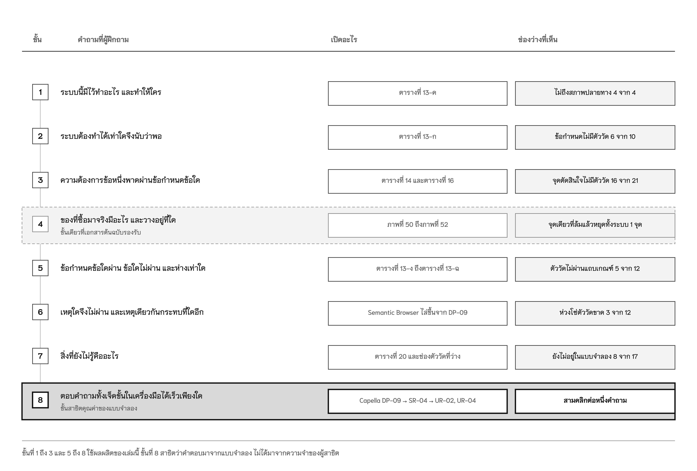

> **ภาพที่ 58-ก** ลำดับการฝึกแปดขั้น พร้อมผลผลิตที่แต่ละขั้นเปิดอ่าน

| ขั้น | คำถามที่ผู้ฝึกถาม | เปิดอะไร | สิ่งที่ได้รู้ | สิ่งที่ยังไม่ต้องรู้ในขั้นนี้ |
|---|---|---|---|---|
| 1 | ระบบนี้มีไว้ทำอะไร และทำให้ใคร | ตารางที่ 13-ค | เกษตรกรต้องการสี่เรื่อง และยังไม่ได้ครบแม้เรื่องเดียว | ของในสวนมีกี่ชิ้น |
| 2 | ระบบต้องทำได้เท่าใดจึงนับว่าพอ | ตารางที่ 13-ก | ข้อกำหนดสิบข้อ สี่ข้อมีตัววัด หกข้อไม่มี | เลือกของชิ้นใดมาทำ |
| 3 | ความต้องการข้อหนึ่งพาดผ่านข้อกำหนดข้อใด | ตารางที่ 14 และตารางที่ 16 | เส้นทางจากความต้องการลงถึงจุดตัดสินใจทุกเส้น | ของชิ้นนั้นวางอยู่ที่ใด |
| 4 | ของที่ซื้อมาจริงมีอะไร และวางอยู่ที่ใด | ภาพที่ 50 ถึงภาพที่ 52 | สามสถานี และเส้นทางจ่ายไฟที่แยกจากเส้นทางข้อมูลด้วยรหัสสี | ค่าที่วัดได้เป็นเท่าใด |
| 5 | ข้อกำหนดข้อใดผ่าน ข้อใดไม่ผ่าน และห่างเท่าใด | ตารางที่ 13-ง ถึงตารางที่ 13-ฉ | ตัววัดสมรรถนะสิบสองตัว ผ่านเจ็ดตัว ไม่ผ่านห้าตัว | เหตุของการไม่ผ่าน |
| 6 | เหตุใดจึงไม่ผ่าน และเหตุเดียวกันกระทบที่ใดอีก | หน้าต่าง Semantic Browser ไล่ขึ้นจาก DP-09 | เหตุเดียวทำให้ตัววัดตกสามตัวข้ามสามระดับชั้น | สิ่งที่ยังไม่มีผู้ใดบันทึก |
| 7 | สิ่งที่ยังไม่รู้คืออะไร | ตารางที่ 20 และช่องตัววัดที่ว่างในตารางที่ 13-ก กับ 13-ข | ประเด็นสิบเจ็ดประเด็น และข้อกำหนดที่ยังตัดสินไม่ได้ | คำตอบเหล่านี้หาได้เร็วเพียงใด |
| 8 | ตอบคำถามทั้งเจ็ดขั้นในเครื่องมือได้เร็วเพียงใด | แบบจำลอง DurianOrchardMonitoring ใน Capella ไล่จาก DP-09 ขึ้นถึง SR-04 แล้วถึง UR-02 กับ UR-04 | คำตอบมาจากแบบจำลอง ไม่ได้มาจากความจำของผู้สาธิต และใช้สามคลิกต่อหนึ่งคำถาม | ไม่มี ขั้นนี้เป็นขั้นสุดท้าย |

**ตารางที่ 22-ค** ลำดับการฝึกแปดขั้น จำแนกตามคำถามที่ผู้ฝึกถาม ผลผลิตที่เปิดอ่าน สิ่งที่ได้รู้ และสิ่งที่ยังไม่ต้องรู้

สิ่งที่ลำดับนี้ซื้อกลับมาคือผู้ฝึกตอบขั้นที่หนึ่งได้ก่อนเห็นของชิ้นใด ซึ่งกลับทางกับการอ่านเอกสารต้นฉบับ ที่ต้องอ่านของทั้งหมดก่อนจึงเดาได้ว่าของเหล่านั้นมีไว้ทำอะไร

เอกสารต้นฉบับรองรับการฝึกได้เฉพาะขั้นที่สี่ เพราะทั้งสองเล่มบรรยายของที่ซื้อมาและการต่อสายไว้ครบ ส่วนเจ็ดขั้นที่เหลือต้องใช้ผลผลิตของเล่มนี้ ซึ่งเป็นผลต่างที่วัดได้ของการแทนด้วยวิศวกรรมระบบ

คอลัมน์สุดท้ายของตารางที่ 22-ค มีน้ำหนักเท่ากับคอลัมน์ที่สี่ เพราะผู้ฝึกที่รู้เรื่องของในสวนก่อนรู้ว่าเกษตรกรต้องการอะไร ย่อมตัดสินใจรอบถัดไปจากของที่มี ไม่ใช่จากความต้องการที่ยังไม่ได้

ขั้นที่แปดต่างจากเจ็ดขั้นแรก เพราะเจ็ดขั้นแรกให้ผู้ฝึกรู้จักระบบ ส่วนขั้นที่แปดให้ผู้ฝึกเห็นว่าความรู้ชุดนั้นเก็บอยู่ที่ใด และเรียกกลับมาด้วยกี่คลิก ขั้นนี้จึงเป็นขั้นที่แสดงคุณค่าของการแทนด้วยวิศวกรรมระบบโดยตรง ไม่ใช่ขั้นที่สอนเครื่องมือ

ลำดับการสาธิตใช้คำถามของนักบำรุงรักษาเป็นจุดตั้งต้น คือเหตุใดสถานีจึงไม่พอใช้ทั้งวัน ผู้สาธิตเลือก DP-09 ใน Project Explorer เปิดหน้าต่าง Semantic Browser แล้วไล่ความสัมพันธ์ขึ้นหนึ่งระดับได้ SR-04 ไล่ขึ้นอีกระดับได้ UR-02 กับ UR-04 จากนั้นเปิดตารางที่ 13-ง ถึงตารางที่ 13-ฉ ซึ่งแสดงว่าการเลือกข้อเดียวนี้ทำให้ตัววัดตกสามตัว คือขาดจากหนึ่งวัน 8 ชั่วโมงที่ระดับข้อกำหนด 10.63 ชั่วโมงที่ภาระที่วัดได้ และ 7.33 ชั่วโมงที่ผลทดสอบแบตเตอรี่

สิ่งที่การสาธิตพิสูจน์คือเส้นทางคำตอบมีอยู่จริงในแบบจำลอง ไม่ได้อยู่ในความจำของผู้สาธิต การตอบคำถามเดียวกันด้วยเอกสารต้นฉบับต้องเปิดสองเล่มและไล่หาเองว่าอุปกรณ์ชิ้นนั้นเกี่ยวกับความต้องการข้อใด ซึ่งเอกสารไม่ได้บันทึกไว้เลย บทสาธิตอีกห้าชุดพร้อมบทบาทผู้ถามอยู่ในตารางที่ 22-ข

ข้อจำกัดของขั้นที่แปดคือความเร็วสามคลิกต่อหนึ่งคำถามเป็นผลจากการจับเวลาของผู้จัดทำเอง ยังไม่มีผู้ใช้รายอื่นทดลองทำตามแล้วบันทึกผล จึงมีสถานะเป็นข้อมูลประกอบ ไม่ใช่ข้อมูลที่ใช้สรุปผลเชิงปริมาณ ตามเงื่อนไขเดียวกับหัวข้อ 3.3.3

### 4.4.2 ช่องว่างที่ผู้ฝึกเห็นในแต่ละขั้น

ลำดับการฝึกไม่ได้แสดงเฉพาะผลงาน แต่แสดงช่องว่างด้วย ช่องว่างที่เจ็ดขั้นแรกเผยและจำนวนที่นับได้อยู่ในตารางที่ 22-ง ส่วนขั้นที่แปดไม่เผยช่องว่างของระบบเดิม เพราะเป็นขั้นวัดความเร็วของการเรียกคำตอบ

| ขั้น | ช่องว่างที่เห็น | จำนวน | หลักฐานในเล่ม |
|---|---|---|---|
| 1 | ตัววัดความสัมฤทธิ์ผลที่ยังไม่ถึงสภาพปลายทาง | 4 จาก 4 | ตารางที่ 13-ค |
| 2 | ข้อกำหนดของระบบที่ไม่มีตัววัด จึงตัดสินไม่ได้ว่าผ่าน | 6 จาก 10 | หัวข้อ 3.6.2 |
| 3 | จุดตัดสินใจออกแบบที่ไม่มีตัววัดทั้งสองระดับชั้น | 16 จาก 21 | หัวข้อ 3.6.3 |
| 4 | จุดเดียวที่ล้มเหลวแล้วหยุดทั้งระบบ คือเกตเวย์ | 1 | ประเด็น F-17 |
| 5 | ตัววัดสมรรถนะที่ไม่ผ่านแถบเกณฑ์ | 5 จาก 12 | ตารางที่ 13-ง ถึงตารางที่ 13-ฉ |
| 6 | ตัววัดสมรรถนะที่ไม่ประกาศว่าขัดเกลาตัววัดใด จึงไม่ส่งผลขึ้นถึงความต้องการใด | 3 จาก 12 | หัวข้อ 3.6.4 |
| 7 | ประเด็นที่แบบจำลองยังไม่อ้างถึง จึงอยู่ในเล่มเท่านั้น | 8 จาก 17 | หัวข้อ 3.6.3 และหัวข้อ 4.1.4 |

**ตารางที่ 22-ง** ช่องว่างที่แต่ละขั้นของการฝึกเผย พร้อมจำนวนที่นับได้และหลักฐานในเล่ม

ช่องว่างทั้งเจ็ดข้อนับเป็นจำนวนได้ทุกข้อ ซึ่งเป็นสิ่งที่การอ่านเอกสารให้ไม่ได้ เพราะการอ่านบอกได้ว่าเอกสารไม่ได้เขียนเรื่องหนึ่งไว้ แต่บอกไม่ได้ว่าขาดกี่ข้อจากทั้งหมดกี่ข้อ การนับต้องมีรายการที่ประกาศไว้ก่อนให้นับเทียบ

ช่องว่างที่สำคัญที่สุดต่อผู้รับช่วงงานต่อคือขั้นที่สองและขั้นที่สาม เพราะข้อกำหนดที่ไม่มีตัววัดจะดูเหมือนผ่านเสมอ ผู้ที่วางแผนงานรอบถัดไปจากรายการที่ดูเหมือนผ่านย่อมวางแผนผิด

### 4.4.3 สิ่งที่เล่มนี้ทำกับช่องว่างแต่ละข้อ

เล่มนี้ไม่ได้ปิดช่องว่างทุกข้อ และแยกสามสถานะไว้ให้ชัด คือปิดแล้ว บันทึกไว้เป็นช่องว่าง และส่งต่อเป็นข้อเสนอแนะ ดังตารางที่ 22-จ

| ช่องว่างของโครงการต้นฉบับ | สิ่งที่เล่มนี้ทำ | สถานะ |
|---|---|---|
| ไม่มีความต้องการของผู้ใช้ประกาศไว้เป็นข้อ | ประกาศความต้องการสี่ข้อ พร้อมตัววัดและระดับที่เป็นอยู่ | ปิดแล้ว |
| ไม่มีแถบเกณฑ์ให้เทียบ จึงไม่มีสิ่งที่เรียกว่าไม่ผ่าน | ประกาศแถบเกณฑ์ปิดสองค่าให้ตัววัดทั้งสิบหกตัว | ปิดแล้ว |
| เอกสารสองเล่มไม่ต่อกัน | ระบุจุดบรรจบที่คำขอ HTTP แล้วประกอบเป็นแบบจำลองเดียว | ปิดแล้ว |
| ไม่มีผู้ใดบอกได้ว่าเปลี่ยนของชิ้นหนึ่งแล้วกระทบอะไร | สร้างห่วงโซ่การสืบย้อนกลับครบทุกเส้นที่ระดับข้อกำหนด | ปิดแล้ว |
| ข้อกำหนดหกข้อและจุดตัดสินใจสิบหกข้อไม่มีตัววัด | รายงานไว้เป็นช่องว่าง ไม่เติมตัววัดที่เอกสารไม่มีค่ารองรับ | บันทึกไว้ |
| ตัววัดสามตัวไม่ต่อขึ้นถึงความต้องการใด | รายงานเป็นจุดขาดของห่วงโซ่ ไม่ต่อเส้นที่ไม่มีหลักฐานรองรับ | บันทึกไว้ |
| ค่าความหน่วงเวลาทั้งชุดไม่ใช่ค่าที่วัดในสนาม | ติดสถานะกำกับทุกค่าตามประเด็น F-14 | บันทึกไว้ |
| ช่องทางแจ้งเตือนเดียวของระบบยุติการให้บริการ | ระบุเป็นประเด็น F-09 แล้วเสนอช่องทางแทนในหัวข้อ 5.3 | ส่งต่อ |
| เกตเวย์เป็นจุดเดียวที่ล้มแล้วหยุดทั้งระบบ | ระบุเป็นประเด็น F-17 แล้วเสนอมาตรการในหัวข้อ 5.3 | ส่งต่อ |

**ตารางที่ 22-จ** ช่องว่างของโครงการต้นฉบับ สิ่งที่เล่มนี้ทำกับแต่ละข้อ และสถานะสามแบบ

เหตุที่สี่ข้อแรกปิดได้ ส่วนสามข้อกลางปิดไม่ได้ อยู่ที่ชนิดของสิ่งที่ขาด สี่ข้อแรกขาดการประกาศ ซึ่งเล่มนี้ประกาศได้จากหลักฐานที่มีอยู่ ส่วนสามข้อกลางขาดค่าที่วัดได้ ซึ่งต้องกลับไปวัดที่ระบบจริง และอยู่นอกขอบเขตตามหัวข้อ 1.3

การเลือกบันทึกไว้แทนการเติมเป็นการเลือกที่ต้องประกาศ เพราะตัววัดที่เติมขึ้นโดยไม่มีค่ารองรับย่อมทำให้ทั้งห่วงโซ่ดูครบ ขณะที่ความครบนั้นไม่มีหลักฐานใดรองรับ ช่องว่างที่เห็นจึงมีค่ามากกว่าความครบที่แต่งขึ้น

### 4.4.4 เกณฑ์ที่ถือว่าผู้ฝึกผ่านการฝึก

เกณฑ์ข้อที่หนึ่ง ผู้ฝึกตอบคำถามเจ็ดขั้นแรกในตารางที่ 22-ค ได้โดยไม่เปิดเอกสารต้นฉบับ และไม่ถามผู้จัดทำ

เกณฑ์ข้อที่สอง ผู้ฝึกแยกได้ว่าค่าใดเป็นค่าที่วัดได้ ค่าใดเป็นเกณฑ์จากเอกสารผู้ผลิต และค่าใดเป็นค่าสันนิษฐาน เพราะการวางแผนงานจากค่าสันนิษฐานโดยเข้าใจว่าเป็นค่าที่วัดได้คือความผิดพลาดที่แพงที่สุดของการรับช่วงงานต่อ

เกณฑ์ข้อที่สาม ผู้ฝึกชี้ช่องว่างในตารางที่ 22-ง ได้ครบทั้งเจ็ดข้อ เกณฑ์ข้อนี้มีน้ำหนักเท่ากับข้อแรก เพราะผู้รับช่วงงานต่อที่เห็นเฉพาะผลงานย่อมประเมินงานที่เหลือต่ำกว่าความจริง

เกณฑ์ข้อที่สี่ ผู้ฝึกเปิดแบบจำลองแล้วสาธิตขั้นที่แปดด้วยตนเอง คือไล่จากจุดตัดสินใจขึ้นถึงความต้องการของผู้ใช้โดยไม่มีผู้ใดบอกทาง เกณฑ์ข้อนี้เป็นข้อเดียวที่พิสูจน์ว่าความรู้ถูกส่งมอบจริง เพราะสามข้อแรกพิสูจน์ได้เพียงว่าผู้ฝึกอ่านเล่มนี้แล้ว

ข้อจำกัดของบทฝึกคือยังไม่มีผู้ฝึกรายใดนอกจากผู้จัดทำเดินตามลำดับนี้ จึงยังไม่มีผลวัดว่าใช้เวลาเท่าใด และยังไม่มีหลักฐานว่าเกณฑ์สามข้อข้างต้นผ่านได้จริง ประโยชน์ข้อ 1.7.4 จึงยังไม่สมบูรณ์ ด้วยเหตุเดียวกับหัวข้อ 4.3.4

# บทที่ 5 สรุปผลการดำเนินการและข้อเสนอแนะ

## 5.1 สรุปผลโครงการย้อนรอยสถาปัตยกรรม

ปริญญานิพนธ์ฉบับนี้ใช้ MBSE ร่วมกับ ARCADIA และ Capella ทำวิศวกรรมย้อนรอยระบบตรวจวัดสภาพแวดล้อมสำหรับสวนทุเรียน เปลี่ยนเอกสารสองเล่มที่ไม่ได้เชื่อมกัน ให้เป็นแบบจำลองที่สืบย้อนกลับได้ครบสี่ระดับชั้น

| ผลผลิตที่ส่งมอบ | จำนวน | ที่อยู่ในเล่ม |
|---|---|---|
| ความต้องการของผู้ใช้ | 4 | หัวข้อ 3.6.1 |
| ข้อกำหนดความต้องการของระบบ | 10 | ตารางที่ 13-ก |
| จุดตัดสินใจออกแบบ | 21 | ตารางที่ 13-ข |
| ตัววัดความสัมฤทธิ์ผลและตัววัดสมรรถนะ | 4 และ 12 | ตารางที่ 13-ค ถึง 13-ฉ |
| ขีดความสามารถพร้อมสถานการณ์การทำงาน | 3 | หัวข้อ 3.7.3 |
| รายการส่วนต่อประสาน | ครบถ้วน | ตารางที่ 17 |
| แผนภาพสถาปัตยกรรมกายภาพ | 4 | หัวข้อ 3.7.7 |
| เมทริกซ์การสืบย้อนกลับ | 2 ระดับ | ตารางที่ 14 ถึง 16 |
| ประเด็นที่แบบจำลองอ้างถึง | 9 | หัวข้อ 3.6.3 |
| ทะเบียนประเด็นที่ตรวจพบ | 17 | ตารางที่ 20 |

**ตารางที่ 22-ฉ** ผลผลิตที่ส่งมอบ จำนวน และตำแหน่งในเล่ม

| เหตุผลเชิงการออกแบบ | สิ่งที่คำอธิบายสถาปัตยกรรมระบุได้ |
|---|---|
| การเลือก LoRa | ผลของเงื่อนไขสองข้อร่วมกัน คือการส่งสัญญาณผ่านทรงพุ่มหนาทึบ และการลดจำนวนจุดที่ต้องเสียค่าบริการเครือข่ายรายเดือน |
| การย้ายจากคลาวด์มาเป็นเซิร์ฟเวอร์ภายใน | การแลกความเสถียรกับต้นทุนดำเนินงาน ซึ่งเป็นที่มาของปัญหาความเสถียรที่พบในภายหลัง |
| โครงสร้างการส่งสัญญาณแบบจุดต่อจุด | ข้อจำกัดเชิงโครงสร้างที่จำกัดความสามารถในการขยายจำนวนโหนดต้นทาง |

**ตารางที่ 22-ช** เหตุผลเชิงการออกแบบที่คำอธิบายสถาปัตยกรรมระบุได้

| ด้าน | ค่าที่ได้ | สถานะของค่า |
|---|---|---|
| พลังงาน | จ่ายได้ 31.7821 Wh คิดเป็นใช้งานต่อเนื่อง 16 ชั่วโมง ต่ำกว่าเป้าหมาย 24 ชั่วโมง | การคำนวณตรวจทานพบความไม่สอดคล้องภายในชุดตัวเลข ตามประเด็น F-05 |
| ความหน่วงเวลา | 2 ถึง 3 วินาทีจากเสา IoT ถึงคลาวด์ และ 2.5 ถึง 3 วินาทีสำหรับการมอนิเตอร์และการแสดงผล | เกณฑ์เชิงทฤษฎีจากเอกสารข้อมูลผู้ผลิต ไม่ใช่ค่าที่วัดได้ในสนาม |
| ต้นทุน | โหนดเกินกรอบงบประมาณร้อยละ 6.278 คิดเป็น 1,790 บาท | ส่วนเกตเวย์ประเมินเป็นตัวเลขไม่ได้ เพราะราคาอุปกรณ์หลายรายการไม่ปรากฏในเอกสารต้นฉบับ |

**ตารางที่ 22-ซ** ผลการยืนยันสมรรถนะเชิงปริมาณสามด้าน พร้อมสถานะของค่า

ผลการเปรียบเทียบสองแนวทางให้ข้อสรุปว่าแนวทางแบบจำลองไม่ทดแทนการอ่านเอกสาร เพราะประเด็นที่ตรวจพบ 14 จาก 17 ประเด็นมาจากการอ่านอย่างมีวินัยและการคำนวณตรวจทาน คุณค่าเฉพาะตัวของแนวทางแบบจำลองอยู่ในสี่เรื่อง

| คุณค่าเฉพาะตัวของแนวทางแบบจำลอง |
|---|
| ตรวจพบความไม่ครบถ้วนของการสืบย้อนกลับ |
| รวมต้นทุนเทียบกรอบงบประมาณที่ประกาศไว้ |
| ตรวจพบความซ้ำซ้อนของขอบเขตการวัด |
| ทำให้ความรู้จากการอ่านมีตำแหน่งจัดเก็บและเชื่อมโยงกับข้อกำหนดได้ ซึ่งเป็นเงื่อนไขที่ทำให้ความรู้คงอยู่หลังโครงการสิ้นสุด |

**ตารางที่ 22-ฌ** คุณค่าสี่เรื่องที่แนวทางแบบจำลองให้ และแนวทางการอ่านให้ไม่ได้

การใช้ ARCADIA ทำให้คำอธิบายสถาปัตยกรรมมีเอกภาพและตรวจสอบย้อนกลับได้ทุกระดับชั้น การวางแผนทรัพยากรด้านเวลา สมรรถนะ และงบประมาณจึงชัดเจนขึ้น ข้อสรุปนี้มีผลภายในขอบเขตของกรณีศึกษาเดียวที่มีเอกสารค่อนข้างครบและไม่มีการเข้าถึงระบบจริง ตามหัวข้อ 3.3.4

### 5.1.1 คุณค่าหลักสี่ข้อที่ปริญญานิพนธ์ฉบับนี้ส่งมอบ

หัวข้อ 1.7 ประกาศประโยชน์ไว้สี่ข้อ หัวข้อนี้ตรวจว่าส่งมอบได้จริงเพียงใด ด้วยเงื่อนไขสองข้อ คือต้องชี้ผลผลิตที่เปิดดูได้ในเล่ม และต้องระบุเงื่อนไขที่ทำให้ข้ออ้างใช้ได้ ข้อใดชี้ผลผลิตไม่ได้จะรายงานว่ายังเป็นข้ออ้าง

| คุณค่าหลัก | สิ่งที่ส่งมอบจริง | หลักฐานในเล่ม | เงื่อนไขที่ทำให้ข้ออ้างนี้ใช้ได้ |
|---|---|---|---|
| 1. ความเข้าใจในคุณลักษณะ โครงสร้าง และการทำงานของระบบเดิม | สามสถานีที่เอกสารต้นฉบับบรรยายไว้ถูกแยกเป็นสี่ระดับชั้น และคุณลักษณะทุกตัวถูกผูกกับแถบเกณฑ์ที่ตัดสินได้ว่าผ่านหรือไม่ผ่าน | หัวข้อ 3.5; ตารางที่ 13-ค ถึงตารางที่ 13-ฉ; ตารางที่ 22 | ค่าทุกค่าต้องอ่านจากแบบจำลองโดยตรง ไม่ใช่การคำนวณด้วยมือแล้วกรอกกลับเข้าเล่ม |
| 2. แบบจำลองสถาปัตยกรรมที่ใช้ให้เหตุผลการออกแบบและสืบย้อนกลับได้ | จุดตัดสินใจออกแบบยี่สิบเอ็ดข้อพร้อมเหตุผล เชื่อมถึงความต้องการด้วยความสัมพันธ์ชนิด Satisfies และเมทริกซ์สองระดับ พร้อมความสัมพันธ์ที่ขาดหายซึ่งตรวจพบได้ | หัวข้อ 3.6.3; ตารางที่ 14 ถึงตารางที่ 16; ประเด็น F-12 | ผู้อ่านต้องยอมรับว่าเหตุผลที่บันทึกไว้เป็นสิ่งที่การศึกษาครั้งนี้สร้างขึ้นใหม่จากหลักฐาน ไม่ใช่เจตนาเดิมของผู้ออกแบบ |
| 3. ตัวอย่างปฏิบัติของวิศวกรรมระบบในงานวิศวกรรมย้อนรอย | สองแนวทางที่ดำเนินควบคู่กันพร้อมเกณฑ์เปรียบเทียบที่กำหนดไว้ล่วงหน้า และผลการทบทวนที่เกิดขึ้นจริง | หัวข้อ 3.2; หัวข้อ 3.3; ตารางที่ 21 | ต้องมีผู้นำวิธีเปรียบเทียบสองแนวทางนี้ไปใช้กับกรณีอื่นแล้วได้ผลที่วัดได้ เพราะเล่มนี้เป็นกรณีศึกษาเดียวตามหัวข้อ 3.3.4 |
| 4. สื่อกลางถ่ายทอดความรู้ระหว่างทีมวิจัยหรือผู้พัฒนารุ่นต่อไป | ผลผลิตทุกรายการมีชื่อองค์ประกอบและตำแหน่งจัดเก็บ และประเด็นเก้าประเด็นที่แบบจำลองอ้างถึงผูกไว้กับตัววัดที่เกี่ยวข้อง | หัวข้อ 3.7.4; ตารางที่ 21 แถวความสามารถในการระบุตำแหน่งของผลผลิต | ต้องมีผู้รับช่วงงานต่อเปิดแบบจำลองแล้วรายงานผล เพราะเล่มนี้ยืนยันได้เพียงว่าความรู้มีตำแหน่งจัดเก็บ |

**ตารางที่ 23** คุณค่าหลักสี่ข้อ พร้อมผลผลิตที่ส่งมอบจริง หลักฐานในเล่ม และเงื่อนไขที่ทำให้ข้ออ้างนั้นใช้ได้

คุณค่าข้อแรกเปลี่ยนความเข้าใจระบบจากการบรรยายเป็นการตัดสิน เพราะสามสถานีถูกแยกเป็นสี่ระดับชั้น และคุณลักษณะทุกตัวผูกกับแถบเกณฑ์ที่ประกาศไว้ล่วงหน้า

ผลที่ได้คือตัววัดสมรรถนะสิบสองตัว ผ่านเจ็ดตัว ไม่ผ่านห้าตัว โดยตัวที่ไม่ผ่านซ้ำกันข้ามสามระดับชั้นในสองเรื่องเดียว คือพลังงานของสถานีและสภาพพร้อมใช้ของเซิร์ฟเวอร์

คุณค่าข้อที่สองคือเหตุผลการออกแบบของจุดตัดสินใจยี่สิบเอ็ดข้อ เชื่อมถึงความต้องการด้วยความสัมพันธ์ชนิด Satisfies และเมทริกซ์สองระดับ ทำให้การวิเคราะห์ผลกระทบอ่านได้จากตารางโดยไม่ต้องย้อนเปิดเอกสารต้นฉบับ

คุณค่าข้อที่สามคือการดำเนินสองแนวทางควบคู่กันแล้ววัดผลด้วยเกณฑ์ที่ตกลงไว้ล่วงหน้า จึงรายงานผลที่ขัดกับความคาดหมายตั้งต้นได้โดยไม่ต้องแก้เกณฑ์ภายหลัง

คุณค่าข้อที่สี่ต้องมีสองอย่างประกอบกัน คือตำแหน่งจัดเก็บที่อ้างถึงได้ และคำถามหน้างานที่ตอบได้จากตำแหน่งนั้น เล่มนี้ส่งมอบอย่างแรกได้ครบ ส่วนอย่างที่สองยังไม่มีผู้รับช่วงงานต่อรายใดเปิดแบบจำลองแล้วรายงานผล

คุณค่าสี่ข้อจึงมีน้ำหนักหลักฐานไม่เท่ากัน สามข้อแรกชี้ผลผลิตที่เปิดดูได้ทั้งหมด ข้อที่สี่ชี้ได้เพียงเงื่อนไขแรกจากสองเงื่อนไข การรายงานตามน้ำหนักหลักฐานเช่นนี้เป็นไปตามหลักที่เล่มนี้ถือมาตลอด คือสิ่งที่ยืนยันไม่ได้ต้องรายงานว่าเป็นช่องว่าง ไม่ถูกนำเสนอว่าเป็นผลงาน

## 5.2 ปัญหาและแนวทางการแก้ไข

### 5.2.1 ปัญหาการขาดข้อมูลประสิทธิภาพของเวลา

ปริญญานิพนธ์ฉบับเดิมไม่ได้บันทึกข้อมูลความหน่วงของแต่ละส่วนอุปกรณ์ไว้ ข้อกำหนดเรื่องการแสดงผลแบบใกล้เวลาจริงจึงทวนสอบไม่ได้

แนวทางที่ใช้คือรวบรวมคุณสมบัติทางเทคนิคจากเอกสารข้อมูลผู้ผลิตของชิ้นส่วนฮาร์ดแวร์และโปรโตคอลสื่อสาร มาคำนวณและป้อนเป็นเกณฑ์สมรรถนะเชิงทฤษฎีในแบบจำลอง เพื่อให้แบบจำลองขับเคลื่อนการออกแบบในระดับถัดไปได้

ค่าที่ได้เป็นเกณฑ์ ไม่ใช่ค่าที่วัดได้ แนวทางนี้จึงแก้ปัญหาการขาดโครงสร้างสำหรับรับค่า แต่ไม่ได้แก้ปัญหาการขาดค่าจริง

### 5.2.2 ปัญหาด้านงบประมาณและทรัพยากร

โครงสร้างต้นทุนของโหนด IoT และเกตเวย์มีมูลค่าสูงกว่างบประมาณที่ตั้งไว้ สาเหตุหนึ่งที่ระบุได้จากแบบจำลองคือการเลือกใช้เซ็นเซอร์ที่มีฟังก์ชันการวัดซ้ำซ้อนกัน

การตรวจสเปกอุปกรณ์ในแบบจำลองพบว่า BME280 ครอบคลุมการวัดอุณหภูมิอากาศ ความชื้นสัมพัทธ์ และความดันบรรยากาศได้ในตัวเดียว ซึ่งซ้อนทับกับ SHT30 ที่วัดอุณหภูมิและความชื้นเช่นกัน

ข้อเสนอคือตัด SHT30 ออกจากสถาปัตยกรรมกายภาพ เพื่อลดต้นทุนให้ใกล้เคียงงบประมาณที่ตั้งไว้โดยไม่กระทบความครบถ้วนของชุดข้อมูล

ข้อควรพิจารณาก่อนดำเนินการคือ SHT30 ต่อผ่านบัส RS485 ขณะที่ BME280 ต่อผ่านบัส I2C การตัด SHT30 ออกจึงเปลี่ยนการกระจายภาระของทั้งสองบัส และต้องตรวจสอบว่าความแม่นยำและช่วงการวัดของ BME280 ครอบคลุมช่วงที่ SHT30 รองรับได้จริงก่อนตัดสินใจ

### 5.2.3 ปัญหาการขาดคำประกาศข้อกำหนดของระบบเดิม

เอกสารต้นฉบับไม่ได้ประกาศข้อกำหนดของระบบไว้เป็นข้อก่อนเริ่มพัฒนา ข้อกำหนดทั้งสามระดับในหัวข้อ 3.6 จึงเป็นข้อกำหนดที่สร้างขึ้นจากหลักฐานและจากประเด็นที่บันทึกไว้

ผลที่ตามมาคือเกณฑ์บางข้อ เช่น อัตราความสำเร็จร้อยละ 96 ในข้อกำหนด SR-01 เป็นเกณฑ์ที่กำหนดขึ้นหลังเห็นผลการทดลองแล้ว จึงใช้เป็นหลักฐานว่าระบบผ่านเกณฑ์ที่ตั้งไว้ล่วงหน้าไม่ได้

แนวทางที่ใช้คือระบุสถานะของข้อกำหนดแต่ละข้อไว้อย่างเปิดเผยว่าเป็นข้อกำหนดที่สร้างขึ้นจากหลักฐาน และแยกข้อเท็จจริงจากเอกสารออกจากการสันนิษฐานของผู้จัดทำทุกครั้ง การแก้ไขลักษณะนี้ไม่ได้ทำให้ปัญหาหมดไป แต่ทำให้ผู้อ่านทราบน้ำหนักของข้อสรุปแต่ละข้อได้ถูกต้อง

## 5.3 ข้อเสนอแนะสำหรับการพัฒนาต่อยอด

### 5.3.1 ด้านระเบียบวิธีการวิศวกรรมระบบ (MBSE/ARCADIA)

การจัดเก็บข้อมูลเชิงพฤติกรรมอย่างละเอียด โครงการ IoT ถัดไปควรบันทึกค่าความหน่วงเวลาจริงและอัตราการใช้พลังงานของทุกส่วนประกอบย่อยตั้งแต่ขั้นทดสอบเบื้องต้น เพื่อให้แบบจำลองระดับสถานการณ์การทำงานมีฐานข้อมูลที่ตรงกับกายภาพจริง ข้อเสนอแนะนี้มาจากประเด็น F-14 โดยตรง

การประกาศข้อกำหนดและเกณฑ์ตรวจรับไว้ล่วงหน้า โครงการถัดไปควรประกาศข้อกำหนดของระบบและเกณฑ์ตรวจรับของแต่ละขั้นงานเป็นลายลักษณ์อักษรก่อนเริ่มพัฒนา ตามเกณฑ์ที่หัวข้อ 3.3 กำหนด เพื่อให้ผลการทดสอบมีสถานะเป็นหลักฐานว่าระบบผ่านเกณฑ์ที่ตั้งไว้ ไม่ใช่เพียงการรายงานค่าที่วัดได้ ข้อเสนอแนะนี้มาจากปัญหาในหัวข้อ 5.2.3

การวิเคราะห์ความปลอดภัยในมิติ Cyber-Physical Security ควรขยายขอบเขตแบบจำลองในระดับการวิเคราะห์ระบบให้ครอบคลุมสิทธิการเข้าถึงฐานข้อมูลและการเข้ารหัสของโปรโตคอลสื่อสาร เพื่อเฝ้าระวังความมั่นคงปลอดภัยของข้อมูลเกษตรกรรม ข้อเสนอแนะนี้มาจากประเด็น F-08

การบริหารจัดการรุ่นของแบบจำลอง เนื่องจาก Capella ไม่มีระบบควบคุมเวอร์ชันในตัว (Baron et al., 2023) การส่งมอบแบบจำลองจึงต้องกำหนดวิธีจัดเก็บและควบคุมรุ่นของไฟล์ไว้ด้วย มิฉะนั้นแบบจำลองที่ส่งมอบจะสูญเสียคุณค่าเมื่อมีผู้แก้ไขหลายรายในอนาคต

### 5.3.2 ด้านการประเมินและการใช้ประโยชน์จากแบบจำลองเครื่องมือ

การแปลงแบบจำลองสู่สถาปัตยกรรมอ้างอิง ควรพัฒนาแบบจำลองที่ได้ให้เป็นสถาปัตยกรรมอ้างอิงสำหรับระบบตรวจวัดสภาพแวดล้อมในสวนผลไม้ เพื่อให้โครงการถัดไปเริ่มจากโครงสร้างที่ผ่านการทบทวนแล้ว แทนการเริ่มออกแบบใหม่ทั้งหมด

การต่อยอดแบบจำลองสู่เมทริกซ์การออกแบบตามหลักสัจพจน์แบบสมบูรณ์ ควรนำโครงสร้างฟังก์ชันเชิงตรรกะไปพัฒนาต่อร่วมกับซอฟต์แวร์ภายนอกเพื่อคำนวณค่าดัชนีความซับซ้อนตามสัจพจน์สารสนเทศ เพื่อเป็นเกณฑ์ชี้วัดความยืดหยุ่นของระบบก่อนสร้างฮาร์ดแวร์จริง ข้อเสนอแนะนี้ต่อเนื่องจากข้อสังเกตในหัวข้อ 2.7 และ 3.7.1 ที่พบว่าการออกแบบของระบบเดิมมีลักษณะเกาะเกี่ยวกัน

การทดสอบคุณค่าของผลงานกับผู้รับช่วงงานต่อ ควรส่งมอบแบบจำลองให้ผู้ที่ไม่ได้ร่วมจัดทำทดลองใช้ตอบคำถามของผู้รับช่วงงานต่อในหัวข้อ 1.1 แล้วบันทึกว่าตอบได้หรือไม่และใช้เวลาเท่าใด เพราะคุณค่าที่อ้างไว้จะกลายเป็นหลักฐานได้เฉพาะเมื่อผ่านการทดสอบกับผู้ใช้จริง

การย้ายช่องทางแจ้งเตือนและทวนสอบบริการภายนอก ควรย้ายช่องทางแจ้งเตือนทั้งหมดไปใช้บริการที่ยังให้บริการอยู่ ตามประเด็น F-09 และควรกำหนดให้การทวนสอบสถานะของบริการภายนอกเป็นกิจกรรมประจำของการบำรุงรักษา เพราะระบบที่พึ่งพาบริการภายนอกย่อมเสื่อมสภาพลงตามการเปลี่ยนแปลงของผู้ให้บริการ แม้ตัวระบบเองจะไม่เปลี่ยนแปลงเลย

เมื่อมองย้อนไปที่โครงการต้นฉบับทั้งสองโครงการ สิ่งที่สูญหายไปเมื่อโครงการสิ้นสุดลงไม่ใช่อุปกรณ์หรือโปรแกรม ซึ่งยังคงอยู่และยังทำงานได้ หากเป็นเหตุผลที่อยู่เบื้องหลังการตัดสินใจแต่ละครั้ง และความเชื่อมโยงระหว่างสิ่งที่สร้างขึ้นกับสิ่งที่เกษตรกรต้องการจริง การย้อนรอยครั้งนี้จึงมีค่ามากกว่าการได้แผนภาพชุดหนึ่ง เพราะได้แสดงให้เห็นว่าความรู้ทางวิศวกรรมจะคงอยู่ต่อไปได้เฉพาะเมื่อมีโครงสร้างรองรับไว้ตั้งแต่ต้น ไม่ใช่เมื่อพยายามเก็บกู้ในภายหลัง
# บรรณานุกรม

Baron, C., Grenier, L., Ostapenko, V., & Xue, R. (2023). Using the ARCADIA/Capella systems engineering method and tool to design manufacturing systems—Case study and industrial feedback. Systems, 11(8), 429. https://doi.org/10.3390/systems11080429

Blessing, L. T. M., & Chakrabarti, A. (2009). DRM, a design research methodology. Springer. https://doi.org/10.1007/978-1-84882-587-1

Capella MBSE Tool. (2026). Case studies. https://mbse-capella.org/case_studies.html

Capella MBSE Tool. (2026). Tool features. https://mbse-capella.org/features.html

Chikofsky, E. J., & Cross, J. H. (1990). Reverse engineering and design recovery: A taxonomy. IEEE Software, 7(1), 13–17. https://doi.org/10.1109/52.43044

Eclipse Foundation. (2026). Eclipse Capella [Computer software]. Eclipse Foundation. https://www.eclipse.org/capella/

Hevner, A. R., March, S. T., Park, J., & Ram, S. (2004). Design science in information systems research. MIS Quarterly, 28(1), 75–105.

International Council on Systems Engineering (INCOSE). (2007). Systems engineering vision 2020 (INCOSE-TP-2004-004-02, Version 2.03). INCOSE.

International Council on Systems Engineering (INCOSE). (2023). Systems engineering handbook: A guide for system life cycle processes and activities (5th ed.). Wiley.

ISO/IEC/IEEE. (2011). ISO/IEC/IEEE 42010:2011 Systems and software engineering—Architecture description. International Organization for Standardization.

ISO/IEC/IEEE. (2015). ISO/IEC/IEEE 15288:2015 Systems and software engineering—System life cycle processes. International Organization for Standardization.

ISO/IEC/IEEE. (2023). ISO/IEC/IEEE 15288:2023 Systems and software engineering—System life cycle processes. International Organization for Standardization.

LY Corporation. (2025, April 1). LINE Notify service has been terminated as of March 31, 2025. LINE Developers. https://developers.line.biz/en/news/2025/04/01/line-notify/

Müller, H. A., Jahnke, J. H., Smith, D. B., Storey, M.-A., Tilley, S. R., & Wong, K. (2000). Reverse engineering: A roadmap. In Proceedings of the Conference on the Future of Software Engineering (pp. 47–60). ACM.

Nunthasrithananon, T., Suyawa, A., & Bubpha, T. (2024). Design and development of a GUI for an automated farm [Unpublished bachelor's thesis]. King Mongkut's University of Technology North Bangkok.

Rappaport, T. S. (2002). Wireless communications: Principles and practice (2nd ed.). Prentice Hall.

Roques, P. (2018). Systems architecture modeling with the Arcadia method: A practical guide to Capella. ISTE Press–Elsevier.

Runeson, P., & Höst, M. (2009). Guidelines for conducting and reporting case study research in software engineering. Empirical Software Engineering, 14(2), 131–164. https://doi.org/10.1007/s10664-008-9102-8

Semtech Corporation. (2020). SX1276/77/78/79: 137 MHz to 1020 MHz low power long range transceiver (Datasheet Rev. 7). Semtech Corporation.

Suh, N. P. (1990). The principles of design. Oxford University Press.

Suh, N. P. (2001). Axiomatic design: Advances and applications. Oxford University Press.

Tuntawisut, N., Kurapa, P., & Keeratipitayanusarn, V. (2024). Development of IoT poles for monitoring and analyzing data in orchards [Unpublished bachelor's thesis]. King Mongkut's University of Technology North Bangkok.

Voirin, J.-L. (2017). Model-based system and architecture engineering with the Arcadia method. ISTE Press–Elsevier.

Yin, R. K. (2018). Case study research and applications: Design and methods (6th ed.). SAGE.
